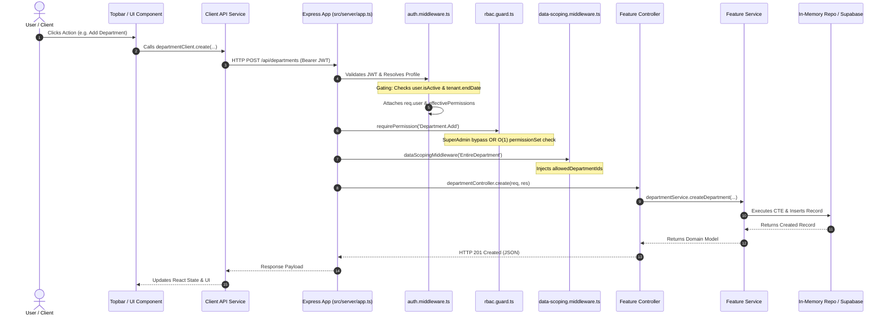

# End-to-End Request Lifecycle

Status: `IMPLEMENTED`

## 1. Lifecycle Diagram

---

## 2. Key Lifecycle Milestones

1. **Bearer Extraction:** Header `Authorization: Bearer <token>` is extracted by `authMiddleware`.
2. **Context Resolution:** Resolves profile from repository or Supabase Auth. Inactive users or expired organizations immediately receive `403 Forbidden`.
3. **Effective Permissions Preloading:** Traverses upward department ancestor CTEs and computes `req.effectivePermissions`.
4. **Permission Guarding:** `requirePermission(key)` checks if `key` or any mutating equivalent (`.Add`, `.Edit`, `.Delete`) satisfies the requirement.
5. **Controller & Service Execution:** Pure business rules are evaluated before mutating storage.
