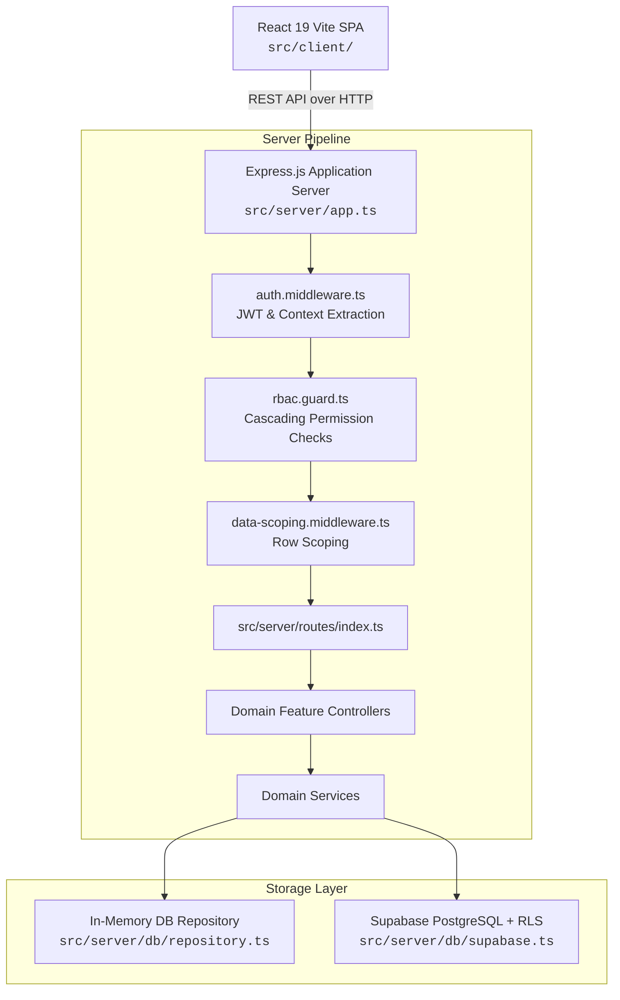

# System Architecture Overview

Status: `IMPLEMENTED`

## 1. High-Level Topology

---

## 2. Core Subsystems

### 2.1 Authentication & Identity Subsystem
- Located in `src/server/middleware/auth.middleware.ts` and `src/features/auth/`.
- Validates Bearer tokens, extracts identity, resolves organizational membership, and gates expired or suspended tenants.

### 2.2 Cascading RBAC Subsystem
- Located in `src/server/middleware/rbac.guard.ts` and `src/features/access-control/`.
- Enforces the 3-tier hierarchy and evaluates implicit `.View` permissions.

### 2.3 Departmental Hierarchy Subsystem
- Located in `src/features/departments/` and `src/server/db/repository.ts`.
- Manages recursive tree structures, downward module inheritance, and upward ancestor permission validation.

### 2.4 Organization & Multi-Tenancy Subsystem
- Located in `src/features/organizations/` and `supabase/migrations/`.
- Manages organization lifecycle (`Onboarding`, `Active`, `Suspended`), subscription tiers (`Starter`, `Standard`, `Enterprise`), sector settings (`Private`, `Public`, `NonProfit`), and statutory IDs.
