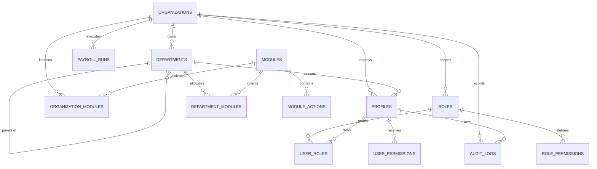

# Database Relationships & Foreign Key Integrity

Status: `IMPLEMENTED`

## 1. Entity Relationship Diagram

---

## 2. Cascading Deletion Rules
- **Organization Deletion:** Deleting an organization cascades to delete all subordinate `departments`, `organization_modules`, `roles`, `payroll_runs`, and profiles.
- **Department Deletion:** Cascades down to child departments via `parent_department_id ON DELETE CASCADE`. Profiles in that department have their `department_id` set to `NULL` (`ON DELETE SET NULL`) to prevent orphan identity destruction.
