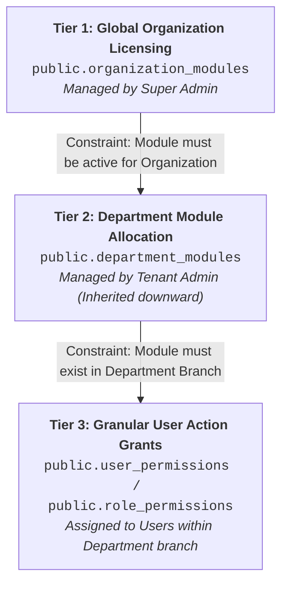

# Three-Tier Cascading RBAC Architecture

Status: `IMPLEMENTED`

## 1. The 3-Tier Hierarchy

The authorization engine is architected around a non-circumventable, three-tiered cascading policy model:

---

## 2. Gatekeeper Constraints

### Tier 1 (Super Admin Gatekeeper)
- Governs organization subscriptions and licensed features (`public.organization_modules`).
- **Circuit Breaker:** If a module is inactive or absent at Tier 1 for an organization, nobody in that organization can access, allocate, or execute actions against that module under any circumstances.

### Tier 2 (Department Boundary Gatekeeper)
- Managed by Tenant Administrators within their verified organization.
- Allocates tenant-licensed modules to specific departments (`public.department_modules`).
- **Recursive Downward Cascade:** Departments in child sub-departments automatically inherit modules allocated to parent departments via recursive CTE queries.

### Tier 3 (User Action Grants)
- Grants specific action permissions (`public.user_permissions` or through roles in `public.user_roles`).
- **Branch Restriction:** A user can ONLY receive action grants for modules present along their department's upward ancestor branch.
