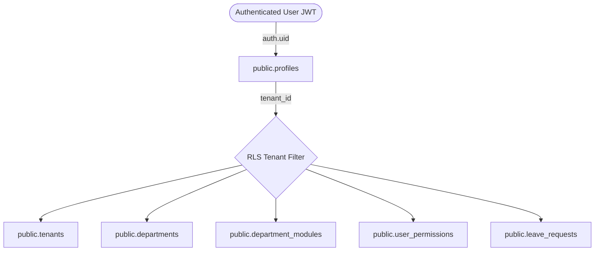
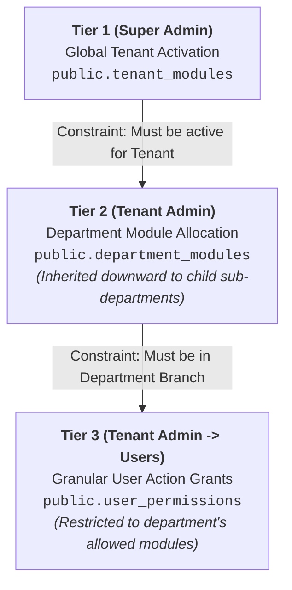

# Multi-Tenant, Departmental Hierarchy & Cascading RBAC Architecture

This document outlines the architecture, data models, recursive CTE procedures, cascading authorization rules, and API design for the JK Payroll System built with **Node.js (TypeScript)** and **Supabase (PostgreSQL + Auth + Row Level Security)**.

---

## 1. Core Architectural Pillars

### 1.1 Strict Multi-Tenancy
- **Tenant Isolation:** Every operational and transactional entity contains a non-nullable `tenant_id UUID` foreign key.
- **Row Level Security (RLS):** Supabase RLS policies enforce that users can only select, insert, update, or delete records matching their authenticated profile's `tenant_id`.



---

### 1.2 Recursive Department Hierarchy
Departments have a self-referential `parent_department_id` representing arbitrary tree depth.

```
                  HQ (Top Level)
                  /            \
        Human Resources       Finance & Accounts
              |                       |
        HR Operations            Payroll Dept
```

- **Downwards Cascade (Sub-Tree):** Sub-departments inherit modules assigned to parent departments.
- **Upwards Cascade (Ancestor Chain):** Used during permission evaluation to verify if an action belongs to a module allocated anywhere along the user's branch up to the root.

---

### 1.3 3-Tier Cascading Module & Permission Entitlement



1. **Tier 1 (Super Admin):** Enables global modules for a Tenant (`tenant_modules`). If a module is inactive or unassigned to a tenant, nobody in that tenant can use it.
2. **Tier 2 (Tenant Admin):** Allocates tenant-enabled modules to specific Departments (`department_modules`). Child sub-departments inherit modules assigned to their parent departments.
3. **Tier 3 (Tenant Admin -> Users):** Grants granular action permissions (`user_permissions`) within the department's allowed modules to specific users.

---

### 1.5 Minimalist Facebook-Style Topbar
The application header adopts a clean Facebook-inspired topbar:
- **Left:** PayPulse brand mark + tenant badge pill (`APEX-CORP`) + rounded search pill.
- **Center:** Flexible empty spacer (`flex-1`). Middle navigation tabs removed.
- **Right (Strictly Two Targets):**
  1. **Notification Circle Button:** Unread red badge counter pill + popover card with "All" / "Unread" filters, approval event items, and mark-all-as-read.
  2. **User Avatar Button:** Active green status dot + Facebook-style floating account card with organization context (`Tenant > Department > Sub-Department`), scope switcher, theme toggle, and session logout.

## 2. Database Schema & Recursive Procedures

### Migrations
1. [20261101000001_multi_tenant_cascading_rbac.sql](file:///c:/Users/HP_06/.gemini/antigravity-ide/scratch/jk-payroll/supabase/migrations/20261101000001_multi_tenant_cascading_rbac.sql)
   - Tables: `tenants`, `departments`, `profiles`, `modules`, `module_actions`, `tenant_modules`, `department_modules`, `user_permissions`, `permission_dependencies`, `type_of_leave`, `leave_requests`.
   - Indexes and Row Level Security (RLS) policies.
2. [20261101000002_functions_and_procedures.sql](file:///c:/Users/HP_06/.gemini/antigravity-ide/scratch/jk-payroll/supabase/migrations/20261101000002_functions_and_procedures.sql)
   - `get_department_sub_tree(p_tenant_id, p_dept_id)`: Recursive downward CTE returning all descendant departments.
   - `get_department_ancestors(p_tenant_id, p_dept_id)`: Recursive upward CTE returning ancestor chain.
   - `get_department_effective_modules(p_tenant_id, p_dept_id)`: Effective modules (direct + ancestor inherited).
   - `get_user_effective_permissions(p_tenant_id, p_user_id)`: 3-tier evaluation + implicit dependency expansion.
   - Validation triggers: Tier 1 -> Tier 2 constraint & Tier 2 -> Tier 3 constraint.
3. [20261101000003_seed_data.sql](file:///c:/Users/HP_06/.gemini/antigravity-ide/scratch/jk-payroll/supabase/migrations/20261101000003_seed_data.sql)
   - Seeds standard modules (`TypeOfLeave`, `RequestForLeave`, `PayrollProcessing`, `EmployeeProfile`, `TaxSettings`).
   - Granular actions and implicit dependency mappings (`.Add` -> `.View`, `.Edit` -> `.View`, etc.).

---

## 3. Application Architecture

```
src/
├── app.ts                         # Express application factory
├── server.ts                      # Server bootstrap
├── config/
│   └── env.ts                     # Environment configuration
├── types/
│   └── index.ts                   # Domain models & Express context types
├── db/
│   ├── repository.ts              # Database repository & CTE implementation
│   └── supabase.ts                # Supabase client wrapper
├── middleware/
│   ├── auth.middleware.ts         # JWT validation & context extraction
│   └── rbac.guard.ts              # Granular RBAC permission guards
├── services/
│   ├── tenant.service.ts          # Tenant management & Tier 1 modules
│   ├── department.service.ts      # Department hierarchy & recursive CTEs
│   ├── permission.service.ts      # Tier 2/3 allocation & implicit evaluation
│   └── data-scoping.service.ts    # Self, SubDepartment, EntireDepartment, Tenant
├── controllers/
│   ├── super-admin.controller.ts  # Super Admin endpoints
│   ├── tenant-admin.controller.ts # Tenant Admin endpoints
│   └── transaction.controller.ts  # Transactional endpoints with scoping
└── routes/
    ├── super-admin.routes.ts
    ├── tenant-admin.routes.ts
    ├── transaction.routes.ts
    └── index.ts
```

---

## 4. Security Test Cases Verified

Automated tests in [tests/rbac.test.ts](file:///c:/Users/HP_06/.gemini/antigravity-ide/scratch/jk-payroll/tests/rbac.test.ts) verify all required security constraints:

| Test Case | Description | Result |
| :--- | :--- | :--- |
| **Test 1** | Attempting to assign a module to a department when tenant does not have it enabled | **FAILED with 400 (Expected)** |
| **Test 2** | Attempting to grant user permission for a module not allocated to their department | **FAILED with 400 (Expected)** |
| **Test 3** | Querying `TypeOfLeave` with only `TypeOfLeave.Add` | **PASSED 200 (Implicit .View)** |
| **Test 4** | Cross-tenant isolation (Tenant A cannot see/mutate Tenant B data) | **PASSED 100% Isolated** |
| **Hierarchy** | Child sub-department inherits module from parent department | **PASSED Inherited** |
| **Scoping** | Transactional scoping: `Self`, `SubDepartment`, `EntireDepartment`, `Tenant` | **PASSED Verified** |
| **Status** | Inactive user and inactive tenant account rejection | **PASSED 403 Forbidden** |
