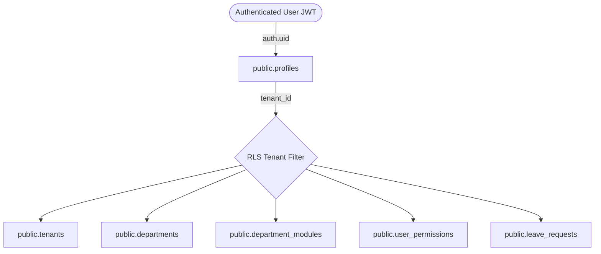
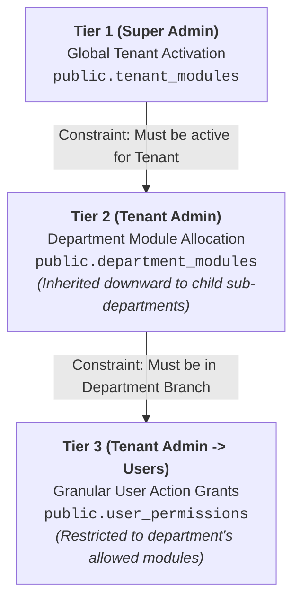
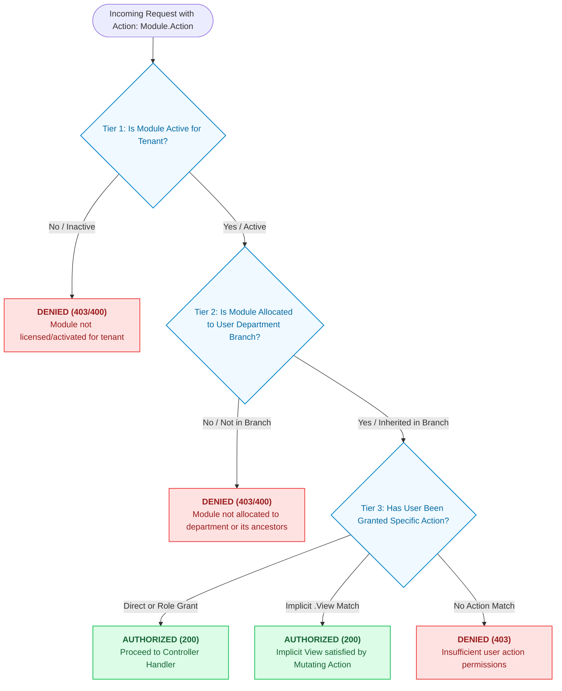

# Multi-Tenant, Departmental Hierarchy & Cascading RBAC Architecture

This document outlines the architecture, data models, recursive CTE procedures, cascading authorization rules, and API design for the JK Payroll System built with **Node.js (TypeScript)** and **Supabase (PostgreSQL + Auth + Row Level Security)**.

---

## 1. Core Architectural Pillars

### 1.1 Strict Multi-Tenancy
- **Tenant Isolation:** Every operational and transactional entity contains a non-nullable `tenant_id UUID` foreign key.
- **Row Level Security (RLS):** Supabase RLS policies enforce that users can only select, insert, update, or delete records matching their authenticated profile's `tenant_id`.



---

### 1.2 Recursive Department Hierarchy
Departments have a self-referential `parent_department_id` representing arbitrary tree depth.

```
                  HQ (Top Level)
                  /            \
        Human Resources       Finance & Accounts
              |                       |
        HR Operations            Payroll Dept
```

- **Downwards Cascade (Sub-Tree):** Sub-departments inherit modules assigned to parent departments.
- **Upwards Cascade (Ancestor Chain):** Used during permission evaluation to verify if an action belongs to a module allocated anywhere along the user's branch up to the root.

---

### 1.3 3-Tier Cascading Module & Permission Entitlement



1. **Tier 1 (Super Admin):** Enables global modules for a Tenant (`tenant_modules`). If a module is inactive or unassigned to a tenant, nobody in that tenant can use it.
2. **Tier 2 (Tenant Admin):** Allocates tenant-enabled modules to specific Departments (`department_modules`). Child sub-departments inherit modules assigned to their parent departments.
3. **Tier 3 (Tenant Admin -> Users):** Grants granular action permissions (`user_permissions`) within the department's allowed modules to specific users.

---

### 1.5 Minimalist Facebook-Style Topbar
The application header adopts a clean Facebook-inspired topbar:
- **Left:** PayPulse brand mark + tenant badge pill (`APEX-CORP`) + rounded search pill.
- **Center:** Flexible empty spacer (`flex-1`). Middle navigation tabs removed.
- **Right (Strictly Two Targets):**
  1. **Notification Circle Button:** Unread red badge counter pill + popover card with "All" / "Unread" filters, approval event items, and mark-all-as-read.
  2. **User Avatar Button:** Active green status dot + Facebook-style floating account card with organization context (`Tenant > Department > Sub-Department`), scope switcher, theme toggle, and session logout.

---

### 1.6 Tech Stack Overview

| Category | Package | Version | Architectural Responsibility |
| :--- | :--- | :--- | :--- |
| **Backend Core** | `express` | `^4.21.2` | Core HTTP application server and REST routing engine |
| **Backend Auth** | `jsonwebtoken` | `^9.0.2` | Powers all JWT verification, token decoding, and `generateTestToken` |
| **Backend Middleware** | `cors` | `^2.8.5` | Express CORS middleware handling cross-origin requests |
| **Backend Config** | `dotenv` | `^16.4.7` | Runtime environment variable loader for `src/config/env.ts` |
| **Backend Validation** | `zod` | `^3.24.2` | Runtime schema validation, request payload validation, and type inference |
| **Database & RLS** | `@supabase/supabase-js` | `^2.49.1` | PostgreSQL database client, authentication, RPC invoker, and RLS integration |
| **Frontend Framework** | `react`, `react-dom` | `^19.3.1` | Reactive component rendering and client application core |
| **Frontend Routing** | `react-router-dom` | `^7.18.5` | Declarative client-side routing and layout guards |
| **Frontend Forms** | `react-hook-form` | `^7.91.0` | High-performance form state management |
| **Frontend Resolvers** | `@hookform/resolvers` | `^7.0.1` | Standard Zod schema resolver for React Hook Form |
| **Frontend Icons** | `lucide-react` | `^1.66.0` | UI iconography library |
| **Build & Bundler** | `vite` | `^6.0.0` | Client dev server and production asset bundler |
| **Build Plugin** | `@vitejs/plugin-react` | `^4.3.4` | Fast Refresh and JSX/TSX compilation in Vite |
| **CSS & PostCSS** | `tailwindcss` | `^3.4.17` | Utility-first CSS styling engine |
| **PostCSS Plugin** | `@tailwindcss/postcss` | `^4.0.0` | Modern Tailwind CSS processor integration |
| **CSS Pipeline** | `postcss` | `^8.4.49` | CSS transformation and AST post-processing pipeline |
| **CSS Prefixer** | `autoprefixer` | `^10.4.20` | Automatic browser prefixing for CSS rules |
| **Type Checker** | `typescript` | `^5.7.3` | Static type checking and NodeNext ESM compilation |
| **Dev Runtime** | `tsx` | `^4.19.3` | Fast TypeScript execution and watcher runtime |
| **Test Runner** | `vitest` | `^3.0.6` | Modern high-performance unit/integration test runner |
| **HTTP Assertion** | `supertest` | `^7.0.0` | HTTP assertion library for testing Express endpoints |

---

## 2. Database Schema & Recursive Procedures

### Migrations & Database Scripts
- **Database Root Configuration:**
  - `supabase/config.toml`: Local Supabase CLI configuration and port bindings.
  - `supabase/seed.sql`: Baseline database seed definitions.
  - `supabase/clean_and_seed_superadmin.sql`: Teardown and superadmin credential initialization.
- **Canonical Migrations (`supabase/migrations/`):**
  1. `20261104000001_core_schema.sql`: Base multi-tenant schema (`tenants`, `departments`, `profiles`, `modules`, `module_actions`, `tenant_modules`, `department_modules`, `user_permissions`, `permission_dependencies`, `type_of_leave`, `leave_requests`).
  2. `20261104000002_functions_and_rls.sql`: Recursive CTE functions (`get_department_sub_tree`, `get_department_ancestors`, `get_department_effective_modules`, `get_user_effective_permissions`) and Row Level Security policies.
  3. `20261104000003_audit_logs.sql`: Security audit logging schema and event storage.
  4. `20261104000004_attach_audit_triggers.sql`: Mutation tracking audit triggers across sensitive entities.
  5. `20261104000005_seed_default_user_roles.sql`: System roles (`SUPER_ADMIN`, `TENANT_ADMIN`, `DEPARTMENT_HEAD`, `STAFF`) and permission matrix bindings.
  6. `20261104000006_fix_auth_users_null_tokens.sql`: Auth token constraints and user profile null token fix.
  7. `20261104000007_audit_logs_superadmin_policy.sql`: Superadmin cross-tenant audit access policies.
  8. `20261104000008_align_organizations_schema.sql`: Enterprise organization entity alignment and metadata.
  9. `20261104000009_expand_organizations_sector_settings.sql`: Multi-sector profile configuration (Private, Public, NonProfit).
- **Catalog Seeds (`supabase/seeds/`):**
  - `20261101000001_seed_catalog.sql`: Core permissions and modules seed dictionary.

---

## 3. Application Architecture

### 3.1 Modern Full-Stack Directory Structure & Layer Boundaries

The codebase follows a modern decoupled full-stack architecture separated into **`server/`**, **`client/`**, and **`shared/`**:

```
jk-payroll/
├── package.json                       # Dependencies & scripts
├── postcss.config.js                  # PostCSS plugin pipeline
├── tailwind.config.js                 # Tailwind utility styling
├── tsconfig.json                      # TypeScript ESM compiler config
├── vite.config.ts                     # Vite client bundling & dev server proxy
├── index.html                         # SPA HTML entry point
│
├── supabase/                          # Supabase configuration, seeds & migrations
│   ├── config.toml
│   ├── seed.sql
│   ├── clean_and_seed_superadmin.sql
│   ├── migrations/                    # 9 canonical migrations (000001 - 000009)
│   └── seeds/
│
├── tests/                             # Comprehensive test suites
│   ├── departments.test.ts            # Department hierarchy tests
│   ├── footer.test.ts                 # Branding and footer specifications
│   ├── organizations-page-crud.test.ts# Organization CRUD & expiration enforcement tests
│   ├── organizations.test.ts          # Organization operational & licensing tests
│   ├── permission-gate.test.ts        # UI permission gating atom tests
│   ├── permission-matrix.test.ts      # Permission matrix allocation tests
│   ├── rbac.test.ts                   # 3-tier cascading RBAC test suite
│   ├── security-phase1.test.ts        # Phase 1 critical security regression suite
│   ├── sidebar.test.ts                # Sidebar navigation tests
│   ├── topbar.test.ts                 # Facebook-style topbar component tests
│   └── user-roles.test.ts             # Role mapping and assignment tests
│
└── src/
    ├── shared/                        # 1. Single source of truth for contracts & constants
    │   ├── types/                     # Domain models, RBAC enums & context types
    │   ├── schemas/                   # Shared Zod validation schemas (frontend & backend)
    │   └── constants/                 # RBAC permissions dictionary & module keys
    │
    ├── server/                        # 2. Node.js (Express) & Supabase Backend
    │   ├── app.ts                     # Express application factory & middleware pipeline
    │   ├── server.ts                  # Server bootstrap & port listener
    │   ├── config/                    # Runtime environment validation (env.ts)
    │   ├── db/                        # Supabase client wrapper & database repository
    │   ├── middleware/                # Auth, RBAC guard, data scoping & validators
    │   └── routes/                    # Central API router (/api/v1)
    │
    ├── client/                        # 3. React 19 + Vite Frontend SPA
    │   ├── main.tsx                   # Client bootstrap entry point
    │   ├── RootApp.tsx                # Declarative React Router routing table
    │   ├── index.css                  # Design system and Tailwind rules
    │   ├── layouts/                   # Shell layouts (DashboardLayout, OnboardingLayout)
    │   ├── pages/                     # Declarative page views (organizations, onboarding)
    │   ├── components/                # UI design system
    │   │   ├── layout/                # Topbar, Sidebar, Footer, SwitcherModal
    │   │   ├── onboarding/            # Wizard forms & invitation handlers
    │   │   └── ui/                    # Decoupled shadcn/ui primitives & StatusPages
    │   └── lib/                       # Client utilities & styling helpers (cn)
    │
    └── features/                      # 4. Domain Feature Modules (Controllers, Services, Hooks, UI)
        ├── access-control/
        ├── audit-logs/
        ├── auth/
        ├── departments/
        ├── leave-management/
        ├── organizations/
        ├── payroll/
        ├── roles/
        └── users/
```

### 3.2 Request Pipeline & Authentication Context Lifecycle

Every incoming request to a protected endpoint traverses a standardized multi-tenant authorization pipeline:

1. **Token Authentication:** Bearer JWT tokens are verified locally via `ENV.JWT_SECRET` (falling back to Supabase Auth token verification).
2. **Profile & Organization Binding:** The authenticated `auth.uid` is resolved against the database profiles repository. Inactive user accounts and expired or suspended organizations are rejected immediately with `403 Forbidden`.
3. **Context Injection:** `req.user` is populated with a verified `AuthUserContext` (`userId`, `tenantId`, `departmentId`, `isTenantAdmin`, `isSuperAdmin`, `isActive`).
4. **Effective Permission Preloading:** User permissions are computed via recursive CTE upward ancestor chain evaluation and attached to `req.effectivePermissions`.

---

### 3.3 Three-Tier Cascading RBAC Architecture

The JK Payroll authorization engine is architected around a non-circumventable, **three-tiered cascading policy model**. Rather than evaluating flat role memberships, authority is strictly gated through three concentric boundaries:



#### Tier 1 — Global / Tenant Module Activation (Root Gatekeeper)
- **Authority Scope:** Managed exclusively by platform Super Administrators (`isSuperAdmin: true`).
- **Database Entity:** `public.tenant_modules` / `public.organizations.modules`.
- **Gatekeeper Mechanics:** Acts as the platform-level root gatekeeper, governing tenant-specific subscription tiers, licensed features, and billing activation states.
- **Circuit Breaker Guarantee:** If a module (e.g., `PayrollProcessing`) is disabled or absent at Tier 1 for a tenant, no organizational unit, department administrator, or end-user within that tenant can access, allocate, or execute actions against that module under any circumstance. Mutation attempts at Tier 2 for unallocated Tier 1 modules fail closed with an explicit constraint error.

#### Tier 2 — Department Module Inheritance (Organizational Boundaries)
- **Authority Scope:** Managed by Tenant Administrators (`isTenantAdmin: true`) within their verified organization.
- **Database Entity:** `public.department_modules`.
- **Policy Boundaries:** Defines which tenant-licensed modules are authorized for operational use by specific departments and teams.
- **Recursive Downward Tree Cascade:** Departments exist in an arbitrary-depth hierarchy (`parent_department_id`). Modules assigned to a parent department (e.g., `HQ` or `Human Resources`) cascade downward automatically to all subordinate child departments, sub-departments, and operational units (e.g., `HR Operations` and `Payroll Units`) via recursive CTE queries:
  $$\text{EffectiveModules}(D) = \text{DirectModules}(D) \cup \bigcup_{A \in \text{Ancestors}(D)} \text{DirectModules}(A)$$
- **Upward Ancestor Chain Validation:** When evaluating whether a user is eligible to exercise an action, the engine inspects the user's assigned department and traverses upward to the root department. If the module is not present along the upward branch, access is strictly denied.

#### Tier 3 — User / Role Action Grants (Granular Capabilities)
- **Authority Scope:** Assigned by Tenant Administrators to individual users or custom organization roles.
- **Database Entities:** `public.user_permissions`, `public.role_permissions`, `public.module_actions`.
- **Granular Action Capabilities:** Operates at the atomic capability level (`Module.Action`), including:
  - Standard CRUD operations: `TypeOfLeave.View`, `TypeOfLeave.Add`, `TypeOfLeave.Edit`, `TypeOfLeave.Delete`.
  - Workflow & State Transitions: `RequestForLeave.Approval.Create`, `PayrollComputation.View`.
- **Strict Tier 2 Subordination:** A Tenant Administrator cannot assign, and an authenticated user cannot exercise, an action grant unless the action's parent module is currently active at Tier 2 for the user's department branch. Database triggers and backend service guards reject any Tier 3 assignment that violates Tier 2 availability.
- **Additive & Explicit Resolution:** Effective user permissions represent the union of direct user grants (`user_permissions`) and assigned custom role grants (`role_permissions`), restricted to the department's authorized module boundary.

---

### 3.4 Runtime Permission Evaluation, In-Memory Set Caching & Complexity Analysis

In a high-throughput enterprise payroll system, evaluating deep recursive CTEs and granular permissions on every HTTP request can introduce significant latency. The runtime architecture eliminates redundant database operations and ensures optimal execution efficiency through request-scoped in-memory caching and constant-time set lookups.

#### Pre-Evaluation vs. Runtime Set Caching Architecture

1. **Preload Phase (Request Bootstrap):**
   - When an authenticated request enters `authMiddleware`, the application resolves the user's effective permissions via `get_user_effective_permissions(p_organization_id, p_user_id)`.
   - The query traverses the department tree upward to the root. For a tree with depth $d$ and total organization actions $m$, this initial resolution runs in $O(d + m)$ time.
   - The resolved permissions are attached to Express context as `req.effectivePermissions` (string array).

2. **In-Memory Set Caching ($O(1)$ Amortized Membership):**
   - The first `requirePermission(requiredKey)` guard executed for a route intercepts the request and inspects `req.permissionSet`.
   - If not yet initialized, it materializes the array into a native JavaScript `Set<string>`:
     ```typescript
     if (!req.permissionSet) {
       req.permissionSet = new Set<string>(req.effectivePermissions || []);
     }
     ```
   - Subsequent permission evaluations within the same request lifecycle (e.g., compound route guards, data-scoping checks, or controller validations) bypass array traversals and execute against the hashed `Set` in guaranteed $O(1)$ amortized lookup time.

3. **Implicit Permission Inheritance ($O(1)$ Resolution):**
   - The authorization system implements an implicit capability inheritance model: possessing any mutating privilege on a module automatically satisfies the requirement for viewing/reading that module:
     $$\text{MutatingActions} = \{ \text{Add}, \text{Edit}, \text{Delete}, \text{Approval.Create} \}$$
     $$\forall M, \quad (\exists A \in \text{MutatingActions} : M.A \in \text{UserPerms}) \implies M.\text{View} \in \text{EffectivePerms}$$
   - When checking for `*.View`, if the explicit key is not present, the guard evaluates up to 4 constant-time set lookups for the module's mutating keys. This maintains strict $O(1)$ worst-case evaluation complexity.

#### Algorithmic Complexity Matrix

| Operation | Naive / Uncached Architecture | JK Payroll Optimized Architecture | Complexity |
| :--- | :--- | :--- | :--- |
| **Department Ancestor Traversal** | Recursive SQL query per middleware check | Single CTE resolution during auth bootstrap | $O(d)$ where $d$ is tree depth ($d \ll n$) |
| **Permission Key Verification** | Linear scan across permission array ($O(m)$) | Request-scoped hashed `Set<string>` probe | $O(1)$ amortized time |
| **Implicit View Inheritance** | Regex scans / multiple nested loops | Direct constant-time probe of 4 mutation keys | $O(1)$ worst-case time |
| **Per-Request Memory Allocation** | Repeated array allocations and filters | Single `Set` instance reused on `req` context | $O(m)$ space where $m$ is granted keys |
| **Super Admin Global Bypass** | Full evaluation chain traversal | Short-circuit boolean flag check (`req.user.isSuperAdmin`) | $O(1)$ immediate bypass |

Through this architecture, runtime permission checking overhead is bounded to $O(1)$ time complexity per route guard, regardless of the tenant's user headcount $n$ or catalog module size $M$.

---

## 4. Security Test Cases Verified

Automated tests in [tests/rbac.test.ts](file:///c:/Users/HP_06/.gemini/antigravity-ide/scratch/jk-payroll/tests/rbac.test.ts) verify all required security constraints:

| Test Case | Description | Result |
| :--- | :--- | :--- |
| **Test 1** | Attempting to assign a module to a department when tenant does not have it enabled | **FAILED with 400 (Expected)** |
| **Test 2** | Attempting to grant user permission for a module not allocated to their department | **FAILED with 400 (Expected)** |
| **Test 3** | Querying `TypeOfLeave` with only `TypeOfLeave.Add` | **PASSED 200 (Implicit .View)** |
| **Test 4** | Cross-tenant isolation (Tenant A cannot see/mutate Tenant B data) | **PASSED 100% Isolated** |
| **Hierarchy** | Child sub-department inherits module from parent department | **PASSED Inherited** |
| **Scoping** | Transactional scoping: `Self`, `SubDepartment`, `EntireDepartment`, `Tenant` | **PASSED Verified** |
| **Status** | Inactive user and inactive tenant account rejection | **PASSED 403 Forbidden** |
