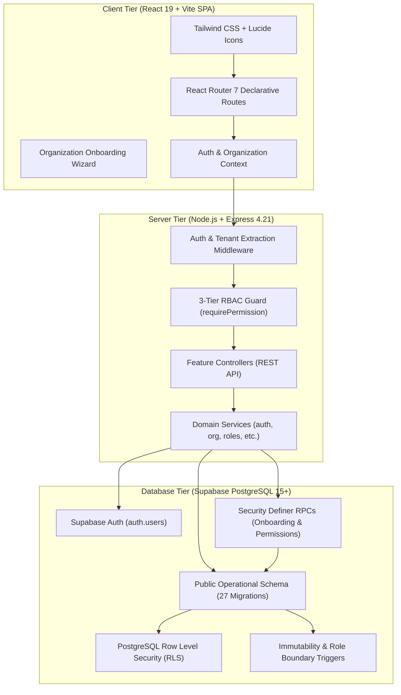
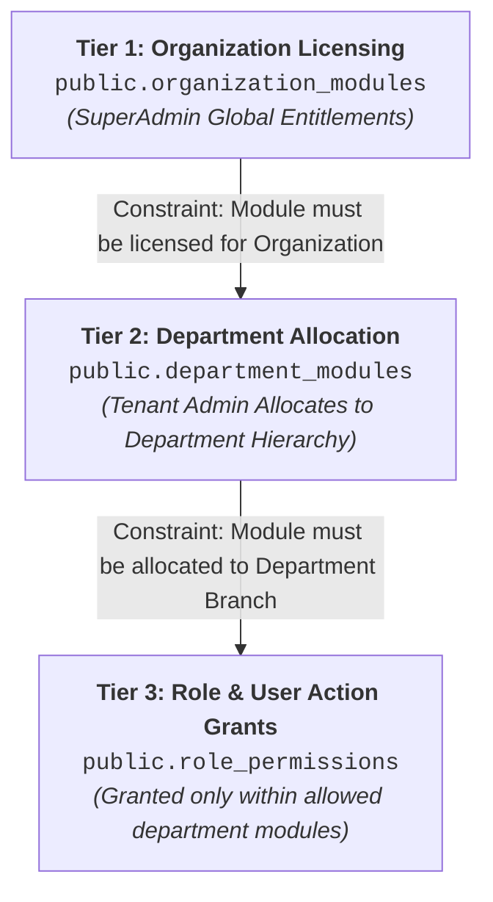

# PayPulse: Consolidated System Architecture Specification

**Document Version:** 3.0.0 (Authoritative Consolidated Architecture)  
**Status:** Implemented, Deployed, and Verified  
**Canonical Scope:** Organization Foundation, Multi-Tenant Boundaries, Cascading RBAC, and System Topology

---

## 1. System Topology Overview

PayPulse (JK Payroll) is an enterprise multi-tenant payroll and workforce management platform built on a decoupled full-stack architecture:



---

## 2. Decoupled Architectural Layers

The repository is partitioned into strict, non-overlapping architectural layers:

| Layer | Path | Allowed Dependencies | Prohibited Dependencies |
| :--- | :--- | :--- | :--- |
| **Shared Contracts** | `src/shared/` | Pure TypeScript types, schemas, and constants | Zero DOM, Node, Express, or React dependencies |
| **Server Tier** | `src/server/` | Node.js, Express, `jsonwebtoken`, Supabase client, shared contracts | Zero React, Vite, or browser DOM APIs |
| **Client Tier** | `src/client/` | React 19, Vite, React Router 7, Tailwind, shared contracts | Zero `express`, server middleware, or direct DB drivers |
| **Feature Slices** | `src/features/` | Domain controllers, services, schemas, hooks, and UI components | Cross-feature direct internal mutation |
| **Database Migrations** | `supabase/` | PostgreSQL DDL/DML, PL/pgSQL, Supabase config | Direct application code |
| **Automated Suites** | `tests/` | Vitest, Supertest, PGlite embedded engine, Supabase live client | Modifying persistent production fixtures |

---

## 3. Strict Multi-Tenancy Architecture

Multi-tenancy in PayPulse is enforced at the schema, query, and network levels:

1. **Entity Binding:** Every operational entity (`departments`, `organization_modules`, `department_modules`, `roles`, `role_permissions`, `organization_members`, `user_roles`, `audit_logs`) is bound to an `organization_id UUID` foreign key.
2. **Referential Integrity:** Operational tables enforce `FOREIGN KEY (organization_id) REFERENCES organizations(id) ON DELETE CASCADE`.
3. **Composite Role Scoping:** Role assignments enforce composite foreign keys:
   ```sql
   CONSTRAINT fk_user_roles_org_role 
     FOREIGN KEY (organization_id, role_id) 
     REFERENCES public.roles(organization_id, id) 
     ON DELETE NO ACTION
   ```
   This prevents assigning a role owned by Organization A to a user operating within Organization B.
4. **Single-Role Primary Key:** `public.user_roles` uses `PRIMARY KEY (organization_id, user_id)`. Each user may hold at most one active role per organization at any time.
5. **Row Level Security (RLS):** Policies on all tables guarantee that non-superadmin actors cannot read or write records outside their authenticated organization.

---

## 4. Three-Tier Cascading RBAC Hierarchy

PayPulse implements a strict 3-tier entitlement cascade:



### 4.1 Tier 1: Organization Licensing (`organization_modules`)
- Controls which platform modules an organization has purchased or enabled.
- If a module (e.g., `PayrollProcessing`) is not in `organization_modules`, no user within the tenant can access it, regardless of their role.

### 4.2 Tier 2: Department Allocation (`department_modules`)
- An organization administrator allocates licensed modules to departments.
- Inherited downwards through the department hierarchy: child sub-departments automatically inherit modules assigned to parent departments.

### 4.3 Tier 3: Role Action Grants (`role_permissions`)
- Permissions are granted to roles via `public.role_permissions`.
- Dynamic permission resolution evaluates:
  $$\text{Effective Permissions} = \text{Role Permissions} \cap \text{Dept Modules} \cap \text{Org Modules}$$

---

## 5. Decision P-01 Option C: Template Catalog Instantiation

### 5.1 Architecture Decision Context
Prior implementations attempted to assign a global `SYSTEM` `TENANT_ADMIN` role (`f0000000-0000-0000-0000-000000000002`). This violated the composite foreign key `(organization_id, role_id) REFERENCES roles(organization_id, id)` because global roles have `organization_id IS NULL`.

### 5.2 Option C Resolution
Under Decision P-01 Option C:
1. Global system roles (`organization_id IS NULL`) are reserved strictly for platform SuperAdmins (`SUPERADMIN`).
2. During organization onboarding, the provisioning RPC instantiates standard tenant-owned template roles:
   - **`ORG_ADMIN`:** Role code `ORG_ADMIN`, `role_type = 'CUSTOM'`, `is_default = true`, bound to the new `organization_id`.
   - **`EMPLOYEE`:** Role code `EMPLOYEE`, `role_type = 'CUSTOM'`, `is_default = true`, bound to the new `organization_id`.
3. Administrative module actions for licensed modules (`Department.*`, `EmployeeProfile.*`, `RolePermission.*`) are populated into `role_permissions` for the newly instantiated `ORG_ADMIN` role.
4. The first organization administrator is assigned to this tenant-owned `ORG_ADMIN` role.

---

## 6. Recursive Department Hierarchy

Departments support arbitrary tree depth through a self-referential `parent_department_id`:

```
                 Corporate HQ (Root)
                  /               \
         Human Resources         Finance & Accounts
               |                         |
         Talent Operations         Payroll Branch
```

- **Downwards Inheritance:** Sub-departments inherit modules assigned to parent departments.
- **Upwards Ancestor Evaluation:** Permission resolution uses recursive Common Table Expressions (CTEs) to verify that an action belongs to an authorized module allocated anywhere along the user's branch up to the root.

---

## 7. Canonical Module & Permission Catalog

The platform defines 14 core modules and 36 canonical actions seeded into `public.modules` and `public.module_actions`:

| Module Code | Module Name | Core Platform Module | Canonical Actions |
| :--- | :--- | :---: | :--- |
| `Department` | Department Hierarchy | Yes | `Department.View`, `Department.Add`, `Department.Edit`, `Department.Delete` |
| `EmployeeProfile` | Employee Profiles | Yes | `EmployeeProfile.View`, `EmployeeProfile.Add`, `EmployeeProfile.Edit`, `EmployeeProfile.Delete` |
| `RolePermission` | Role & Permission Access | Yes | `RolePermission.View`, `RolePermission.Add`, `RolePermission.Edit`, `RolePermission.Delete` |
| `TypeOfLeave` | Leave Type Configuration | No | `TypeOfLeave.View`, `TypeOfLeave.Add`, `TypeOfLeave.Edit`, `TypeOfLeave.Delete` |
| `RequestForLeave` | Employee Leave Requests | No | `RequestForLeave.View`, `RequestForLeave.Add`, `RequestForLeave.Edit`, `RequestForLeave.Delete` |
| `PayrollProcessing` | Payroll Calculation Engine | No | `Payroll.Calculate`, `Payroll.Approve`, `Payroll.Disburse`, `Payroll.View` |
| `AuditLogs` | System Audit Trails | Yes | `AuditLogs.View`, `AuditLogs.Export` |
| `CompanySettings` | Organization Configuration | Yes | `CompanySettings.View`, `CompanySettings.Edit` |

Core Platform modules cannot be disabled or omitted during organization provisioning.
