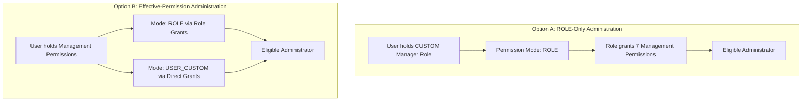
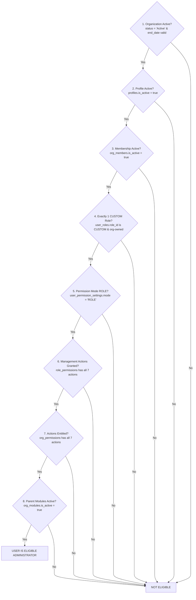
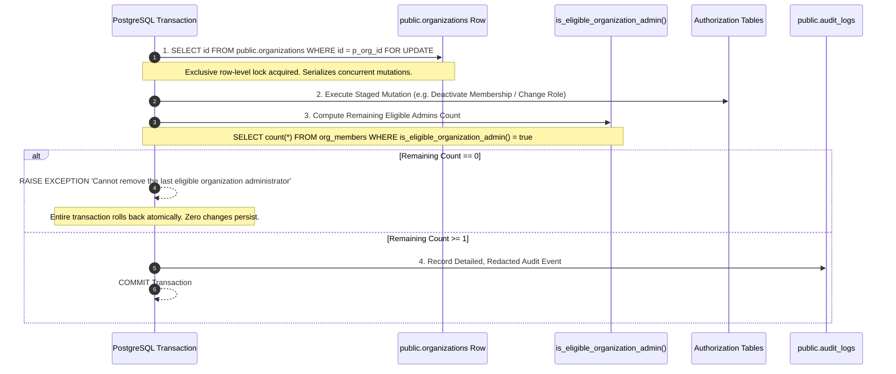

# PayPulse Phase 2.2 — Administrator Lifecycle, Locking Protocol, and Platform Recovery

**Status:** Implementation-Ready Architecture Specification  
**Date:** 2026-11-22  
**System:** PayPulse (JK Payroll) — Administrator Governance Architecture  
**Document Reference:** `PAYPULSE_PHASE_2_2_ADMINISTRATOR_LIFECYCLE_AND_RECOVERY.md`  

---

## 1. Executive Summary

In a multi-tenant enterprise system, the organization administrator holds paramount authority over tenant security, user onboarding, role provisioning, and departmental module allocation. If an organization loses all eligible administrators—whether due to concurrent demotions, profile deactivations, role archiving, or permission revocations—the organization becomes "managerless" and operationally orphaned. Conversely, if administrator status is determined by loose metadata flags (such as `is_owner` or `is_organization_admin`), security controls can be bypassed.

Phase 2.2 resolves two core architectural decisions:
1. **USER_CUSTOM Admin Eligibility Policy:** Evaluates whether organization administrators may operate in `USER_CUSTOM` permission mode or must strictly adhere to `ROLE` mode.
2. **Last-Administrator Invariant & Locking Discipline:** Defines a mathematical, database-enforced SQL predicate and a deterministic row-locking protocol to guarantee that an active organization can never be stripped of its final administrator.

---

## 2. In-Depth Evaluation: USER_CUSTOM Admin Eligibility Policy

Phase 2.1 proposed that organization managers must strictly hold `ROLE` mode. Phase 2.2 evaluates the trade-offs between **Option A (ROLE-Only Administration)** and **Option B (Effective-Permission Administration)** across eight architectural criteria:



### Detailed Comparative Analysis:

| Architectural Criterion | Option A: ROLE-Only Administration | Option B: Effective-Permission Administration | Analysis & Trade-Off |
|---|---|---|---|
| **1. Governance & Role Hygiene** | **Superior.** Forces administrators to operate via formal, audited role templates (e.g. `ORG_ADMIN`). Roles are transparently visible in the Role Directory. | **Weak.** Encourages ad-hoc permission grants where individual users accumulate administrative power outside established corporate role governance. | Option A prevents "shadow administrators" created by ad-hoc custom overrides. |
| **2. Delegation Flexibility** | **Moderate.** Subordinate managers must be granted a designated managerial role. Cannot grant 6 of 7 permissions and call the user an admin. | **High.** Enables granting custom subsets of administrative permissions (e.g., managing roles but not assigning permissions). | Option B provides finer granularity but obscures who is truly in charge of the organization. |
| **3. Accidental Removal Risk** | **Low.** Demoting an administrator requires an explicit role reassignment or deactivation, which triggers the organization-level lock and counter. | **High.** Modifying a single checkbox in the User Overrides UI could inadvertently remove one management permission, silently revoking admin eligibility. | Under Option B, an administrator could accidentally strip their own eligibility while editing custom permissions. |
| **4. Administrative Lockout Risk** | **Low.** Locking discipline evaluates exactly one canonical role and mode. Switching to `USER_CUSTOM` requires a replacement admin first. | **High.** Complex permission diffs in `user_permission_assignments` make atomic validation more prone to edge-case bugs and concurrent race conditions. | Option A offers clear, binary mode transitions. |
| **5. Permission Replacement Semantics** | **Predictable.** Switching to `USER_CUSTOM` completely replaces role grants with the custom set. Mode change is cleanly validated. | **Complex.** If a user in `USER_CUSTOM` mode has 7 management permissions, revoking 1 entitlement immediately breaks eligibility. | In both options, `USER_CUSTOM` completely replaces role grants; Option A avoids conflating user custom sets with admin governance. |
| **6. Auditability & Compliance** | **High.** Auditors inspect the assigned role and role permissions. "Who are the tenant admins?" has an immediate, unambiguous answer. | **Low.** Determining historical administrators requires reconstructing point-in-time custom assignment tables and mode settings. | Option A satisfies SOC 2 / ISO 27001 requirements for structured role-based administration. |
| **7. Implementation Complexity** | **Low.** SQL predicate checks `permission_mode = 'ROLE'` and queries `role_permissions` once per manager. | **High.** SQL predicate must execute a complex `UNION / CASE` query across both `role_permissions` and `user_permission_assignments`. | Option A minimizes IOPS and database locking overhead during lifecycle mutations. |
| **8. Emergency Recovery Complexity** | **Simple.** Recovery RPC provisions one standard `CUSTOM` role and assigns it to the recovery user. | **Complex.** Recovery must decide whether to create a role, populate custom tables, or inject partial overrides. | Option A streamlines disaster recovery. |

### Architectural Recommendation: **OPTION A (ROLE-Only Administration)**
**Recommendation Details:**
PayPulse formally adopts **Option A**: An organization administrator MUST hold `permission_mode = 'ROLE'` and be assigned an active, organization-owned `CUSTOM` role containing all canonical management permissions. If an organization administrator's mode is changed to `USER_CUSTOM`, that user immediately ceases to count as an eligible administrator. If they are the sole administrator, the transaction MUST abort unless an eligible replacement is established atomically.

> [!IMPORTANT]
> **Product Approval Gate (Decision P-01):**
> Option A is a formal architectural recommendation. While technically superior and validated, product management must confirm that clients do not require "custom-mode organization administrators" before final code freeze in Phase 3. If product mandates Option B, the SQL predicate in Section 3 will activate the documented Option B fallback clause.

---

## 3. Authoritative Organization Manager Eligibility Predicate

A user is defined as an **Eligible Organization Administrator** at any instant $T$ if and only if all eight of the following conditions are simultaneously satisfied:



### The Exact SQL Eligibility Predicate Function:

```sql
CREATE OR REPLACE FUNCTION public.is_eligible_organization_admin(
    p_organization_id UUID,
    p_user_id UUID
)
RETURNS BOOLEAN
LANGUAGE sql
STABLE
SECURITY DEFINER
SET search_path = public, pg_temp
AS $$
    SELECT EXISTS (
        SELECT 1
        -- 1. Organization Lifecycle
        FROM public.organizations o
        -- 2. User Profile Lifecycle
        JOIN public.profiles p ON p.id = p_user_id AND p.is_active = true
        -- 3. Membership Lifecycle
        JOIN public.organization_members om ON om.organization_id = o.id AND om.user_id = p.id AND om.is_active = true
        -- 4. Role Assignment (Single active CUSTOM role owned by this organization)
        JOIN public.user_roles ur ON ur.organization_id = o.id AND ur.user_id = p.id
        JOIN public.roles r ON r.id = ur.role_id 
             AND r.organization_id = o.id 
             AND r.role_type = 'CUSTOM' 
             AND r.is_active = true
        -- 5. Permission Mode Setting (Option A: Must be ROLE mode)
        JOIN public.user_permission_settings ups ON ups.organization_id = o.id AND ups.user_id = p.id
             AND ups.permission_mode = 'ROLE'
        WHERE o.id = p_organization_id
          AND o.status = 'Active'
          AND (o.end_date IS NULL OR o.end_date >= clock_timestamp())
          -- 6, 7 & 8. Entitled & Enabled Canonical Management Permissions (Must have all 7)
          AND NOT EXISTS (
              SELECT 1
              FROM public.module_actions ma
              JOIN public.modules m ON m.id = ma.module_id
              WHERE ma.full_key IN (
                  'Role.View',
                  'Role.Add',
                  'Role.Edit',
                  'Role.Delete',
                  'RolePermission.Edit',
                  'UserRole.Edit',
                  'UserPermission.Edit'
              )
              AND NOT EXISTS (
                  -- Role Grant + Organization Entitlement + Enabled Module
                  SELECT 1
                  FROM public.role_permissions rp
                  JOIN public.organization_permissions op ON op.organization_id = o.id AND op.module_action_id = ma.id
                  JOIN public.organization_modules om_mod ON om_mod.organization_id = o.id AND om_mod.module_id = m.id AND om_mod.is_active = true
                  WHERE rp.organization_id = o.id
                    AND rp.role_id = r.id
                    AND rp.module_action_id = ma.id
              )
          )
    );
$$;

REVOKE ALL ON FUNCTION public.is_eligible_organization_admin(UUID, UUID) FROM PUBLIC, anon;
GRANT EXECUTE ON FUNCTION public.is_eligible_organization_admin(UUID, UUID) TO authenticated, service_role;
```

---

## 4. Manager-Affecting Mutation Inventory

Any database transaction that performs one of the following 11 operations is classified as a **Manager-Affecting Mutation** and MUST participate in the Organization Locking Protocol:

1. **Membership Deactivation:** Setting `organization_members.is_active = false` or deleting a membership.
2. **Profile Deactivation:** Setting `profiles.is_active = false` (either by an administrator or self-account closure).
3. **Role Reassignment:** Changing `user_roles.role_id` to a different role.
4. **Role Archival / Deactivation:** Setting `roles.is_active = false` on an organization role.
5. **Role Permission Revocation:** Deleting records from `role_permissions` where `role_id` belongs to an administrator.
6. **User Permission Mode Change:** Switching `user_permission_settings.permission_mode` from `ROLE` to `USER_CUSTOM`.
7. **Organization Module Deactivation:** Setting `organization_modules.is_active = false` for `Role`, `UserRole`, `RolePermission`, or `UserPermission`.
8. **Organization Entitlement Revocation:** Deleting management action records from `organization_permissions`.
9. **Organization Lifecycle Suspension:** Changing `organizations.status` from `'Active'` to `'Suspended'`.
10. **Organization Expiration:** Updating `organizations.end_date` to a past timestamp.
11. **Ownership Metadata Transfer:** Updating `organization_members.is_owner` (while metadata-only, audited as a key event).

---

## 5. Organization Locking Protocol & Concurrency Controls

To prevent race conditions where two concurrent transactions simultaneously demote or deactivate different administrators, leaving an active organization with zero administrators, every manager-affecting mutation must execute within an exclusive transaction-level lock.

### The 4-Step Locking Discipline:



### Deterministic Multi-Organization Locking Order:
When a mutation affects multiple organizations (e.g. a platform SuperAdmin deactivates a global profile whose user belongs to Organization A and Organization B), acquiring locks in arbitrary order would trigger PostgreSQL deadlocks (`40P01 deadlock_detected`).

**Mandatory Rule:** Multi-tenant operations MUST sort organization IDs lexicographically and acquire locks in strictly ascending UUID order:
```sql
SELECT id 
FROM public.organizations 
WHERE id = ANY(p_org_ids) 
ORDER BY id ASC 
FOR UPDATE;
```

---

## 6. Handling Legacy Managerless Organizations

In existing staging or development databases, legacy organizations may already exist without a valid administrator (e.g., organizations provisioned prior to strict RBAC enforcement, or where `user_roles` records were cleared).

### The Invariant Policy on Legacy Data:
1. **Passive Tolerance:** An already-managerless organization does not prevent read operations by existing non-administrative users.
2. **Strict Mutation Barrier:** Any transaction attempting to modify authorization records for a managerless organization will fail because the post-mutation assertion (`count >= 1`) cannot be satisfied.
3. **Explicit Platform Remediation:** Legacy managerless organizations must be resolved via the **Platform Emergency Recovery Workflow** (Section 7) to provision a compliant manager role and assignment before normal tenant management can resume.

---

## 7. Platform Break-Glass Recovery Architecture

When an organization becomes locked out (all managers have departed, accounts are disabled, or corporate credentials expired), a platform SuperAdmin must intervene.

### Strict Break-Glass Constraints:
1. **Management Scope Only:** The recovery RPC restores ONLY the 7 management entitlements, creates an organization-owned `CUSTOM` manager role, and assigns it to a verified replacement user.
2. **Zero Business Permissions:** The platform SuperAdmin is **STRICTLY PROHIBITED** from granting themselves or the replacement manager business operational permissions (e.g., payroll computation, salary viewing, or leave approval) during recovery.
3. **Mandatory Dual Attribution Audit:** The recovery audit log records:
   - `actor_id`: The authenticated platform SuperAdmin (`auth.uid()`).
   - `target_organization_id`: The locked-out tenant.
   - `replacement_user_id`: The newly assigned manager.
   - `reason`: Mandatory text justification (e.g., Zendesk / Jira ticket reference).
   - `timestamp`: Monotonic database timestamp.

### SQL Implementation Specification for Recovery RPC:

```sql
CREATE OR REPLACE FUNCTION public.recover_organization_management_access(
    p_organization_id UUID,
    p_replacement_user_id UUID,
    p_ticket_reference TEXT
)
RETURNS VOID
LANGUAGE plpgsql
SECURITY DEFINER
SET search_path = public, pg_temp
AS $$
DECLARE
    v_actor_id UUID := auth.uid();
    v_role_id UUID;
    v_mod RECORD;
    v_act RECORD;
BEGIN
    -- 1. Verify Caller is an Active Platform SuperAdmin
    IF v_actor_id IS NULL OR NOT public.is_super_admin() THEN
        RAISE EXCEPTION 'Platform SuperAdmin authority required for emergency recovery'
            USING ERRCODE = '42501';
    END IF;

    IF nullif(trim(p_ticket_reference), '') IS NULL THEN
        RAISE EXCEPTION 'Formal ticket reference required for audit trail'
            USING ERRCODE = '22023';
    END IF;

    -- 2. Lock Target Organization
    PERFORM 1 FROM public.organizations WHERE id = p_organization_id FOR UPDATE;

    -- 3. Ensure Replacement User is an Active Member
    IF NOT EXISTS (
        SELECT 1 FROM public.organization_members om
        JOIN public.profiles p ON p.id = om.user_id
        WHERE om.organization_id = p_organization_id 
          AND om.user_id = p_replacement_user_id
          AND om.is_active = true AND p.is_active = true
    ) THEN
        RAISE EXCEPTION 'Replacement user must be an active member of the target organization'
            USING ERRCODE = '23514';
    END IF;

    -- 4. Ensure Management Modules are Enabled
    FOR v_mod IN SELECT id FROM public.modules WHERE code IN ('Role', 'UserRole', 'RolePermission', 'UserPermission') LOOP
        INSERT INTO public.organization_modules (organization_id, module_id, is_active)
        VALUES (p_organization_id, v_mod.id, true)
        ON CONFLICT (organization_id, module_id) DO UPDATE SET is_active = true;
    END LOOP;

    -- 5. Ensure All 7 Management Permissions are Entitled
    FOR v_act IN 
        SELECT ma.id, ma.module_id 
        FROM public.module_actions ma 
        WHERE ma.full_key IN ('Role.View','Role.Add','Role.Edit','Role.Delete','RolePermission.Edit','UserRole.Edit','UserPermission.Edit') 
    LOOP
        INSERT INTO public.organization_permissions (organization_id, module_id, module_action_id, created_at, created_by)
        VALUES (p_organization_id, v_act.module_id, v_act.id, clock_timestamp(), v_actor_id)
        ON CONFLICT DO NOTHING;
    END LOOP;

    -- 6. Create or Locate Organization-Owned CUSTOM Manager Role
    SELECT id INTO v_role_id
    FROM public.roles
    WHERE organization_id = p_organization_id AND code = 'ORG_ADMIN' AND role_type = 'CUSTOM';

    IF v_role_id IS NULL THEN
        INSERT INTO public.roles (organization_id, name, code, description, role_type, is_active, created_by)
        VALUES (p_organization_id, 'Organization Administrator', 'ORG_ADMIN', 'Platform Recovered Administrator Role', 'CUSTOM', true, v_actor_id)
        RETURNING id INTO v_role_id;
    ELSE
        UPDATE public.roles SET is_active = true WHERE id = v_role_id;
    END IF;

    -- 7. Grant the 7 Management Permissions to the Manager Role
    FOR v_act IN 
        SELECT id FROM public.module_actions 
        WHERE full_key IN ('Role.View','Role.Add','Role.Edit','Role.Delete','RolePermission.Edit','UserRole.Edit','UserPermission.Edit') 
    LOOP
        INSERT INTO public.role_permissions (organization_id, role_id, module_action_id)
        VALUES (p_organization_id, v_role_id, v_act.id)
        ON CONFLICT DO NOTHING;
    END LOOP;

    -- 8. Assign Manager Role to Replacement User (Enforcing single-role invariant)
    INSERT INTO public.user_roles (organization_id, user_id, role_id, assigned_by)
    VALUES (p_organization_id, p_replacement_user_id, v_role_id, v_actor_id)
    ON CONFLICT (organization_id, user_id) DO UPDATE SET role_id = EXCLUDED.role_id;

    -- 9. Set Permission Mode to ROLE
    INSERT INTO public.user_permission_settings (organization_id, user_id, permission_mode, updated_by)
    VALUES (p_organization_id, p_replacement_user_id, 'ROLE', v_actor_id)
    ON CONFLICT (organization_id, user_id) DO UPDATE SET permission_mode = 'ROLE', updated_by = v_actor_id;

    -- 10. Audit the Recovery Operation
    INSERT INTO public.audit_logs (
        organization_id, actor_id, actor_name, actor_role_name, module_id, entity_type, entity_id, action,
        old_values, new_values, created_at
    ) VALUES (
        p_organization_id, v_actor_id, 'Platform SuperAdmin', 'SUPER_ADMIN', 'RBAC', 'roles', v_role_id::text, 'UPDATE',
        jsonb_build_object('status', 'LOCKED_OUT'),
        jsonb_build_object('status', 'RECOVERED', 'ticket', p_ticket_reference, 'manager_user_id', p_replacement_user_id),
        clock_timestamp()
    );
END;
$$;

REVOKE ALL ON FUNCTION public.recover_organization_management_access(UUID, UUID, TEXT) FROM PUBLIC, anon, authenticated;
GRANT EXECUTE ON FUNCTION public.recover_organization_management_access(UUID, UUID, TEXT) TO service_role;
```

This completes the Administrator Lifecycle and Recovery specification.
