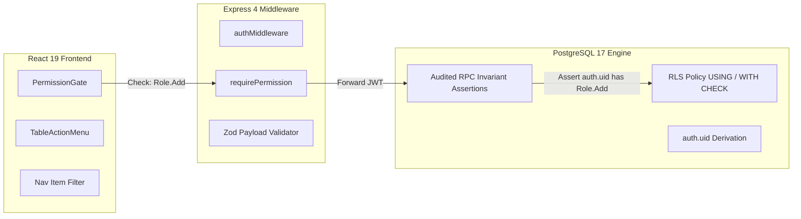

# PayPulse Phase 2.2 — Application API Authorization Contract and Route-to-Permission Matrix

**Status:** Implementation-Ready Architecture Specification  
**Date:** 2026-11-22  
**System:** PayPulse (JK Payroll) — Application Authorization Layer  
**Document Reference:** `PAYPULSE_PHASE_2_2_API_AUTHORIZATION_MATRIX.md`  

---

## 1. Executive Summary & Existing Codebase Audit

To establish a single, unified authorization contract across the React 19 SPA, Express 4 backend, and PostgreSQL database, a line-by-line inspection of all Express routes, controllers, and guards was conducted across:
- `src/server/routes/index.ts`
- `src/server/middleware/auth.middleware.ts`
- `src/server/middleware/rbac.guard.ts`
- `src/features/organizations/organization.routes.ts`
- `src/features/roles/role.routes.ts`
- `src/features/roles/user-role.routes.ts`
- `src/features/users/user.routes.ts`
- `src/features/access-control/access-control.routes.ts`
- `src/features/departments/department.routes.ts`
- `src/features/audit-logs/audit-logs.routes.ts`
- `src/features/leave-management/leave.routes.ts`
- `src/features/payroll/payroll.routes.ts`

### Critical Vulnerabilities and Gaps Identified in Existing Code:
1. **Unprotected Read Routes:**
   - `GET /api/roles`: Only checks `authenticateJwt`; has NO permission check! Any authenticated user in the organization can inspect all roles.
   - `GET /api/roles/:id`: Has NO permission check.
   - `GET /api/roles/:id/permissions`: Has NO permission check.
   - `GET /api/user-roles`: Has NO permission check.
   - `GET /api/users`: Has NO permission check. Any user can dump all staff accounts.
   - `GET /api/departments`: Has NO permission check.
2. **Coarse `requireTenantAdmin` Over-Reliance:**
   - In `role.routes.ts`, `user-role.routes.ts`, `access-control.routes.ts`, and `user.routes.ts`, mutating endpoints use `requireTenantAdmin`.
   - `requireTenantAdmin` checks `req.user.isTenantAdmin || isSuperAdmin(req.user)`—a binary flag derived from `membership.isOwner || profile.isTenantAdmin` rather than granular permissions (`Role.Add`, `UserRole.Edit`, `RolePermission.Edit`).
3. **SuperAdmin Blanket Bypass in Middleware:**
   - In `src/server/middleware/rbac.guard.ts` (lines 44-46), `requirePermission()` explicitly executes:
     `if (isSuperAdmin(req.user)) { return next(); }`
   - This grants SuperAdmin blanket bypass over ALL business permissions (such as approving leave or modifying salaries), violating Approved Decision 13.
4. **Implicit `.View` Inheritance in Middleware:**
   - In `rbac.guard.ts` (lines 69-85), holding any mutating permission (`*.Add`, `*.Edit`, `*.Delete`) automatically grants `*.View`. This violates Phase 2's explicit requirement that permission resolution must not imply view inheritance without an explicit decision.

---

## 2. Authoritative Route-to-Permission Matrix

The table below maps every API endpoint to its required canonical permission, organization scope, resource scope, and existing gap:

| HTTP Method | API Route | Operation Description | Required Canonical Permission | Organization Scope | Resource Scope | Existing Code Status & Gap | Required Phase 3 Remediation |
|---|---|---|---|---|---|---|---|
| **PUBLIC** | | | | | | | |
| `GET` | `/health` | Server Health & Uptime | None | None | Public | Open (Correct) | Retain open. |
| `POST` | `/api/organizations/onboarding` | Redeem Onboarding Token & Provision Org | None (Guarded by cryptographic token) | Pre-auth token | Target Onboarding Inv | Uses legacy migration 18 RPC (`service_role`) | Replace with caller-JWT redemption RPC. |
| **ORGANIZATIONS (Platform & Tenant Management)** | | | | | | | |
| `GET` | `/api/organizations` | List Organizations | SuperAdmin or `Organization.View` | Global (SuperAdmin) or Caller Tenant | Tenant list | Uses `authMiddleware` only; lacks granular filter | Restrict to SuperAdmin or own organization ID. |
| `GET` | `/api/organizations/:id` | Get Organization Details | SuperAdmin or `Organization.View` | Must match `:id` | Target Organization | Checks `:id` against `req.user.organizationId` | Add `requirePermission('Organization.View')`. |
| `POST` | `/api/organizations` | Platform Provision Organization | `SuperAdmin` Only | Global | New Organization | `requireSuperAdmin` (Correct) | Convert to caller-JWT bootstrap RPC. |
| `POST` | `/api/organizations/onboarding-invitations` | Issue 24h Onboarding Invitation Link | `SuperAdmin` Only | Global | Onboarding Invitation | `requireSuperAdmin` (Correct) | Bind to caller `auth.uid()`; drop `p_actor_id`. |
| `PUT` | `/api/organizations/:id` | Update Organization Details | `Organization.Edit` | Must match `:id` | Target Organization | Uses `requireTenantAdmin` | Replace with `requirePermission('Organization.Edit')`. |
| `PUT` | `/api/organizations/:id/settings` | Update Org Statutory / Locale Settings | `Organization.Edit` | Must match `:id` | Organization Settings | Uses `requireTenantAdmin` | Replace with `requirePermission('Organization.Edit')`. |
| `PUT` | `/api/organizations/:id/modules` | Allocate Platform Modules | `SuperAdmin` Only | Global | Target Organization Modules | `requireSuperAdmin` (Correct) | Write to `organization_modules` relational table. |
| `POST` | `/api/organizations/:id/suspend` | Suspend Organization Lifecycle | `SuperAdmin` Only | Global | Target Organization | `requireSuperAdmin` (Correct) | Acquire org lock; audit event. |
| `DELETE` | `/api/organizations/:id` | Archive / Delete Organization | `SuperAdmin` Only | Global | Target Organization | `requireSuperAdmin` (Correct) | Prohibit hard delete; enforce status `'Archived'`. |
| **ROLE DIRECTORY & MANAGEMENT** | | | | | | | |
| `GET` | `/api/roles` | List Organization Roles | `Role.View` | Caller Tenant | Organization Roles | **VULNERABLE:** No permission guard! | Add `requirePermission('Role.View')`. |
| `GET` | `/api/roles/:id` | Get Single Role Details | `Role.View` | Caller Tenant | Target Role | **VULNERABLE:** No permission guard! | Add `requirePermission('Role.View')`. |
| `GET` | `/api/roles/:id/permissions` | Get Role's Active Permission Grants | `RolePermission.View` | Caller Tenant | Target Role Grants | **VULNERABLE:** No permission guard! | Add `requirePermission('RolePermission.View')`. |
| `POST` | `/api/roles` | Create New Organization Role | `Role.Add` | Caller Tenant | New Role | Uses `requireTenantAdmin` | Replace with `requirePermission('Role.Add')`. |
| `PUT` | `/api/roles/:id` | Update Role Name / Description | `Role.Edit` | Caller Tenant | Target Role | Uses `requireTenantAdmin` | Replace with `requirePermission('Role.Edit')`. |
| `DELETE` | `/api/roles/:id` | Archive Role | `Role.Delete` | Caller Tenant | Target Role | Uses `requireTenantAdmin` | Replace with `requirePermission('Role.Delete')`. Check last admin. |
| `PUT` | `/api/roles/:id/permissions` | Assign Permissions to Role | `RolePermission.Edit` | Caller Tenant | Target Role Grants | Uses `requireTenantAdmin` | Replace with `requirePermission('RolePermission.Edit')`. |
| **USER ROLE ASSIGNMENTS** | | | | | | | |
| `GET` | `/api/user-roles` | List User Role Assignments | `UserRole.View` | Caller Tenant | User Role Mapping | **VULNERABLE:** No permission guard! | Add `requirePermission('UserRole.View')`. |
| `GET` | `/api/user-roles/:id` | Get Specific User Role Assignment | `UserRole.View` | Caller Tenant | User Role Mapping | **VULNERABLE:** No permission guard! | Add `requirePermission('UserRole.View')`. |
| `POST` | `/api/user-roles` | Assign User Role | `UserRole.Edit` | Caller Tenant | Target User Role | Uses `requireTenantAdmin` | Replace with `requirePermission('UserRole.Edit')`. |
| `PUT` | `/api/user-roles/:id` | Change Assigned Role | `UserRole.Edit` | Caller Tenant | Target User Role | Uses `requireTenantAdmin` | Replace with `requirePermission('UserRole.Edit')`. |
| `DELETE` | `/api/user-roles/:id` | Remove Role Assignment | `UserRole.Edit` | Caller Tenant | Target User Role | Uses `requireTenantAdmin` | Replaced by mandatory replacement reassignment. |
| **USER PROFILES & OVERRIDES** | | | | | | | |
| `GET` | `/api/users` | List Staff Profiles | `Profile.View` | Caller Tenant | Staff Profiles | **VULNERABLE:** No permission guard! | Add `requirePermission('Profile.View')`. |
| `GET` | `/api/users/:id` | Get Staff Profile Details | `Profile.View` or Self (`id === auth.uid()`) | Caller Tenant | Target User Profile | **VULNERABLE:** No permission guard! | Allow if self or caller has `Profile.View`. |
| `GET` | `/api/users/:id/permissions` | Inspect User Effective Permissions | `UserPermission.View` or Self | Caller Tenant | User Permission Set | **VULNERABLE:** No permission guard! | Allow if self or caller has `UserPermission.View`. |
| `POST` | `/api/users` | Create New User Profile | `Profile.Add` | Caller Tenant | New Staff Profile | Uses `requireTenantAdmin` | Replace with `requirePermission('Profile.Add')`. |
| `PUT` | `/api/users/:id/permissions` | Manage Mode & User Custom Grants | `UserPermission.Edit` | Caller Tenant | User Custom Grants | Uses `requireTenantAdmin` | Replace with `requirePermission('UserPermission.Edit')`. |
| **ACCESS CONTROL & PERMISSION OVERVIEW** | | | | | | | |
| `POST` | `/api/access-control/evaluate` | Runtime Permission Evaluation | Authenticated User | Caller Tenant | Self Context | Open to authenticated users | Retain; validates runtime caller permissions. |
| `GET` | `/api/access-control/matrix/:roleId` | Get Permissions Matrix for Role | `RolePermission.View` | Caller Tenant | Role Matrix | Uses `requireTenantAdmin` | Replace with `requirePermission('RolePermission.View')`. |
| `PUT` | `/api/access-control/matrix/:roleId` | Update Permissions Matrix for Role | `RolePermission.Edit` | Caller Tenant | Role Matrix | Uses `requireTenantAdmin` | Replace with `requirePermission('RolePermission.Edit')`. |
| `POST` | `/api/access-control/departments/modules` | Allocate Tenant Modules to Dept | `DepartmentModule.Edit` | Caller Tenant | Dept Module Allocation | Uses `requireTenantAdmin` | Replace with `requirePermission('DepartmentModule.Edit')`. |
| **DEPARTMENTS HIERARCHY** | | | | | | | |
| `GET` | `/api/departments` | List Departments | `Department.View` | Caller Tenant | Department List | **VULNERABLE:** No permission guard! | Add `requirePermission('Department.View')`. |
| `GET` | `/api/departments/tree` | Get Full Hierarchy Tree | `Department.View` | Caller Tenant | Hierarchy Tree | **VULNERABLE:** No permission guard! | Add `requirePermission('Department.View')`. |
| `POST` | `/api/departments` | Create Department | `Department.Add` | Caller Tenant | New Department | Uses `requireTenantAdmin` | Replace with `requirePermission('Department.Add')`. |
| `PUT` | `/api/departments/:id` | Update Department | `Department.Edit` | Caller Tenant | Target Department | Uses `requireTenantAdmin` | Replace with `requirePermission('Department.Edit')`. |
| `DELETE` | `/api/departments/:id` | Delete / Archive Department | `Department.Delete` | Caller Tenant | Target Department | Uses `requireTenantAdmin` | Replace with `requirePermission('Department.Delete')`. |
| **AUDIT LOGS** | | | | | | | |
| `GET` | `/api/audit-logs` | List Audit Logs Snapshot | `UserPermission.View` or `AuditLogs.View` | Caller Tenant | Audit Trail | Checks `user.isTenantAdmin` or `AuditLogs.View` | Align guard with canonical permission catalog. |
| `GET` | `/api/audit-logs/:id` | Get Audit Log Details | `UserPermission.View` or `AuditLogs.View` | Caller Tenant | Target Audit Entry | Checks `user.isTenantAdmin` or `AuditLogs.View` | Align guard with canonical permission catalog. |
| `POST/PUT/DELETE` | `/api/audit-logs/*` | Mutate Audit Logs | Denied to All | N/A | N/A | Returns `405 Method Not Allowed` | Retain `405` immutability barrier. |

---

## 3. Unified End-to-End Authorization Contract

To ensure absolute alignment between React, Express, and PostgreSQL:

### Tripartite Authorization Principles:
1. **Advisory UI Presentation:** The React frontend evaluates `userPermissions.includes(requiredKey)` solely to optimize user experience (hiding buttons, disabling inputs). The frontend is NEVER trusted as a security boundary.
2. **Deterministic Route Barrier:** Express validates request syntax, confirms tenant membership, and executes `requirePermission(canonicalKey)`. It rejects unauthorized requests with `403 Forbidden` before controller execution.
3. **Authoritative Persistence Barrier:** PostgreSQL independently checks `auth.uid()`, active membership, and current organization entitlements inside RLS policies and audited RPCs. Even if an attacker bypasses Express or connects directly to PostgREST, the database enforces the exact same authorization invariants.
