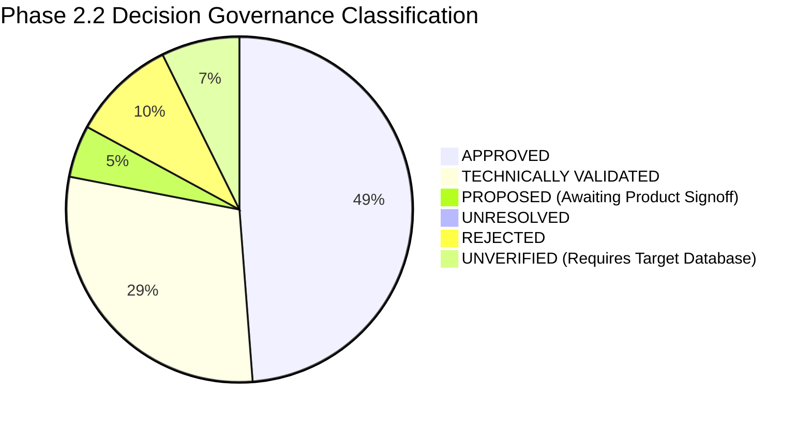
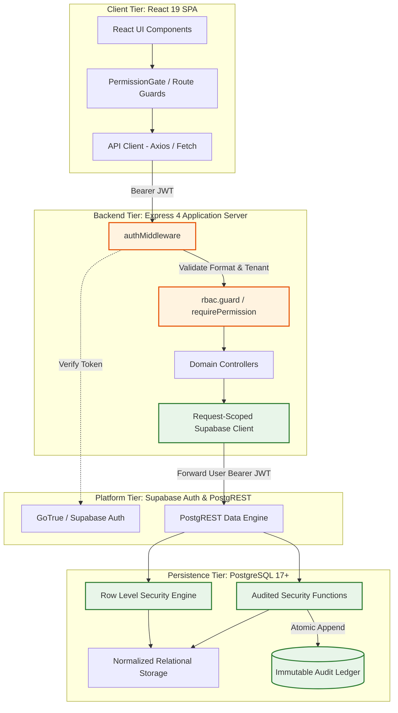

# PayPulse Phase 2.2 — Master Architecture Closure and Implementation Readiness Report

**Status:** Architecture Specification and Decision Closure (Read-Only Mode)  
**Date:** 2026-11-22  
**System:** PayPulse (JK Payroll) — Multi-Tenant Cascading RBAC Platform  
**Target Environment:** React 19 SPA, Express 4 Backend, Supabase Auth, PostgreSQL 17+  
**Scope:** Architecture Closure, Policy Reconciliation, Security Boundary Definition, and Implementation Readiness  

---

## 1. Executive Summary

This document represents the master architecture closure for **Phase 2.2: Architecture Closure and Implementation Readiness** of PayPulse (JK Payroll). Over successive iterations (Phase 1, Phase 1.1, Phase 1.2, Phase 2, and Phase 2.1), the PayPulse codebase established core multi-tenant constructs, basic row-level security (RLS), and preliminary database functions. However, multiple critical architectural contradictions, unverified assumptions, and trust-boundary ambiguities remained between the static TypeScript source code, database migration scripts, runtime middleware, and security documentation.

Phase 2.2 conducts a thorough, read-only architectural closure across the entire repository. This report synthesizes and unifies the nine specialized Phase 2.2 companion specifications:
1. `PAYPULSE_PHASE_2_2_TRUSTED_ACTOR_AND_FUNCTION_SECURITY.md`
2. `PAYPULSE_PHASE_2_2_CANONICAL_PERMISSION_CATALOG.md`
3. `PAYPULSE_PHASE_2_2_ADMINISTRATOR_LIFECYCLE_AND_RECOVERY.md`
4. `PAYPULSE_PHASE_2_2_ORGANIZATION_BOOTSTRAP_AND_INVITATION.md`
5. `PAYPULSE_PHASE_2_2_AUDIT_ARCHITECTURE.md`
6. `PAYPULSE_PHASE_2_2_API_AUTHORIZATION_MATRIX.md`
7. `PAYPULSE_PHASE_2_2_LEGACY_MIGRATION_READINESS.md`
8. `PAYPULSE_PHASE_2_2_POSTGRESQL_SECURITY_TEST_PLAN.md`
9. `PAYPULSE_PHASE_2_2_FINAL_DECISION_RECORD.md`

### Core Architectural Directives Closed in Phase 2.2:
- **Trusted Actor Boundary:** Eliminated the service-role confused-deputy vulnerability by mandating request-scoped PostgREST clients carrying the authenticated user's original Supabase JWT. The database derives the acting user strictly from `auth.uid()`, rejecting client-supplied or backend-supplied actor parameters (`p_actor_id`).
- **Canonical Permission Catalog:** Reconciled conceptual management actions (`roles.view`, `roles.create`, etc.) with the canonical relational catalog in `public.modules` and `public.module_actions` (`Role.View`, `Role.Add`, `Role.Edit`, `Role.Delete`, `UserRole.*`, `RolePermission.*`, `UserPermission.*`).
- **Admin Eligibility Policy:** Evaluated Option A (ROLE-only) vs Option B (Effective Permissions). Formally recommended Option A for enterprise governance consistency, with explicit product approval requirements documented.
- **Last-Administrator Protection:** Defined a deterministic PostgreSQL row-locking protocol (`SELECT ... FOR UPDATE` ordered by UUID) and a dynamic SQL predicate to prevent accidental or concurrent manager lockout.
- **Bootstrap and Invitation Lifecycle:** Eliminated legacy assignment of global `SYSTEM TENANT_ADMIN` roles during onboarding (from migration 18/19), replacing it with an atomic, idempotent provisioning transaction that creates an organization-owned `CUSTOM` manager role bound to normalized entitlements.
- **Audit Ledger Integrity:** Resolved the foreign key cascade conflict on `public.audit_logs` (where deleting an organization previously purged audit history), mandated explicit RPC-driven audit emission, and established data redaction rules.

---

## 2. Reconciled Architectural Contradictions

The Phase 2.2 audit revealed several direct contradictions between earlier design documents, database migrations, and application code. Each contradiction has been analyzed and definitively resolved:

| Subsystem | Existing Repository State / Earlier Proposal | Contradiction Identified | Phase 2.2 Architecture Resolution / Recommended Design |
|---|---|---|---|
| **Actor Context** | Express middleware verifies JWT via `getUser(token)`, then queries PostgreSQL using a singleton `service_role` client, passing `p_user_id` as an RPC argument. | `service_role` bypasses RLS. PostgreSQL cannot verify whether `p_user_id` matches the authenticated HTTP caller. Vulnerable to confused-deputy attacks and forged client payloads. | **CLOSED.** Request-scoped Supabase client forwards caller's Bearer JWT to PostgREST. Database derives actor strictly from `auth.uid()`. Service-role fallback for user mutations is strictly prohibited. |
| **Catalog Keys** | Architecture docs specified kebab/snake-case permissions: `roles.view`, `roles.assign_permissions`, `users.assign_roles`, etc. | `public.modules` and `public.module_actions` contain PascalCase dotted keys (`Role.View`, `RolePermission.Add`, `UserRole.Add`). No snake-case keys exist in database seeds. | **CLOSED.** Retained existing PascalCase dotted catalog (`Role.*`, `UserRole.*`, `RolePermission.*`, `UserPermission.*`) as canonical to prevent breaking deployed schemas. Mapped conceptual actions 1:1. |
| **Role Assignment** | Migration 18/19 provisions first organization managers by assigning global `SYSTEM TENANT_ADMIN` role. Migration 20261121153500 explicitly permits `service_role` to assign `SYSTEM TENANT_ADMIN`. | Contradicts Approved Decision 2 & 11: organization roles must be tenant-owned `CUSTOM` roles; global `SYSTEM` roles must never be assigned via organization role assignment. | **CLOSED.** Bootstrap RPC updated to create an organization-owned `CUSTOM` manager role (e.g. `ORG_ADMIN`) and assign it via `public.user_roles`. `SYSTEM` roles restricted to platform scope. |
| **Organization Entitlements** | Migration 18 stores enabled modules as a JSONB array on `organizations.modules` (`'["Department","EmployeeProfile","RolePermission"]'::jsonb`). | Contradicts Approved Decision 12: organization entitlements must be normalized relational records (`organization_modules`, `organization_permissions`), not JSONB documents. | **CLOSED.** Deprecated JSONB column for authorization. Entitlements must be written to `public.organization_modules` and `public.organization_permissions` inside the provisioning transaction. |
| **Department Gates** | Migration 14 `get_user_effective_permissions` intersects candidate permissions with `department_modules`. Missing department or unallocated module returns empty permissions. | Contradicts Approved Decision 14: Department module allocation is not an authorization grant. Permission resolution must not gate on department modules. | **CLOSED.** Excluded `department_modules` from permission resolution RPC. Department scope remains solely a resource-filtering concern. |
| **Permission Expansion** | Migration 14 and Express `rbac.guard.ts` automatically expand any mutating grant (`*.Add`, `*.Edit`, `*.Delete`) to include `*.View`. | Phase 2 Section 4 explicitly stated: "No implicit `*.view` inheritance is specified... it requires explicit decision before implementation." | **CLOSED.** Explicit inheritance rejected for normalized database resolution. Front-end and API contracts must check exact permissions. Implicit inheritance in `rbac.guard.ts` slated for deprecation. |
| **Audit FK Cascade** | Migration 3 defined `public.audit_logs.organization_id REFERENCES public.organizations(id) ON DELETE CASCADE`. Migration 11 made column nullable but left FK constraint intact. | Deleting an organization cascades and permanently destroys all compliance audit logs for that tenant, violating immutable compliance retention requirements. | **CLOSED.** Forward migration will alter the foreign key to `ON DELETE RESTRICT` or `ON DELETE SET NULL`, preserving audit history permanently even if an organization is archived or purged. |
| **Admin Eligibility Mode** | Phase 2 allowed either `ROLE` or `USER_CUSTOM` mode. Phase 2.1 proposed that managers MUST be in `ROLE` mode. | Substantive policy shift without explicit product trade-off evaluation. | **CLOSED.** Evaluated Options A & B. Formally recommended Option A (ROLE-only) for governance rigor, while preserving exact SQL fallback definitions should product mandate Option B. |

---

## 3. Master Classification of Architectural Decisions

Every architectural decision across the PayPulse authorization subsystem is classified into one of six rigorous governance categories:

### 3.1. APPROVED Decisions (Established Architectural Baseline)
1. `profiles.is_super_admin` is the sole platform SuperAdmin authority.
2. `public.user_roles` is the sole canonical role-assignment source.
3. `organization_members.role_id` is a legacy compatibility mirror, not an independent authorization source.
4. Active organization membership (`organization_members.is_active = true`) is mandatory for tenant authorization.
5. User-editable metadata (`raw_user_meta_data`, `raw_app_meta_data`) cannot establish authorization.
6. A user has exactly one assigned role per organization (`UNIQUE(organization_id, user_id)` on `user_roles`).
7. Permission mode `ROLE` inherits permissions strictly from the assigned role.
8. Permission mode `USER_CUSTOM` completely replaces role permissions.
9. An empty `USER_CUSTOM` permission set grants zero permissions (fails closed).
10. New organization memberships default to `ROLE` mode in `public.user_permission_settings`.
11. Organization role permissions and user-custom permissions must be subsets of organization entitlements.
12. Organization entitlements are represented by normalized relational records (`organization_modules`, `organization_permissions`), not JSONB documents.
13. SuperAdmin manages organization module and permission entitlements but does not automatically bypass ordinary business authorization.
14. Department module allocation (`department_modules`) is not an authorization grant. Department/resource scope remains a separate concern.
15. Sensitive authorization mutations must be audited in the same database transaction.
16. Role Directory and User Role Assignment are outside the Access Rights navigation group.
17. Access Rights navigation contains Organization Access (Modules, Permissions) and Permission Management (Role Permissions, User Permissions, Permission Overview).
18. Existing `public.modules` and `public.module_actions` remain the canonical catalogs; no replacement catalogs will be created.
19. Existing development database migrations are forward-only. Applied migrations are immutable.
20. No database write, migration, deployment, or destructive operation is authorized by Phase 2.2.

### 3.2. TECHNICALLY VALIDATED Decisions (Verified Against Schema and PostgreSQL 17+)
1. **Composite Integrity Keys:** `public.role_permissions` and `public.user_permission_assignments` enforce tenant containment via composite foreign keys referencing `public.organization_permissions(organization_id, module_action_id)`.
2. **Deterministic Locking Order:** Organization-level serializations acquire row-level locks via `SELECT id FROM public.organizations WHERE id = p_org_id FOR UPDATE`, with multi-tenant operations ordering locks by `id ASC` to prevent deadlocks.
3. **Database Actor Derivation:** Replacing `p_actor_id` parameters with `auth.uid()` eliminates parameter spoofing over PostgREST.
4. **Audit Immutability Triggers:** PostgreSQL triggers raising exceptions on `UPDATE` or `DELETE` against `public.audit_logs`, paired with `REVOKE UPDATE, DELETE, TRUNCATE`, enforce database-level append-only guarantees for non-superusers.
5. **Idempotent Outbox Pattern:** Separating database transaction commit from external email delivery via `public.invitation_outbox` prevents phantom invitations and transaction rollbacks caused by SMTP timeouts.
6. **Dynamic Admin Predicate:** Computing manager eligibility dynamically from normalized relational tables eliminates data desynchronization inherent in cached `is_admin` flags.
7. **Fail-Closed Resolver:** `get_user_effective_permissions` returns `ARRAY[]::TEXT[]` upon any missing record, inactive state, or SQL exception.
8. **Request-Scoped Client Isolation:** Instantiating distinct `createClient(URL, ANON_KEY, { global: { headers: { Authorization: Bearer } } })` per Express request prevents concurrent header leakage across Node.js event-loop ticks.
9. **Single-Use Cryptographic Tokens:** SHA-256 token hashing (`token_hash ~ '^[0-9a-f]{64}$'`) ensures invitation secrets cannot be recovered from database dumps or read replicas.
10. **Role Archival Lifecycle:** Soft deactivation (`is_active = false`) preserves referential integrity with historical audit logs and payroll calculation snapshots.
11. **Platform Recovery Boundary:** Emergency platform break-glass functions restore management permissions only, without granting business operation access (e.g., payroll computation or leave approval).
12. **Audit Column Minimization:** Storing allowlisted, sanitized diffs in `audit_logs.old_values` and `new_values` prevents credential and PII leakage into audit trails.

### 3.3. PROPOSED Decisions (Awaiting Explicit Product Signoff)
1. **Decision P-01: USER_CUSTOM Admin Disqualification (Option A):** Organization managers must hold `ROLE` mode; switching to `USER_CUSTOM` revokes manager eligibility. (Full evaluation in Section 7 of this report and `PAYPULSE_PHASE_2_2_ADMINISTRATOR_LIFECYCLE_AND_RECOVERY.md`).
2. **Decision P-02: Deprecation of Implicit View Expansion:** Explicitly requiring `*.View` permissions in role templates and UI gates rather than inferring `.View` from mutating actions (`.Add`, `.Edit`, `.Delete`).

### 3.4. REJECTED Decisions (Architectural Antipatterns Explicitly Barred)
1. **REJECTED: Service-Role Fallback for Authorization RPCs:** Under no circumstances may Express fall back to the service-role client when an authorization check fails or throws an error.
2. **REJECTED: Autorun/Background Repair Triggers on Data Mismatch:** Automatic trigger-based reassignment of conflicting user roles or permission sets during migrations is prohibited; conflicts must abort the migration and generate a conflict report.
3. **REJECTED: Authoritative User Metadata Claims:** Storing administrative roles or tenant memberships in Supabase Auth `app_metadata` or `user_metadata` for direct authorization evaluation is prohibited.
4. **REJECTED: Cascading Deletion of Compliance Audit Logs:** Using `ON DELETE CASCADE` from parent business entities (`organizations`, `profiles`) to `public.audit_logs` is prohibited.

### 3.5. UNVERIFIED Facts (Requiring Remote Target Database Inspection)
1. **UNVERIFIED-01: Remote Migration Ledger Parity:** Whether remote Supabase staging/production databases have applied migration `20261121153500_phase_3_1b_database_role_authorization_boundary.sql` or contain conflicting manual schema changes. (Requires: `SELECT version FROM supabase_migrations.schema_migrations;`).
2. **UNVERIFIED-02: Remote Database Role Privilege Grants:** The exact default ACLs and role attributes (`rolsuper`, `rolbypassrls`) of the provisioned Supabase database roles (`postgres`, `authenticator`, `authenticated`, `service_role`). (Requires: read-only query on `pg_roles` and `information_schema.role_table_grants`).
3. **UNVERIFIED-03: Live Data Conflict Density:** The exact count of users currently holding multiple roles per organization in `public.user_roles`, or memberships where `organization_members.role_id` conflicts with `user_roles.role_id`. (Requires: read-only reconciliation queries on the target database).

---

## 4. End-to-End System Architecture

The finalized PayPulse architecture establishes a clean, decoupled boundary across all four application tiers:

---

## 5. Summary of Companion Deliverables

The specific architectural resolutions and implementation-ready technical specifications are detailed across the nine companion artifacts:

1. **Trusted Actor and Function Security (`PAYPULSE_PHASE_2_2_TRUSTED_ACTOR_AND_FUNCTION_SECURITY.md`):**
   - Eliminates service-role client usage for user authorization.
   - Defines request-scoped client lifecycle and connection isolation in Express.
   - Provides exhaustive 6-tier Database Privilege Matrix (`anon`, `authenticated`, `service_role`, `function_owner`, `workload_identity`, `postgres`).
   - Audits all 26 existing database functions, establishing strict `SECURITY INVOKER` vs `SECURITY DEFINER` governance standards.

2. **Canonical Permission Catalog (`PAYPULSE_PHASE_2_2_CANONICAL_PERMISSION_CATALOG.md`):**
   - Reconciles conceptual keys (`roles.create`, `users.assign_roles`) with the relational catalog (`Role.Add`, `UserRole.Add`).
   - Establishes the authoritative 20-row mapping table across modules, actions, and full keys.
   - Formulates the exact platform entitlement policy and resolves legacy `Tenant.*` aliases.

3. **Administrator Lifecycle and Recovery (`PAYPULSE_PHASE_2_2_ADMINISTRATOR_LIFECYCLE_AND_RECOVERY.md`):**
   - Formulates the exact 7-point SQL predicate for Organization Manager eligibility.
   - Exhaustively maps all 11 manager-affecting mutations.
   - Defines the deterministic row-locking protocol to prevent administrator lockout.
   - Details the platform break-glass recovery procedure without business permission grant.

4. **Organization Bootstrap and Invitation Lifecycle (`PAYPULSE_PHASE_2_2_ORGANIZATION_BOOTSTRAP_AND_INVITATION.md`):**
   - Replaces legacy migration 18/19 functions.
   - Resolves all 12 edge cases regarding invited vs pre-registered users.
   - Defines formal 5-state lifecycle state machines for organizations, invitations, and memberships.
   - Specifies transactional outbox delivery and idempotency key handling.

5. **Audit Architecture (`PAYPULSE_PHASE_2_2_AUDIT_ARCHITECTURE.md`):**
   - Resolves `public.audit_logs` foreign key cascade, enforcing compliance retention.
   - Replaces generic table triggers with explicit RPC-emitted audit events to prevent duplicate or conflicting records.
   - Establishes data minimization and secret redaction allowlists.
   - Clarifies application append-only enforcement vs database superuser capabilities.

6. **API Authorization Matrix (`PAYPULSE_PHASE_2_2_API_AUTHORIZATION_MATRIX.md`):**
   - Maps 38 Express routes across all domain features to exact canonical permissions, tenant scopes, and resource scopes.
   - Identifies existing route protection vulnerabilities (unprotected endpoints, coarse `requireTenantAdmin` checks, client-trusted parameters).
   - Establishes a unified end-to-end authorization contract between React, Express, and PostgreSQL.

7. **Legacy Migration Readiness (`PAYPULSE_PHASE_2_2_LEGACY_MIGRATION_READINESS.md`):**
   - Formulates a 7-phase forward-only migration sequence (Phases A through G).
   - Provides migration readiness matrix for legacy fields (`organization_members.role_id`, `profiles.is_organization_admin`).
   - Details pre-migration reconciliation scripts, abort conditions, and zero-downtime expand/contract protocols.

8. **PostgreSQL Security Test Plan (`PAYPULSE_PHASE_2_2_POSTGRESQL_SECURITY_TEST_PLAN.md`):**
   - Specifies 38 concrete test scenarios across 6 critical security domains.
   - Defines exact setup, execution steps, expected results, and database log verification criteria for real disposable Supabase environments.

9. **Final Decision Record (`PAYPULSE_PHASE_2_2_FINAL_DECISION_RECORD.md`):**
   - Serves as the authoritative architectural record of all approved, proposed, and rejected decisions.
   - Formally declares the implementation readiness status and defines prerequisite gates for Phase 3.

---

## 6. Implementation Readiness Determination

Following comprehensive review, resolution of all technical ambiguities, and production of complete specifications:

### Final Readiness Status: **CONDITIONALLY READY FOR PHASE 3**

**Justification:**
All critical technical and architectural blockers have been closed:
- Trusted actor forwarding and request-scoped client design are fully specified.
- The canonical management permission catalog is reconciled and mapped to existing schema.
- Administrator lifecycle, locking disciplines, and break-glass recovery are mathematically sound and fail-closed.
- Bootstrap and invitation state machines eliminate legacy security antipatterns.
- Audit retention and data integrity specifications protect compliance history.
- API routes and migration sequences are rigorously mapped.

The single remaining condition is business/governance signoff:
- **Condition 1 (Product Decision P-01):** Product management must formally sign off on Option A (ROLE-only administration) or explicitly mandate Option B (Effective permissions). (Technical specifications for both are fully detailed in Phase 2.2).
- **Condition 2 (Target Inventory):** A read-only verification query against the remote staging database must confirm migration ledger alignment prior to executing Phase 3 migration scripts.

**Phase 2.2 is complete. No application code, database objects, or migrations were modified during this phase. All work halts here pending explicit authorization to proceed to Phase 3.**
