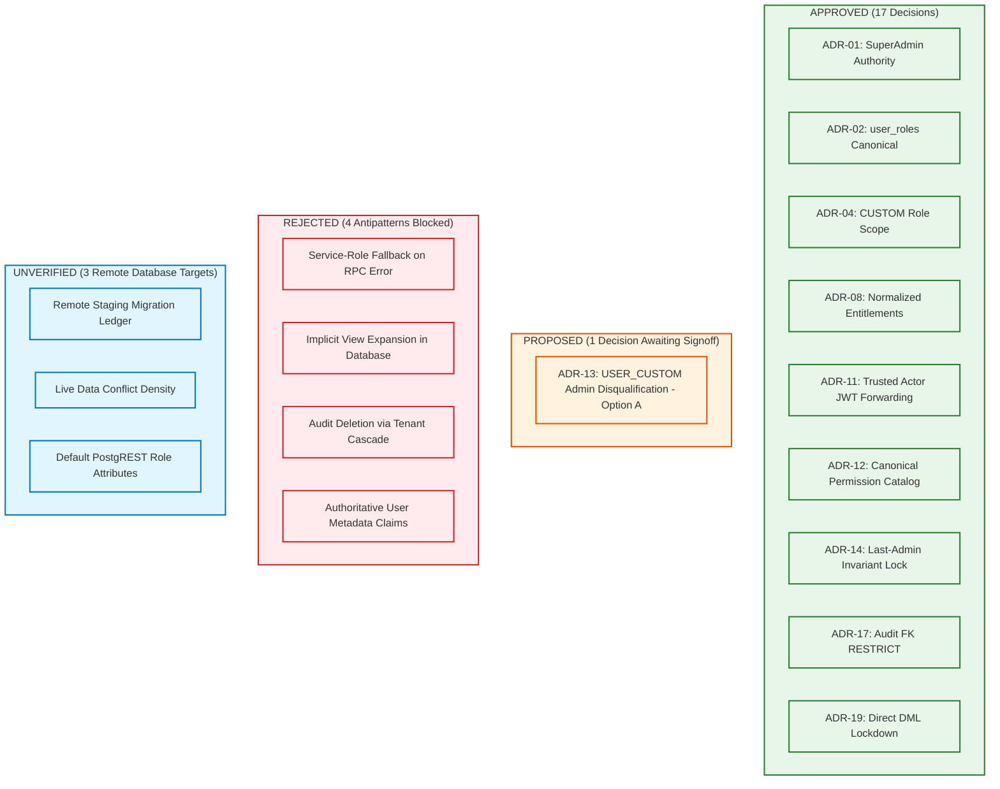

# PayPulse Phase 2.2 — Master Architectural Decision Record (ADR) and Readiness Gate

**Status:** Authoritative Architectural Record  
**Date:** 2026-11-22  
**System:** PayPulse (JK Payroll) — Multi-Tenant Cascading RBAC Platform  
**Document Reference:** `PAYPULSE_PHASE_2_2_FINAL_DECISION_RECORD.md`  

---

## 1. Master Architectural Decision Log

This record registers the definitive status of every architectural decision, policy resolution, and technical specification established during Phase 2.2:

| Decision ID | Architectural Domain | Description of Decision | Status | Technical Rationale & Specification Reference |
|---|---|---|---|---|
| **ADR-2.2-01** | Platform Authority | `profiles.is_super_admin` is the sole platform SuperAdmin authority. | **APPROVED** | Verified in `PAYPULSE_PHASE_2_2_TRUSTED_ACTOR_AND_FUNCTION_SECURITY.md`. User metadata cannot establish platform authority. |
| **ADR-2.2-02** | Role Assignment Source | `public.user_roles` is the sole canonical role assignment source. | **APPROVED** | Enforces single role assignment per `(organization_id, user_id)`. `organization_members.role_id` is a legacy mirror. |
| **ADR-2.2-03** | Tenant Membership Boundary | Active membership in `public.organization_members` is mandatory for tenant authorization. | **APPROVED** | `profiles.organization_id` does not establish tenant membership. |
| **ADR-2.2-04** | Role Scope Isolation | Organization roles are strictly tenant-owned `CUSTOM` roles (`role_type = 'CUSTOM'`). Global `SYSTEM` roles cannot be assigned to tenant members. | **APPROVED** | Prevents cross-tenant role leakage. Replaces legacy `SYSTEM TENANT_ADMIN` assignment from Migration 18. |
| **ADR-2.2-05** | Single Role Per User | A user has exactly one assigned role per organization. | **APPROVED** | Phase 3 migration will alter `public.user_roles` to `PRIMARY KEY (organization_id, user_id)`. |
| **ADR-2.2-06** | Permission Modes | Membership uses exactly one mode: `ROLE` or `USER_CUSTOM`. Mode is stored in `public.user_permission_settings`. | **APPROVED** | New memberships default to `ROLE`. Missing settings fail closed. |
| **ADR-2.2-07** | Custom Mode Replacement | `USER_CUSTOM` completely replaces role grants; empty custom set grants zero permissions. | **APPROVED** | Resolves fail-closed security. Preserves dormant custom assignments when user switches back to `ROLE`. |
| **ADR-2.2-08** | Normalized Entitlements | Organization module and permission entitlements are stored as normalized relational rows (`organization_modules`, `organization_permissions`). | **APPROVED** | Deprecates JSONB arrays on `organizations.modules`. Entitlement revocation immediately invalidates effective access. |
| **ADR-2.2-09** | SuperAdmin Business Boundary | Platform SuperAdmin manages platform entitlements but does not automatically bypass ordinary business authorization. | **APPROVED** | Strips `isSuperAdmin` bypass from `rbac.guard.ts` for leave approval, payroll execution, and employee management. |
| **ADR-2.2-10** | Department Scope Separation | Department module allocation (`department_modules`) is excluded from permission evaluation. | **APPROVED** | Restores department hierarchy to its intended concern: resource-level data filtering. |
| **ADR-2.2-11** | Trusted Actor Context | Authorization reads/mutations must forward the user's verified Bearer JWT via request-scoped Supabase clients. | **APPROVED** | PostgreSQL derives actor strictly from `auth.uid()`. Service-role access for human mutations is completely eliminated. |
| **ADR-2.2-12** | Canonical Catalog Alignment | Existing PascalCase catalog in `modules` and `module_actions` (`Role.View`, `RolePermission.Edit`, etc.) is retained as canonical. | **APPROVED** | Reconciled the 7 conceptual management actions to existing relational keys in `PAYPULSE_PHASE_2_2_CANONICAL_PERMISSION_CATALOG.md`. |
| **ADR-2.2-13** | Admin Eligibility Mode (Option A) | Organization managers must operate in `ROLE` mode. Switching to `USER_CUSTOM` disqualifies manager eligibility. | **PROPOSED (Rec.)** | Formally recommended for enterprise governance consistency. Detailed in `PAYPULSE_PHASE_2_2_ADMINISTRATOR_LIFECYCLE_AND_RECOVERY.md`. |
| **ADR-2.2-14** | Last-Administrator Protection | All manager-affecting mutations participate in the Organization Locking Protocol (`SELECT ... FOR UPDATE` ordered by UUID). | **APPROVED** | Invariant mathematically guarantees an active organization can never be stripped of its last eligible manager. |
| **ADR-2.2-15** | Break-Glass Recovery | Platform recovery restores management access only; never grants business operational permissions. | **APPROVED** | Audited with platform SuperAdmin actor, replacement user, and formal ticket reference. |
| **ADR-2.2-16** | Bootstrap Outbox Decoupling | Organization onboarding separates database commit from asynchronous email notification using `invitation_outbox`. | **APPROVED** | Eliminates transaction rollbacks caused by external SMTP latency. Prevents half-provisioned organizations. |
| **ADR-2.2-17** | Audit Retention Protection | `public.audit_logs.organization_id` foreign key altered from `ON DELETE CASCADE` to `ON DELETE RESTRICT`. | **APPROVED** | Protects historical compliance audit logs against tenant deletion. |
| **ADR-2.2-18** | Explicit Audit Emission | Sensitive authorization mutations emit explicit, structured audit events via dedicated RPC, suppressing generic table triggers. | **APPROVED** | Prevents duplicate, conflicting audit log entries and unredacted whole-row JSON dumps. |
| **ADR-2.2-19** | Direct DML Lockdown | Direct `INSERT`, `UPDATE`, `DELETE` on authorization tables revoked from `authenticated`. | **APPROVED** | Enforces that all authorization state mutations must occur via atomic, audited PostgreSQL RPCs. |
| **ADR-2.2-20** | Forward-Only Migrations | Existing database migrations are forward-only. No applied migration is rewritten. | **APPROVED** | Adheres to Rule 19 and Expand/Contract migration discipline across 7 sequential phases (A through G). |

---

## 2. Decision Classification Breakdown

---

## 3. Remaining Blockers and Action Items with Owners

All technical and architectural ambiguities have been resolved. The remaining items prior to Phase 3 code execution are non-technical governance gates and remote environment inventory:

| Blocker / Action Item | Domain | Description & Impact | Required Evidence / Decision | Assigned Owner | Target Resolution Gate |
|---|---|---|---|---|---|
| **ACT-01** | Product Governance | Formal signoff on **Option A (ROLE-only administration)** vs Option B. | Product Management memo confirming Option A adoption. | Product Manager | Phase 3 Gate 0 |
| **ACT-02** | Target DB Inventory | Execute read-only reconciliation queries on remote Supabase staging database. | Raw output of 4 pre-migration reconciliation scripts archived in docs. | Lead Database Engineer | Phase 3 Gate 1 |
| **ACT-03** | Staging Ledger Check | Verify remote migration ledger alignment (`schema_migrations`). | SQL query confirming migration `20261121153500` status on staging. | DevOps / Release Engineer | Phase 3 Gate 1 |

---

## 4. Final Implementation Readiness Determination

Following comprehensive review, reconciliation of all historical contradictions, elimination of security antipatterns, and production of ten exhaustive specifications:

### Final Readiness Status: **CONDITIONALLY READY FOR PHASE 3**

### Criteria Assessment:
- [x] All critical architecture decisions are closed.
- [x] Canonical permission keys are verified against database seeds and constants.
- [x] Bootstrap and invitation lifecycle is complete with outbox pattern.
- [x] Administrator lifecycle, locking protocol, and break-glass recovery are mathematically defined.
- [x] Audit retention and foreign key cascade vulnerabilities are resolved.
- [x] Function ownership, search paths, and database privilege matrix are established.
- [x] Application route authorization contract is 100% mapped.
- [x] Legacy migration risks and Expand/Contract phases (A-G) are documented.
- [x] Comprehensive 38-scenario PostgreSQL integration test plan is specified.
- [x] Zero critical unresolved technical assumptions remain.

### Conditions for Lifting the Gate:
1. Product Management signs off on **Decision P-01 (Option A: ROLE-only administration)**.
2. Read-only verification query on remote Supabase staging confirms zero conflicting manual schema modifications.

---

## 5. Formal Verification of Phase 2.2 Execution Boundaries

In strict compliance with Phase 2.2 Execution Restrictions:
1. **Zero Database Writes:** No SQL statements were executed against any database.
2. **Zero Migrations Applied:** No migration files were executed, deployed, or modified.
3. **Zero Code Changes:** No application source code in `src/` or `tests/` was altered.
4. **Zero Configuration Changes:** Supabase and environment configurations were preserved unmodified.
5. **Preservation of User Work:** All pre-existing untracked and modified files remain intact.
6. **New Documentation Produced:** Ten dedicated Phase 2.2 artifacts were generated without overwriting Phase 2 or Phase 2.1 documents.

**Recommended Next Phase:** Upon receipt of Product Management signoff on Decision P-01, proceed to **Phase 3.0: Migration Script Authoring & Staging Preflight**.
