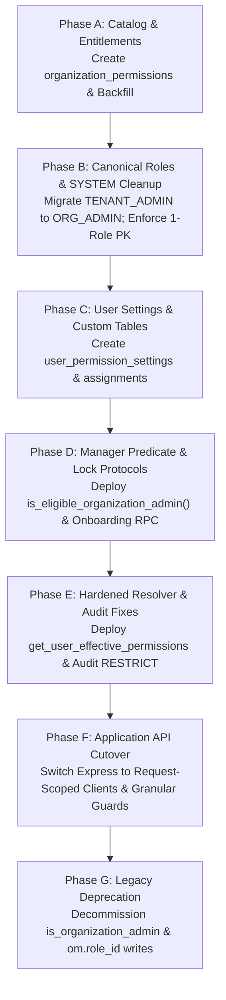

# PayPulse Phase 2.2 — Legacy Data and Migration Readiness Specification

**Status:** Implementation-Ready Architecture Specification  
**Date:** 2026-11-22  
**System:** PayPulse (JK Payroll) — Database Migration Architecture  
**Document Reference:** `PAYPULSE_PHASE_2_2_LEGACY_MIGRATION_READINESS.md`  

---

## 1. Executive Summary

As PayPulse transitions to strict normalized RBAC, existing database environments (local development, staging, and production) contain historical records created under earlier architectural assumptions. Specifically:
- `organization_members.role_id` exists as a legacy role pointer alongside `public.user_roles`.
- `profiles.is_organization_admin` was previously used as a boolean administrative flag.
- `profiles.organization_id` was historically populated but cannot establish multi-organization membership.
- `organization_members.is_owner` was treated as an administrative bypass in some queries.
- Migration `20261121000018_superadmin_onboarding_invitations.sql` assigned the global `SYSTEM TENANT_ADMIN` role to organization members.
- `public.user_roles` primary key in base migration 1 allows multiple roles per user per organization.

### The Immutable Migration Law: Forward-Only
In accordance with Rule 19, **applied development migrations are forward-only and must never be rewritten or modified in place**. All schema evolutions, column deprecations, and data reconciliations must occur via new, additive forward migrations adhering to the **Expand / Contract Pattern**.

---

## 2. Legacy Migration Readiness Matrix

The table below catalogs every legacy object, its current schema state, the required Phase 3 evolution, associated data risks, compatibility requirements, and verification procedures:

| Existing Database Object | Current Schema State | Required Phase 3 Change | Data Risk | Backward Compatibility Requirement | Verification Query / Procedure |
|---|---|---|---|---|---|
| `organization_members.role_id` | Foreign key to `public.roles(id)`. Populated during legacy onboarding. | Cease using as authorization authority. Maintain as read-only mirror temporarily; drop column in final Phase G. | **Low.** If code reads `role_id` instead of `user_roles`, role reassignment desync occurs. | Dual-write trigger during transition: updates to `user_roles` sync to `om.role_id` until cutover. | Verify zero mismatches: `SELECT count(*) FROM om JOIN ur ON om.user_id = ur.user_id WHERE om.role_id <> ur.role_id;` |
| `profiles.is_organization_admin` | Boolean flag on `profiles`. Set to `false` in recent migrations; checked in legacy guards. | Deprecate as authority source. Retain as non-authoritative metadata; drop in Phase G. | **Medium.** Legacy scripts or third-party reports may rely on this boolean. | Express middleware ignores flag for permission evaluation; sets flag advisory only. | Audit scan of all codebase queries referencing `is_organization_admin`. |
| `profiles.organization_id` | Foreign key to `organizations(id)` on `profiles`. | Deprecate as membership evidence. Authoritative membership is strictly `public.organization_members`. | **High.** Users belonging to multiple organizations have ambiguous single `organization_id`. | Used solely as "last active organization" hint in user preferences. | `SELECT count(*) FROM profiles p WHERE organization_id IS NOT NULL AND NOT EXISTS (SELECT 1 FROM organization_members om WHERE om.user_id = p.id AND om.organization_id = p.organization_id);` |
| `organization_members.is_owner` | Boolean flag on `organization_members`. Set to `true` during onboarding. | Restrict to corporate lifecycle metadata. Strip all permission bypass logic in RPCs. | **Low.** Purely architectural; does not alter table structure. | Retain column; update functions to remove `OR om.is_owner = true` clauses. | Inspect all RPC definitions to confirm `is_owner` grants zero permissions. |
| `public.user_roles` PK | `PRIMARY KEY (organization_id, user_id, role_id)`. Allows multiple roles per user. | Reconcile duplicates; alter PK to `PRIMARY KEY (organization_id, user_id)`. | **CRITICAL.** Migration fails if any user holds $>1$ role in an organization. | Pre-migration report identifies multi-role users; manual business review resolves winners. | Preflight: `SELECT organization_id, user_id, count(*) FROM user_roles GROUP BY 1, 2 HAVING count(*) > 1;` |
| `SYSTEM` Roles in `user_roles` | Migration 18 assigned `SYSTEM TENANT_ADMIN` role (`organization_id IS NULL`) to members. | Migrate existing `TENANT_ADMIN` assignments to organization-owned `CUSTOM` manager roles. | **High.** Stripping system role without replacement locks out tenant admins. | Forward migration creates `ORG_ADMIN` custom role per org and updates `role_id` atomically. | `SELECT count(*) FROM user_roles ur JOIN roles r ON r.id = ur.role_id WHERE r.role_type = 'SYSTEM';` |
| `public.organization_permissions` | Table does not exist in base schema. Entitlements were JSONB on `organizations.modules`. | Create normalized table `organization_permissions`. Backfill entitlements from active modules. | **High.** Stale or incomplete backfill causes immediate permission denial for all users. | Backfill script runs inside transaction; aborts if any canonical action missing. | Count check: `SELECT count(*) FROM organization_permissions;` against licensed modules. |
| `public.user_permission_settings` | Table does not exist. Users implicitly operate in union mode. | Create table `user_permission_settings`. Backfill `permission_mode = 'ROLE'` for all memberships. | **Medium.** Missing row denies business access in fail-closed resolver. | Provisioning trigger ensures every membership has a settings row. | `SELECT count(*) FROM organization_members om WHERE NOT EXISTS (SELECT 1 FROM user_permission_settings ups WHERE ups.organization_id = om.organization_id AND ups.user_id = om.user_id);` |
| `public.audit_logs` FK | `organization_id NOT NULL REFERENCES organizations(id) ON DELETE CASCADE`. | Alter FK to `ON DELETE RESTRICT`. Add monotonic sequence column. | **Low.** DDL lock on audit logs table during index creation. | Execute during maintenance window using `NOT VALID` then `VALIDATE CONSTRAINT`. | `\d public.audit_logs` foreign key inspection. |

---

## 3. Pre-Migration Data Reconciliation Scripts (Read-Only)

Before any Phase 3 forward migration script is executed, the technical auditor must execute these non-destructive inventory queries on the target database to produce a reconciliation report:

```sql
-- 1. Identify Users with Multiple Roles in the Same Organization
SELECT 
    ur.organization_id,
    o.name AS organization_name,
    ur.user_id,
    p.email,
    count(*) AS assigned_role_count,
    array_agg(r.code) AS assigned_role_codes
FROM public.user_roles ur
JOIN public.organizations o ON o.id = ur.organization_id
JOIN public.profiles p ON p.id = ur.user_id
JOIN public.roles r ON r.id = ur.role_id
GROUP BY ur.organization_id, o.name, ur.user_id, p.email
HAVING count(*) > 1;

-- 2. Identify Assignments of Global SYSTEM Roles to Organization Members
SELECT 
    ur.organization_id,
    o.name AS organization_name,
    ur.user_id,
    p.email,
    r.code AS system_role_code
FROM public.user_roles ur
JOIN public.organizations o ON o.id = ur.organization_id
JOIN public.profiles p ON p.id = ur.user_id
JOIN public.roles r ON r.id = ur.role_id
WHERE r.role_type = 'SYSTEM';

-- 3. Identify Role ID Discrepancies between organization_members and user_roles
SELECT 
    om.organization_id,
    om.user_id,
    p.email,
    r_om.code AS member_table_role,
    r_ur.code AS user_roles_table_role
FROM public.organization_members om
JOIN public.user_roles ur ON ur.organization_id = om.organization_id AND ur.user_id = om.user_id
JOIN public.profiles p ON p.id = om.user_id
JOIN public.roles r_om ON r_om.id = om.role_id
JOIN public.roles r_ur ON r_ur.id = ur.role_id
WHERE om.role_id <> ur.role_id;

-- 4. Identify Orphaned Memberships (Profiles missing or Inactive)
SELECT 
    om.organization_id,
    om.user_id,
    p.is_active AS profile_active,
    om.is_active AS member_active
FROM public.organization_members om
LEFT JOIN public.profiles p ON p.id = om.user_id
WHERE p.id IS NULL OR p.is_active = false;
```

---

## 4. Phased Forward-Only Migration Execution Roadmap

The implementation is structured into 7 sequential, forward-only phases (Phases A through G):



### Detailed Phase Specifications:

#### Phase A — Catalog Normalization & Entitlements Schema
- **Target Objects:** `public.organization_permissions`, composite indexes, backfill trigger.
- **Actions:**
  - Create `public.organization_permissions(organization_id, module_id, module_action_id)`.
  - Add composite foreign keys referencing `organization_modules` and `module_actions`.
  - Backfill entitlements: For each active module in `organization_modules`, insert all associated actions from `module_actions`.
- **Abort Condition:** Abort if duplicate catalog keys exist or if any module action references an inactive module.
- **Rollback Strategy:** Additive; schema changes do not impact legacy resolver.

#### Phase B — Role Normalization & Assignment Uniqueness
- **Target Objects:** `public.roles`, `public.user_roles`.
- **Actions:**
  - Forward migration inspects all `SYSTEM TENANT_ADMIN` assignments. For each tenant, creates an organization-owned `CUSTOM` role `ORG_ADMIN` (if not present) and points `user_roles.role_id` to the custom role.
  - Assert that preflight query #1 returns zero multi-role rows.
  - Drop PK on `user_roles(organization_id, user_id, role_id)`; add `PRIMARY KEY (organization_id, user_id)`.
  - Add foreign key `(organization_id, role_id) REFERENCES roles(organization_id, id)`.
- **Abort Condition:** Abort if un-reconciled multi-role users or cross-organization role references remain.

#### Phase C — User Permission Modes & Settings
- **Target Objects:** `public.user_permission_settings`, `public.user_permission_assignments`.
- **Actions:**
  - Create `public.user_permission_settings(organization_id, user_id, permission_mode)`.
  - Create `public.user_permission_assignments(organization_id, user_id, module_id, module_action_id)`.
  - Backfill `user_permission_settings`: Insert a row with `permission_mode = 'ROLE'` for every existing active membership.
- **Abort Condition:** Abort if any active membership fails to receive a settings record.

#### Phase D — Administrator Lifecycle & Onboarding RPCs
- **Target Objects:** `is_eligible_organization_admin()`, `provision_organization_bootstrap()`, `recover_organization_management_access()`.
- **Actions:**
  - Deploy dynamic manager eligibility predicate and row-locking protocols.
  - Deploy replacement onboarding RPC creating `CUSTOM` manager roles and normalized entitlements.
  - Revoke legacy migration 18/19 function execution.

#### Phase E — Hardened Resolver & Audit Protection
- **Target Objects:** `get_user_effective_permissions()`, `public.audit_logs`.
- **Actions:**
  - Update `get_user_effective_permissions` to use `auth.uid()`, eliminate `department_modules` gating, and resolve via `user_permission_settings`.
  - Grant `EXECUTE` on resolver to `authenticated`.
  - Alter `audit_logs` FK constraint to `ON DELETE RESTRICT`. Add `audit_seq`.

#### Phase F — Application Layer Cutover
- **Target Objects:** Express middleware, controllers, routes, React SPA.
- **Actions:**
  - Deploy request-scoped Supabase client in Express.
  - Replace `requireTenantAdmin` with granular `requirePermission(canonicalKey)` across all routes.
  - Strip `isSuperAdmin` blanket bypass from business routes.
  - Update React SPA `PermissionGate` and navigation menus.

#### Phase G — Legacy Retirement (Contract Phase)
- **Target Objects:** `organization_members.role_id`, `profiles.is_organization_admin`, `organizations.modules` (JSONB).
- **Actions:**
  - Cease all writes to legacy columns.
  - Mark columns deprecated in schema documentation.
  - In a future maintenance release after 90 days of stable operation, drop deprecated legacy columns.

---

## 5. Post-Migration Verification & Gate Checklist

Prior to signing off on any migration phase:
1. `SELECT count(*) FROM user_roles GROUP BY organization_id, user_id HAVING count(*) > 1;` MUST return `0`.
2. `SELECT count(*) FROM user_roles ur JOIN roles r ON r.id = ur.role_id WHERE r.role_type = 'SYSTEM';` MUST return `0`.
3. `SELECT count(*) FROM organizations o WHERE o.status = 'Active' AND (SELECT count(*) FROM organization_members om WHERE om.organization_id = o.id AND public.is_eligible_organization_admin(o.id, om.user_id) = true) = 0;` MUST return `0`.
4. `npm test` must run with all suites passing.
5. Post-migration audit log must record migration execution details and checksums.
