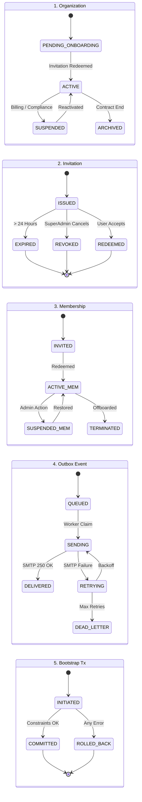
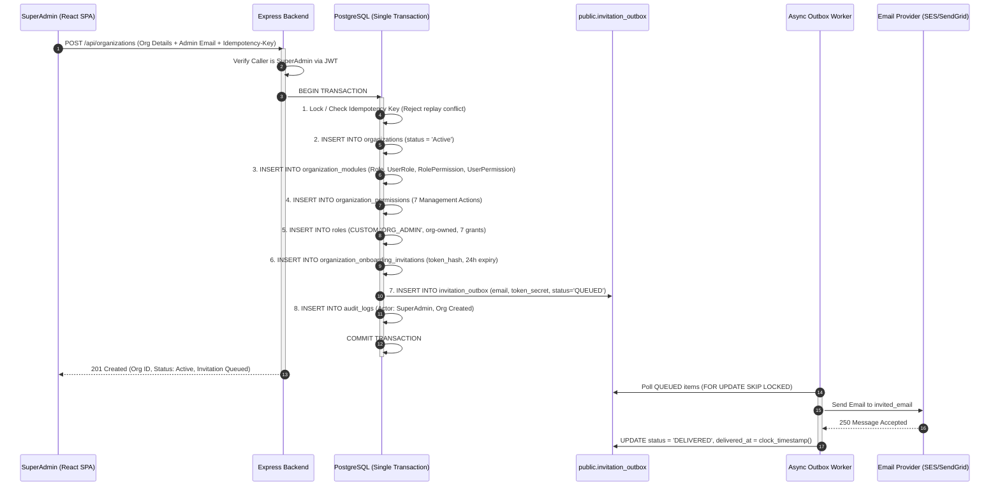

# PayPulse Phase 2.2 — Organization Bootstrap, Invitation Lifecycle, and Outbox Pattern

**Status:** Implementation-Ready Architecture Specification  
**Date:** 2026-11-22  
**System:** PayPulse (JK Payroll) — Onboarding and Provisioning Architecture  
**Document Reference:** `PAYPULSE_PHASE_2_2_ORGANIZATION_BOOTSTRAP_AND_INVITATION.md`  

---

## 1. Executive Summary

In early implementations of PayPulse (`20261121000018_superadmin_onboarding_invitations.sql`), organization onboarding was executed via a single `SECURITY DEFINER` function callable only by `service_role`. That legacy routine suffered from three critical architectural flaws:
1. **System Role Misassignment:** It assigned the global `SYSTEM TENANT_ADMIN` role (`r.role_type = 'SYSTEM' AND r.organization_id IS NULL`), directly violating the core architectural invariant that tenant roles must be tenant-owned `CUSTOM` roles.
2. **Un-normalized Module Grants:** It stored enabled modules as a JSONB array on `organizations.modules` rather than inserting into `public.organization_modules` and `public.organization_permissions`.
3. **External Email / Transaction Coupling:** External email sending was either tightly coupled to database execution or assumed to succeed, risking orphaned invitations or database rollbacks caused by external SMTP delivery latency.

Phase 2.2 establishes a complete, implementation-ready specification for the **First-Manager Lifecycle**, resolving all 12 operational lifecycle questions, defining 5 rigorous state machines, and separating database transaction completion from asynchronous notification delivery using the **Transactional Outbox Pattern**.

---

## 2. Resolution of the 12 First-Manager Lifecycle Questions

### Q1: Does the first manager already need an existing Supabase Auth account?
**Resolution:** **NO.** In enterprise SaaS, the organization is frequently bootstrapped by a platform sales representative or SuperAdmin before the designated tenant administrator has registered on the platform. The platform issues an onboarding invitation bound to an email address; the manager registers their Supabase Auth account during invitation acceptance.

### Q2: What happens when the invited manager has not registered?
**Resolution:** The organization is created in state `PENDING` (or `ACTIVE` under pre-provisioned contract rules, but with membership in state `INVITED`). An onboarding invitation record is generated in `public.organization_onboarding_invitations`, and an email dispatch event is queued in `public.invitation_outbox`. No `profiles` or `user_roles` records are created for the unauthenticated user until redemption.

### Q3: When is the organization created?
**Resolution:** The organization record is created **at the instant of the SuperAdmin bootstrap transaction**. It receives a permanent UUID, legal name, tax ID, sector, tier, and canonical slug.

### Q4: When does the organization become ACTIVE?
**Resolution:** Under PayPulse enterprise policy, the organization becomes `status = 'ACTIVE'` **immediately upon transaction commit** so that contractual start dates, licensed modules, and statutory settings are officially anchored. However, business access remains completely dormant because zero users hold active memberships until invitation acceptance.

### Q5: Can a pending organization exist without an active manager?
**Resolution:** **YES, during the 24-hour onboarding window.** A newly provisioned organization with an unredeemed invitation has zero active members. This temporary, controlled state is fully supported by the schema. The Last-Administrator Invariant is enforced only once the first administrator accepts their invitation and activates membership.

### Q6: When does membership become active?
**Resolution:** Membership becomes `is_active = true` **atomically within the invitation redemption transaction**. When the invited manager authenticates with Supabase Auth (or provides a newly confirmed account), the system verifies the token hash, matches the invited email, creates their `profiles` row, creates `organization_members(is_active = true)`, assigns the `ORG_ADMIN` custom role in `user_roles`, initializes `user_permission_settings('ROLE')`, and marks the invitation `redeemed_at = clock_timestamp()`.

### Q7: How is an invitation securely linked to the eventual authenticated user?
**Resolution:** Cryptographic token binding:
1. The backend generates a 256-bit high-entropy secret (`token_secret`), computes `token_hash = sha256(token_secret)`, and stores `token_hash` in `organization_onboarding_invitations`.
2. The invitation email delivers a link: `https://app.paypulse.com/onboard?token=<token_secret>`.
3. Upon acceptance, the user logs in or registers via Supabase Auth. The client sends `token_secret` and user Bearer JWT to the redemption endpoint.
4. The database computes `sha256(token_secret)`, locks the invitation row, and verifies:
   - `lower(auth.users.email) == lower(invitation.invited_email)`.
5. This guarantees that user UUID $B$ cannot redeem an invitation issued to user $A$, even if $B$ intercepts the token string.

### Q8: How are expired and revoked invitations handled?
**Resolution:**
- **Expiration:** Invitations carry `expires_at = created_at + INTERVAL '24 hours'`. The redemption RPC rejects expired links with error code `42501 (Onboarding invitation has expired)`.
- **Revocation:** A platform SuperAdmin may revoke an outstanding invitation at any time. When revoked, `revoked_at` is set, and any attempt to redeem triggers immediate rejection. Expired/revoked invitations leave the organization clean; a new invitation can be issued to a replacement email.

### Q9: How is invitation replay prevented?
**Resolution:** The invitation record enforces `chk_onboarding_invitation_redemption` and updates `redeemed_at = clock_timestamp(), redeemed_by = auth.uid()` under an exclusive row lock (`SELECT ... FOR UPDATE`). Subsequent redemption attempts observe `redeemed_at IS NOT NULL` and abort with `42501 (Invitation already redeemed)`.

### Q10: How does the system recover if email delivery fails?
**Resolution:** Decoupled Outbox Architecture. The database transaction writes to `public.invitation_outbox(status = 'QUEUED')`. An asynchronous worker picks up queued events and transmits them via SendGrid/SES. If SMTP delivery times out or fails:
- The database transaction remains 100% committed.
- The outbox worker increments `retry_count` and applies exponential backoff.
- The SuperAdmin UI displays "Email Delivery Pending / Failed" with a "Resend Invitation" button that resets the outbox item without duplicating database entities.

### Q11: What happens if the invitation is accepted twice concurrently?
**Resolution:** Row-level locking. The redemption RPC executes `SELECT * FROM organization_onboarding_invitations WHERE token_hash = ... FOR UPDATE`. The first transaction acquires the lock and marks `redeemed_at`. The second transaction waits for lock release, re-evaluates `redeemed_at`, detects prior completion, and returns the existing result idempotently if called by the same user, or aborts if called by another.

### Q12: What happens if the initial manager account is deactivated before invitation acceptance?
**Resolution:** If an Auth user was pre-registered but subsequently banned or deactivated in `profiles.is_active = false`, the redemption RPC checks `profiles.is_active`. If inactive, redemption is rejected with `403 Forbidden: Inactive user account`.

---

## 3. Five Authoritative Lifecycle State Machines



---

## 4. The Transactional Onboarding Architecture



---

## 5. Idempotency Specification

Network retries and double-clicks must not create duplicate organizations or conflicting invitation records.

### Idempotency Contract:
1. **Idempotency Key:** Client provides `Idempotency-Key: <UUID_v4>` in HTTP headers.
2. **Persistence Table:**
   ```sql
   CREATE TABLE public.idempotency_records (
       key TEXT PRIMARY KEY,
       actor_id UUID NOT NULL REFERENCES auth.users(id),
       organization_id UUID REFERENCES public.organizations(id),
       request_path TEXT NOT NULL,
       payload_hash TEXT NOT NULL,
       response_code INTEGER,
       response_payload JSONB,
       created_at TIMESTAMPTZ NOT NULL DEFAULT clock_timestamp()
   );
   ```
3. **Execution Semantics:**
   - **New Key:** Transaction inserts key, processes provisioning, caches response payload, and commits.
   - **Identical Replay (Same key + Same payload_hash):** Transaction observes existing record and returns cached `response_payload` with HTTP status `200 OK` (Zero duplicate records written).
   - **Mismatched Replay (Same key + Different payload_hash):** Transaction immediately aborts with `409 Conflict: Idempotency payload mismatch`.
   - **Failed Transaction:** If database constraints fail, the transaction rolls back completely; the idempotency key is NOT committed, permitting clean subsequent retries.

---

## 6. Implementation Specification for Onboarding RPC

The replacement for legacy migration 18/19 routines is specified below, establishing normalized entitlements and an organization-owned `CUSTOM` role:

```sql
CREATE OR REPLACE FUNCTION public.provision_organization_bootstrap(
    p_organization_name TEXT,
    p_organization_code TEXT,
    p_invited_email TEXT,
    p_token_hash TEXT,
    p_idempotency_key TEXT,
    p_payload_hash TEXT,
    p_department_name TEXT DEFAULT 'Human Resources',
    p_department_code TEXT DEFAULT 'HR'
)
RETURNS TABLE (organization_id UUID, role_id UUID, invitation_id UUID)
LANGUAGE plpgsql
SECURITY DEFINER
SET search_path = public, pg_temp
AS $$
DECLARE
    v_actor_id UUID := auth.uid();
    v_org_id UUID;
    v_dept_id UUID;
    v_role_id UUID;
    v_inv_id UUID;
    v_mod RECORD;
    v_act RECORD;
BEGIN
    -- 1. Assert Caller is Platform SuperAdmin
    IF v_actor_id IS NULL OR NOT public.is_super_admin() THEN
        RAISE EXCEPTION 'Only active SuperAdmins may provision new organizations'
            USING ERRCODE = '42501';
    END IF;

    -- 2. Idempotency Check
    IF EXISTS (
        SELECT 1 FROM public.idempotency_records
        WHERE key = p_idempotency_key AND payload_hash <> p_payload_hash
    ) THEN
        RAISE EXCEPTION 'Idempotency conflict: payload does not match prior submission'
            USING ERRCODE = '40001';
    END IF;

    -- 3. Create Organization
    INSERT INTO public.organizations (
        name, code, slug, status, is_active, created_by
    ) VALUES (
        trim(p_organization_name),
        upper(trim(p_organization_code)),
        lower(regexp_replace(trim(p_organization_code), '[^a-zA-Z0-9]+', '-', 'g')),
        'Active',
        true,
        v_actor_id
    ) RETURNING id INTO v_org_id;

    -- 4. Create Initial Department
    INSERT INTO public.departments (
        organization_id, code, name, created_by
    ) VALUES (
        v_org_id, upper(trim(p_department_code)), trim(p_department_name), v_actor_id
    ) RETURNING id INTO v_dept_id;

    -- 5. Allocate Mandatory Management Modules
    FOR v_mod IN SELECT id FROM public.modules WHERE code IN ('Role', 'UserRole', 'RolePermission', 'UserPermission') LOOP
        INSERT INTO public.organization_modules (organization_id, module_id, is_active)
        VALUES (v_org_id, v_mod.id, true);
    END LOOP;

    -- 6. Entitle the 7 Canonical Management Permissions
    FOR v_act IN 
        SELECT ma.id, ma.module_id 
        FROM public.module_actions ma 
        WHERE ma.full_key IN (
            'Role.View','Role.Add','Role.Edit','Role.Delete',
            'RolePermission.Edit','UserRole.Edit','UserPermission.Edit'
        )
    LOOP
        INSERT INTO public.organization_permissions (
            organization_id, module_id, module_action_id, created_at, created_by
        ) VALUES (
            v_org_id, v_act.module_id, v_act.id, clock_timestamp(), v_actor_id
        );
    END LOOP;

    -- 7. Create Organization-Owned CUSTOM Manager Role
    INSERT INTO public.roles (
        organization_id, name, code, description, role_type, is_active, created_by
    ) VALUES (
        v_org_id, 'Organization Administrator', 'ORG_ADMIN', 'Primary Organization Management Role', 'CUSTOM', true, v_actor_id
    ) RETURNING id INTO v_role_id;

    -- 8. Assign Management Permissions to Manager Role
    FOR v_act IN 
        SELECT id FROM public.module_actions 
        WHERE full_key IN (
            'Role.View','Role.Add','Role.Edit','Role.Delete',
            'RolePermission.Edit','UserRole.Edit','UserPermission.Edit'
        )
    LOOP
        INSERT INTO public.role_permissions (organization_id, role_id, module_action_id)
        VALUES (v_org_id, v_role_id, v_act.id);
    END LOOP;

    -- 9. Create 24-Hour Onboarding Invitation
    INSERT INTO public.organization_onboarding_invitations (
        organization_id, invited_email, token_hash, created_by, expires_at
    ) VALUES (
        v_org_id, lower(trim(p_invited_email)), p_token_hash, v_actor_id, clock_timestamp() + INTERVAL '24 hours'
    ) RETURNING id INTO v_inv_id;

    -- 10. Record Idempotency
    INSERT INTO public.idempotency_records (
        key, actor_id, organization_id, request_path, payload_hash, response_code, response_payload
    ) VALUES (
        p_idempotency_key, v_actor_id, v_org_id, '/api/organizations', p_payload_hash, 201,
        jsonb_build_object('organization_id', v_org_id, 'role_id', v_role_id, 'invitation_id', v_inv_id)
    );

    -- 11. Transactional Audit Log
    INSERT INTO public.audit_logs (
        organization_id, actor_id, actor_name, actor_role_name, module_id, entity_type, entity_id, action,
        new_values, created_at
    ) VALUES (
        v_org_id, v_actor_id, 'Platform SuperAdmin', 'SUPER_ADMIN', 'ORGANIZATION', 'organizations', v_org_id::text, 'CREATE',
        jsonb_build_object('name', p_organization_name, 'code', p_organization_code, 'invited_email', p_invited_email),
        clock_timestamp()
    );

    RETURN QUERY SELECT v_org_id, v_role_id, v_inv_id;
END;
$$;

REVOKE ALL ON FUNCTION public.provision_organization_bootstrap(TEXT, TEXT, TEXT, TEXT, TEXT, TEXT, TEXT, TEXT) FROM PUBLIC, anon;
GRANT EXECUTE ON FUNCTION public.provision_organization_bootstrap(TEXT, TEXT, TEXT, TEXT, TEXT, TEXT, TEXT, TEXT) TO authenticated;
```

This closes the Organization Bootstrap and Invitation Lifecycle specification.
