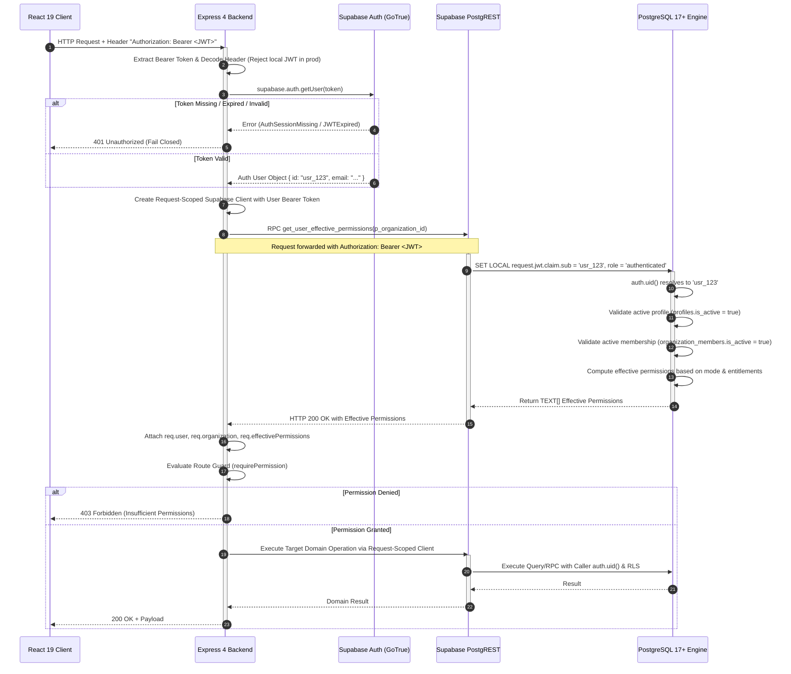

# PayPulse Phase 2.2 — Trusted Actor Context and Function Security Specification

**Status:** Implementation-Ready Architecture Specification (Read-Only Review)  
**Date:** 2026-11-22  
**System:** PayPulse (JK Payroll) — Backend & PostgreSQL Security Architecture  
**Document Reference:** `PAYPULSE_PHASE_2_2_TRUSTED_ACTOR_AND_FUNCTION_SECURITY.md`  

---

## 1. Executive Summary & Problem Statement

In the existing PayPulse implementation, `src/server/middleware/auth.middleware.ts` validates incoming bearer tokens using Supabase Auth, but subsequently performs user profile lookups and executes authorization RPCs (such as `get_user_effective_permissions`, `create_organization_onboarding_invitation`, and `provision_organization_from_onboarding_invitation`) using a singleton Supabase client configured with `ENV.SUPABASE_SERVICE_ROLE_KEY`.

### The Vulnerability: Confused Deputy via Service-Role Impersonation
1. **RLS Bypass:** `service_role` possesses the `BYPASSRLS` capability in PostgreSQL. Any query or table modification executed by this role completely circumvents row-level security policies.
2. **Untrusted Identity Parameters:** PostgreSQL functions executed under `service_role` cannot establish whether an arbitrary `p_user_id` or `p_actor_id` parameter was submitted by the true authenticated caller, an attacker manipulating JSON payloads, or a vulnerable backend controller.
3. **Privilege Escalation:** If an endpoint inadvertently forwards an untrusted user identifier, or if a backend developer writes an administrative query without strict tenancy checks, cross-tenant data leakage or horizontal privilege escalation immediately occurs.

### The Architectural Resolution
Phase 2.2 permanently closes this architectural vulnerability by establishing a **Request-Scoped Caller-JWT Trust Boundary**. All user-initiated reads and mutations must reach PostgREST carrying the original, verified Supabase Bearer JWT. In PostgreSQL, the actor is derived strictly from `auth.uid()`. Service-role access is strictly prohibited from executing human-facing authorization RPCs.

---

## 2. Trusted Actor End-to-End Execution Flow

The sequence below outlines the exact lifecycle of an authenticated HTTP request from the client browser to PostgreSQL:



### Detailed Stage Breakdown:

1. **Client Submission:** The browser sends `Authorization: Bearer <supabase_access_token>`.
2. **Express Token Inspection:**
   - In production (`NODE_ENV === 'production'`), Express immediately rejects any token whose issuer (`iss`) matches local development issuers (`ENV.JWT_ISSUER`), terminating requests with `401 Unauthorized`.
   - Express validates token presence and calls `supabase.auth.getUser(token)` against Supabase Auth.
3. **Request-Scoped Client Initialization:**
   - Express constructs a dedicated, request-isolated Supabase client instance using `ENV.SUPABASE_ANON_KEY` and passes the caller's verified bearer token in the `global.headers` configuration:
     ```typescript
     export function createRequestScopedClient(token: string): SupabaseClient {
       return createClient(ENV.SUPABASE_URL, ENV.SUPABASE_ANON_KEY, {
         auth: {
           autoRefreshToken: false,
           persistSession: false,
         },
         global: {
           headers: {
             Authorization: `Bearer ${token}`,
           },
         },
       });
     }
     ```
   - **Isolation Guarantee:** Creating a fresh client or using an immutable request wrapper ensures that concurrent HTTP requests executing on the Node.js event loop cannot leak `Authorization` headers across asynchronous continuations. The global singleton `getSupabaseClient()` is NEVER used for caller operations.
4. **PostgREST Context Propagation:**
   - When PostgREST receives the request, it verifies the JWT signature using the shared project secret or public JWKS.
   - PostgREST switches PostgreSQL session context to `role = 'authenticated'` and sets transaction-local GUCs: `request.jwt.claims` containing `sub`, `email`, and `role`.
5. **Database Actor Derivation:**
   - In PostgreSQL, `auth.uid()` evaluates directly to `(current_setting('request.jwt.claims', true)::jsonb ->> 'sub')::uuid`.
   - The database engine now possesses cryptographic proof of the caller's identity. Any user ID passed as an argument (`p_user_id`) is either ignored or strictly validated against `auth.uid()`.
6. **Active Profile and Membership Validation:**
   - Database functions independently verify:
     - `profiles.is_active = true` for `auth.uid()`.
     - `organizations.status = 'Active'` and `(end_date IS NULL OR end_date >= clock_timestamp())`.
     - `organization_members.is_active = true` for `(p_organization_id, auth.uid())`.
   - If any predicate fails, the function fails closed and returns empty sets or throws `42501 Insufficient Privilege`.
7. **Failure Handling (Strict Fail-Closed):**
   - If PostgREST returns an error, the database connection times out, or the caller's JWT is expired, Express immediately responds with `401 Unauthorized` or `403 Forbidden`.
   - **Prohibition:** Express is explicitly prohibited from retrying failed authorization RPCs using the service-role client.

---

## 3. Workload Identity Model for Background & Scheduled Jobs

Background tasks (e.g., cron jobs, billing cycles, payroll computation dispatchers) operate without a human HTTP caller. They must not impersonate arbitrary user accounts or run as unconstrained superusers.

### Workload Identity Architecture:
1. **Distinct Actor Type:** `public.audit_logs` recognizes `actor_type = 'SYSTEM'`.
2. **Dedicated Workload Database Role:** Background tasks connect to PostgreSQL using a dedicated non-superuser role (e.g., `payroll_workload_worker`) with:
   - `LOGIN` enabled (via mutual TLS or secret credentials stored in secrets management).
   - `BYPASSRLS` explicitly **DISABLED**.
   - Direct DML revoked on authorization and audit tables.
   - Explicit `EXECUTE` grants restricted only to specific worker RPCs (e.g., `process_scheduled_payroll_run(p_run_id)`).
3. **Deterministic Actor Identification:** In worker audit records, `actor_id` is set to `NULL` or a designated system UUID (`00000000-0000-0000-0000-000000000000`), with `actor_name = 'PayPulse System Worker'` and `actor_type = 'SYSTEM'`.

---

## 4. PostgreSQL Database Privilege Matrix

To enforce least-privilege boundaries and prevent data tampering via direct Data API access, privileges across all operational roles must adhere to the following specification:

| Database Role | Direct SELECT | Direct INSERT | Direct UPDATE | Direct DELETE | TRUNCATE | RPC EXECUTE (Human Mutations) | RPC EXECUTE (Resolver Reads) | RLS Behavior | Intended Operational Use |
|---|---|---|---|---|---|---|---|---|---|
| **`anon`** | None (Revoked on all business tables) | None | None | None | Revoked | None | None | Enforced (All denied) | Unauthenticated public endpoints (Health check, login landing). |
| **`authenticated`** | Tenant-scoped via RLS (Own organization data only) | Restricted (Business entities via RLS; Revoked on RBAC/Audit) | Restricted (Business entities via RLS; Revoked on RBAC/Audit) | Revoked on all authorization & audit tables | Revoked | Explicitly Granted on narrow audited mutation RPCs | Explicitly Granted (`get_user_effective_permissions`) | Enforced strictly. Bounded by active membership. | Ordinary application users operating via React SPA. |
| **`service_role`** | Unrestricted (Administrative backend only) | Revoked on Auth Mutation tables (Must use bootstrap RPC) | Revoked on Auth Mutation tables | Revoked on Auth Mutation tables & Audit | Revoked | **REVOKED** on human mutation RPCs | Granted (For initial server startup cache warm only) | Bypasses RLS (PostgreSQL default) | Platform infrastructure, provisioning orchestration, batch migration scripts. |
| **`function_owner` (Least-Privilege Non-Login)** | Granted on targeted schema tables | Granted on audited tables | Granted on audited tables | Revoked on audit logs | Revoked | N/A (Defines functions) | N/A | Subject to RLS unless `SECURITY DEFINER` | Dedicated security principal owning RPCs. Never granted superuser. |
| **`workload_worker`** | Granted on transactional domain tables | Granted on payroll output tables | Granted on payroll run status | Revoked | Revoked | Granted on dedicated background RPCs | Granted | Enforced (Bypasses RLS only if explicitly granted tenant view) | Scheduled batch workers and asynchronous outbox consumers. |
| **`postgres` (Superuser / DB Owner)** | Full | Full | Full | Full | Full | Full | Full | Bypasses RLS | Database migrations, schema DDL, disaster recovery operations only. |

### Critical Direct-DML Lockdown Rule:
Direct `INSERT`, `UPDATE`, and `DELETE` on the following tables must be **REVOKED** from `authenticated`:
- `public.modules`
- `public.module_actions`
- `public.organization_modules`
- `public.organization_permissions`
- `public.roles`
- `public.role_permissions`
- `public.user_roles`
- `public.user_permission_settings`
- `public.user_permission_assignments`
- `public.audit_logs`

All mutations to authorization state MUST occur via atomic, audited PostgreSQL RPCs.

---

## 5. Security Definer vs. RLS Analysis & Standard

The interaction between PostgreSQL security mechanisms requires precise understanding:
1. **SECURITY DEFINER:** Functions execute with the privileges of the function owner, not the calling role.
2. **Function Ownership & Superuser:** If a `SECURITY DEFINER` function is owned by `postgres` (a superuser), it automatically inherits `BYPASSRLS`. RLS policies on underlying tables are completely ignored.
3. **FORCE ROW LEVEL SECURITY:** `ALTER TABLE ... FORCE ROW LEVEL SECURITY` ensures that table owners are subject to RLS. However, PostgreSQL superusers and roles with the `BYPASSRLS` attribute **still bypass forced RLS**.
4. **Execution ACLs:** Granting `EXECUTE ON FUNCTION` to `PUBLIC` allows any database role (including `anon`) to call the routine.

### The PayPulse Function Security Standard:
Every database function in PayPulse must conform to these mandatory rules:
1. **Explicit Schema Qualification:** Every table, view, type, and function reference must be schema-qualified (e.g. `public.organizations`, `auth.uid()`).
2. **Hardened Search Path:** Every function must declare `SET search_path = public, pg_temp` (with `pg_temp` last) to prevent search-path hijacking attacks.
3. **No Caller Actor Parameters:** Functions must derive the executing actor exclusively from `auth.uid()`. Parameter signatures such as `p_actor_id UUID` are prohibited for user-facing RPCs.
4. **Revoke PUBLIC Execution:** Every function must explicitly execute `REVOKE ALL ON FUNCTION ... FROM PUBLIC, anon;`.
5. **Least-Privilege Ownership:** Functions should be owned by a dedicated schema-owner role that does not possess `SUPERUSER` or `BYPASSRLS`. Where functions must perform elevated operations (e.g., writing to `audit_logs`), access must be fenced by internal assertion of `auth.uid()`.

---

## 6. Comprehensive Inventory of Existing Database Functions

A complete audit of all 26 database functions across migrations 1 through 20261121153500 is documented below:

| # | Function Signature | Migration Source | Security Mode | Declared Search Path | Granted Roles | Caller Actor Trusted? | Potential Tenant Bypass? | Required Remediation in Phase 3 |
|---|---|---|---|---|---|---|---|---|
| 1 | `fn_sync_department_hierarchy()` | 20261104000001 | INVOKER | Default (Unset) | Trigger | N/A (Trigger) | Low | Set `search_path = public, pg_temp`. |
| 2 | `current_user_organization_id()` | 20261121000014 | DEFINER | `public, pg_temp` | `authenticated` | Uses `auth.uid()` | No | Retain as helper. |
| 3 | `is_super_admin()` | 20261121000013 | DEFINER | `public, pg_temp` | `authenticated` | Uses `auth.uid()` | No | Retain. Validates `profiles.is_super_admin`. |
| 4 | `is_organization_admin(UUID)` | 20261121000014 | DEFINER | `public, pg_temp` | `authenticated` | Uses `auth.uid()` | Medium | Legacy check; references `is_organization_admin` and `is_owner`. Replace with canonical admin predicate in Phase 3. |
| 5 | `is_organization_member(UUID)` | 20261121000013 | DEFINER | `public, pg_temp` | `authenticated` | Uses `auth.uid()` | No | Retain. Checks `organization_members.is_active`. |
| 6 | `get_sub_department_ids(UUID, UUID)` | 20261104000002 | DEFINER | `public, pg_temp` | `authenticated` | Caller parameters | Low | Convert to `SECURITY INVOKER`. |
| 7 | `get_ancestor_department_ids(UUID, UUID)` | 20261104000002 | DEFINER | `public, pg_temp` | `authenticated` | Caller parameters | Low | Convert to `SECURITY INVOKER`. |
| 8 | `get_user_effective_permissions(UUID, UUID)` | 20261121000014 | DEFINER | `public, pg_temp` | `service_role` ONLY | Checks `auth.uid()` defense-in-depth | High | **CRITICAL:** Granted only to `service_role`. Must grant to `authenticated` and enforce `p_user_id = auth.uid()`. Remove `department_modules` and implicit `.View` expansion. |
| 9 | `custom_access_token_hook(JSONB)` | 20261121000014 | DEFINER | `public, pg_temp` | `supabase_auth_admin` | Supabase GoTrue hook | Low | Retain; non-callable by users. |
| 10 | `record_audit_log()` | 20261119000011 | DEFINER | `public, pg_temp` | Trigger | Trusts GUCs / JWT | Medium | Trigger function. Trusts `app.current_actor_id` GUC. Harden to rely on `auth.uid()` and explicit RPCs. |
| 11 | `enforce_audit_log_immutability()` | 20261119000011 | DEFINER | `public, pg_temp` | Trigger | Trigger | No | Retain. Blocks UPDATE/DELETE on `audit_logs`. |
| 12 | `fn_sync_organization_active_status()` | 20261121000013 | DEFINER | `public, pg_temp` | Trigger | Trigger | No | Retain. |
| 13 | `safe_cast_uuid(TEXT)` | 20261121000013 | INVOKER | `public, pg_temp` | `PUBLIC` | Pure utility | No | Retain immutable utility. |
| 14 | `fn_enforce_profile_security_fields()` | 20261121000014 | DEFINER | `public, pg_temp` | Trigger | Trigger | No | Retain. Protects `is_super_admin` against non-superadmin updates. |
| 15 | `fn_protect_profile_audit_fields()` | 20261121000017 | DEFINER | `public, pg_temp` | Trigger | Trigger | No | Retain. Protects audit attribution columns. |
| 16 | `create_organization_onboarding_invitation(UUID, TEXT, TEXT)` | 20261121000018 | DEFINER | `public, pg_temp` | `service_role` ONLY | **VULNERABLE:** Trusts `p_actor_id` | **HIGH** | Accepts `p_actor_id`. Replace with `create_onboarding_invitation()` using `auth.uid()`. Revoke service_role execution. |
| 17 | `provision_organization_from_onboarding_invitation(TEXT, UUID, JSONB, TEXT, TEXT)` | 20261121000018 | DEFINER | `public, pg_temp` | `service_role` ONLY | Trusts `p_user_id` | **HIGH** | Assigns `SYSTEM TENANT_ADMIN` role and JSONB modules. Replace with atomic CUSTOM manager role & normalized entitlements. |
| 18 | `is_active_org_admin_for_user(UUID, UUID)` | 20261121000019 | DEFINER | `public, pg_temp` | Internal | Trusts `p_user_id` | Medium | Checks legacy `is_owner`, `profiles.is_organization_admin`. Replace with canonical predicate. |
| 19 | `create_organization_member_invitation(UUID, UUID, TEXT, UUID, UUID, TEXT)` | 20261121000019 | DEFINER | `public, pg_temp` | `service_role` ONLY | Trusts `p_actor_id` | **HIGH** | Trusts `p_actor_id`. Replace with caller-JWT RPC using `auth.uid()`. |
| 20 | `provision_organization_member_from_invitation(TEXT, UUID, TEXT)` | 20261121000019 | DEFINER | `public, pg_temp` | `service_role` ONLY | Trusts `p_user_id` | Medium | Harden with caller-JWT integration. |
| 21 | `reject_superadmin_role_assignment()` | 20261121000020 | DEFINER | `public, pg_temp` | Trigger | Trigger | No | Retain. Blocks assignment of `SUPER_ADMIN` role code. |
| 22 | `reject_superadmin_role_code_with_assignments()` | 20261121000020 | DEFINER | `public, pg_temp` | Trigger | Trigger | No | Retain. Blocks renaming assigned roles to `SUPER_ADMIN`. |
| 23 | `normalize_organization_role_code(TEXT)` | 20261121153500 | IMMUTABLE | `pg_catalog, public, pg_temp` | `PUBLIC` | Pure utility | No | Retain. |
| 24 | `is_assignable_organization_role(UUID, UUID)` | 20261121153500 | DEFINER | `pg_catalog, public, pg_temp` | Internal | Checks role scope | Low | Retain. Ensures role is CUSTOM and owned by target organization. |
| 25 | `is_existing_trusted_tenant_admin_user_role(UUID, UUID, UUID)` | 20261121153500 | DEFINER | `pg_catalog, public, pg_temp` | Internal | Legacy check | Medium | Compatibility helper for migration 18 records. Deprecate in Phase 3. |
| 26 | `enforce_organization_role_assignment()` | 20261121153500 | DEFINER | `pg_catalog, public, auth, pg_temp` | Trigger | Checks `auth.role()` | Medium | Allows `service_role` to assign `SYSTEM TENANT_ADMIN`. Update to enforce CUSTOM manager roles exclusively. |

---

## 7. Implementation-Ready Function Remediation Specifications

### Remediation A: Hardening `get_user_effective_permissions`
The canonical permission resolver must be updated to execute under `SECURITY DEFINER` (or `SECURITY INVOKER` if read policies allow), grant `EXECUTE` to `authenticated`, derive user identity strictly from `auth.uid()`, eliminate `department_modules` gating, and eliminate implicit `.View` expansion:

```sql
CREATE OR REPLACE FUNCTION public.get_user_effective_permissions(
    p_organization_id UUID
)
RETURNS TEXT[]
LANGUAGE plpgsql
STABLE
SECURITY DEFINER
SET search_path = public, pg_temp
AS $$
DECLARE
    v_user_id UUID := auth.uid();
    v_mode TEXT;
    v_effective_keys TEXT[];
BEGIN
    -- 1. Strict Actor Check: Caller must be an authenticated Supabase user
    IF v_user_id IS NULL OR p_organization_id IS NULL THEN
        RETURN ARRAY[]::TEXT[];
    END IF;

    -- 2. Verify Active Organization, Profile, and Membership
    IF NOT EXISTS (
        SELECT 1
        FROM public.organizations o
        JOIN public.organization_members om ON om.organization_id = o.id
        JOIN public.profiles p ON p.id = om.user_id
        WHERE o.id = p_organization_id
          AND o.status = 'Active'
          AND (o.end_date IS NULL OR o.end_date >= clock_timestamp())
          AND om.user_id = v_user_id
          AND om.is_active = true
          AND p.is_active = true
    ) THEN
        RETURN ARRAY[]::TEXT[];
    END IF;

    -- 3. Resolve Permission Mode (Fail closed if missing)
    SELECT ups.permission_mode INTO v_mode
    FROM public.user_permission_settings ups
    WHERE ups.organization_id = p_organization_id
      AND ups.user_id = v_user_id;

    IF v_mode IS NULL THEN
        RETURN ARRAY[]::TEXT[];
    END IF;

    -- 4. Resolve Candidate Permissions according to Mode
    IF v_mode = 'ROLE' THEN
        SELECT COALESCE(array_agg(DISTINCT ma.full_key), ARRAY[]::TEXT[])
        INTO v_effective_keys
        FROM public.user_roles ur
        JOIN public.roles r ON r.id = ur.role_id
        JOIN public.role_permissions rp ON rp.role_id = r.id AND rp.organization_id = p_organization_id
        JOIN public.module_actions ma ON ma.id = rp.module_action_id
        JOIN public.organization_permissions op ON op.organization_id = p_organization_id AND op.module_action_id = ma.id
        JOIN public.organization_modules om ON om.organization_id = p_organization_id AND om.module_id = ma.module_id
        WHERE ur.organization_id = p_organization_id
          AND ur.user_id = v_user_id
          AND r.organization_id = p_organization_id
          AND r.role_type = 'CUSTOM'
          AND r.is_active = true
          AND om.is_active = true;

    ELSIF v_mode = 'USER_CUSTOM' THEN
        SELECT COALESCE(array_agg(DISTINCT ma.full_key), ARRAY[]::TEXT[])
        INTO v_effective_keys
        FROM public.user_permission_assignments upa
        JOIN public.module_actions ma ON ma.id = upa.module_action_id
        JOIN public.organization_permissions op ON op.organization_id = p_organization_id AND op.module_action_id = ma.id
        JOIN public.organization_modules om ON om.organization_id = p_organization_id AND om.module_id = ma.module_id
        WHERE upa.organization_id = p_organization_id
          AND upa.user_id = v_user_id
          AND om.is_active = true;
    ELSE
        RETURN ARRAY[]::TEXT[];
    END IF;

    RETURN v_effective_keys;
END;
$$;

REVOKE ALL ON FUNCTION public.get_user_effective_permissions(UUID) FROM PUBLIC, anon;
GRANT EXECUTE ON FUNCTION public.get_user_effective_permissions(UUID) TO authenticated, service_role;
```

---

## 8. Summary of Phase 2.2 Security Closure Decisions

1. **Service-Role Elimination:** Singleton service-role client usage for user authorization queries is permanently decommissioned.
2. **Caller JWT Forwarding:** Express must instantiate request-scoped clients forwarding `Authorization: Bearer <JWT>`.
3. **Database Trust Boundary:** `auth.uid()` is established as the sole database-level authority for human actors.
4. **Direct DML Lockdown:** All direct DML against authorization tables is revoked from `authenticated`. Mutations must pass through audited, atomic RPCs.
5. **No Service-Role Fallback:** If an authorization RPC fails, Express must fail closed with `401` or `403`.
