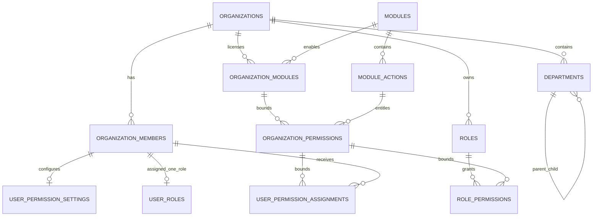

# PayPulse Phase 2 — Final Database Architecture and Migration Specification

**Status:** Design specification only; not implemented or deployed  
**Date:** 2026-11-22 (Asia/Manila)  
**Scope:** Organization-scoped authorization schema, security, migration, and PostgreSQL verification plan

> This document consolidates the nine Phase 2 design deliverables into one review artifact. It does not create or apply migrations, execute database writes, or assert deployed-state verification. The repository contains pre-existing modified and untracked files; none were changed for this document.

## 1. Executive architecture summary

Use the existing `public.modules` and `public.module_actions` as the sole module and permission catalogs. Keep `public.organization_modules` as organization module licensing and add normalized `public.organization_permissions` to entitle individual actions. Organization roles grant subsets of those entitlements. A membership uses exactly one mode: `ROLE` or `USER_CUSTOM`; custom mode completely replaces role grants. All effective grants are intersected with current organization entitlements.

Active organization membership is required for business access. `public.user_roles` is the canonical organization role assignment source and must enforce one assignment per `(organization_id,user_id)`. Organization roles are tenant-owned `CUSTOM` roles; global `SYSTEM` roles cannot be assigned via the organization role path. `organization_members.role_id`, `profiles.is_organization_admin`, and `profiles.organization_id` cease being authorization sources after a reviewed transition. `organization_members.is_owner` remains lifecycle metadata, not a permission bypass.

`profiles.is_super_admin` remains the trusted platform authority source for platform entitlement management. Platform authority does not confer organization business permissions. `department_modules` is excluded from permission resolution, while department/resource data scoping remains intact.

## 2. Entity relationship diagram

Audit events use the existing audit system, whose deployed schema and triggers require inventory before implementation.

## 3. Exact target table and relationship specification

Names below are the target names. Existing objects are retained where noted; do not create replacement catalogs. This is a logical/DDL specification, not runnable SQL: first inspect the actual PostgreSQL definitions, deployed migration ledger, current data, and existing indexes.

### Catalog and entitlement tables

| Table | Target fields / constraints / relationships |
|---|---|
| `public.modules` | Retain canonical catalog. `id` primary key; `code` globally unique and non-null. No duplicate catalog. |
| `public.module_actions` | Retain canonical permission catalog. `id` primary key; `module_id` non-null FK to `modules`; `action`, `full_key` non-null; `UNIQUE(module_id,action)`; `UNIQUE(full_key)`. Composite key `(module_id,id)` supports integrity FKs. Each permission belongs to exactly one module. |
| `public.organization_modules` | Retain. Unique/primary key `(organization_id,module_id)`; both FKs; `is_active NOT NULL`; timestamps/actor metadata follow existing conventions. This row means the module is enabled only when active. |
| `public.organization_permissions` | New. `organization_id UUID NOT NULL`, `module_id UUID NOT NULL`, `module_action_id UUID NOT NULL`, `created_at TIMESTAMPTZ NOT NULL`, `created_by UUID`. PK `(organization_id,module_action_id)`. FK `(organization_id,module_id)` → `organization_modules(organization_id,module_id)`. FK `(module_id,module_action_id)` → `module_actions(module_id,id)`. Add unique `(organization_id,module_id,module_action_id)` as a referenced key if required by child composite FKs. Trigger/RPC guard must reject entitlement when parent module is disabled; the FK alone cannot enforce `is_active=true`. |

### Roles and assignments

| Table | Target fields / constraints / relationships |
|---|---|
| `public.roles` | Retain. Organization roles: `role_type='CUSTOM'`, non-null `organization_id`; global roles: `role_type='SYSTEM'`, null organization. Organization code unique on `(organization_id,code)`. Global SYSTEM codes use a separate unique index on `code` where `organization_id IS NULL`. Existing constraint form must be checked against PostgreSQL version before forward change. Do not assign SYSTEM roles through organization role assignment. |
| `public.role_permissions` | Retain/evolve to carry `organization_id`, `role_id`, `module_id`, `module_action_id`. Unique `(organization_id,role_id,module_action_id)`. Composite FK `(organization_id,role_id)` → organization-owned role key. Composite FK `(organization_id,module_id,module_action_id)` → `organization_permissions`. One grant row per role/action; no cross-organization role/grant relationships. |
| `public.user_roles` | Retain/evolve with `organization_id`, `user_id`, `role_id`, assignment timestamps/actor. Enforce `UNIQUE(organization_id,user_id)`. FK `(organization_id,user_id)` → membership; FK `(organization_id,role_id)` → organization-owned custom role. Assignment requires active membership and active role. SYSTEM role assignments are rejected by constraints/guarded mutation path. |

### Membership mode and direct assignments

| Table | Target fields / constraints / relationships |
|---|---|
| `public.user_permission_settings` | New. `(organization_id UUID,user_id UUID,permission_mode TEXT,created_at,updated_at,updated_by)`. PK `(organization_id,user_id)`; FK to membership `(organization_id,user_id)`; check `permission_mode IN ('ROLE','USER_CUSTOM')`. Membership provisioning inserts `ROLE` by default in the same transaction. Missing settings deny business access. |
| `public.user_permission_assignments` | New normalized user-custom grants: `organization_id,user_id,module_id,module_action_id,created_at,created_by`. PK `(organization_id,user_id,module_action_id)`. FK to membership; composite FK to organization entitlement. No JSONB authority store. Dormant custom rows remain stored in ROLE mode. |
| `public.organization_members` | Retain as membership boundary. Ensure unique `(organization_id,user_id)` and active status semantics. `role_id` remains temporarily for compatibility but is not resolver authority. `is_owner` is metadata only. |
| `public.profiles` | Retain. `is_super_admin` remains platform authority input. `is_organization_admin` becomes non-authoritative and is retired only after consumer/data review. `organization_id` is not membership evidence. |
| `public.department_modules` | Retain department allocation data during compatibility and resource-scoping transition. It must not gate permissions. Keep department-to-organization referential integrity. |

### Indexes

Ensure indexes support active membership lookup `(organization_id,user_id,is_active)`, role assignment `(organization_id,user_id)`, role grant `(organization_id,role_id)`, entitlement lookup `(organization_id,module_action_id)`, and reverse catalog lookup `(module_action_id)` where useful. Existing PK and unique constraints already create indexes; inventory first to avoid duplicates. Add query-plan-based covering/partial indexes only after checking deployed data volumes and queries.

### Constraints that require careful forward evolution

The checked-in base migration defines `user_roles` with a three-column PK that permits multiple roles per user/org. It defines role type/scope checks and a NULLS-NOT-DISTINCT role-code uniqueness constraint. Forward migrations must reconcile rows before replacing constraints. Never delete or select conflicting assignments automatically. Composite FK introduction may fail on legacy cross-scope records; the migration must abort and emit/report conflicts rather than repair silently.

## 4. Permission resolution specification

For `(actor_user_id, organization_id, permission_code)`, resolve in this order and fail closed on any error:

1. Verify authenticated identity, active profile, active organization lifecycle, and active membership in the requested organization. `profiles.organization_id` alone is not membership.
2. Find the canonical `module_actions` row by exact stable `full_key`; reject unknown or inactive catalog entries per catalog policy.
3. Require an active `organization_modules` row for the action's module and a matching `organization_permissions` row. A disabled module denies even if stale entitlement/grant records remain.
4. Require one `user_permission_settings` row. Missing row denies; normal membership provisioning creates `ROLE` settings atomically.
5. For `ROLE`, load only the one active organization-owned role assigned through `user_roles`, then its `role_permissions`. Do not add direct grants.
6. For `USER_CUSTOM`, load only `user_permission_assignments`. Do not fall back to role grants. Empty set grants zero business permissions.
7. Intersect either selected source with current organization entitlements and active module status. Entitlement revocation immediately removes effectiveness even if dormant custom rows remain.
8. Do not consult `department_modules`, owner status, `profiles.is_organization_admin`, global SYSTEM role names, or SuperAdmin status to grant business permissions.

No implicit `*.view` inheritance is specified. Existing source documentation describes such behavior historically, but the approved decisions do not establish it for this target; it requires explicit decision before implementation.

## 5. RLS and function security specification

- Enable and force RLS on exposed authorization tables. Deny `anon`; grant only necessary SQL privileges independently of row policies.
- Authenticated reads are limited to rows whose organization is accessible through the caller's active membership. Avoid policies that merely check `TO authenticated` without a tenant predicate.
- Platform entitlement mutations require the trusted SuperAdmin authority check and platform mutation path. They do not grant business access.
- Role CRUD requires explicit management grants (`roles.view/create/update/delete` as applicable); role permission changes require `roles.assign_permissions`; role assignment requires `users.assign_roles`; permission-mode and custom grant changes require `users.manage_permissions`.
- UPDATE policies must pair `USING` on the old row with `WITH CHECK` on the resulting row, including tenant, membership, entitlement, and role ownership validation.
- Express service-role access bypasses RLS. Every service-role read/mutation must independently validate actor identity, requested organization, active membership, explicit management permission, target role/action scope, and audit actor. Never treat service-role credentials as authorization.
- Prefer `SECURITY INVOKER`. For unavoidable `SECURITY DEFINER` routines: non-exposed schema, fixed `search_path`, fully qualified object references, actor/context checks inside the function, strict input validation, explicit owner, and revoke `EXECUTE` from `PUBLIC`, `anon`, and `authenticated` unless narrowly required. Grant only to intended DB roles. Internal boolean helpers must not be public permission oracles.
- Audit existing helper functions, including membership/admin checks, department traversal, permission resolver, provisioning, and audit triggers. Their actual deployed definitions, owners, ACLs, and Auth-hook configuration are not established by static migration review.

## 6. Transactional audit and administrator lifecycle

Use one consistent mutation model: narrowly scoped PostgreSQL RPCs (or a transaction-capable repository that invokes one database transaction boundary) perform authorization mutation and audit insertion together. The database derives actor from trusted execution context; caller-provided actor IDs are ignored/rejected. Mutation, audit row, and any state transition commit or roll back together. Record old/new state needed for review without secrets or unnecessary personal data. Audit storage is append-only and failure aborts the mutation.

Apply this pattern to entitlement, role, role-grant, role-assignment, mode, custom permission, onboarding, replacement, removal, and recovery operations. Use organization row/advisory locking or a consistently locked administrator set for admin-sensitive changes. To demote/deactivate/remove an administrator: establish a replacement first, then perform both changes in one serialized transaction. Definition of “active authorized administrator” must require explicit approved policy (including membership, profile, organization lifecycle, role and permission criteria).

Initial manager provisioning creates an organization-owned custom manager role and grants only the approved management permissions: `roles.view`, `roles.create`, `roles.update`, `roles.delete`, `roles.assign_permissions`, `users.assign_roles`, `users.manage_permissions`. Then assign exactly one role and write the audit event in the same transaction. It must fail atomically if any action is absent from the catalog or not entitled. Do not implicitly add payroll, employee, or other business grants. The recovery route is a controlled platform administration workflow that restores organization management authority without inheriting business permissions; exact operator, approval, and audit requirements remain unresolved policy decisions.

## 7. Legacy reconciliation and forward-only migration sequence

### Required read-only reports before data changes

Inventory organization module entitlements and produce an explicitly reviewed organization/action entitlement mapping. Do not infer that every action under an enabled module is entitled. Inventory role scope/type and role grants; flag SYSTEM role use, cross-org grants, and grants beyond organization entitlements. Inventory user role assignments; identify multiple roles per organization and `organization_members.role_id` mismatches without choosing a winner. Inventory direct user grants and classify each membership as ROLE or USER_CUSTOM after review; never union role/direct grants automatically. Inventory owners, `is_organization_admin`, SYSTEM TENANT_ADMIN assignments, department module allocations and all consumers, and any JSONB module settings used for authorization.

Do not drop old columns/tables during expansion. After cutover, stop legacy writes, prove no remaining consumers, retain audit history, then retire legacy authority and structures in separate migrations.

### Phases

| Phase | Objects and prerequisites | Validation, abort conditions, and recovery |
|---|---|---|
| A — Catalog and entitlements | Verify catalog uniqueness and codes; add entitlement table, keys, indexes, and reviewed backfill mapping. | Abort on duplicate/conflicting catalog keys, invalid action/module relation, disabled-module entitlement, or unreviewed mapping. Keep legacy path intact. |
| B — Canonical roles | Add scoped composite relationships and unique one-role invariant after conflict report/manual reconciliation. | Abort if duplicate memberships/assignments, global SYSTEM assignment, or cross-org references remain. Do not silently choose/reassign. Keep old role field for compatibility. |
| C — User modes | Add settings and custom assignments; classify existing effective access explicitly. | Abort on unclassified grants or invalid entitlement references. Preserve custom rows as dormant when in ROLE. |
| D — Manager provisioning | Add organization manager provisioning, management permissions, and last-admin serialization. | Atomic role/grants/assignment/audit; abort if required action not entitled or replacement/admin invariant cannot be met. |
| E — Resolver, RLS, functions, audit | Implement final resolver and restricted mutation functions; remove department permission gate. | Verify function ACL/search path and RLS behaviors; service-role paths validated separately. Maintain compatibility until parity evidence passes. |
| F — Application cutover | Switch backend reads/writes to durable normalized schema; remove map-backed persistence and generic tenant-admin bypasses; update frontend APIs. | Validate every mutation's actor/org/scope and cache invalidation. Use reversible compatibility window while old schema remains. |
| G — Legacy retirement | Stop old writes, remove legacy authorization consumers and retire old fields in later forward migrations. | Require code/deployment inventory, reconciliation signoff, audit retention review, and successful rollback rehearsal before dropping. |

Every migration is forward-only. Downtime and lock impact cannot be established from local source; use expand/contract, assess table size/locks against the confirmed target, and define per-migration recovery before application. This plan is not authorization to apply any migration.

## 8. PostgreSQL integration test plan

Run on a confirmed disposable real PostgreSQL/Supabase target; PGlite/mocks are supplemental only.

- **Entitlements:** enabled module without action entitlement denies; entitled action with disabled module denies; cross-org action grant rejected; revocation immediately ineffective.
- **Assignments:** one role assignment succeeds; second is rejected or atomically replaces; cross-org role rejected; inactive role/membership rejected; missing membership rejected; two-session concurrent assignments cannot violate uniqueness.
- **Modes:** ROLE uses only role grants; USER_CUSTOM uses only direct grants; empty custom set is zero; switching preserves dormant assignments; revoked entitlement cannot be revived by dormant row.
- **Delegation:** `roles.assign_permissions` permits assigning any entitled action without actor personally having that business action; absent management permission denies; business action never implies management authority; non-entitled action and other organization always denied.
- **SuperAdmin/department:** platform authority manages entitlements but adds no business grants; business access requires membership/action; missing department module allocation does not deny a valid action; department resource filters still isolate records and organizations.
- **Audit:** each successful sensitive mutation records atomic audit; forced audit error rolls back mutation; actor cannot be spoofed; concurrent changes have consistent audit state/order.
- **RLS/functions:** anonymous denied; tenant boundary enforced; UPDATE old-row `USING` and new-row `WITH CHECK` verified; internal helper EXECUTE grants restricted; fixed search paths verified; untrusted users cannot invoke internal helpers; service-role paths independently validate tenant and actor.
- **Last admin:** cannot remove last eligible manager; replacement transaction works; concurrent demotions/removals cannot leave zero managers; recovery restores management only and no implicit business permissions.

No PostgreSQL validation is claimed by this static design review.

## 9. Decision record, open questions, and readiness

### Approved target decisions captured

Normalized organization permission entitlements; one role per membership; explicit ROLE/USER_CUSTOM mode; custom mode replaces role grants; empty custom mode grants zero; dormant custom rows preserved; entitlement intersection always applies; explicit delegation permissions; SuperAdmin separated from business access; department modules excluded from permission evaluation; sensitive authorization writes audited atomically; no destructive initial legacy cleanup.

### Unresolved decisions / blockers

1. Exact deployed schema, constraints, function definitions/owners/ACLs, RLS policies, triggers, grants, and migration ledger need a confirmed-target read-only inventory.
2. Current catalog codes and exact spelling/case for management keys must be confirmed from canonical `module_actions`; user-provided dotted examples may differ from checked-in catalog names.
3. Initial manager grant viability depends on explicit organization entitlement of every required management action. Product must decide the reviewed baseline entitlement mapping; no implicit all-actions backfill.
4. Define active administrator eligibility and organization lifecycle conditions for last-admin protection.
5. Define recovery operator, approvals, and audit requirements. Platform SuperAdmin must not gain business permissions automatically.
6. Define ownership transfer/removal semantics and whether owner-only actions exist.
7. Define audit table payload/retention guarantees and the exact actor-context mechanism used by DB RPCs.
8. Resolve any duplicate roles, cross-org associations, conflicting direct/role grants, and profile/membership mismatches manually.
9. Decide whether implicit view inheritance is desired; it is excluded from this target until explicitly approved.
10. Identify all department module and JSONB module authorization consumers before cutover/retirement.

### Readiness

| Category | Status | Basis |
|---|---|---|
| Architecture | READY (target model) | Internally coherent with approved decisions. |
| Schema specification | NOT READY | Deployed constraints/data and canonical catalog codes need inventory. |
| Migration design | READY WITH GATES | Phased forward-only sequence defined; reconciliation gates remain. |
| Security specification | NOT READY | Deployed policies, function ACLs, audit actor context, and privileged paths unverified. |
| Implementation readiness | NOT READY | Open policy decisions and data reconciliation remain. |
| Database deployment readiness | NOT READY | No target has been validated or approved for deployment by this design. |

**Stop point:** This document completes the Phase 2 design artifact only. It does not start Phase 3 or approve implementation/deployment.
