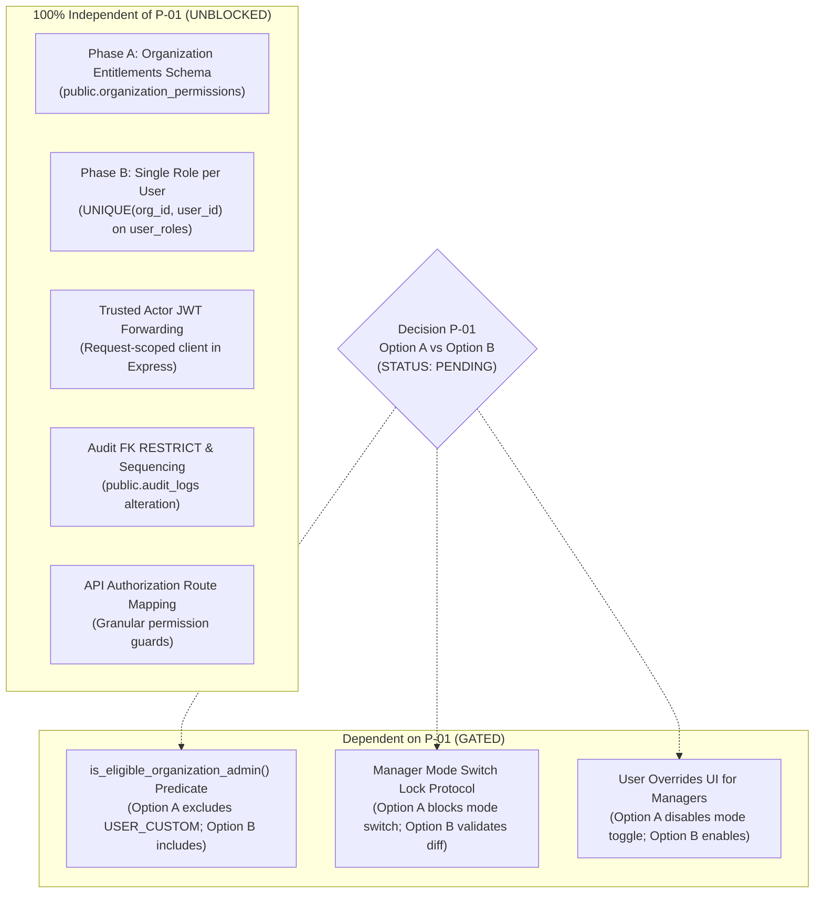

# PayPulse Phase 3.0 — Decision and Blocker Register

**Status:** Official Register  
**Date:** 2026-11-22  
**System:** PayPulse (JK Payroll) — Governance & Implementation Tracking  
**Document Reference:** `docs/phase-3/PAYPULSE_PHASE_3_0_DECISION_AND_BLOCKER_REGISTER.md`  

---

## 1. Executive Summary & Purpose

The **Decision and Blocker Register** is the formal governance instrument for Phase 3.0. It tracks the status of all policy decisions, architectural consensus items, technical constraints, environment gates, and operational blockers.

In strict compliance with the Phase 3.0 safeguards:
- **Decision P-01 (Option A vs. Option B)** is tracked rigorously without inferring or fabricating approval.
- **Environment and Staging Gates** are tracked with explicit pre-conditions.
- Any decision requiring business signoff is clearly labeled as **PENDING** and fenced from blocking independent engineering authoring.

---

## 2. Decision P-01 Governance Status: Option A vs. Option B

### 2.1 The Decision Context
- **Option A (ROLE-Only Organization Administration):** An organization administrator MUST operate in `ROLE` mode and hold an organization-owned `CUSTOM` manager role containing all 7 management permissions. Switching to `USER_CUSTOM` mode completely disqualifies the user from administrator eligibility.
- **Option B (Effective-Permission Administration):** An organization administrator qualifies if their effective permissions contain all 7 management permissions, regardless of whether they operate in `ROLE` or `USER_CUSTOM` mode.

### 2.2 Current Governance Status
- **Status:** **PENDING (Formal Product Management Signoff Required)**
- **Architecture Position:** Architecture strongly recommends **Option A** for enterprise governance consistency, transparent SOC 2 auditability, and prevention of shadow administrators created via ad-hoc overrides.
- **Safeguard Enforcement:** Architecture recommendations do **not** constitute product signoff. Option A has **not** been approved by Product Management. Therefore, it is recorded as **PENDING**.

### 2.3 Dependency Analysis for Decision P-01

#### What is UNBLOCKED and can proceed:
1. **Phase A Forward Migration Authoring:** Normalized entitlements (`organization_permissions`) are identical under both Option A and Option B.
2. **Phase B Forward Migration Authoring:** Enforcing one role per user (`UNIQUE(organization_id, user_id)`) is identical under both options.
3. **Staging Preflight Verification:** Data reconciliation queries are identical under both options.
4. **Trusted Actor Client Implementation:** Request-scoped JWT forwarding is identical under both options.
5. **Audit FK Protection:** Altering `audit_logs` FK to `RESTRICT` is identical under both options.

#### What is GATED and must remain pending:
1. Freezing the SQL definition of `is_eligible_organization_admin()` in Phase D migrations.
2. Finalizing the UI form controls for switching permission modes on organization administrators.

---

## 3. Master Blocker & Prerequisite Register

| Blocker ID | Domain | Category | Description & Impact | Pre-Condition to Lift Gate | Current Status | Assigned Owner |
|---|---|---|---|---|---|---|
| **BLK-01** | Governance | Product Policy | Decision P-01 (Option A) awaiting formal Product Management approval. | Product Management memo confirming Option A or Option B adoption. | **PENDING** | Product Manager |
| **BLK-02** | Environment | Staging Access | Staging project reference not designated; `.env` project (`fsnfqnbixitmmjmeogml`) is documented as `development`. | Formal designation of disposable staging project ref and explicit read-only authorization. | **BLOCKED** | Project Owner / DevOps |
| **BLK-03** | Environment | Remote Parity | Remote migration ledger parity and schema drift unverified on staging database. | Execution of read-only migration ledger inspection on authorized staging target. | **BLOCKED** | Lead Database Engineer |
| **BLK-04** | Data Integrity | Preflight Reconciliation | Unknown count of live multi-role users or legacy system role assignments on staging target. | Execution and archival of the 4 pre-migration data reconciliation queries. | **BLOCKED** | Database Specialist |
| **BLK-05** | Testing | Test Execution | 38 PostgreSQL security test scenarios specified, but cannot be executed without live database. | Provisioning of real disposable Supabase project matching target version. | **BLOCKED** | QA / Security Engineer |

---

## 4. Architectural Consensus Decisions Log (Closed Baseline)

The following architectural decisions are closed and form the immutable target baseline:

| Decision ID | Domain | Status | Core Specification |
|---|---|---|---|
| **ADR-01** | Platform Authority | **APPROVED** | `profiles.is_super_admin` is the sole platform SuperAdmin authority. User metadata cannot establish authorization. |
| **ADR-02** | Role Assignment | **APPROVED** | `public.user_roles` is the sole canonical role assignment source. `organization_members.role_id` is a non-authoritative legacy mirror. |
| **ADR-03** | Tenant Boundary | **APPROVED** | Active membership in `public.organization_members` is mandatory for tenant authorization. `profiles.organization_id` does not establish membership. |
| **ADR-04** | Role Scope Isolation | **APPROVED** | Organization roles are strictly tenant-owned `CUSTOM` roles. Global `SYSTEM` roles cannot be assigned to tenant members. |
| **ADR-05** | Single Role Invariant | **APPROVED** | A user has exactly one assigned role per organization. Phase B migration enforces `UNIQUE (organization_id, user_id)`. |
| **ADR-06** | Permission Mode | **APPROVED** | Membership uses `ROLE` or `USER_CUSTOM`. New memberships default to `ROLE`. Missing settings fail closed. |
| **ADR-07** | Custom Mode Replacement | **APPROVED** | `USER_CUSTOM` completely replaces role grants; empty custom set grants zero permissions. |
| **ADR-08** | Normalized Entitlements | **APPROVED** | Module and permission entitlements are normalized relational rows (`organization_modules`, `organization_permissions`). JSONB column is deprecated. |
| **ADR-09** | SuperAdmin Boundary | **APPROVED** | SuperAdmin does not receive automatic business-operation permission bypass. |
| **ADR-10** | Department Scope | **APPROVED** | `department_modules` is excluded from permission evaluation. Department hierarchy is strictly a resource data-scoping concern. |
| **ADR-11** | Trusted Actor Context | **APPROVED** | Request-scoped Supabase client forwards caller Bearer JWT. Database derives actor from `auth.uid()`. Service-role fallback barred. |
| **ADR-12** | Permission Catalog | **APPROVED** | Existing PascalCase catalog in `modules` and `module_actions` retained as canonical. 7 management actions mapped 1:1. |
| **ADR-13** | Last-Admin Protection | **APPROVED** | All manager-affecting mutations participate in the Organization Locking Protocol (`SELECT ... FOR UPDATE` ordered by UUID). |
| **ADR-14** | Break-Glass Recovery | **APPROVED** | Platform recovery restores management access only; never grants business operational permissions. |
| **ADR-15** | Outbox Onboarding | **APPROVED** | Organization onboarding separates database transaction commit from asynchronous email notification using `invitation_outbox`. |
| **ADR-16** | Audit Retention | **APPROVED** | `public.audit_logs.organization_id` foreign key altered to `ON DELETE RESTRICT`. |
| **ADR-17** | Explicit Audit Emission | **APPROVED** | Sensitive authorization mutations emit explicit, structured audit events via dedicated RPC, suppressing generic table triggers. |
| **ADR-18** | Direct DML Lockdown | **APPROVED** | Direct `INSERT`, `UPDATE`, `DELETE` on authorization tables revoked from `authenticated`. Mutations must pass through audited RPCs. |
| **ADR-19** | Forward-Only Migrations | **APPROVED** | Applied migrations are immutable. All schema evolution is forward-only using the Expand/Contract pattern. |

---

## 5. Protocol for Resolving Blockers

1. **To lift BLK-01:** Submit formal Product Management decision on Option A vs. Option B.
2. **To lift BLK-02 & BLK-03:** Project Owner must provide exact staging project credentials, confirm project designation, and grant explicit read-only preflight authorization.
3. **To lift BLK-04 & BLK-05:** Execute preflight queries and run the 38 security integration tests against the confirmed disposable target.
