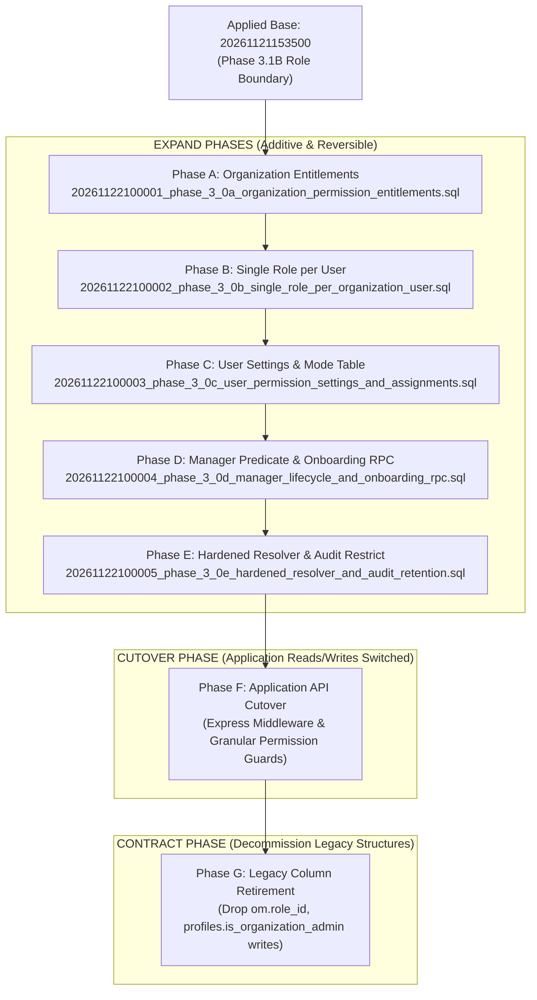

# PayPulse Phase 3.0 — Migration Dependency Matrix and Safety Assessment

**Status:** Completed Architectural Matrix  
**Date:** 2026-11-22  
**System:** PayPulse (JK Payroll) — Database Migration Architecture  
**Document Reference:** `docs/phase-3/PAYPULSE_PHASE_3_0_MIGRATION_DEPENDENCY_MATRIX.md`  

---

## 1. Executive Summary

This document specifies the complete **Migration Dependency Matrix** for the Phase 3 schema evolution. In adherence to the **Forward-Only** migration principle (Rule 19) and the **Expand / Contract Pattern**, all schema evolutions are partitioned into logically isolated, individually reviewable, and transaction-safe migration units.

Each migration phase is documented with its target objects, strict pre-conditions, forward SQL actions, data transformation rules, constraint validations, post-conditions, rollback/compensating strategies, and safety assessments.

---

## 2. Master Migration Sequence and Dependency Flow

---

## 3. Comprehensive Migration Specification Matrix

### 3.1 Phase A: Organization Permission Entitlements
- **Target Filename:** `supabase/migrations/20261122100001_phase_3_0a_organization_permission_entitlements.sql`
- **Objective:** Introduce normalized `public.organization_permissions` table to bind module actions to licensed organizations. Add `is_active` to `public.organization_modules`.
- **Preconditions:**
  1. Base migration `20261121153500` applied.
  2. `public.modules` and `public.module_actions` populated with canonical catalog.
- **Forward SQL Actions:**
  - `ALTER TABLE public.organization_modules ADD COLUMN IF NOT EXISTS is_active BOOLEAN NOT NULL DEFAULT true;`
  - Create table `public.organization_permissions(organization_id, module_id, module_action_id, is_active, created_at, created_by)`.
  - Add PK `(organization_id, module_action_id)`.
  - Add composite FK `(organization_id, module_id) REFERENCES public.organization_modules(organization_id, module_id) ON DELETE CASCADE`.
  - Add FK `(module_action_id) REFERENCES public.module_actions(id) ON DELETE CASCADE`.
  - Add covering indexes: `(organization_id, module_action_id)`, `(organization_id, module_id)`.
  - Enable and force RLS; add SELECT policy for active members & SuperAdmin.
  - Revoke direct `INSERT/UPDATE/DELETE` from `authenticated`.
- **Data Transformation (Backfill):**
  - Atomic query inserts all actions from `module_actions` matching currently enabled `organization_modules` into `organization_permissions`.
- **Postconditions & Validation:**
  - `SELECT count(*) FROM organization_permissions;` matches active module action counts.
  - Legacy `organizations.modules` JSONB column remains intact as an unread fallback.
- **Compensating Rollback Strategy:**
  - Additive migration. Compensating forward script drops `public.organization_permissions` table and `organization_modules.is_active` column. Zero data loss on core business tables.
- **Safety & Lock Impact:** Low risk. Table creation acquires exclusive lock only on newly created table. Brief `SHARE UPDATE EXCLUSIVE` lock on `organization_modules` for column addition.

---

### 3.2 Phase B: Single Role per Organization User Envariant
- **Target Filename:** `supabase/migrations/20261122100002_phase_3_0b_single_role_per_organization_user.sql`
- **Objective:** Enforce `UNIQUE(organization_id, user_id)` on `public.user_roles` and enforce composite FK referencing organization-owned custom roles.
- **Preconditions:**
  1. Phase A migration successfully applied.
  2. Staging preflight check confirms zero multi-role users in `user_roles`.
  3. Preflight check confirms zero assignments of `SYSTEM` roles to organization members.
- **Forward SQL Actions:**
  - Precondition assertion block inside transaction: raises exception listing conflicting rows if any user has $>1$ role or references a `SYSTEM` role.
  - Drop existing PK constraint `user_roles_pkey` on `(organization_id, user_id, role_id)`.
  - Add new PK constraint `PRIMARY KEY (organization_id, user_id)` on `public.user_roles`.
  - Add `CONSTRAINT uq_roles_org_id UNIQUE (organization_id, id)` on `public.roles`.
  - Add composite FK `CONSTRAINT fk_user_roles_org_role FOREIGN KEY (organization_id, role_id) REFERENCES public.roles(organization_id, id) ON DELETE RESTRICT`.
- **Data Transformation (Reconciliation):**
  - Atomically maps existing `SYSTEM TENANT_ADMIN` assignments to organization-owned `CUSTOM` manager role `ORG_ADMIN`.
- **Postconditions & Validation:**
  - `SELECT organization_id, user_id, count(*) FROM user_roles GROUP BY 1, 2 HAVING count(*) > 1;` returns `0 rows`.
  - Attempting to insert a second role for a user raises `23505 unique_violation`.
- **Compensating Rollback Strategy:**
  - Re-adding the 3-column primary key via compensating script.
- **Safety & Lock Impact:** Medium risk. Modifying primary key on `user_roles` acquires an `ACCESS EXCLUSIVE` lock on `user_roles`. Must execute during low-traffic maintenance window. Precondition checks guarantee transaction rolls back immediately if conflicts exist.

---

### 3.3 Phase C: User Settings & Custom Assignments Schema
- **Target Filename:** `supabase/migrations/20261122100003_phase_3_0c_user_permission_settings_and_assignments.sql`
- **Objective:** Create `public.user_permission_settings` (`ROLE` vs `USER_CUSTOM`) and `public.user_permission_assignments`.
- **Preconditions:** Phase B successfully applied.
- **Forward SQL Actions:**
  - Create table `public.user_permission_settings(organization_id, user_id, permission_mode, created_at, updated_at, updated_by)`.
  - Add check constraint: `permission_mode IN ('ROLE', 'USER_CUSTOM')`.
  - Create table `public.user_permission_assignments(organization_id, user_id, module_id, module_action_id, created_at, created_by)`.
  - Add composite FK to `organization_permissions`.
  - Backfill: Insert `permission_mode = 'ROLE'` for every active `organization_members` record.
- **Postconditions & Validation:** Every active membership has exactly one row in `user_permission_settings`.
- **Compensating Rollback Strategy:** Forward script drops newly created tables.

---

### 3.4 Phase D: Manager Eligibility & Onboarding RPCs
- **Target Filename:** `supabase/migrations/20261122100004_phase_3_0d_manager_lifecycle_and_onboarding_rpc.sql`
- **Objective:** Deploy `is_eligible_organization_admin()`, deterministic locking protocols, `provision_organization_bootstrap()`, and `recover_organization_management_access()`.
- **Preconditions:** Phases A–C applied. Product Management decision on P-01 confirmed.
- **Forward SQL Actions:**
  - Deploy dynamic SQL eligibility predicate.
  - Deploy replacement onboarding RPC creating `CUSTOM` manager roles and normalized entitlements.
  - Create `public.invitation_outbox` and `public.idempotency_records`.
  - Revoke legacy onboarding functions (`create_organization_onboarding_invitation`, `provision_organization_from_onboarding_invitation`).
- **Postconditions & Validation:** Onboarding RPC succeeds in test harness; legacy functions non-callable.

---

### 3.5 Phase E: Hardened Resolver & Audit Protection
- **Target Filename:** `supabase/migrations/20261122100005_phase_3_0e_hardened_resolver_and_audit_retention.sql`
- **Objective:** Deploy hardened `get_user_effective_permissions()`, alter `audit_logs` FK to `RESTRICT`, and deploy `emit_authorization_audit_event()`.
- **Preconditions:** Phases A–D applied.
- **Forward SQL Actions:**
  - Replace `get_user_effective_permissions` to use `auth.uid()`, eliminate `department_modules` gating, and resolve via `user_permission_settings`.
  - Grant `EXECUTE` on resolver to `authenticated`.
  - Alter `audit_logs` FK: `DROP CONSTRAINT audit_logs_organization_id_fkey; ADD CONSTRAINT ... ON DELETE RESTRICT`.
  - Add `audit_seq BIGSERIAL` to `audit_logs`.
- **Postconditions & Validation:** Resolver returns correct permissions for `auth.uid()`. Deleting test organization with audit logs fails with `23503 foreign_key_violation`.

---

## 4. Reversible vs. Irreversible Operations

| Migration Phase | Schema Reversibility | Data Transformation Reversibility | Rollback Mechanism |
|---|---|---|---|
| **Phase A** | Fully Reversible (Drop table `organization_permissions`) | Additive (Data backfilled from canonical catalog) | Drop table script. |
| **Phase B** | Reversible (Revert PK to 3 columns) | **Compensating Required** (Mapped system roles to custom roles) | Forward compensating script. Must not drop custom roles with assignments. |
| **Phase C** | Fully Reversible (Drop settings & assignment tables) | Additive (Defaulted to `ROLE`) | Drop table script. |
| **Phase D** | Fully Reversible (Drop/replace functions) | Additive (New outbox table) | Function replacement script. |
| **Phase E** | Reversible with Care (Altering FK back to CASCADE is possible but dangerous) | Additive (New column `audit_seq`) | Keep FK RESTRICT; revert function definitions. |
