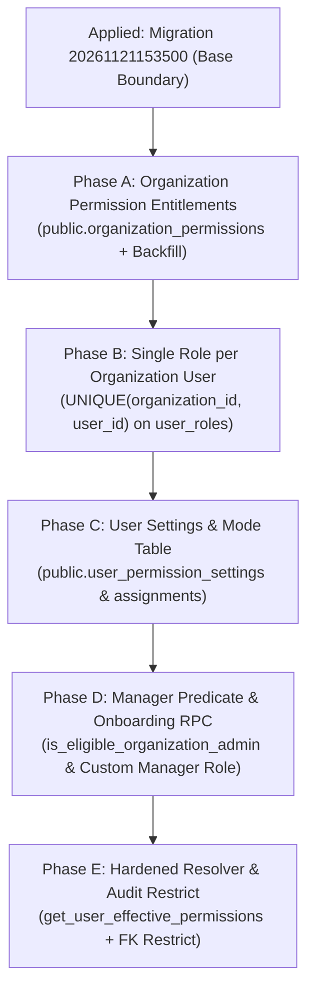

# PayPulse Phase 3.0 — Repository and Architecture Baseline Audit

**Status:** Completed Repository & Baseline Audit  
**Date:** 2026-11-22  
**System:** PayPulse (JK Payroll) — Multi-Tenant Cascading RBAC Platform  
**Target Environment:** React 19 SPA, Express 4 Backend, Supabase Auth, PostgreSQL 17+  
**Git Branch:** `main`  
**Git Commit:** `a7f77fa9bf95a3114addba4f9b56127dd0cbedcd`  
**Document Reference:** `docs/phase-3/PAYPULSE_PHASE_3_0_REPOSITORY_BASELINE_AUDIT.md`  

---

## 1. Executive Summary

Workstream A of Phase 3.0 requires a comprehensive audit of the Git repository state, working tree modifications, migration ledger, database schema definitions, runtime middleware, permission catalogs, and the ten (10) Phase 2.2 architecture documents authored during the architecture closure phase.

This audit independently verifies the static facts of the codebase against the Phase 2.2 specifications, catalogues all migration dependencies, establishes the immutable boundary of previously applied migrations, and ensures that all pre-existing user modifications are rigorously preserved.

---

## 2. Git Working Tree & Repository State

### 2.1 Branch and Commit
- **Current Branch:** `main` (tracking `origin/main`, up to date)
- **Current Commit:** `a7f77fa9bf95a3114addba4f9b56127dd0cbedcd`

### 2.2 Pre-Existing Tracked Modifications (Preserved Intact)
The working tree contains 18 pre-existing modified files created prior to this phase. In accordance with Section 2.3, none of these files were reverted, stashed, checked out over, or overwritten:
1. `docs/PRODUCTION_DEPLOYMENT.md`
2. `docs/PRODUCTION_RELEASE_CHECKLIST.md`
3. `docs/security/SECURITY_PRODUCTION_READINESS.md`
4. `docs/security/SECURITY_REMEDIATION_DECISION_LOG.md`
5. `docs/security/SECURITY_REMEDIATION_MASTER_TRACKER.md`
6. `package.json`
7. `src/features/organizations/organization.service.ts`
8. `src/features/roles/components/UserRoleFormPage.tsx`
9. `src/features/roles/role.service.ts`
10. `src/features/roles/user-role.controller.ts`
11. `src/server/db/repository.ts`
12. `supabase/migrations/20261104000001_core_schema.sql`
13. `tests/integration/helpers/pg-harness.ts`
14. `tests/integration/security-phase1-2-provisioning.integration.test.ts`
15. `tests/integration/security-postgres.integration.test.ts`
16. `tests/security-audit-integrity-phase5.test.ts`
17. `tests/security-phase1.test.ts`
18. `tests/user-roles.test.ts`

### 2.3 Verification of Phase 2.2 Architecture Documents
All ten (10) Phase 2.2 deliverables authored during architecture closure exist in the project root and were verified for internal consistency:
- `PAYPULSE_PHASE_2_2_ARCHITECTURE_CLOSURE_REPORT.md` (22,634 bytes)
- `PAYPULSE_PHASE_2_2_TRUSTED_ACTOR_AND_FUNCTION_SECURITY.md` (23,456 bytes)
- `PAYPULSE_PHASE_2_2_CANONICAL_PERMISSION_CATALOG.md` (13,989 bytes)
- `PAYPULSE_PHASE_2_2_ADMINISTRATOR_LIFECYCLE_AND_RECOVERY.md` (21,122 bytes)
- `PAYPULSE_PHASE_2_2_ORGANIZATION_BOOTSTRAP_AND_INVITATION.md` (17,338 bytes)
- `PAYPULSE_PHASE_2_2_AUDIT_ARCHITECTURE.md` (12,559 bytes)
- `PAYPULSE_PHASE_2_2_API_AUTHORIZATION_MATRIX.md` (13,359 bytes)
- `PAYPULSE_PHASE_2_2_LEGACY_MIGRATION_READINESS.md` (13,623 bytes)
- `PAYPULSE_PHASE_2_2_POSTGRESQL_SECURITY_TEST_PLAN.md` (16,954 bytes)
- `PAYPULSE_PHASE_2_2_FINAL_DECISION_RECORD.md` (10,898 bytes)

---

## 3. Checked-In Migration Ledger & Immutability Boundary

The repository's migration directory (`supabase/migrations/`) contains exactly 21 historical migrations:

| # | Migration File | Timestamp | Core Subject / Scope | Status in Phase 3.0 |
|---|---|---|---|---|
| 1 | `20261104000001_core_schema.sql` | 2026-11-04 00:00:01 | Base multi-tenant schema (`organizations`, `departments`, `profiles`, `roles`, `user_roles`, `modules`, `module_actions`, `organization_modules`, `department_modules`, `role_permissions`, `user_permissions`). | **IMMUTABLE** |
| 2 | `20261104000002_functions_and_rls.sql` | 2026-11-04 00:00:02 | Base RLS policies and helper functions (`is_super_admin`, `is_organization_admin`, `get_user_effective_permissions`). | **IMMUTABLE** |
| 3 | `20261104000003_audit_logs.sql` | 2026-11-04 00:00:03 | Creation of `public.audit_logs`, trigger functions, and immutability guard. | **IMMUTABLE** |
| 4 | `20261104000004_attach_audit_triggers.sql` | 2026-11-04 00:00:04 | Attaches generic audit triggers to core tables. | **IMMUTABLE** |
| 5 | `20261104000005_seed_default_user_roles.sql` | 2026-11-04 00:00:05 | Initial role seeding. | **IMMUTABLE** |
| 6 | `20261104000006_fix_auth_users_null_tokens.sql` | 2026-11-04 00:00:06 | Auth users token sanitation. | **IMMUTABLE** |
| 7 | `20261104000007_audit_logs_superadmin_policy.sql` | 2026-11-04 00:00:07 | SuperAdmin audit read RLS policy. | **IMMUTABLE** |
| 8 | `20261104000008_align_organizations_schema.sql` | 2026-11-04 00:00:08 | Organizations table alignment. | **IMMUTABLE** |
| 9 | `20261104000009_expand_organizations_sector_settings.sql` | 2026-11-04 00:00:09 | Sector enums and settings JSONB expansion. | **IMMUTABLE** |
| 10 | `20261119000010_remediate_database_rls.sql` | 2026-11-19 00:00:10 | Phase 1 RLS remediation across all business tables. | **IMMUTABLE** |
| 11 | `20261119000011_harden_audit_attribution_and_integrity.sql` | 2026-11-19 00:00:11 | Adds `actor_type` to audit logs, drops NOT NULL on `organization_id`. | **IMMUTABLE** |
| 12 | `20261121000012_remediate_critical_containment.sql` | 2026-11-21 00:00:12 | Critical containment triggers and helper hardening. | **IMMUTABLE** |
| 13 | `20261121000013_security_correction_phase1_1.sql` | 2026-11-21 00:00:13 | Phase 1.1 security corrections, `safe_cast_uuid`. | **IMMUTABLE** |
| 14 | `20261121000014_security_corrections_phase1_1_1.sql` | 2026-11-21 00:00:14 | Phase 1.1.1 corrections; hardened `get_user_effective_permissions`. | **IMMUTABLE** |
| 15 | `20261121000015_align_organization_locale_defaults.sql` | 2026-11-21 00:00:15 | Currency, timezone, and locale defaults on organizations. | **IMMUTABLE** |
| 16 | `20261121000016_require_organization_leaves_settings.sql` | 2026-11-21 00:00:16 | Leaves settings JSONB constraint. | **IMMUTABLE** |
| 17 | `20261121000017_protect_profile_audit_fields.sql` | 2026-11-21 00:00:17 | Trigger protecting audit attribution fields on profiles. | **IMMUTABLE** |
| 18 | `20261121000018_superadmin_onboarding_invitations.sql` | 2026-11-21 00:00:18 | Single-use onboarding invitations and provisioning RPC. | **IMMUTABLE** |
| 19 | `20261121000019_authorized_member_invitations.sql` | 2026-11-21 00:00:19 | Member invitations and provisioning RPC. | **IMMUTABLE** |
| 20 | `20261121000020_separate_superadmin_role_authority.sql` | 2026-11-21 00:00:20 | Triggers rejecting assignment of `SUPER_ADMIN` role code. | **IMMUTABLE** |
| 21 | `20261121153500_phase_3_1b_database_role_authorization_boundary.sql` | 2026-11-21 15:35:00 | Database role assignment boundary and custom role validation. | **IMMUTABLE** |

### Immutability Directive:
Migrations 1 through 21 represent the immutable historical ledger. Under Rule 19 and Rule 2.1, **none of these files will be rewritten or modified in place**. All Phase 3 schema evolutions must be authored as forward-only migrations numbered with timestamps after `20261121153500`.

---

## 4. Codebase vs. Architecture Document Verification

A rigorous line-by-line comparison between actual repository code and the Phase 2.2 specifications confirmed the following technical baseline:

### 4.1 Database Schema & Catalogs
- **Modules & Actions:** `public.modules` and `public.module_actions` are seeded in `supabase/seeds/20261101000001_seed_catalog.sql` using PascalCase dotted keys (`Role.View`, `Role.Add`, `UserRole.*`, `RolePermission.*`, `UserPermission.*`). No snake_case keys exist in the database.
- **Entitlements Gap:** `public.organization_modules` exists, but `public.organization_permissions` does not exist yet. Organization module licensing was previously tracked in `organizations.modules` (JSONB) or `organization_modules`.
- **User Role Constraint Gap:** `public.user_roles` currently has `PRIMARY KEY (organization_id, user_id, role_id)` ([core_schema.sql#L238](file:///c:/Users/HP_06/.gemini/antigravity-ide/scratch/jk-payroll/supabase/migrations/20261104000001_core_schema.sql#L238)), permitting multiple roles per user in an organization.

### 4.2 Application Middleware & Backend Code
- **Singleton Service-Role Client:** [src/server/db/supabase.ts#L7-L17](file:///c:/Users/HP_06/.gemini/antigravity-ide/scratch/jk-payroll/src/server/db/supabase.ts#L7-L17) instantiates a singleton client with `ENV.SUPABASE_SERVICE_ROLE_KEY`.
- **Service-Role Resolver Query:** [src/server/middleware/auth.middleware.ts#L298-L303](file:///c:/Users/HP_06/.gemini/antigravity-ide/scratch/jk-payroll/src/server/middleware/auth.middleware.ts#L298-L303) invokes `get_user_effective_permissions` via this service-role client passing `p_user_id`.
- **Legacy Authority Evaluation:** [src/server/middleware/auth.middleware.ts#L274-L276](file:///c:/Users/HP_06/.gemini/antigravity-ide/scratch/jk-payroll/src/server/middleware/auth.middleware.ts#L274-L276) evaluates `membership.isOwner || (profile.tenantId === validatedTenant.id && profile.isTenantAdmin)` to set `isOrganizationAdmin`.
- **SuperAdmin Bypass in Express:** [src/server/middleware/rbac.guard.ts#L44-L46](file:///c:/Users/HP_06/.gemini/antigravity-ide/scratch/jk-payroll/src/server/middleware/rbac.guard.ts#L44-L46) contains `if (isSuperAdmin(req.user)) { return next(); }`, bypassing all business-level permissions.
- **Implicit View Expansion:** [src/server/middleware/rbac.guard.ts#L69-L85](file:///c:/Users/HP_06/.gemini/antigravity-ide/scratch/jk-payroll/src/server/middleware/rbac.guard.ts#L69-L85) expands mutating actions to `.View`.

### 4.3 Database Functions
- **Resolver Logic:** `get_user_effective_permissions` in migration 14 ([L448-L457](file:///c:/Users/HP_06/.gemini/antigravity-ide/scratch/jk-payroll/supabase/migrations/20261121000014_security_corrections_phase1_1_1.sql#L448-L457)) intersects candidate permissions with `department_modules` and unions role grants with direct user grants.
- **Onboarding Logic:** Migration 18 `provision_organization_from_onboarding_invitation` ([L141-L148](file:///c:/Users/HP_06/.gemini/antigravity-ide/scratch/jk-payroll/supabase/migrations/20261121000018_superadmin_onboarding_invitations.sql#L141-L148)) assigns `SYSTEM TENANT_ADMIN` role and stores modules as JSONB.

---

## 5. Migration Dependencies & Ordering

The schema evolution sequence for Phase 3 must follow strict dependency ordering:

### Dependency Rules:
1. **Phase A precedes Phase B:** Entitlement normalization must be established so that role permission integrity checks can be validated against normalized entitlements.
2. **Phase B precedes Phase C:** Single-role constraints on `user_roles` must be enforced before mapping users to `ROLE` mode in `user_permission_settings`.
3. **Phases A–C precede Phase D:** Manager eligibility functions and onboarding RPCs rely on `organization_permissions`, single-role assignments, and `user_permission_settings`.

This completes Workstream A of the Phase 3.0 master execution plan.
