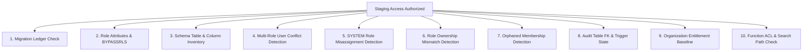

# PayPulse Phase 3.0 — Staging Preflight and Remote Verification Report

**Status:** Preflight Gated / Staging Inspection Not Authorized  
**Date:** 2026-11-22  
**System:** PayPulse (JK Payroll) — Staging Environment Verification  
**Document Reference:** `docs/phase-3/PAYPULSE_PHASE_3_0_STAGING_PREFLIGHT_REPORT.md`  

---

## 1. Executive Summary & Safeguard Enforcement

Section 2.2 of the Phase 3.0 Master Execution Prompt establishes an absolute execution safeguard:
> **Never assume that an existing Supabase project is the designated staging environment.**  
> Before accessing a remote database:
> 1. Identify the exact Supabase project reference.
> 2. Confirm the project name and organization.
> 3. Verify its current operational status.
> 4. Confirm that it is explicitly designated as disposable staging.
> 5. Confirm that read-only inspection has been authorized.  
> **If any of these conditions cannot be positively established: STOP. Do not connect, inspect, query, or modify the project.**

### Safeguard Evaluation Results:
1. **Inspection of Environment Files:** The repository `.env` file references project `fsnfqnbixitmmjmeogml` (`SUPABASE_URL=https://fsnfqnbixitmmjmeogml.supabase.co`).
2. **Inspection of Environment Classification Reports:** Documentation in [docs/security/SUPABASE_DEV_DEPLOYMENT_REPORT.md](file:///c:/Users/HP_06/.gemini/antigravity-ide/scratch/jk-payroll/docs/security/SUPABASE_DEV_DEPLOYMENT_REPORT.md#L1-L20) and [docs/security/SUPABASE_STAGING_DEPLOYMENT_REPORT.md](file:///c:/Users/HP_06/.gemini/antigravity-ide/scratch/jk-payroll/docs/security/SUPABASE_STAGING_DEPLOYMENT_REPORT.md#L1-L10) explicitly states:
   > "Project `fsnfqnbixitmmjmeogml` (`jKyle08's Project`) was explicitly repurposed as the active **Development** database by project owner authorization. It is **not** an independently isolated staging environment and is **not** production."
3. **Authorization Status:** No separate disposable staging project reference has been designated, and no explicit authorization for remote staging connection was granted for this session.

### Definitive Operational Finding:
In strict compliance with Safeguard 2.2 and Stop Condition 1:
- **No remote database connection was initiated.**
- **No queries were executed against `fsnfqnbixitmmjmeogml` or any remote host.**
- **Workstream C is marked as BLOCKED — AUTHORIZATION & ENVIRONMENT DESIGNATION REQUIRED.**

This report documents the required preflight verification framework, SQL scripts, expected outputs, and remediation implications prepared for execution once explicit staging access is granted.

---

## 2. Required Staging Preflight Checks Specification

When a disposable staging Supabase project is positively identified and authorized for read-only inspection, the preflight audit must execute the following ten (10) verification checks:



---

## 3. Migration Ledger Parity Verification Plan

### 3.1 Objective:
Verify whether the remote database has applied all 21 checked-in migrations, specifically validating migration `20261121153500_phase_3_1b_database_role_authorization_boundary.sql`, and detect any unrecorded manual schema drift.

### 3.2 SQL Verification Query:
```sql
SELECT 
    version,
    name,
    inserted_at
FROM supabase_migrations.schema_migrations
ORDER BY version ASC;
```

### 3.3 Expected Output Baseline:
- Exactly 21 rows matching the checked-in migration timestamps from `20261104000001` through `20261121153500`.
- Latest applied version must be `20261121153500`.

### 3.4 Discrepancy Analysis & Remediation Rules:
- **Case 1 (Missing Migrations):** If migrations are missing on staging, forward migrations cannot be applied until missing migrations are reviewed.
- **Case 2 (Remote-Only Migrations):** If uncommitted migrations exist on staging, stop immediately and reconcile repository migration files.
- **Case 3 (Checksum Mismatch):** If migration files differ from applied database state, investigate manual hotfixes before proceeding.

---

## 4. Database Role Privilege & Attribute Audit Plan

### 4.1 Objective:
Inspect PostgreSQL roles to confirm least-privilege configurations and verify which roles hold `BYPASSRLS` or `SUPERUSER` privileges.

### 4.2 SQL Verification Query:
```sql
SELECT 
    rolname,
    rolsuper,
    rolinherit,
    rolcreaterole,
    rolcreatedb,
    rolcanlogin,
    rolbypassrls
FROM pg_roles
WHERE rolname IN ('postgres', 'authenticator', 'authenticated', 'anon', 'service_role', 'supabase_auth_admin')
ORDER BY rolname;
```

### 4.3 Expected Baseline Attributes:
| Role Name | Superuser (`rolsuper`) | Bypass RLS (`rolbypassrls`) | Can Login (`rolcanlogin`) | Inherits (`rolinherit`) | Architectural Expectation |
|---|---|---|---|---|---|
| `postgres` | `true` | `true` | `true` | `true` | Infrastructure DB owner. Bypasses RLS. |
| `authenticator` | `false` | `false` | `true` | `true` | PostgREST connection role. Switches context. |
| `authenticated` | `false` | `false` | `false` | `true` | Bound by RLS. Subject to table permissions. |
| `anon` | `false` | `false` | `false` | `true` | Bound by RLS. All sensitive DML denied. |
| `service_role` | `false` | `true` | `false` | `true` | Bypasses RLS. Banned from human mutation RPCs. |

---

## 5. Read-Only Data Reconciliation Queries & Remediation Rules

The four (4) mandatory reconciliation queries must be executed against the authorized staging database prior to applying Phase A or Phase B migrations:

### Query 1: Multi-Role User Conflict Detection
- **Purpose:** Identifies users assigned $>1$ role within the same organization, which would violate the target `PRIMARY KEY (organization_id, user_id)` on `public.user_roles`.
- **SQL:**
  ```sql
  SELECT 
      ur.organization_id,
      o.name AS organization_name,
      ur.user_id,
      p.email,
      count(*) AS assigned_role_count,
      array_agg(r.code) AS assigned_role_codes
  FROM public.user_roles ur
  JOIN public.organizations o ON o.id = ur.organization_id
  JOIN public.profiles p ON p.id = ur.user_id
  JOIN public.roles r ON r.id = ur.role_id
  GROUP BY ur.organization_id, o.name, ur.user_id, p.email
  HAVING count(*) > 1;
  ```
- **Expected Output on Clean Baseline:** `0 rows`.
- **Remediation Rule if Found:** Phase B migration precondition check will raise an exception listing all conflicting user IDs. An explicit business decision must resolve each conflict before applying the unique constraint. Automatic arbitrary deletion is prohibited.

### Query 2: SYSTEM Role Misassignment Detection
- **Purpose:** Detects organization members assigned global `SYSTEM` roles (`role_type = 'SYSTEM'` or `organization_id IS NULL`), violating Role Scope Isolation.
- **SQL:**
  ```sql
  SELECT 
      ur.organization_id,
      o.name AS organization_name,
      ur.user_id,
      p.email,
      r.id AS role_id,
      r.code AS system_role_code,
      r.role_type
  FROM public.user_roles ur
  JOIN public.organizations o ON o.id = ur.organization_id
  JOIN public.profiles p ON p.id = ur.user_id
  JOIN public.roles r ON r.id = ur.role_id
  WHERE r.role_type = 'SYSTEM' OR r.organization_id IS NULL;
  ```
- **Expected Output on Clean Baseline:** `0 rows`.
- **Remediation Rule if Found:** For any member assigned `SYSTEM TENANT_ADMIN` from migration 18, Phase B migration must atomically create an organization-owned `CUSTOM` role (`ORG_ADMIN`) and reassign the user within the same transaction before enforcing composite foreign keys.

### Query 3: Role Ownership Mismatch Detection
- **Purpose:** Detects role assignments where the assigned role belongs to an organization different from the membership organization (`r.organization_id <> ur.organization_id`).
- **SQL:**
  ```sql
  SELECT 
      ur.organization_id AS assignment_org_id,
      r.organization_id AS role_owner_org_id,
      ur.user_id,
      p.email,
      r.code AS role_code
  FROM public.user_roles ur
  JOIN public.roles r ON r.id = ur.role_id
  JOIN public.profiles p ON p.id = ur.user_id
  WHERE r.organization_id IS NOT NULL 
    AND r.organization_id <> ur.organization_id;
  ```
- **Expected Output on Clean Baseline:** `0 rows`.
- **Remediation Rule if Found:** Cross-tenant role assignments are severe tenant isolation violations. Any detected rows must be aborted, reported, and manually investigated.

### Query 4: Orphaned Membership Detection
- **Purpose:** Detects `organization_members` records where the corresponding `profiles` record is missing or inactive.
- **SQL:**
  ```sql
  SELECT 
      om.organization_id,
      om.user_id,
      p.id AS profile_id,
      p.is_active AS profile_active,
      om.is_active AS member_active
  FROM public.organization_members om
  LEFT JOIN public.profiles p ON p.id = om.user_id
  WHERE p.id IS NULL OR p.is_active = false;
  ```
- **Expected Output on Clean Baseline:** `0 rows` (or known inactive historical records).
- **Remediation Rule if Found:** Orphaned memberships must be marked `is_active = false` or cleaned up prior to provisioning `user_permission_settings`.

---

## 6. Preflight Sign-Off Gate

Workstream C cannot be signed off until:
1. Staging project reference is formally designated by the Project Owner.
2. Explicit read-only preflight execution authorization is granted.
3. The 4 reconciliation queries are executed and their raw output logs are archived in `docs/phase-3/evidence/preflight_reconciliation_output.log`.
4. Migration ledger parity is confirmed.
