# PAYPULSE — ARCHITECTURAL DECISION P-01 RBAC GOVERNANCE COMPARISON

**Decision Identifier:** Architectural Decision P-01 (Organization Administrator Authority & Initial Tenant Provisioning Model)  
**System:** PayPulse (JK Payroll)  
**Current Governance Status:** **APPROVED & FULLY IMPLEMENTED (Option C — Template Catalog Instantiation)**  
**Approval Authorization:** Master Execution Directive — Engineering Delegation Baseline  
**Implementation Migrations:** `20261122100004_phase_3_0c_onboarding_role_compatibility.sql`, `20261122100005_seed_canonical_module_catalog.sql`, `20261122100006_fix_provision_organization_module_columns.sql`, `20261122100007_align_invitation_error_message.sql`  
**Stakeholders:** Product Management, Principal PostgreSQL Architect, Supabase Security Engineer, Application Security Engineer  
**Document Path:** `docs/phase-3/review/PAYPULSE_DECISION_P01_RBAC_GOVERNANCE_COMPARISON.md`  
**Date:** November 22, 2026  

---

## 1. Context & Problem Statement

### 1.1 The Multi-Tenant RBAC Conflict
In JK Payroll (PayPulse), Phase 3.0B establishes strict structural isolation at the PostgreSQL storage engine level:
1. `public.user_roles` primary key is mutated to `(organization_id, user_id)` (one role per user per tenant).
2. `public.user_roles` and `public.organization_members` enforce composite foreign keys referencing `public.roles(organization_id, id)`.

Because global `SYSTEM` roles have `roles.organization_id IS NULL`, they cannot be assigned to tenant users under these composite foreign keys.

However, the baseline tenant onboarding RPC `public.provision_organization_from_onboarding_invitation()` ([Migration 18](file:///c:/Users/HP_06/.gemini/antigravity-ide/scratch/jk-payroll/supabase/migrations/20261121000018_superadmin_onboarding_invitations.sql)) currently assigns the global `SYSTEM` `TENANT_ADMIN` role (`f0000000-0000-0000-0000-000000000002`). This creates an immediate runtime conflict (**Finding F-30B-07**).

To resolve this conflict, the system must establish an approved model for how an initial organization administrator is provisioned and authorized. This document provides the authoritative Product Management comparison across all viable architectural alternatives.

---

## 2. Detailed Evaluation of Architectural Options

```mermaid
graph TD
    subgraph OptionA ["Option A: Organization-Owned Initial Role"]
        A1[Onboarding Invitation Redeemed] --> A2[Create Tenant Organization]
        A2 --> A3[Create Custom Admin Role 'ORG_ADMIN']
        A3 --> A4[Allocate Modules & Permissions]
        A4 --> A5[Assign Custom Role to Owner]
        A5 --> A6[Owner has immediate Full Admin Access]
    end

    subgraph OptionB ["Option B: Unassigned Initial Membership"]
        B1[Onboarding Invitation Redeemed] --> B2[Create Tenant Organization]
        B2 --> B3[Create Owner Membership with role_id = NULL]
        B3 --> B4[RLS permits is_owner access]
        B4 --> B5[Owner has 0 Effective Permissions]
        B5 --> B6[Requires explicit Post-Onboarding Role Setup]
    end

    subgraph OptionC ["Option C: Seeded Standard Role Catalog"]
        C1[Onboarding Invitation Redeemed] --> C2[Create Tenant Organization]
        C2 --> C3[Instantiate Tenant Standard Role Templates]
        C3 --> C4[Assign Tenant 'ORGANIZATION_MANAGER']
        C4 --> C5[Consistent Multi-Tenant RBAC Hierarchy]
    end
```

### 2.1 Option A — Organization-Owned Initial Administrator Role

#### Architecture & Technical Mechanics
During atomic onboarding redemption within `public.provision_organization_from_onboarding_invitation()`:
1. An organization-scoped custom role (e.g. `ORG_ADMIN` or `ORGANIZATION_MANAGER`) is created:
   `INSERT INTO public.roles (organization_id, code, name, role_type, is_default, is_mutable, is_active) VALUES (v_org_id, 'ORG_ADMIN', 'Organization Administrator', 'CUSTOM', true, true, true)`.
2. Core organization modules are populated into `public.organization_modules`.
3. Department modules for the initial department ('HR') are populated into `public.department_modules`.
4. Authorized administrative module actions (e.g., all actions for `Department`, `RolePermission`, `EmployeeProfile`) are inserted into `public.role_permissions` for that role.
5. The initial owner is assigned this custom role in both `user_roles` and `organization_members`.

#### Security Implications
- **Strengths:** Fully satisfies the principle of explicit role-based access. No bypasses or special cases are needed in permission evaluation; all permissions are recorded in `role_permissions`.
- **Risks:** The role code cannot collide with the protected code list in Phase 3.1b trigger `trg_phase31b_user_role_assignment` ([Migration 21](file:///c:/Users/HP_06/.gemini/antigravity-ide/scratch/jk-payroll/supabase/migrations/20261121153500_phase_3_1b_database_role_authorization_boundary.sql)). If `ORG_ADMIN` is chosen, the trigger must be updated to permit `service_role` or initial owner provisioning of that specific role code.

#### Onboarding User Experience (UX)
- **Frictionless:** The tenant administrator completes the onboarding form and immediately lands in an operational dashboard with complete authority to invite colleagues, configure departments, and assign roles. No secondary activation step is required.

#### Permission Initialization (3-Tier Cascade)
- **Tier 1 (Org Licensing):** Populates `organization_modules` with baseline modules (`Department`, `EmployeeProfile`, `RolePermission`).
- **Tier 2 (Dept Allocation):** Allocates those modules to the root HR department via `department_modules`.
- **Tier 3 (User Grant):** Binds the module actions to the initial role via `role_permissions`.
- **Result:** `get_user_effective_permissions()` successfully resolves all administrative keys.

---

### 2.2 Option B — Unassigned Initial Membership

#### Architecture & Technical Mechanics
During atomic onboarding redemption:
1. Organization, HR department, and profile are created.
2. In `public.organization_members`, the user is inserted with `is_owner = true`, but **`role_id = NULL`**.
3. **Zero rows are inserted into `public.user_roles`**.
4. The composite foreign key `fk_organization_members_org_role` succeeds because PostgreSQL default `MATCH SIMPLE` permits `NULL` role identifiers.
5. The composite foreign key `fk_user_roles_org_role` is not triggered because no row is inserted into `user_roles`.

#### Security Implications
- **Strengths:** Maximum fail-closed posture. No permissions or synthetic roles are created during provisioning. Zero risk of trigger collision with Phase 3.1b.
- **Risks:** **Severe authorization decoupling**. In PostgreSQL RLS policies ([Migration 14](file:///c:/Users/HP_06/.gemini/antigravity-ide/scratch/jk-payroll/supabase/migrations/20261121000014_security_corrections_phase1_1_1.sql)), `is_organization_admin()` treats `om.is_owner = true` as an administrator. However, in `get_user_effective_permissions()`, the user has **zero permissions**. This creates an architectural split where the user can execute direct SQL RLS queries as an admin, but is completely rejected by Express API route guards that evaluate granular permission tokens.

#### Onboarding User Experience (UX)
- **High Friction / Broken Flow:** Upon first login, the user is an owner without an assigned role. Every dashboard page requiring permissions (e.g. `Department.View`, `RolePermission.View`) displays "Access Denied" or empty states unless an explicit "Initial Role Setup" workflow intercepts the user session and forces the SuperAdmin or tenant owner to execute role creation.

#### Permission Initialization
- `organization_modules` and `department_modules` are not initialized.
- `role_permissions` is empty.
- `get_user_effective_permissions()` returns `[]` (empty array).

---

### 2.3 Option C — Per-Tenant Standard Role Catalog Instantiation (Recommended)

#### Architecture & Technical Mechanics
Adopt the canonical enterprise multi-tenant RBAC pattern (modeled after AWS IAM and Okta):
1. Maintain a platform catalog of standard tenant role templates (`TENANT_MANAGER`, `EMPLOYEE`, `PAYROLL_OFFICER`).
2. When an organization is provisioned, the provisioning RPC transactionally:
   - Clones standard template roles into tenant-owned custom roles (`organization_id = v_org_id`).
   - Populates `organization_modules`, `department_modules`, and `role_permissions` from the template definitions.
   - Assigns the initial owner the tenant's own `TENANT_MANAGER` role.
3. This completely decouples tenant administration from platform `SYSTEM` roles while guaranteeing consistent, predictable role hierarchies across all organizations.

#### Security Implications
- Full auditability.
- Structural tenant isolation: every role is bounded by `organization_id`.
- Zero SYSTEM role cross-contamination.
- Zero reliance on `is_owner` permission bypasses.

---

## 3. Comprehensive Multi-Dimensional Comparison Matrix

| Evaluation Dimension | Option A (Custom Initial Admin Role) | Option B (Unassigned Initial Membership) | Option C (Template Catalog Instantiation) |
|---|---|---|---|
| **Composite FK Compatibility** | **100% Compatible** (`roles.org_id = v_org_id`) | **100% Compatible** (`role_id IS NULL`) | **100% Compatible** (`roles.org_id = v_org_id`) |
| **Phase 3.1b Trigger Harmony** | Requires trigger update if code is protected (`ORG_ADMIN`) | **Fully Harmonious** (trigger ignores `NULL` role) | **Fully Harmonious** (uses code like `TENANT_MANAGER` or updates trigger) |
| **Permission Initialization** | Immediate 3-tier cascade (`org_mod` $\rightarrow$ `dept_mod` $\rightarrow$ `role_perm`) | **None** (`get_user_effective_permissions` returns empty) | **Comprehensive** (standard role and permission set cloned) |
| **Onboarding UX** | **Seamless** (immediate administrative capability) | **Broken** (requires secondary setup / approval flow) | **Seamless & Enterprise-Standard** |
| **Least Privilege & SOC 2** | Transparent, fully auditable role assignment | Ambiguous (owner has database RLS power, 0 API power) | **Optimal** (standardized role definitions across all tenants) |
| **Backward Compatibility** | Requires one-time migration of existing staging `TENANT_ADMIN` | Requires handling null-role edge cases in all services | Requires one-time migration of existing staging `TENANT_ADMIN` |
| **Recovery Implications** | Standard role reassignment if owner departs | Complex recovery workflow required for unassigned accounts | Standard role reassignment; consistent across tenants |
| **Migration Complexity** | Moderate (update RPC + backfill staging orgs) | Low DDL complexity; High Application complexity | Moderate-High (template catalog + provisioning RPC) |

---

## 4. In-Depth Analysis of Critical Governance Dimensions

### 4.1 Security Implications & Privilege Escalation Risks
1. **The Risk of `is_owner` Privilege Creep:**  
   In baseline migrations 3 and 14, `om.is_owner = true` was introduced as an ownership flag. In the in-memory mock repository (`src/server/db/repository.ts#L1430`), `member.isOwner` unconditionally returns **all** module permissions, bypassing role checks. If Option B is adopted without an explicit permission bridge, developers might be tempted to replicate this mock shortcut in PostgreSQL, effectively making `is_owner` an unconstrained super-user flag. This violates the Core Architecture Principle of Three-Tier Cascading RBAC.
2. **Shadow Administrators:**  
   Under Decision P-01 Option B (effective-permission administration), a user might be granted permissions individually via `user_permissions` overrides until they accumulate 7 management permissions, becoming an "accidental" or "shadow" administrator without holding an administrative title. Option A and Option C enforce that administrative authority is granted **strictly through approved roles**, ensuring full SOC 2 compliance.

### 4.2 Onboarding User Experience & First-Run Flow
- Under Option A or Option C, the SuperAdmin issues an onboarding link, the company representative redeems it, and their company is immediately operational.
- Under Option B, redemption leaves the company in a "zombie" state: the company exists, but no user inside it has permission to view employees, create departments, or invite members. To make Option B usable, Product Management would have to specify and fund:
  1. A secondary SuperAdmin approval gate after tenant creation.
  2. Or an unauthenticated/first-time wizard that assigns permissions before normal routing.

### 4.3 Permission Initialization in the 3-Tier Cascade
The PayPulse 3-tier model mandates:
$$\text{Effective Permissions} = (\text{Tier 1: Org Modules}) \cap (\text{Tier 2: Dept Modules}) \cap (\text{Tier 3: Role/User Grants})$$

- If an onboarding workflow provisions a role (Option A/C) but omits `organization_modules` or `department_modules`, the intersection is **empty**.
- Therefore, any remediation of `provision_organization_from_onboarding_invitation()` MUST atomically populate all three tiers within the same PostgreSQL transaction.

### 4.4 Backward Compatibility & Staging Reconciliation
Existing staging data contains onboarded tenants where users hold `f0000000-0000-0000-0000-000000000002` (SYSTEM `TENANT_ADMIN`).
- Under Option A or Option C, a forward data migration (`20261122100003_phase_3_0b_data_reconcile_system_roles.sql`) must be applied prior to Phase 3.0B DDL. This migration converts existing `TENANT_ADMIN` assignments into the new tenant-owned custom manager roles.
- Under Option B, existing `TENANT_ADMIN` assignments would have to be stripped (`role_id = NULL`), leaving existing staging administrators without roles.

---

## 5. Architectural Recommendation

The Architectural Team unanimously recommends **Option C (Per-Tenant Standard Role Catalog Instantiation)**, with **Option A** as an acceptable streamlined variant:

### Rationale:
1. **Architectural Coherence:** It strictly upholds the Three-Tier Cascading RBAC mandate without inventing exception paths for `is_owner`.
2. **Relational Integrity:** Completely resolves Finding F-30B-07. Every assigned role strictly satisfies `(organization_id, role_id) REFERENCES public.roles(organization_id, id)`.
3. **Enterprise Compliance:** Provides clean SOC 2 audit trails: every user action is tied to an explicit, tenant-scoped role grant.
4. **Zero Onboarding UX Regression:** Newly onboarded tenants are immediately functional.

---

## 6. Formal Governance Gate & STOP Protocol

> [!IMPORTANT]
> **GOVERNANCE GATE STOP NOTICE:**  
> Decision P-01 has **NOT** received formal Product Management approval.  
> In accordance with repository safety rules:
> - Engineering will **NOT** synthesize `ORG_ADMIN` roles in executable migrations.
> - Engineering will **NOT** convert existing tenant data on staging.
> - Engineering will **NOT** modify the semantic definition of `is_owner`.
> - Phase 3.0B execution remains **GATED** until Product Management delivers a formal signoff memo confirming either Option A or Option C.

### Required Product Management Action:
Please review this comparison and issue formal approval on the following decisions:
1. **Approval of Administrative Model:** Confirm adoption of Option A (or Option C template model).
2. **Approval of Role Nomenclature:** Confirm canonical role code (e.g. `ORG_ADMIN` or `ORGANIZATION_MANAGER`) and display name.
3. **Approval of Initial Entitlements:** Confirm the standard list of administrative module actions granted upon tenant creation.
