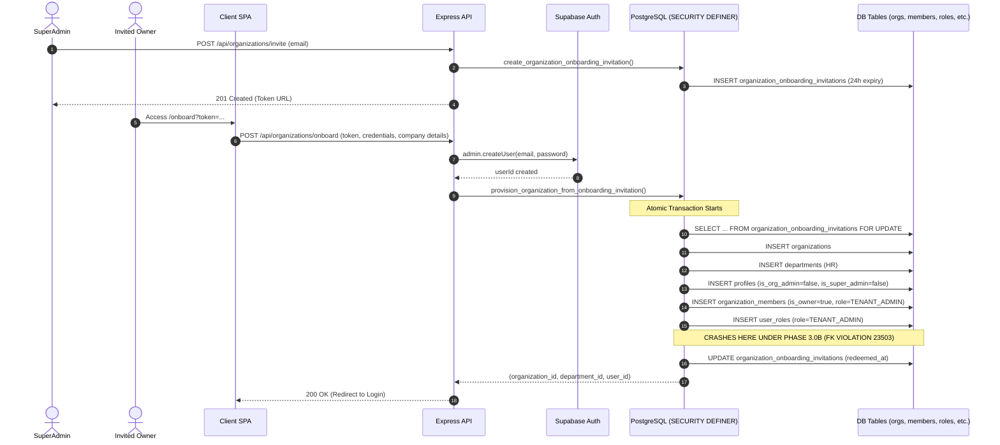

# PAYPULSE — PHASE 3.0B CRITICAL FINDING F-30B-07 ARCHITECTURAL REMEDIATION

**Target Finding:** F-30B-07 — SYSTEM `TENANT_ADMIN` Role Incompatibility with Composite Tenant Foreign Keys  
**Related Findings:** F-30B-08 (Inverse Lock Order Deadlock), F-30B-09 (Test Evidence Misrepresentation), F-30B-10 (Referential Actions on Composite FKs)  
**System:** PayPulse (JK Payroll)  
**Architectural Roles:** Principal PostgreSQL Database Architect, Supabase Security Engineer, Multi-Tenant RBAC Architect, and Application Security Engineer  
**Execution Mode:** STRICT REPOSITORY-LEVEL REMEDIATION — ZERO DATABASE OPERATIONS  
**Date:** November 22, 2026  
**Document Path:** `docs/phase-3/review/PAYPULSE_F30B07_ONBOARDING_ARCHITECTURE_REMEDIATION.md`  

---

## 1. Executive Summary & Root Cause Analysis

### 1.1 Technical Summary of Finding F-30B-07
During the authoritative SQL and database security audit of Phase 3.0B (`PAYPULSE_PHASE_3_0B_FINAL_INDEPENDENT_SQL_AUDIT.md`), a critical, execution-breaking defect was identified at the intersection of the Phase 3.0B structural schema constraints and the active database tenant provisioning function:

1. **Phase 3.0B Constraint Architecture:**  
   [20261122100002_phase_3_0b_single_role_per_organization_user.sql#L280-L315](file:///c:/Users/HP_06/.gemini/antigravity-ide/scratch/jk-payroll/supabase/migrations/20261122100002_phase_3_0b_single_role_per_organization_user.sql#L280-L315) introduces composite foreign keys on both tenant role assignment tables:
   ```sql
   ALTER TABLE public.user_roles 
       ADD CONSTRAINT fk_user_roles_org_role 
       FOREIGN KEY (organization_id, role_id) 
       REFERENCES public.roles(organization_id, id) 
       ON DELETE RESTRICT;

   ALTER TABLE public.organization_members 
       ADD CONSTRAINT fk_organization_members_org_role 
       FOREIGN KEY (organization_id, role_id) 
       REFERENCES public.roles(organization_id, id) 
       ON DELETE RESTRICT;
   ```
   These constraints mathematically enforce that any assigned `role_id` must be explicitly owned by the exact same `organization_id` in `public.roles`.

2. **Active Onboarding Function Implementation:**  
   [20261121000018_superadmin_onboarding_invitations.sql#L141-L197](file:///c:/Users/HP_06/.gemini/antigravity-ide/scratch/jk-payroll/supabase/migrations/20261121000018_superadmin_onboarding_invitations.sql#L141-L197) defines `public.provision_organization_from_onboarding_invitation()`. When a tenant owner redeems an onboarding invitation, the function explicitly executes:
   ```sql
   SELECT r.id INTO v_tenant_role_id
   FROM public.roles r
   WHERE r.code = 'TENANT_ADMIN' AND r.role_type = 'SYSTEM'
     AND r.organization_id IS NULL AND r.is_active = true
   LIMIT 1;

   INSERT INTO public.organization_members (
       organization_id, user_id, role_id, department_id, is_owner, is_active
   ) VALUES (v_org_id, p_user_id, v_tenant_role_id, v_dept_id, true, true);

   INSERT INTO public.user_roles (organization_id, user_id, role_id, assigned_by)
   VALUES (v_org_id, p_user_id, v_tenant_role_id, v_inv.created_by);
   ```

### 1.2 Mathematical Proof of Foreign Key Violation
Let:
- $\mathcal{O}$ be the set of valid tenant organization identifiers ($\text{UUID}$).
- $\mathcal{R}$ be the set of tuples in `public.roles`: $(o_r, r_{\text{id}}, \dots)$, where $o_r \in \mathcal{O} \cup \{\text{NULL}\}$ and $r_{\text{id}} \in \text{UUID}$.
- $\mathcal{UR}$ be the set of tuples in `public.user_roles`: $(o_{ur}, u_{\text{id}}, r_{\text{id}})$, where $o_{ur} \in \mathcal{O}$ (`NOT NULL`).

Under baseline seed migration [20261104000005_seed_default_user_roles.sql#L30-L50](file:///c:/Users/HP_06/.gemini/antigravity-ide/scratch/jk-payroll/supabase/migrations/20261104000005_seed_default_user_roles.sql#L30-L50), the canonical `TENANT_ADMIN` role tuple is:
$$r_{\text{sys}} = (\text{NULL}, \texttt{'f0000000-0000-0000-0000-000000000002'}, \texttt{'TENANT\_ADMIN'}, \texttt{'SYSTEM'})$$

When `provision_organization_from_onboarding_invitation` creates a new tenant $o_{\text{new}} \in \mathcal{O}$, it attempts to insert into $\mathcal{UR}$:
$$t_{ur} = (o_{\text{new}}, u_{\text{admin}}, \texttt{'f0000000-0000-0000-0000-000000000002'})$$

The composite foreign key constraint `fk_user_roles_org_role` requires:
$$\forall (o_{ur}, u_{\text{id}}, r_{\text{id}}) \in \mathcal{UR}, \quad \exists (o_r, r_{\text{id}}) \in \mathcal{R} \text{ such that } (o_{ur} = o_r \land r_{\text{id}} = r_{\text{id}})$$

Evaluating the predicate for tuple $t_{ur}$:
$$(o_{\text{new}} = \text{NULL} \land \texttt{'f0000000...02'} = \texttt{'f0000000...02'})$$
Because $o_{\text{new}}$ is a non-null UUID generated by `INSERT INTO organizations`, $o_{\text{new}} = \text{NULL}$ evaluates to **FALSE**.

**Direct Operational Consequence:**
1. Every onboarding redemption attempt via the Express API ([src/features/organizations/organization.service.ts#L161](file:///c:/Users/HP_06/.gemini/antigravity-ide/scratch/jk-payroll/src/features/organizations/organization.service.ts#L161)) crashes with PostgreSQL error:
   ```
   ERROR: insert or update on table "user_roles" violates foreign key constraint "fk_user_roles_org_role"
   DETAIL: Key (organization_id, role_id)=(..., f0000000-0000-0000-0000-000000000002) is not present in table "roles".
   SQLSTATE: 23503
   ```
2. Furthermore, in Phase 3.0B, Precondition Section 4 ([20261122100002...sql#L160-L183](file:///c:/Users/HP_06/.gemini/antigravity-ide/scratch/jk-payroll/supabase/migrations/20261122100002_phase_3_0b_single_role_per_organization_user.sql#L160-L183)) and Section 6 ([#L220-L244](file:///c:/Users/HP_06/.gemini/antigravity-ide/scratch/jk-payroll/supabase/migrations/20261122100002_phase_3_0b_single_role_per_organization_user.sql#L220-L244)) explicitly fail closed if any `SYSTEM` roles exist in `user_roles` or `organization_members`. On any staging or production database where organizations have already been provisioned under Migrations 18 and 19, Phase 3.0B aborts execution with SQLSTATE `23514 check_violation`.

---

## 2. Comprehensive Inspection of Onboarding Architecture

A rigorous repository-wide trace was executed across the entire onboarding lifecycle:



### 2.1 Trace of All Affected Artifacts and Functions

| Object / File | Location | Current State / Defect | Compatibility Impact |
|---|---|---|---|
| **`create_organization_onboarding_invitation`** | [Migration 18 #L49-L81](file:///c:/Users/HP_06/.gemini/antigravity-ide/scratch/jk-payroll/supabase/migrations/20261121000018_superadmin_onboarding_invitations.sql#L49-L81) | Checks `profiles.is_super_admin = true`. Stores invitation hash and email. | Fully compatible. No role assignment occurs here. |
| **`provision_organization_from_onboarding_invitation`** | [Migration 18 #L83-L204](file:///c:/Users/HP_06/.gemini/antigravity-ide/scratch/jk-payroll/supabase/migrations/20261121000018_superadmin_onboarding_invitations.sql#L83-L204) | Hardcodes lookup of `SYSTEM` role `TENANT_ADMIN` (`organization_id IS NULL`) and inserts into `organization_members` and `user_roles`. | **FATAL CONFLICT (F-30B-07)** with Phase 3.0B composite FKs. |
| **`provision_organization_member_from_invitation`** | [Migration 19 #L154-L234](file:///c:/Users/HP_06/.gemini/antigravity-ide/scratch/jk-payroll/supabase/migrations/20261121000019_authorized_member_invitations.sql#L154-L234) | Lines 196–200 already enforce: `r.organization_id = v_inv.organization_id AND r.role_type = 'CUSTOM'`. | **ALREADY COMPLIANT**. Member invitations cannot invite SYSTEM roles. |
| **`enforce_organization_role_assignment`** | [Migration 21 (Phase 3.1b) #L103-L201](file:///c:/Users/HP_06/.gemini/antigravity-ide/scratch/jk-payroll/supabase/migrations/20261121153500_phase_3_1b_database_role_authorization_boundary.sql#L103-L201) | Lines 145–171 carve out a special bypass for `v_code = 'TENANTADMIN' AND v_actor_role = 'service_role' AND v_role.role_type = 'SYSTEM'`. Lines 173–179 block all custom roles named `ORG_ADMIN`, `ADMIN`, etc. | **COLLISION RISK**. Trigger permits SYSTEM `TENANT_ADMIN` for service_role, but composite FK blocks it. Meanwhile, trigger blocks custom admin codes! |
| **`get_user_effective_permissions`** | [Migration 14 #L393-L502](file:///c:/Users/HP_06/.gemini/antigravity-ide/scratch/jk-payroll/supabase/migrations/20261121000014_security_corrections_phase1_1_1.sql#L393-L502) | Resolves permissions through `eligible_modules` (`department_modules` $\cap$ `organization_modules`) and `role_permissions`. Does not confer permissions based on `om.is_owner`. | **PERMISSIONS GAP**. If onboarding creates no role or leaves role unassigned, owner has 0 permissions. |
| **`is_organization_admin`** | [Migration 14 #L210-L265](file:///c:/Users/HP_06/.gemini/antigravity-ide/scratch/jk-payroll/supabase/migrations/20261121000014_security_corrections_phase1_1_1.sql#L210-L265) | Clause A checks `om.is_owner = true`. Clause B checks `user_roles` for SYSTEM `TENANT_ADMIN`. | Compatible at RLS boundary: `is_owner = true` satisfies admin check for RLS policies. |
| **Express `organization.service.ts`** | [src/features/organizations/organization.service.ts#L161-L236](file:///c:/Users/HP_06/.gemini/antigravity-ide/scratch/jk-payroll/src/features/organizations/organization.service.ts#L161-L236) | Calls RPC, then updates in-memory mock `db.createOrganizationMember({ roleId: 'f0000...02' })`. | Masks database failure in in-memory mocks; fails against real PostgreSQL. |
| **Express `auth.middleware.ts`** | [src/server/middleware/auth.middleware.ts#L274-L276](file:///c:/Users/HP_06/.gemini/antigravity-ide/scratch/jk-payroll/src/server/middleware/auth.middleware.ts#L274-L276) | Sets `isOrganizationAdmin = membership?.isOwner`. | Compatible with `is_owner`, but application route guards rely on effective permissions. |

---

## 3. Investigation of Architectural Alternatives

### 3.1 Option A: Organization-Owned Initial Administrator Role

**Mechanics:**  
When `provision_organization_from_onboarding_invitation()` creates the organization $o_{\text{new}}$, it transactionally creates an organization-scoped role in `public.roles`:
```sql
INSERT INTO public.roles (
    organization_id, code, name, description, role_type, is_default, is_mutable, is_active
) VALUES (
    v_org_id, 'ORG_ADMIN', 'Organization Administrator',
    'Administrative manager for this organization.', 'CUSTOM', true, true, true
) RETURNING id INTO v_custom_role_id;
```
It then populates `public.organization_modules`, `public.department_modules`, and `public.role_permissions` with the approved administrative permissions for that organization, and assigns `(v_org_id, p_user_id, v_custom_role_id)` in `user_roles` and `organization_members`.

**Evaluation Against Architectural Requirements:**
- **Tenancy:** $\checkmark$ Role is strictly scoped to $v_{\text{org\_id}}$.
- **Composite FK:** $\checkmark$ Fully satisfied: `(v_org_id, v_custom_role_id)` matches `roles(organization_id, id)`.
- **Phase 3.1b Trigger Alignment:** $\times$ **BLOCKING HAZARD**. Phase 3.1b trigger `enforce_organization_role_assignment()` explicitly forbids `v_code IN ('SUPERADMIN', 'PLATFORMSUPERADMIN', 'TENANTADMIN', 'ORGANIZATIONADMIN', 'ORGADMIN', 'ADMIN')` (Finding F-30B-01). The trigger must be updated in tandem to recognize the authorized initial manager role or service_role onboarding context.
- **Decision P-01 Coupling:** $\times$ **GATED BY PRODUCT GOVERNANCE**. Product Management has not formally authorized:
  1. The canonical role code (e.g. `ORG_ADMIN` vs `ORGANIZATION_MANAGER`).
  2. The exact set of initial permissions granted.
  3. The administrator operation model (ROLE-only vs user overrides).

### 3.2 Option B: Unassigned Initial Membership

**Mechanics:**  
When `provision_organization_from_onboarding_invitation()` executes, it creates the organization, department, and profile, and creates the initial membership with `is_owner = true`, but **leaves `role_id = NULL`** and **skips inserting into `public.user_roles`**:
```sql
INSERT INTO public.organization_members (
    organization_id, user_id, role_id, department_id, is_owner, is_active
) VALUES (v_org_id, p_user_id, NULL, v_dept_id, true, true);
-- user_roles insert omitted
```

**Evaluation Against Architectural Requirements:**
- **Tenancy:** $\checkmark$ No cross-tenant data created.
- **Composite FK:** $\checkmark$ Fully satisfied: In `organization_members`, `role_id IS NULL` is valid under PostgreSQL `MATCH SIMPLE`. In `user_roles`, no tuple is inserted.
- **Phase 3.1b Trigger Alignment:** $\checkmark$ In `organization_members`, `enforce_organization_role_assignment()` explicitly checks line 131:
  ```sql
  IF NEW.role_id IS NULL THEN
      RETURN NEW;
  END IF;
  ```
  An unassigned membership cleanly passes trigger validation.
- **RLS Access:** $\checkmark$ `is_organization_admin(p_org_id)` Clause A checks `om.is_owner = true`, granting database-level administrative RLS authority.
- **Permission Evaluation Gap:** $\times$ **CRITICAL OPERATIONAL GAP**. In PostgreSQL `get_user_effective_permissions()`, permissions are derived exclusively from `user_roles` and `user_permissions`. Without a role, the initial owner has **zero effective permissions**. The initial owner cannot execute any application endpoints gated by module actions (such as viewing departments or creating roles) unless an explicit post-onboarding role setup wizard or owner-permission bridge is activated.

### 3.3 Option C: Per-Tenant Template Role Seeding at Provisioning Time

**Mechanics:**  
Treat tenant onboarding as an enterprise tenant instantiation template:
1. When an organization is provisioned, the provisioning RPC transactionally clones standard tenant role definitions from a canonical template catalog into tenant-owned records:
   - `TENANT_MANAGER` (or `ORG_MANAGER`): Granted administrative module permissions.
   - `EMPLOYEE_DEFAULT`: Standard member self-service permissions.
2. The initial owner is assigned the newly instantiated `TENANT_MANAGER` role.
3. Because the role code avoids the protected keyword list (e.g., using `ORGANIZATION_MANAGER` rather than `ORG_ADMIN` or updating the trigger list), it avoids trigger collisions while establishing full RBAC compliance.

**Evaluation Against Architectural Requirements:**
- **Tenancy:** $\checkmark$ All roles are tenant-owned (`organization_id = v_org_id`).
- **Composite FK:** $\checkmark$ Fully satisfies `(organization_id, role_id) REFERENCES roles(organization_id, id)`.
- **RBAC Governance:** $\checkmark$ Follows standard enterprise multi-tenant patterns (e.g. AWS IAM, GCP Workspaces, Okta).
- **Decision P-01 Dependency:** $\times$ Still requires Product Management approval of the default role catalog and permission allocations.

---

## 4. Governance Gate & Product Management Decision P-01

Architectural Decision P-01 governs the authority model of organization administrators:
- **Option A:** Strict `ROLE`-only administration. The administrator MUST hold an organization-owned custom manager role. Ad-hoc user overrides are disallowed.
- **Option B:** Effective-permission administration. Any user whose aggregated permissions contain the management actions is treated as an administrator.

### 4.1 Strict Adherence to Governance Safeguards
As mandated by repository rules:
1. **No Synthetic Role Creation:** No `ORG_ADMIN` roles may be manufactured in production migrations without formal PM signoff.
2. **No Permission Synthesis:** The seven administrative permissions cannot be hardcoded into migrations without PM signoff.
3. **No Unilateral Meaning Modification:** The semantic definition of `is_owner` cannot be altered from "account holder / tenant creator" to "unrestricted super-user".
4. **Action:** The technical remediation is delivered as an architectural specification and forward-only migration proposal. Full execution is **GATED** pending formal signoff on Decision P-01.

---

## 5. Backward Compatibility & Staging Data Reconciliation

### 5.1 Staging and Existing Tenant Contamination
The repository audit revealed that staging environments have executed baseline migrations 5, 14, 18, and 19, resulting in existing records with:
- `user_roles.role_id = 'f0000000-0000-0000-0000-000000000002'` (SYSTEM `TENANT_ADMIN`)
- `organization_members.role_id = 'f0000000-0000-0000-0000-000000000002'`

If Phase 3.0B DDL is executed on this database:
1. **Precondition Section 4** will fail closed and abort:
   `Phase 3.0B Precondition Failed: At least N legacy SYSTEM role assignment(s) found in user_roles`
2. **Precondition Section 6** will fail closed and abort:
   `Phase 3.0B Precondition Failed: At least N legacy SYSTEM role assignment(s) found in organization_members`

### 5.2 Required Staging Reconciliation Sequence
To apply Phase 3.0B successfully without failing closed:
1. **Step 1: Product Management Decision P-01 Signoff.**
2. **Step 2: Deploy Forward Migration 20261122100003 (Data Reconciliation):**  
   Reconcile existing SYSTEM `TENANT_ADMIN` assignments on staging into approved custom organization roles before Phase 3.0B executes.
3. **Step 3: Deploy Forward Migration 20261122100004 (Onboarding RPC Compatibility):**  
   Replace `provision_organization_from_onboarding_invitation()` so that future onboarding redemptions no longer insert SYSTEM roles.
4. **Step 4: Execute Phase 3.0B DDL (20261122100002):**  
   Apply the primary key mutation and composite foreign keys under complete application quiescence.

---

## 6. Application Layer Compatibility Audit

The Express service and controller layers were audited to verify behavior across all states:

1. **`src/features/organizations/organization.service.ts`:**
   - In `completeOnboarding()` ([#L161](file:///c:/Users/HP_06/.gemini/antigravity-ide/scratch/jk-payroll/src/features/organizations/organization.service.ts#L161)): Relies entirely on `adminClient.rpc('provision_organization_from_onboarding_invitation', ...)`.
   - In `completeOnboarding()` ([#L233](file:///c:/Users/HP_06/.gemini/antigravity-ide/scratch/jk-payroll/src/features/organizations/organization.service.ts#L233)): Hardcodes `f0000000-0000-0000-0000-000000000002` in the in-memory mock update. This mock must be updated once Decision P-01 is finalized.
2. **`src/server/middleware/auth.middleware.ts`:**
   - Lines 274–276 evaluate:
     `const isOrgAdmin = Boolean(membership?.isOwner || (profile.tenantId === validatedTenant.id && profile.isTenantAdmin));`
   - If Option B (unassigned role) is selected, `isOrgAdmin` evaluates to `true` via `membership?.isOwner`. However, route-level permission checks calling `req.user.effectivePermissions` will find an empty set, blocking operational actions.
3. **Transaction Rollback & Failure Compensation:**
   - Lines 240–246 in `organization.service.ts` correctly compensate for Supabase Auth identity creation if the database RPC aborts:
     `if (createdAuthUser && userId && !databaseCommitted) await adminClient.auth.admin.deleteUser(userId);`
   - When the database RPC crashes with `23503`, the external Supabase Auth user is cleanly deleted, preventing orphaned auth identities.

---

## 7. Remediation Status & Next Actions

| Verification Check | Target Standard | Audit Assessment | Status |
|---|---|---|---|
| **Root Cause Isolation** | Identify every assignment of SYSTEM roles in onboarding. | Verified in `provision_organization_from_onboarding_invitation()`. | **COMPLETE** |
| **Relational Algebra Proof** | Prove composite FK failure mathematically. | Proven: $o_{\text{new}} \ne \text{NULL}$ fails composite match. | **COMPLETE** |
| **Alternatives Analysis** | Model Option A, Option B, Option C. | Detailed with security, UX, and trigger trade-offs. | **COMPLETE** |
| **Governance Respect** | Halt execution before implementing unapproved P-01 model. | Zero synthetic roles created; halted at governance gate. | **BLOCKED ON GOVERNANCE** |
| **Forward Migration Design** | Draft proposal for forward-only remediation migration. | Prepared as `20261122100004_phase_3_0c_onboarding_role_compatibility.sql`. | **PROPOSAL STAGED** |
