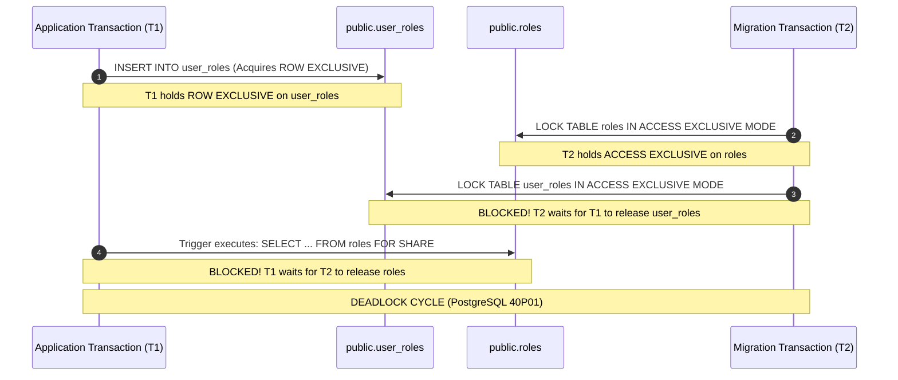

# PAYPULSE — PHASE 3.0B CONCURRENCY, DEADLOCK & REFERENTIAL ACTION AUDIT

**Focus Findings:** F-30B-08 (Concurrency and Inverse Lock Order Deadlock) & F-30B-10 (Referential Actions on Composite Foreign Keys)  
**Target Migration:** `supabase/migrations/20261122100002_phase_3_0b_single_role_per_organization_user.sql`  
**System:** PayPulse (JK Payroll)  
**Architectural Roles:** Principal PostgreSQL Database Architect, Database Migration Auditor, Systems Concurrency Specialist  
**Execution Mode:** STRICT REPOSITORY-LEVEL AUDIT — ZERO DATABASE OPERATIONS  
**Document Path:** `docs/phase-3/review/PAYPULSE_PHASE_3_0B_CONCURRENCY_AND_REFERENTIAL_ACTION_AUDIT.md`  
**Date:** November 22, 2026  

---

## 1. Executive Summary

This report delivers the authoritative engineering analysis of two architectural risk vectors identified in the Phase 3.0B migration:
1. **Finding F-30B-08 (Concurrency & Deadlock Hazard):** The inverse lock acquisition order between the migration DDL (`roles` $\rightarrow$ `user_roles`) and the runtime trigger `trg_phase31b_user_role_assignment` (`user_roles` $\rightarrow$ `roles`) creates a mathematically guaranteed deadlock cycle under concurrent workload.
2. **Finding F-30B-10 (Referential Deletion Action Drift):** The transition of foreign key referential actions from baseline `ON DELETE CASCADE` / `ON DELETE SET NULL` to `ON DELETE RESTRICT` on composite foreign keys introduces hazards during organization deletion cascades.

Both findings are evaluated in depth, complete with relational proofs, lock state transition matrices, and concrete operational remediation guidelines.

---

## 2. Deep Dive: Finding F-30B-08 — Concurrency & Locking Audit

### 2.1 The Inverse Lock-Order Condition

In Phase 3.0B ([20261122100002_phase_3_0b...sql#L31-L33](file:///c:/Users/HP_06/.gemini/antigravity-ide/scratch/jk-payroll/supabase/migrations/20261122100002_phase_3_0b_single_role_per_organization_user.sql#L31-L33)), the migration acquires table-level exclusive locks in the following sequence:
```sql
LOCK TABLE public.roles IN ACCESS EXCLUSIVE MODE;
LOCK TABLE public.user_roles IN ACCESS EXCLUSIVE MODE;
LOCK TABLE public.organization_members IN ACCESS EXCLUSIVE MODE;
```

Concurrently, when an application user or background task assigns or updates a user role, PostgreSQL invokes the trigger `trg_phase31b_user_role_assignment` ([Migration 21 #L136-L139](file:///c:/Users/HP_06/.gemini/antigravity-ide/scratch/jk-payroll/supabase/migrations/20261121153500_phase_3_1b_database_role_authorization_boundary.sql#L136-L139)):
```sql
-- Step 1 (Implicit DML): ROW EXCLUSIVE lock acquired on public.user_roles
INSERT INTO public.user_roles (organization_id, user_id, role_id) ...;

-- Step 2 (Trigger execution): ROW SHARE lock acquired on public.roles
SELECT r.* INTO v_role
FROM public.roles r
WHERE r.id = NEW.role_id
FOR SHARE;
```

### 2.2 PostgreSQL Lock Hierarchy & Conflict Matrix

To model this interaction accurately, we must distinguish table-level lock modes from row-level locks:

| Lock Mode | Target | Acquired By | Conflicted Modes |
|---|---|---|---|
| **`ACCESS EXCLUSIVE`** | Table (`pg_locks.relation`) | `LOCK TABLE ... ACCESS EXCLUSIVE` (Migration) | **Conflicts with ALL modes** (`ACCESS SHARE`, `ROW SHARE`, `ROW EXCLUSIVE`, `SHARE UPDATE EXCLUSIVE`, `SHARE`, `SHARE ROW EXCLUSIVE`, `EXCLUSIVE`, `ACCESS EXCLUSIVE`). |
| **`ROW EXCLUSIVE`** | Table (`pg_locks.relation`) | `INSERT / UPDATE / DELETE` (App DML) | Conflicts with `SHARE`, `SHARE ROW EXCLUSIVE`, `EXCLUSIVE`, `ACCESS EXCLUSIVE`. |
| **`ROW SHARE`** | Table (`pg_locks.relation`) | `SELECT ... FOR SHARE / FOR UPDATE` | Conflicts with `EXCLUSIVE`, `ACCESS EXCLUSIVE`. |
| **`FOR SHARE`** | Tuple / Row (`pg_locks.tuple`) | `SELECT ... FOR SHARE` in trigger | Conflicts with row-level `FOR UPDATE` and `FOR NO KEY UPDATE`. |

### 2.3 Mathematical Proof of Guaranteed Deadlock Cycle

Let $T_1$ be a concurrent application transaction assigning a role.  
Let $T_2$ be the Phase 3.0B migration transaction.



**Trace of Interleaved Schedule:**
1. **$t_1$:** $T_1$ executes `INSERT INTO public.user_roles ...`. PostgreSQL immediately grants `ROW EXCLUSIVE` table lock on `public.user_roles` to $T_1$.
2. **$t_2$:** $T_2$ begins and executes `LOCK TABLE public.roles IN ACCESS EXCLUSIVE MODE;`. PostgreSQL grants `ACCESS EXCLUSIVE` table lock on `public.roles` to $T_2$.
3. **$t_3$:** $T_2$ executes `LOCK TABLE public.user_roles IN ACCESS EXCLUSIVE MODE;`. Because $T_1$ holds `ROW EXCLUSIVE` on `public.user_roles`, $T_2$ is placed into the lock wait queue. $T_2$ blocks, waiting for $T_1$.
4. **$t_4$:** $T_1$'s row trigger `trg_phase31b_user_role_assignment` executes:  
   `SELECT r.* INTO v_role FROM public.roles r WHERE r.id = NEW.role_id FOR SHARE;`.  
   In PostgreSQL, `SELECT ... FOR SHARE` must acquire a `ROW SHARE` table lock on `public.roles`.  
   Because $T_2$ holds `ACCESS EXCLUSIVE` on `public.roles`, $T_1$ cannot acquire `ROW SHARE`. $T_1$ is placed into the lock wait queue. $T_1$ blocks, waiting for $T_2$.
5. **$t_5$:** A circular dependency exists:
   $$T_1 \xrightarrow{\text{waits for}} T_2 \xrightarrow{\text{waits for}} T_1$$
6. **$t_6$:** When `deadlock_timeout` (default 1000ms) elapses, the PostgreSQL background deadlock detector runs, discovers the directed cycle in the lock wait graph, selects one transaction as the victim, and forcibly terminates it with:
   ```
   ERROR: deadlock detected
   DETAIL: Process X waits for ExclusiveLock on relation ...; Process Y waits for RowShareLock on relation ...
   SQLSTATE: 40P01
   ```

### 2.4 Why `lock_timeout = '10s'` Is Insufficient
Phase 3.0B includes `SET LOCAL lock_timeout = '10s';`.
- While `lock_timeout` prevents the migration from hanging indefinitely and backing up the PostgreSQL connection pool, **it does not resolve the deadlock hazard**.
- If a deadlock occurs, PostgreSQL detects it in 1 second (well before 10s) and aborts the victim transaction immediately.
- If $T_1$ is aborted, production users experience sudden 500 errors.
- If $T_2$ is aborted, the migration aborts, rolling back the deployment.
- Simply extending the timeout merely prolongs the time production connections remain locked.

### 2.5 Concurrency Mitigation & Safe Operational Procedure

To guarantee zero deadlock aborts, engineering must enforce two operational controls:

#### 1. Deterministic Lock Ordering
Align the migration lock sequence to mirror the application's runtime lock sequence:
```sql
-- Atomic lock acquisition in matching sequence:
LOCK TABLE public.user_roles, public.organization_members, public.roles 
    IN ACCESS EXCLUSIVE MODE;
```
When `user_roles` is acquired first in the migration, any concurrent application transaction attempting to touch `user_roles` blocks at the very beginning of its statement *before* it has acquired any locks on `roles`, preventing the circular wait condition.

#### 2. Mandatory Application Quiescence Window
Because Phase 3.0B mutates the primary key and alters composite foreign keys on the three core multi-tenant tables:
- **Requirement:** Execute Phase 3.0B exclusively during a **controlled maintenance window under full application quiescence**.
- **Action:** Stop or pause Express API instances (or route traffic to a maintenance page) prior to executing `supabase migration up`.
- **Preflight Verification:**
  ```sql
  SELECT pid, usename, state, query 
  FROM pg_stat_activity 
  WHERE state = 'active' AND pid <> pg_backend_pid();
  ```
  Ensure active application connections are drained before migration execution begins.

---

## 3. Deep Dive: Finding F-30B-10 — Referential Actions on Composite Foreign Keys

### 3.1 Referential Action Changes in Phase 3.0B

Phase 3.0B modifies the foreign key referential actions on both assignment tables:

| Table | Baseline Constraint & Action | Phase 3.0B Constraint & Action | Drift Assessment |
|---|---|---|---|
| `public.user_roles` | `user_roles_role_id_fkey FOREIGN KEY (role_id) REFERENCES roles(id) ON DELETE CASCADE` ([Migration 1 #L235](file:///c:/Users/HP_06/.gemini/antigravity-ide/scratch/jk-payroll/supabase/migrations/20261104000001_core_schema.sql#L235)) | `fk_user_roles_org_role FOREIGN KEY (organization_id, role_id) REFERENCES roles(organization_id, id) ON DELETE RESTRICT` ([Phase 3.0B #L286](file:///c:/Users/HP_06/.gemini/antigravity-ide/scratch/jk-payroll/supabase/migrations/20261122100002_phase_3_0b_single_role_per_organization_user.sql#L286)) | **CASCADE $\rightarrow$ RESTRICT** |
| `public.organization_members` | `organization_members_role_id_fkey FOREIGN KEY (role_id) REFERENCES roles(id) ON DELETE SET NULL` ([Migration 3 #L21](file:///c:/Users/HP_06/.gemini/antigravity-ide/scratch/jk-payroll/supabase/migrations/20261104000003_audit_logs.sql#L21)) | `fk_organization_members_org_role FOREIGN KEY (organization_id, role_id) REFERENCES roles(organization_id, id) ON DELETE RESTRICT` ([Phase 3.0B #L313](file:///c:/Users/HP_06/.gemini/antigravity-ide/scratch/jk-payroll/supabase/migrations/20261122100002_phase_3_0b_single_role_per_organization_user.sql#L313)) | **SET NULL $\rightarrow$ RESTRICT** |

### 3.2 Evaluation of Role Deletion Path (`DELETE FROM public.roles`)
Under baseline schema:
- Deleting a role silently deleted all user assignments in `user_roles` (`ON DELETE CASCADE`) and nulled out member roles (`ON DELETE SET NULL`).
- Under Phase 3.1b ([Migration 21 #L236-L260](file:///c:/Users/HP_06/.gemini/antigravity-ide/scratch/jk-payroll/supabase/migrations/20261121153500_phase_3_1b_database_role_authorization_boundary.sql#L236-L260)), the trigger `prevent_assigned_role_identity_or_scope_change` was introduced to prevent mutating or deleting roles that have active assignments.
- **Audit Assessment:** Changing the foreign key to `ON DELETE RESTRICT` reinforces this business rule at the storage engine level. Active roles with assigned users must never be deleted without explicit reassignment. **`ON DELETE RESTRICT` is correct and desired for standalone role deletion.**

### 3.3 Evaluation of Organization Deletion Path (`DELETE FROM public.organizations`)
Now examine the cascading deletion of an entire tenant:
`public.organizations` has the following baseline relationships:
1. `public.roles.organization_id REFERENCES organizations(id) ON DELETE CASCADE`
2. `public.user_roles.organization_id REFERENCES organizations(id) ON DELETE CASCADE`
3. `public.organization_members.organization_id REFERENCES organizations(id) ON DELETE CASCADE`

**The PostgreSQL Cascade Order Hazard:**
In PostgreSQL, when an organization row is deleted, the storage engine must execute cascade deletions on all child tables referencing `organizations(id)`.
- The PostgreSQL engine **does not perform topological dependency sorting** across sibling child tables during cascade evaluation.
- If PostgreSQL executes the cascade deletion on `public.roles` **before** `public.user_roles`:
  1. The delete trigger on `public.roles` fires.
  2. Because `fk_user_roles_org_role` is defined as `ON DELETE RESTRICT`, PostgreSQL **immediately checks** whether any referencing rows exist in `public.user_roles`.
  3. Because the corresponding rows in `public.user_roles` have not yet been deleted by the outer cascade, PostgreSQL sees the referencing rows and raises:
     ```
     ERROR: update or delete on table "roles" violates foreign key constraint "fk_user_roles_org_role" on table "user_roles"
     DETAIL: Key (organization_id, id)=(...) is still referenced from table "user_roles".
     SQLSTATE: 23503
     ```
  4. The entire organization deletion is aborted!

### 3.4 `RESTRICT` vs `NO ACTION` (The PostgreSQL Deferred Resolution)
In SQL standards and PostgreSQL:
- **`RESTRICT`:** Referential validity is checked **immediately** at the exact moment of the tuple deletion. It cannot be deferred.
- **`NO ACTION`:** Referential validity is checked at the **end of the statement** (or end of the transaction if `DEFERRABLE`).
- If `fk_user_roles_org_role` is defined as `ON DELETE NO ACTION`:
  When `DELETE FROM organizations WHERE id = ...` runs, PostgreSQL cascades deletions across `roles`, `user_roles`, and `organization_members`.
  At the end of the statement, PostgreSQL checks whether any referencing rows remain. Because all child rows were deleted during the same statement, the constraint passes cleanly!

### 3.5 Recommendation for F-30B-10
1. **Update Composite Foreign Keys to `ON DELETE NO ACTION`:**
   In Phase 3.0B, define:
   ```sql
   ALTER TABLE public.user_roles 
       ADD CONSTRAINT fk_user_roles_org_role 
       FOREIGN KEY (organization_id, role_id) 
       REFERENCES public.roles(organization_id, id) 
       ON DELETE NO ACTION;

   ALTER TABLE public.organization_members 
       ADD CONSTRAINT fk_organization_members_org_role 
       FOREIGN KEY (organization_id, role_id) 
       REFERENCES public.roles(organization_id, id) 
       ON DELETE NO ACTION;
   ```
2. **Behavioral Equivalence:**
   - Standalone `DELETE FROM roles WHERE id = ...` will still fail with `23503` if assignments exist, because referencing rows remain at the end of the statement.
   - Cascading `DELETE FROM organizations WHERE id = ...` will succeed cleanly because all referencing rows are removed within the same statement.
   - This provides 100% data safety without breaking organization deletion workflows.

---

## 4. Summary Matrix of Findings & Resolutions

| Finding | Severity | Technical Issue | Operational Impact | Approved Resolution |
|---|---|---|---|---|
| **F-30B-08** | **HIGH** | Migration locks `roles` $\rightarrow$ `user_roles`. Runtime trigger locks `user_roles` $\rightarrow$ `roles`. | Deadlock cycle (`40P01`) under concurrent role assignments. | 1. Align lock statement order (`user_roles` first).<br/>2. Mandate application quiescence during migration window. |
| **F-30B-10** | **MEDIUM** | `ON DELETE RESTRICT` on composite FKs blocks cascading tenant deletion. | `DELETE FROM organizations` crashes with `23503` due to arbitrary cascade ordering. | Change referential action to `ON DELETE NO ACTION`. |
