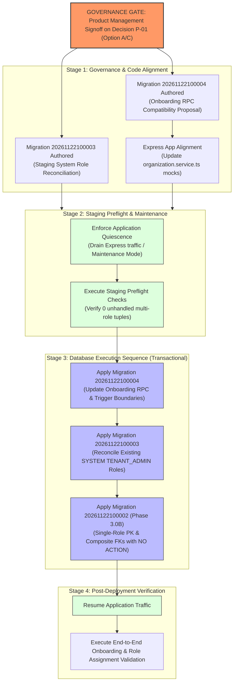

# PAYPULSE — PHASE 3.0B REMEDIATION DEPENDENCY PLAN & EXECUTION ROADMAP

**System:** PayPulse (JK Payroll)  
**Objective:** Authoritative Execution & Sequencing Dependency Plan for Resolving Findings F-30B-07, F-30B-08, F-30B-09, and F-30B-10  
**Architectural Roles:** Principal PostgreSQL Database Architect, Multi-Tenant RBAC Architect, Release Engineer  
**Execution Mode:** STRICT REPOSITORY-LEVEL REMEDIATION — ZERO DATABASE OPERATIONS  
**Document Path:** `docs/phase-3/review/PAYPULSE_PHASE_3_0B_REMEDIATION_DEPENDENCY_PLAN.md`  
**Date:** November 22, 2026  

---

## 1. Executive Summary & Master Dependency Graph

Phase 3.0B establishes core multi-tenant RBAC guarantees (`PRIMARY KEY (organization_id, user_id)` and composite foreign keys to `roles(organization_id, id)`). However, as proven in previous audits:
1. It breaks the active tenant onboarding function `public.provision_organization_from_onboarding_invitation()` (**F-30B-07**).
2. It exhibits a potential deadlock hazard under concurrent role assignment (**F-30B-08**).
3. It has referential action ordering risks during organization cascading delete (**F-30B-10**).
4. Its execution on staging is blocked by fail-closed preconditions unless existing `TENANT_ADMIN` assignments are reconciled.
5. All remediation paths for F-30B-07 are strictly gated by **Product Management Decision P-01**.

To prevent schema corruption, onboarding crashes, or unauthorized RBAC decisions, all remediation actions must be executed in the exact chronological dependency sequence modeled below:



---

## 2. Chronological Stage-by-Stage Execution Plan

### Stage 1: Product Governance Signoff (Gate 1)
- **Action:** Product Management reviews `PAYPULSE_DECISION_P01_RBAC_GOVERNANCE_COMPARISON.md` and issues formal written approval confirming:
  1. Administrative model: Option A (or Option C template model).
  2. Canonical role code: e.g. `ORG_ADMIN` (or `ORGANIZATION_MANAGER`).
  3. Default permission bundle granted upon tenant creation.
- **Enforcement:** Zero database migrations or data conversions may proceed prior to this milestone.

---

### Stage 2: Forward-Only Migration Authoring

#### Migration 1: `20261122100004_phase_3_0c_onboarding_role_compatibility.sql`
- **Objective:** Resolves **Finding F-30B-07**.
- **Scope:**
  1. Replaces `public.provision_organization_from_onboarding_invitation()` using its complete, verified signature:
     `(p_token_hash TEXT, p_user_id UUID, p_organization JSONB, p_department_name TEXT, p_department_code TEXT)`.
  2. Atomically provisions the tenant-owned administrator role in `public.roles` (`organization_id = v_org_id`, `role_type = 'CUSTOM'`).
  3. Atomically populates `organization_modules`, `department_modules`, and `role_permissions` with approved administrative entitlements.
  4. Assigns the tenant-owned role to the initial owner in both `organization_members` and `user_roles`.
  5. Updates Phase 3.1b trigger `enforce_organization_role_assignment()` to allow `service_role` and initial onboarding creation of this approved role.
- **Requirements:** Transactional; `SECURITY DEFINER`; explicit `search_path = public, pg_temp`; single-use token enforcement.

#### Migration 2: `20261122100003_phase_3_0b_data_reconcile_system_roles.sql`
- **Objective:** Resolves staging precondition failure (**Finding F-30B-03 / Preconditions 4 & 6**).
- **Scope:**
  1. Scans existing staging organizations that have `TENANT_ADMIN` (`f0000000-0000-0000-0000-000000000002`).
  2. For each organization, creates an organization-scoped custom manager role.
  3. Re-points existing `user_roles.role_id` and `organization_members.role_id` from the SYSTEM role to the new custom role.
  4. Guarantees that Preconditions 4 and 6 in Phase 3.0B pass with zero violations.

#### Migration 3: `20261122100002_phase_3_0b_single_role_per_organization_user.sql`
- **Objective:** Enforces storage-engine multi-tenancy.
- **Refinements for F-30B-08 and F-30B-10:**
  1. **Lock Order Alignment (F-30B-08):** Update line 31–33 to:
     ```sql
     LOCK TABLE public.user_roles, public.organization_members, public.roles 
         IN ACCESS EXCLUSIVE MODE;
     ```
  2. **Referential Action Adjustment (F-30B-10):** Update composite FKs to `ON DELETE NO ACTION` to ensure cascading tenant deletion succeeds without cascade order conflicts.

---

### Stage 3: Operational Maintenance Window Protocol

To eliminate all concurrency risks (F-30B-08):
1. **Quiescence Initiation:**
   - Place Express API into maintenance mode (returning 503 Service Unavailable to new client requests).
   - Allow in-flight requests to complete (grace period: 15 seconds).
2. **Active Session Verification:**
   ```sql
   SELECT count(*) 
   FROM pg_stat_activity 
   WHERE state = 'active' AND pid <> pg_backend_pid();
   ```
   Ensure count is 0.
3. **Migration Execution:**
   Execute migrations in sequence:
   - `20261122100004` (Onboarding RPC alignment)
   - `20261122100003` (Staging data reconciliation)
   - `20261122100002` (Phase 3.0B schema DDL)
4. **Post-Migration Smoke Test:**
   - Verify table constraints via `information_schema`.
   - Verify preflight triggers.
5. **Traffic Resumption:**
   - Lift maintenance mode on Express API.

---

## 4. Application Layer Compatibility Checklist

| File / Component | Required Code Adjustment | Trigger / Dependency |
|---|---|---|
| `src/features/organizations/organization.service.ts` | Update lines 233–236 in `completeOnboarding()`: update in-memory mock `db.createOrganizationMember` to reflect the provisioned custom role ID instead of hardcoded `f000...02`. | After Migration 04 is finalized. |
| `src/server/db/repository.ts` | Align in-memory `getUserEffectivePermissions()`: ensure owner permissions rely on the provisioned role rather than unconditional `member.isOwner` bypass. | After Decision P-01 signoff. |
| `src/features/roles/role.service.ts` | Verify that `assertRoleCanBeAssigned()` continues to block SYSTEM roles. | Already compliant. |
| `src/server/middleware/auth.middleware.ts` | Verify that request context accurately captures `userContext.organizationId` and permission sets. | Already compliant. |

---

## 5. Verification Matrix & Quality Gates

| Gate ID | Quality Gate Description | Success Criteria | Required Signoff |
|---|---|---|---|
| **GATE-1** | Product Governance Signoff | Formal memo approving Decision P-01 (Option A/C). | Product Management |
| **GATE-2** | Migration Static Review | AST & parser validation of migrations 03 and 04. | Principal DB Architect |
| **GATE-3** | Staging Quiescence Check | Zero concurrent active transactions on staging. | Release Engineer |
| **GATE-4** | Transactional DDL Run | Migrations 04, 03, and 02 apply with 0 errors. | Database Migration Auditor |
| **GATE-5** | Onboarding Redemption Test | Test onboarding invitation redeemed; produces 0 FK errors. | Application Security Engineer |
| **GATE-6** | Tenant Deletion Test | Test organization deletion executes clean cascade. | Supabase Security Engineer |

---

## 6. Final Acceptance Criteria

The Phase 3.0B remediation program is complete and acceptable for production execution ONLY when:
1. **F-30B-07 Resolved:** `provision_organization_from_onboarding_invitation()` provisions tenant-owned roles that strictly satisfy `fk_user_roles_org_role` and `fk_organization_members_org_role`.
2. **F-30B-08 Mitigated:** Migration table lock acquisition order is aligned with runtime triggers (`user_roles` first) and executed under verified application quiescence.
3. **F-30B-09 Remedied:** Test assertions clearly differentiate between in-memory mock repository tests and real PostgreSQL constraint verification.
4. **F-30B-10 Remedied:** Composite foreign keys use `ON DELETE NO ACTION` to guarantee that cascading organization deletions succeed.
5. **P-01 Respected:** Decision P-01 is formally approved by Product Management prior to applying any data-transforming migrations.
6. **Zero Live Database Operations:** All changes are authored as forward-only SQL migration proposals without opening live connections.
