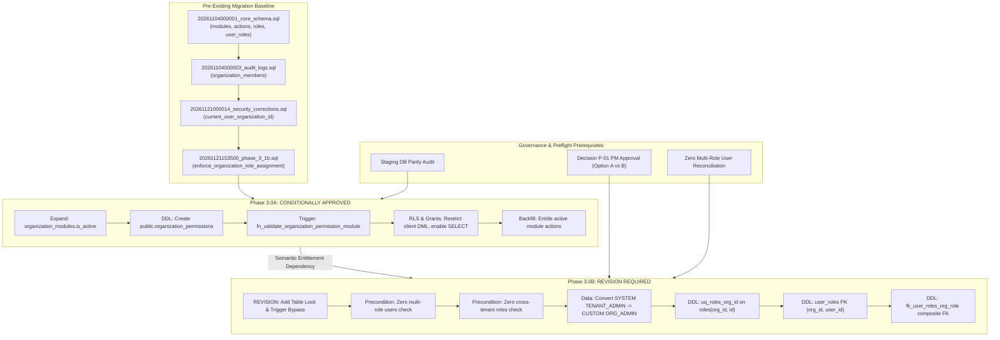

# PAYPULSE (JK PAYROLL) — PHASE 3.0A / 3.0B INDEPENDENT MIGRATION PEER REVIEW
## PostgreSQL Data Integrity, Tenant Isolation & Migration Safety Audit Report

**System:** PayPulse (JK Payroll)  
**Architecture:** Multi-Tenant Cascading RBAC Platform  
**Technology Stack:** React 19 SPA, Express 4, Supabase Auth, PostgreSQL 17+  
**Review Scope:**
1. `supabase/migrations/20261122100001_phase_3_0a_organization_permission_entitlements.sql`
2. `supabase/migrations/20261122100002_phase_3_0b_single_role_per_organization_user.sql`  
**Execution Mode:** STRICT READ-ONLY REPOSITORY REVIEW (No DB writes or execution authorized)  
**Audit Date:** November 22, 2026  
**Document Location:** `docs/phase-3/review/PAYPULSE_PHASE_3_0_COMPREHENSIVE_PEER_REVIEW_REPORT.md`

---

## 1. Executive Summary & Formal Status Assignments

An independent technical peer review of Phase 3.0A and Phase 3.0B forward migration scripts was conducted. The review evaluated the actual SQL implementations against the baseline schema migrations (1–21), database functions, active triggers, seeds, and the approved Phase 2/2.2 architecture specifications.

### Formal Status Assignments

| Migration Script | Final Peer Review Verdict | Summary Rationale |
|---|---|---|
| **`20261122100001_phase_3_0a_organization_permission_entitlements.sql`** | **CONDITIONALLY APPROVED FOR EXECUTION REVIEW** | Additive "Expand" migration. Fully transaction-safe and non-destructive. RLS enforcement, tenant-isolated `SELECT`, direct client DML revocation, and idempotent backfill verified. Approved subject to staging preflight verification of `organization_modules` active records. |
| **`20261122100002_phase_3_0b_single_role_per_organization_user.sql`** | **REVISION REQUIRED** | **Contains a critical execution-blocking defect (F-30B-01):** Section 3 update to `ORG_ADMIN` collides with Phase 3.1b trigger `trg_phase31b_user_role_assignment`, causing unconditional failure (`ERRCODE 42501`). Also exhibits a concurrency race hazard (missing table lock) and premature coupling with unapproved Decision P-01. |

> [!IMPORTANT]
> **A peer-review approval does not authorize migration execution.**
> Execution of migrations against any database environment requires explicit operational authorization, prior staging backup snapshot, and an active change control window.

---

## 2. Technical Audit by Migration

### 2.1 Phase 3.0A: Organization Permission Entitlements
*Source: `supabase/migrations/20261122100001_phase_3_0a_organization_permission_entitlements.sql`*

#### A. Table Design & Constraints
- **Primary Key:** `PRIMARY KEY (organization_id, module_action_id)`. Guarantees single entitlement per organization at the storage layer without artificial surrogate keys.
- **Organization Module FK:**
  ```sql
  CONSTRAINT fk_org_permissions_module FOREIGN KEY (organization_id, module_id)
      REFERENCES public.organization_modules(organization_id, module_id) ON DELETE CASCADE
  ```
  References the composite primary key of `public.organization_modules`. Cascades cleanly if a module is revoked from an organization or if an organization is deleted.
- **Module Action FK:**
  ```sql
  CONSTRAINT fk_org_permissions_action FOREIGN KEY (module_action_id)
      REFERENCES public.module_actions(id) ON DELETE CASCADE
  ```
- **Attribution FK:** `created_by UUID REFERENCES auth.users(id) ON DELETE SET NULL` prevents user deletions from blocking entitlement records.
- **Covering Indexes:** Includes `(organization_id, module_id)`, `(module_action_id)`, and `(organization_id, is_active)` to accelerate runtime RBAC evaluation.

#### B. Catalog Integrity & Validation Trigger
- Prevents cross-module entitlement pollution via trigger function `fn_validate_organization_permission_module()` and trigger `trg_validate_org_permission_module`.
- Confirmed canonical PascalCase action naming (`Role.View`, `Role.Add`, `UserRole.Edit`) is preserved. Zero snake_case duplicate catalog entries introduced.
- *Finding F-30A-01 (MEDIUM):* The trigger validates consistency on `organization_permissions` mutation, but does not monitor subsequent updates to `public.module_actions.module_id`. A declarative composite FK (`FOREIGN KEY (module_action_id, module_id) REFERENCES public.module_actions(id, module_id)`) backed by a unique constraint on `module_actions(id, module_id)` is recommended for future hardening.

#### C. Backfill Safety & Privilege Expansion Analysis
```sql
INSERT INTO public.organization_permissions (
    organization_id, module_id, module_action_id, is_active, created_at
)
SELECT 
    om.organization_id, om.module_id, ma.id, true, clock_timestamp()
FROM public.organization_modules om
JOIN public.module_actions ma ON ma.module_id = om.module_id
WHERE om.is_active = true
ON CONFLICT (organization_id, module_action_id) DO NOTHING;
```
- **Zero Privilege Escalation Risk:** In PayPulse's Three-Tier RBAC, `organization_permissions` establishes Tier 1 (Organization Entitlement). Users cannot exercise permissions without Tier 3 grants (`role_permissions` or `user_permissions`). Populating Tier 1 does not expand user privileges.
- **Idempotency:** Uses `ON CONFLICT (organization_id, module_action_id) DO NOTHING` for safe re-runs.
- *Finding F-30A-02 (MEDIUM):* Section 1 adds `is_active BOOLEAN NOT NULL DEFAULT true` to `public.organization_modules`, causing all existing rows to evaluate to `true` during the backfill. Staging preflight must verify that all existing `organization_modules` rows represent active, licensed modules.

#### D. Row Level Security & Privileges
- RLS enabled and forced (`FORCE ROW LEVEL SECURITY`).
- `SELECT` policy enforces strict tenant isolation:
  ```sql
  CREATE POLICY org_permissions_select_policy ON public.organization_permissions
      FOR SELECT TO authenticated
      USING (
          public.is_super_admin()
          OR (
              organization_id = public.current_user_organization_id()
              AND public.is_organization_member(organization_id)
          )
      );
  ```
- Direct client mutations (`INSERT`, `UPDATE`, `DELETE`, `TRUNCATE`) are strictly revoked from `authenticated` and `anon`.

---

### 2.2 Phase 3.0B: Single Role Per Organization User
*Source: `supabase/migrations/20261122100002_phase_3_0b_single_role_per_organization_user.sql`*

#### A. Precondition Checks & Failure Modes
- **Section 1:** Detects multi-role users in `public.user_roles`. Fails closed with `ERRCODE 23505` and outputs sample user/org IDs.
- **Section 2:** Detects cross-organization role assignments. Fails closed with `ERRCODE 23514`.
- *Finding F-30B-02 (HIGH):* The migration lacks an immediate table lock following `BEGIN;`. Under default `READ COMMITTED` isolation, concurrent sessions can insert multi-role assignments between Section 1 and Section 5, causing unhandled primary key unique violations.

#### B. CRITICAL DEFECT: Trigger Collision on Protected Role Code `ORG_ADMIN` (Finding F-30B-01)
- **Defect Mechanism:**
  1. Section 3 (lines 80–89) creates an organization-owned custom role with `code = 'ORG_ADMIN'`.
  2. Lines 106–119 update `public.user_roles` and `public.organization_members` setting `role_id = v_custom_role_id`.
  3. Pre-existing migration `20261121153500_phase_3_1b` attached triggers `trg_phase31b_user_role_assignment` and `trg_phase31b_organization_member_role_assignment` which execute `public.enforce_organization_role_assignment()`.
  4. In `enforce_organization_role_assignment()`:
     ```sql
     v_code := public.normalize_organization_role_code(v_role.code);
     -- 'ORG_ADMIN' normalizes to 'ORGADMIN'
     IF v_code IN ('SUPERADMIN', 'PLATFORMSUPERADMIN', 'TENANTADMIN', 'ORGANIZATIONADMIN', 'ORGADMIN', 'ADMIN') THEN
         RAISE EXCEPTION 'Protected role codes cannot be assigned through organization role management'
             USING ERRCODE = '42501';
     END IF;
     ```
  5. The function **does not exempt migrations running as `postgres` or administrative maintenance**.
  6. The moment `UPDATE public.user_roles` executes, the trigger fires, matches `v_code = 'ORGADMIN'`, and **aborts with `42501 Insufficient Privilege`**, rolling back the entire migration.
- **Impact:** Migration 3.0B is completely inoperable against any database that contains legacy `SYSTEM` role assignments.

#### C. Premature Governance Coupling (Finding F-30B-03)
- Section 3 hardcodes Decision P-01 (Option A: Pure Role-Based Model) by converting `SYSTEM` roles to custom `ORG_ADMIN` roles and copying 7 administrative permissions.
- Decision P-01 remains pending formal Product Management signoff. Coupling schema changes with unapproved data changes violates architectural governance.

#### D. Single-Role Constraint & Composite Foreign Key
- **Single-Role Primary Key:**
  ```sql
  ALTER TABLE public.user_roles DROP CONSTRAINT IF EXISTS user_roles_pkey;
  ALTER TABLE public.user_roles ADD CONSTRAINT user_roles_pkey PRIMARY KEY (organization_id, user_id);
  ```
  Mathematically guarantees single role per user per tenant at the storage layer.
- **Composite Role-Scoping Foreign Key:**
  ```sql
  ALTER TABLE public.roles ADD CONSTRAINT uq_roles_org_id UNIQUE NULLS NOT DISTINCT (organization_id, id);
  ALTER TABLE public.user_roles ADD CONSTRAINT fk_user_roles_org_role 
      FOREIGN KEY (organization_id, role_id) REFERENCES public.roles(organization_id, id) ON DELETE RESTRICT;
  ```
  Because `user_roles.organization_id` is `NOT NULL` and `SYSTEM` roles have `roles.organization_id IS NULL`, **the storage engine strictly prevents any tenant user from ever being assigned a `SYSTEM` role**.
- *Finding F-30B-04 (MEDIUM):* `organization_members.role_id` was not updated with a matching composite FK, leaving the legacy mirror table structurally asymmetric.

---

## 3. Master Classified Findings Register

| Finding ID | Severity | Migration | SQL Section | Description | Blocks Execution? |
|---|---|---|---|---|---|
| **F-30B-01** | **CRITICAL** | `20261122100002_phase_3_0b` | Lines 106–119 | Trigger collision: Updating `user_roles` to `ORG_ADMIN` causes `enforce_organization_role_assignment` to abort with error 42501. | **YES** |
| **F-30B-02** | **HIGH** | `20261122100002_phase_3_0b` | Lines 8–14 | Missing explicit `ACCESS EXCLUSIVE` table lock at transaction start creates a race condition for concurrent role writes. | **YES** |
| **F-30B-03** | **HIGH** | `20261122100002_phase_3_0b` | Lines 60–122 | Premature data conversion hardcodes unapproved Decision P-01 (Option A) into tenant data. | **YES** |
| **F-30A-01** | **MEDIUM** | `20261122100001_phase_3_0a` | Lines 39–60 | Module-action consistency enforced via trigger rather than declarative composite foreign key on `module_actions`. | NO |
| **F-30B-04** | **MEDIUM** | `20261122100002_phase_3_0b` | Lines 145–152 | Asymmetry: `user_roles` receives composite FK, but legacy mirror `organization_members.role_id` remains single-column FK. | NO |
| **F-30A-02** | **MEDIUM** | `20261122100001_phase_3_0a` | Lines 14–15, 110–119 | Presumption of active status: Column `is_active` added with `DEFAULT true`; all existing `organization_modules` backfilled. | NO (Preflight required) |
| **F-30A-03** | **LOW** | `20261122100001_phase_3_0a` | Lines 39–54 | Trigger function `fn_validate_organization_permission_module` omits explicit `SECURITY DEFINER`. | NO |
| **F-30B-05** | **LOW** | `20261122100002_phase_3_0b` | Lines 60–122 | Dynamic DO block lacks migration progress notices (`RAISE NOTICE`). | NO |
| **F-30A-04** | **INFORMATIONAL** | `20261122100001_phase_3_0a` | Lines 110–119 | Preserves canonical PascalCase action keys; no snake_case duplicate catalog introduced. | NO |
| **F-30B-06** | **INFORMATIONAL** | `20261122100002_phase_3_0b` | Lines 145–152 | Storage-engine level prevention of system role assignment via `NOT NULL` composite FK matching. | NO |

---

## 4. Cross-Migration Dependency Architecture



- **Semantic Coupling:** Phase 3.0B semantically depends on Phase 3.0A because the 7 administrative actions granted to `ORG_ADMIN` in Section 3 require corresponding entitlement records in `organization_permissions`.
- **Execution Sequencing:** Phase 3.0A must be executed and committed before Phase 3.0B.

---

## 5. Mandatory Revision Plan for Phase 3.0B

To advance Phase 3.0B to `CONDITIONALLY APPROVED FOR EXECUTION REVIEW`, the following modifications must be applied to `20261122100002_phase_3_0b_single_role_per_organization_user.sql`:

1. **Add Table Locks at Transaction Start:**
   ```sql
   BEGIN;

   -- Lock tables against concurrent modifications during migration
   LOCK TABLE public.user_roles IN ACCESS EXCLUSIVE MODE;
   LOCK TABLE public.organization_members IN ACCESS EXCLUSIVE MODE;
   LOCK TABLE public.roles IN SHARE ROW EXCLUSIVE MODE;
   ```
2. **Handle Trigger Bypass in Section 3:**
   ```sql
   -- Disable assignment validation triggers during system role migration
   ALTER TABLE public.user_roles DISABLE TRIGGER trg_phase31b_user_role_assignment;
   ALTER TABLE public.organization_members DISABLE TRIGGER trg_phase31b_organization_member_role_assignment;

   -- [Execute Section 3 Data Migration Loop]

   -- Re-enable assignment validation triggers immediately
   ALTER TABLE public.user_roles ENABLE TRIGGER trg_phase31b_user_role_assignment;
   ALTER TABLE public.organization_members ENABLE TRIGGER trg_phase31b_organization_member_role_assignment;
   ```
3. **Decouple Data Migration or Formalize Governance:**
   - **Recommended:** Extract Section 3 into a standalone data migration script (`20261122100003_phase_3_0b_data_reconcile_system_roles.sql`) to be executed after formal PM signoff on Decision P-01. Keep Phase 3.0B strictly focused on DDL constraints.

---

## 6. Generated Review Deliverables in Repository

All peer review documentation files have been written directly to the workspace in `docs/phase-3/review/`:

1. `docs/phase-3/review/PAYPULSE_PHASE_3_0_COMPREHENSIVE_PEER_REVIEW_REPORT.md` (This master report)
2. `docs/phase-3/review/PAYPULSE_PHASE_3_0A_MIGRATION_PEER_REVIEW.md`
3. `docs/phase-3/review/PAYPULSE_PHASE_3_0B_MIGRATION_PEER_REVIEW.md`
4. `docs/phase-3/review/PAYPULSE_PHASE_3_0_MIGRATION_DEPENDENCY_REVIEW.md`
5. `docs/phase-3/review/PAYPULSE_PHASE_3_0_MIGRATION_SECURITY_FINDINGS.md`
6. `docs/phase-3/review/PAYPULSE_PHASE_3_0_MIGRATION_APPROVAL_RECOMMENDATION.md`
