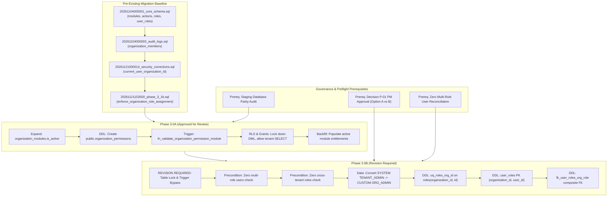

# PAYPULSE — PHASE 3.0 MIGRATION DEPENDENCY & TOPOLOGY REVIEW
## Inter-Migration Coupling, Schema Prerequisites & Execution Sequencing Audit

**System:** PayPulse (JK Payroll)  
**Migrations Evaluated:**
1. `supabase/migrations/20261122100001_phase_3_0a_organization_permission_entitlements.sql`
2. `supabase/migrations/20261122100002_phase_3_0b_single_role_per_organization_user.sql`  
**Stack:** React 19, Express 4, Supabase Auth, PostgreSQL 17+  
**Review Type:** Migration Topology & Dependency Graph Audit  
**Review Date:** November 22, 2026  
**Execution Mode:** STRICT READ-ONLY REPOSITORY REVIEW (No DB writes or execution authorized)

---

## 1. Executive Summary

This audit evaluates the inter-migration dependencies, historical schema coupling, and execution sequencing between Phase 3.0A (`organization_permission_entitlements`) and Phase 3.0B (`single_role_per_organization_user`).

### Key Review Findings:
1. **Syntactic Decoupling:** At the pure PostgreSQL DDL level, Phase 3.0B does **not** reference `public.organization_permissions`. It could technically be applied before Phase 3.0A without generating a foreign key syntax error.
2. **Semantic & Architectural Coupling:** At the semantic RBAC level, Phase 3.0B **strictly depends on Phase 3.0A**. In Section 3 of 3.0B, newly created `ORG_ADMIN` custom roles are granted the 7 canonical administrative permissions. Under PayPulse's Three-Tier RBAC, role permissions cannot be validly entitled unless the organization possesses those permissions in `organization_permissions`.
3. **Upstream Schema Coupling:** Both migrations strictly depend on the historical migration baseline up through `20261121153500_phase_3_1b_database_role_authorization_boundary.sql`. Specifically, 3.0B is deeply coupled to (and currently blocked by) the trigger functions established in 3.1b.
4. **Governance Dependency:** Phase 3.0B depends on the resolution of Architectural Decision P-01 (Organization Administrator Authority Model).

---

## 2. Historical Baseline Dependencies (Migrations 1–21)

The table below catalogs the exact schema objects required by Phase 3.0A and Phase 3.0B from the pre-existing migration history:

| Object Required | Originating Migration | Description | Used By |
|---|---|---|---|
| `public.organizations` | `20261104000001_core_schema.sql` | Tenant root table | 3.0A, 3.0B |
| `public.modules` | `20261104000001_core_schema.sql` | RBAC module catalog | 3.0A |
| `public.module_actions` | `20261104000001_core_schema.sql` | Granular action catalog | 3.0A, 3.0B |
| `public.organization_modules` | `20261104000001_core_schema.sql` | Module allocation bridge | 3.0A |
| `public.roles` | `20261104000001_core_schema.sql` | Role definitions | 3.0B |
| `public.user_roles` | `20261104000001_core_schema.sql` | User role assignments | 3.0B |
| `public.role_permissions` | `20261104000001_core_schema.sql` | Role action grants | 3.0B |
| `public.organization_members` | `20261104000003_audit_logs.sql` | Tenant membership bridge | 3.0B |
| `public.is_super_admin()` | `20261104000002_functions_and_rls.sql` | SuperAdmin check function | 3.0A |
| `public.current_user_organization_id()` | `20261121000014_security_corrections_phase1_1_1.sql` | Contextual tenant resolver | 3.0A |
| `public.is_organization_member()` | `20261121000014_security_corrections_phase1_1_1.sql` | Active membership assertion | 3.0A |
| `trg_phase31b_user_role_assignment` | `20261121153500_phase_3_1b` | Role assignment security trigger | 3.0B |
| `public.enforce_organization_role_assignment()` | `20261121153500_phase_3_1b` | Role code enforcement | 3.0B (Trigger Collision) |

---

## 3. Cross-Migration Dependency Analysis: 3.0A vs. 3.0B

### 3.1 DDL vs. Semantic Dependency

```
+-------------------------------------------------------------+
| Phase 3.0A: Organization Permission Entitlements             |
| - Creates public.organization_permissions                   |
| - Backfills all actions from active organization_modules     |
+-------------------------------------------------------------+
                            |
                            | Semantic Entitlement Dependency
                            v
+-------------------------------------------------------------+
| Phase 3.0B: Single Role & Scoped Role Assignments           |
| - Replaces user_roles PK with (org_id, user_id)             |
| - Adds composite FK: (org_id, role_id) -> roles(org_id, id)  |
| - Migrates SYSTEM roles -> CUSTOM ORG_ADMIN roles           |
| - Grants 7 admin actions to ORG_ADMIN role                  |
+-------------------------------------------------------------+
```

1. **Why 3.0B Semantically Depends on 3.0A:**
   In Section 3 of 3.0B (lines 92–102), the migration inserts role permissions for the newly created `ORG_ADMIN` role:
   - `Role.View`, `Role.Add`, `Role.Edit`, `Role.Delete`
   - `RolePermission.Edit`
   - `UserRole.Edit`
   - `UserPermission.Edit`
   
   If Phase 3.0B were executed *without* Phase 3.0A:
   - The role permissions would exist in `public.role_permissions`.
   - However, the organization would have **zero records in `public.organization_permissions`** because Phase 3.0A was not applied.
   - When downstream Phase 3.0C or Phase 3.0D enforces composite foreign key `(organization_id, module_action_id) REFERENCES public.organization_permissions(organization_id, module_action_id)` on `public.role_permissions`, those newly created grants would fail referential integrity and become illegal orphan grants.

2. **Can 3.0A and 3.0B Be Reviewed Independently?**
   - **Yes, for static technical audit.** The SQL structure, indexes, constraints, and failure modes can be audited independently.
   - **No, for execution sequencing.** Phase 3.0A must be fully applied and verified before Phase 3.0B is executed.

---

## 4. Governance & Upstream Decision Prerequisites

Phase 3.0B is gated on the following non-database prerequisites:

```
[Prerequisite 1: Canonical Catalog Integrity]
      |
      +---> [Phase 3.0A: Entitlements DDL & Backfill]
                  |
[Prerequisite 2: Governance Signoff on Decision P-01]
      |           |
      v           v
[Prerequisite 3: Trigger Remediated 3.0B]
      |
      +---> [Phase 3.0B: Single-Role DDL & Data Reconciliation]
```

### 4.1 Decision P-01 (Organization Administrator Authority)
- **Status:** Architecture Resolution recommended (Option A), but formal Product Management approval is pending.
- **Impact on 3.0B:** Section 3 of 3.0B creates `CUSTOM ORG_ADMIN` roles and assigns them. If Product Management adopts Option B (`is_owner` attribute flag), Section 3 of 3.0B is redundant and counterproductive.
- **Recommendation:** Decouple Section 3 data migration from Phase 3.0B DDL until Decision P-01 is signed off.

### 4.2 Phase 3.1b Trigger Conflict
- Phase 3.0B cannot execute against any database where `20261121153500_phase_3_1b` is active without explicit trigger bypass handling (Finding F-30B-01).

---

## 5. End-to-End Migration Dependency Diagram



---

## 6. Execution Sequencing Recommendations

1. **Step 1:** Complete Staging Preflight verification (verify `organization_modules` active counts and baseline migration ledger parity).
2. **Step 2:** Apply and verify Phase 3.0A (`20261122100001_phase_3_0a_organization_permission_entitlements.sql`).
3. **Step 3:** Remediate Phase 3.0B to resolve Finding F-30B-01 (trigger collision) and F-30B-02 (table lock).
4. **Step 4:** Finalize Product Management signoff on Decision P-01.
5. **Step 5:** Execute Pre-3.0B preflight check on staging to guarantee zero multi-role users exist.
6. **Step 6:** Apply and verify revised Phase 3.0B.
