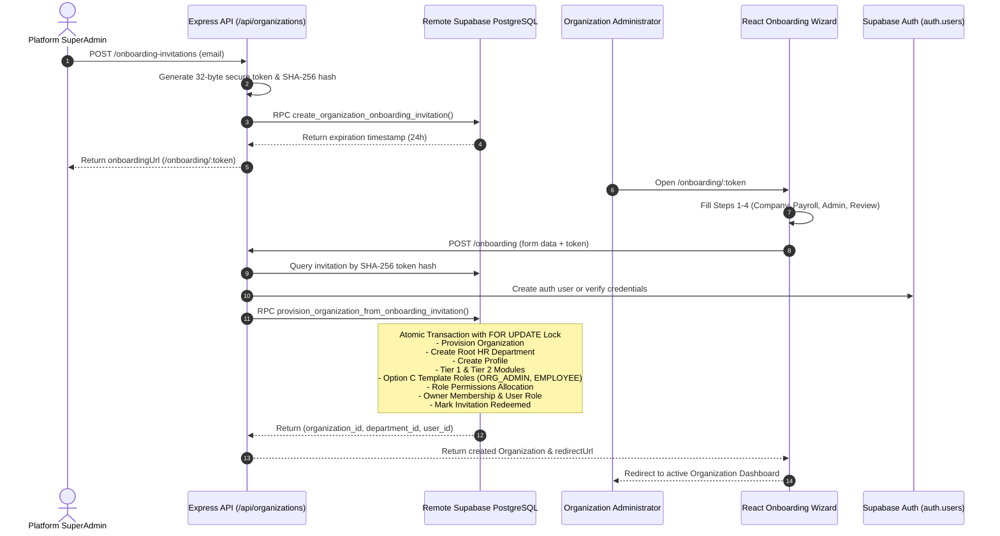

# PayPulse: Consolidated Organization Onboarding Specification

**Document Version:** 3.0.0 (Authoritative Onboarding Reference)  
**Status:** Implemented, Deployed, and Verified across Live Supabase PostgreSQL and Client Wizard  
**Scope:** SuperAdmin Invitations, 24-Hour Expiration, SHA-256 Hashing, Atomic Provisioning RPC, Option C Role Instantiation, and Client Wizard

---

## 1. Onboarding Lifecycle Overview

The PayPulse organization onboarding lifecycle follows a strict zero-trust, cryptographically verified sequence:



---

## 2. SuperAdmin Invitation Generation

### 2.1 Cryptographic Token Standards
1. **Entropy:** 32 cryptographically random bytes generated via Node.js `randomBytes(32).toString('base64url')`.
2. **Storage:** The raw plaintext bearer token is never persisted in the database. Only the SHA-256 hash is stored:
   $$\text{token\_hash} = \text{SHA-256}(\text{bearer\_token})$$
3. **Expiration:** Strictly 24 hours from creation timestamp.

### 2.2 Security Definer RPC: `create_organization_onboarding_invitation`
```sql
CREATE OR REPLACE FUNCTION public.create_organization_onboarding_invitation(
    p_actor_id UUID,
    p_invited_email TEXT,
    p_token_hash TEXT
)
RETURNS TIMESTAMPTZ
LANGUAGE plpgsql
SECURITY DEFINER
SET search_path = public, pg_temp
AS $$
DECLARE
    v_is_super BOOLEAN;
    v_expires_at TIMESTAMPTZ;
BEGIN
    SELECT is_super_admin INTO v_is_super
    FROM public.profiles
    WHERE id = p_actor_id AND is_active = true;

    IF v_is_super IS NOT TRUE THEN
        RAISE EXCEPTION 'Only an active SuperAdmin can create onboarding invitations' USING ERRCODE = '42501';
    END IF;

    v_expires_at := clock_timestamp() + interval '24 hours';

    INSERT INTO public.organization_onboarding_invitations (
        token_hash, invited_email, created_by, expires_at
    ) VALUES (
        p_token_hash, lower(trim(p_invited_email)), p_actor_id, v_expires_at
    );

    RETURN v_expires_at;
END;
$$;
```

---

## 3. Atomic Provisioning RPC (Decision P-01 Option C)

The database procedure `public.provision_organization_from_onboarding_invitation` performs the entire onboarding flow in a single atomic transaction:

### 3.1 Concurrency & Replay Protection
```sql
-- Atomic row lock prevents race conditions and concurrent redemptions
SELECT * INTO v_inv
FROM public.organization_onboarding_invitations
WHERE token_hash = trim(p_token_hash)
FOR UPDATE;

IF NOT FOUND THEN
    RAISE EXCEPTION 'Invalid onboarding invitation' USING ERRCODE = '42501';
END IF;

IF v_inv.redeemed_at IS NOT NULL THEN
    -- Idempotent safe retry if redeemed by the exact same user
    IF v_inv.redeemed_by = p_user_id AND v_inv.organization_id IS NOT NULL THEN
        SELECT d.id INTO v_dept_id FROM public.departments d
        WHERE d.organization_id = v_inv.organization_id ORDER BY d.created_at ASC LIMIT 1;
        RETURN QUERY SELECT v_inv.organization_id, v_dept_id, p_user_id;
        RETURN;
    END IF;
    RAISE EXCEPTION 'Onboarding invitation has already been used' USING ERRCODE = '42501';
END IF;

IF v_inv.expires_at <= clock_timestamp() THEN
    RAISE EXCEPTION 'Onboarding invitation has expired' USING ERRCODE = '42501';
END IF;
```

### 3.2 Step-by-Step Transaction Execution
1. **Organization Creation:** Inserts `public.organizations` with status `'Active'`, sector, tier, currency (`PHP`), timezone (`Asia/Manila`), and country code (`PH`).
2. **Root Department Creation:** Inserts root department (e.g. `Human Resources` / `HR`) bound to the organization.
3. **Profile Creation:** Inserts `public.profiles` row with `is_organization_admin = false, is_super_admin = false`.
4. **Tier 1 Modules:** Inserts `public.organization_modules` records for Core Platform modules (`Department`, `EmployeeProfile`, `RolePermission`).
5. **Tier 2 Modules:** Inserts `public.department_modules` records allocating core modules to the root HR department.
6. **Tier 3 Option C Roles:**
   - Instantiates tenant-owned `ORG_ADMIN` role (`role_type = 'CUSTOM'`, `is_default = true`, bound to new `organization_id`).
   - Instantiates tenant-owned `EMPLOYEE` role (`role_type = 'CUSTOM'`, `is_default = true`, bound to new `organization_id`).
   - Populates `public.role_permissions` granting all administrative actions within licensed modules to `ORG_ADMIN`.
7. **Membership & Assignment:**
   - Inserts `public.organization_members` (`is_owner = true`, `role_id = ORG_ADMIN`, `department_id = root_dept_id`).
   - Inserts `public.user_roles` (`role_id = ORG_ADMIN`).
8. **Redemption State:** Updates invitation with `redeemed_at = clock_timestamp(), redeemed_by = p_user_id, organization_id = v_org_id`.

---

## 4. Application Integration & Error Compensation

In `src/features/organizations/organization.service.ts`:

### 4.1 Transactional Compensation Strategy
Supabase Auth and PostgreSQL are separate services. If the database RPC fails after a new Supabase Auth user was created, the application service immediately rolls back the identity provider state:
```typescript
try {
  const { data: provisioned, error } = await adminClient.rpc(
    'provision_organization_from_onboarding_invitation',
    { ... }
  );
  if (error) throw new Error(error.message || 'Atomic onboarding transaction failed');
  databaseCommitted = true;
} catch (error) {
  // If the database transaction failed, delete the newly created Supabase Auth user
  if (createdAuthUser && userId && !databaseCommitted) {
    const { error: cleanupError } = await adminClient.auth.admin.deleteUser(userId);
    if (cleanupError) console.error('Unable to remove unprovisioned Auth identity:', cleanupError.message);
  }
  throw error;
}
```

### 4.2 Client Form & Wizard Integration
1. **Interactive Steps:** Handled by `OrganizationOnboardingWizard.tsx` (`src/client/components/onboarding/`).
2. **Local Draft Persistence:** `useFormDraft` hook preserves in-progress form inputs in `localStorage` until submission commits.
3. **Submission Endpoint:** `POST /api/organizations/onboarding` handles incoming requests before the authenticated barrier using the single-use token as authorization.
