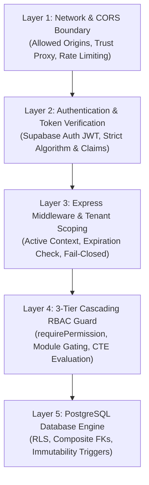

# PayPulse: Consolidated Security & Access Control Specification

**Document Version:** 3.0.0 (Authoritative Security Specification)  
**Status:** Implemented, Deployed, and Verified across Live Supabase PostgreSQL and Express API  
**Scope:** Authentication, Session Lifecycle, Multi-Tenancy, 3-Tier RBAC, Privilege Escalation Protection, and Audit Immutability

---

## 1. Multi-Layer Defense-in-Depth Model

PayPulse enforces security across five distinct architectural boundaries:



---

## 2. Authentication & Identity Architecture

### 2.1 Identity Provider (Supabase Auth)
- Production authentication relies exclusively on Supabase Auth (`auth.users`).
- Plaintext passwords and private key material are never stored in the application database.
- Deprecated backdoor credentials and automatic provisioning routines (identified in SEC-FIND-02) have been permanently removed.

### 2.2 JWT Verification Standards
1. **Algorithm Enforcement:** Strictly allows only configured algorithms (`HS256` or `RS256`). Tokens with `alg: none` are rejected.
2. **Issuer & Audience Validation:**
   - Issuer (`iss`) must match `jk-payroll` or Supabase project URL.
   - Audience (`aud`) must match `jk-payroll-api` or `authenticated`.
3. **Expiration:** Tokens past their `exp` timestamp fail with `401 Unauthorized`.
4. **Production Configuration Guard:**
   - `ALLOW_LOCAL_JWT` is prohibited in production. Startup fails immediately if `ALLOW_LOCAL_JWT=true` when `NODE_ENV=production`.
   - Missing Supabase keys (`SUPABASE_URL`, `SUPABASE_ANON_KEY`, `SUPABASE_SERVICE_ROLE_KEY`) halt server startup.

---

## 3. Organization Lifecycle & Expiration Enforcement

1. **Active Status Verification:** Inactive organizations (`status != 'Active'` or `is_active = false`) deny access to all tenant users.
2. **Subscription Expiration:** If an organization has an `end_date` in the past, logins for all users under that organization are blocked immediately:
   ```typescript
   if (!profile.is_super_admin && tenantRecord?.endDate) {
     if (new Date(tenantRecord.endDate).getTime() < Date.now()) {
       throw new Error('Organization subscription or access period has expired. Users under this company cannot log in.');
     }
   }
   ```
3. **SuperAdmin Exemption:** Platform SuperAdmins have null expiration dates and retain administrative access to manage or unblock expired tenants.

---

## 4. Cascading RBAC Authorization & Policy Enforcement

### 4.1 3-Tier Cascading Formula
An action grant is effective if and only if all three tiers are satisfied:
$$\text{Access Granted} \iff \text{Action} \in \text{Role Grants} \land \text{Module} \in \text{Dept Modules} \land \text{Module} \in \text{Org Modules}$$

### 4.2 Fail-Closed Guarantee
- If the permission resolution RPC (`get_user_effective_permissions`) throws an error or fails, the application returns an empty permission set `[]`.
- Access is denied by default (`403 Forbidden`). Fallback grants or default permissions are strictly prohibited.

### 4.3 SuperAdmin Privilege Escalation Protection
1. **Database Trigger:** `trg_enforce_organization_role_assignment` intercepts all writes to `public.user_roles`:
   - Assignment of global SuperAdmin role (`f0000000-0000-0000-0000-000000000001`) is rejected with code `42501`.
   - Creation or assignment of protected role codes (`SUPERADMIN`, `SUPER_ADMIN`) is blocked.
2. **Client-Controlled Flags Rejected:** The onboarding API and client forms cannot set `is_super_admin` or `is_organization_admin` on profile rows. Only server-side database RPCs control administrative state.

---

## 5. PostgreSQL Row Level Security (RLS) Isolation

Every operational table has Row Level Security enabled (`ENABLE ROW LEVEL SECURITY`) and enforced (`FORCE ROW LEVEL SECURITY`):

| Database Table | Anonymous Access | Authenticated Member Access | Service-Role Access |
| :--- | :---: | :---: | :---: |
| `public.organizations` | **DENIED (0 rows)** | Read own organization only | Full access (Bypass RLS) |
| `public.departments` | **DENIED (0 rows)** | Read/write own organization departments | Full access (Bypass RLS) |
| `public.profiles` | **DENIED (0 rows)** | Read own organization profiles | Full access (Bypass RLS) |
| `public.roles` | **DENIED (0 rows)** | Read own organization roles | Full access (Bypass RLS) |
| `public.role_permissions` | **DENIED (0 rows)** | Read own organization role permissions | Full access (Bypass RLS) |
| `public.user_roles` | **DENIED (0 rows)** | Read own organization role assignments | Full access (Bypass RLS) |
| `public.organization_modules` | **DENIED (0 rows)** | Read own organization modules | Full access (Bypass RLS) |
| `public.department_modules` | **DENIED (0 rows)** | Read own organization department modules | Full access (Bypass RLS) |
| `public.audit_logs` | **DENIED (0 rows)** | Read own organization audit logs (SuperAdmin/TenantAdmin) | Full access (Append-only) |

---

## 6. Audit Trail Immutability & Forensics

1. **Immutability Enforcement:** The trigger `trg_audit_log_immutability` executes before `UPDATE`, `DELETE`, or `TRUNCATE` on `public.audit_logs`:
   ```sql
   CREATE OR REPLACE FUNCTION public.check_audit_log_immutability()
   RETURNS trigger AS $$
   BEGIN
       RAISE EXCEPTION 'Audit logs are immutable and cannot be updated, deleted, or truncated' USING ERRCODE = '42501';
   END;
   $$ LANGUAGE plpgsql;
   ```
2. **Actor Attribution:** Every mutation captures `auth.uid()`, client IP, user agent, before/after JSONB state, and PostgreSQL `clock_timestamp()`.
3. **Retention Independence:** Deleting an operational department or role does not alter historical audit log entries.

---

## 7. Database Function Security & Least-Privilege Execution Model

Implemented and enforced via migrations `20261122130000_harden_database_functions_and_security.sql` and `20261122150000_isolate_rls_helpers_in_private_schema.sql`:

### 7.1 Immutable `search_path` Standard
All database functions and triggers across both `public` and `private` schemas must explicitly configure a fixed `search_path`:
- Standard: `SET search_path = public, pg_temp;` or `SET search_path = private, public, pg_temp;`
- Catalog-pinned: `SET search_path = pg_catalog, public, pg_temp;` (used for low-level cast, system functions, and role normalization)
- Functions with mutable or null `search_path` are strictly forbidden to prevent search path hijacking.

### 7.2 Function Execution Privileges Matrix & Schema Isolation Architecture
PayPulse implements a two-tier schema isolation boundary to achieve **0 Supabase Security Advisor findings** and eliminate the HTTP RPC attack surface:

1. **`private` Schema (Internal RLS Helpers):**
   - Unexposed by PostgREST Data API (`schemas = ["public", "graphql_public"]` in `supabase/config.toml`).
   - Contains all 8 authoritative `SECURITY DEFINER` functions.
   - Access: `REVOKE ALL ON SCHEMA private FROM PUBLIC, anon; GRANT USAGE ON SCHEMA private TO authenticated, service_role;`
   - Execution: `REVOKE ALL ON ALL FUNCTIONS IN SCHEMA private FROM PUBLIC, anon; GRANT EXECUTE ... TO authenticated, service_role;`
2. **`public` Schema (Backward Compatibility & Client API):**
   - All public compatibility helpers are defined strictly as **`SECURITY INVOKER`** (`prosecdef = false`).
   - Because `prosecdef = false`, they cannot bypass RLS on their own and are **NOT flagged** by the Supabase Security Advisor linter.

| Function Category | Function Names | Schema | Definition Mode | `PUBLIC` | `anon` | `authenticated` | `service_role` | Justification |
| :--- | :--- | :---: | :---: | :---: | :---: | :---: | :---: | :--- |
| **Trigger Functions** | `enforce_audit_log_immutability`, `fn_sync_department_hierarchy`, `fn_sync_organization_active_status`, `record_audit_log`, `enforce_profile_security_fields`, `enforce_organization_role_assignment`, etc. | `public` | `SECURITY DEFINER` | **REVOKED** | **REVOKED** | **REVOKED** | **REVOKED** / Owner | Triggers execute exclusively via engine mutation triggers. Exposing them to `authenticated` or `anon` creates unintended RPC endpoints. |
| **Internal Traversal Helpers** | `get_ancestor_department_ids`, `get_sub_department_ids` | `public` | `SECURITY DEFINER` | **REVOKED** | **REVOKED** | **REVOKED** | **GRANTED** | Internal recursive CTEs invoked by administrative routines or server workloads; direct client invocation is denied. |
| **Authoritative RLS Helpers** | `current_user_organization_id`, `is_super_admin`, `is_organization_admin`, `is_organization_member`, `get_profile_by_id`, `is_assignable_organization_role`, `is_existing_trusted_tenant_admin_membership`, `is_existing_trusted_tenant_admin_user_role` | `private` | `SECURITY DEFINER` | **REVOKED** | **REVOKED** | **GRANTED** | **GRANTED** | Isolated from PostgREST HTTP RPC endpoints. Evaluated within PostgreSQL RLS policy expressions when authenticated users execute queries. Identity is cryptographically pinned via `auth.uid()`. |
| **Compatibility Wrappers** | `is_super_admin`, `current_user_organization_id`, `is_organization_member`, `is_organization_admin`, `get_profile_by_id`, `is_assignable_organization_role`, `is_existing_trusted_tenant_admin_membership`, `is_existing_trusted_tenant_admin_user_role` | `public` | `SECURITY INVOKER` | **REVOKED** | **REVOKED** | **GRANTED** | **GRANTED** | Thin invoker shims delegating to `private.*`. Preserves SQL compatibility without triggering Security Advisor warnings (`prosecdef = false`). |
| **Utility Functions** | `safe_cast_uuid` | `public` | `IMMUTABLE INVOKER` | **REVOKED** | **REVOKED** | **GRANTED** | **GRANTED** | Read-only deterministic parsing function used in data transformations and RLS parsing. |

### 7.3 Detailed Function Investigation and Classification (Supabase Security Advisor 8 Findings)
Each of the 8 SECURITY DEFINER functions accessible by `authenticated` has been audited, categorized, and secured:

1. **`public.current_user_organization_id()`**
   - **Classification:** RLS Helper Function
   - **Parameters:** None (`()`)
   - **Owner & search_path:** `postgres`, `SET search_path = public, pg_temp`
   - **Tables Accessed:** `public.organization_members`, `public.organizations`, `auth.jwt()`, `auth.uid()`
   - **RLS Policy References:** `departments_select_policy`, `departments_all_policy`, `roles_select_policy`, `roles_all_policy`, `audit_logs_select_policy`, `profiles_update_policy`
   - **Trigger Usage:** None directly
   - **Supabase RPC Dependency:** Not called via `.rpc()` in client or server. Evaluated transparently in PostgreSQL query engine during RLS execution.
   - **Security Analysis:** Parameterless function strictly bound to `auth.uid()` and verified JWT claims. Fail-closed: returns NULL on ambiguous or missing membership. Safe for authenticated execution.

2. **`public.get_profile_by_id(p_id UUID)`**
   - **Classification:** RLS Helper Function (Hardened with Internal Multi-Tenant Authorization)
   - **Parameters:** `p_id UUID`
   - **Owner & search_path:** `postgres`, `SET search_path = public, pg_temp`
   - **Tables Accessed:** `public.profiles`, `public.organizations`, `public.organization_members`
   - **RLS Policy References:** `profiles_update_policy` (anti-recursion helper for old-row inspections on `public.profiles`)
   - **Trigger Usage:** None directly
   - **Supabase RPC Dependency:** Not called via `.rpc()` in client or server. Evaluated in RLS `profiles_update_policy`.
   - **Security Analysis & Remediation:** Hardened via migration `20261122150000_harden_security_definer_profile_helper.sql`. Contains internal authorization check: returns row only if `is_super_admin()`, `p_id = auth.uid()`, or caller is active Org Admin of the profile's organization. Direct RPC attempts with arbitrary target UUIDs return NULL.

3. **`public.is_assignable_organization_role(p_role_id UUID, p_organization_id UUID)`**
   - **Classification:** RLS Helper & Trigger Validation Function
   - **Parameters:** `p_role_id UUID`, `p_organization_id UUID`
   - **Owner & search_path:** `postgres`, `SET search_path = pg_catalog, public, pg_temp`
   - **Tables Accessed:** `public.roles`
   - **RLS Policy References:** `user_roles_insert_policy`, `user_roles_update_policy`, `org_members_insert_policy`, `org_members_update_policy`
   - **Trigger Usage:** Called inside trigger function `enforce_organization_role_assignment()`
   - **Supabase RPC Dependency:** Not called via `.rpc()`. Evaluated in RLS and triggers.
   - **Security Analysis:** Pure validation predicate returning `BOOLEAN`. Confirms role is tenant-owned `CUSTOM`, active, and not a reserved administrative role. Returns no sensitive state.

4. **`public.is_existing_trusted_tenant_admin_membership(p_membership_id UUID, p_organization_id UUID, p_user_id UUID, p_role_id UUID, p_is_owner BOOLEAN)`**
   - **Classification:** RLS Helper Function
   - **Parameters:** 5 identification/state parameters
   - **Owner & search_path:** `postgres`, `SET search_path = pg_catalog, public, pg_temp`
   - **Tables Accessed:** `public.organization_members`, `public.roles`
   - **RLS Policy References:** `org_members_update_policy`
   - **Trigger Usage:** None directly
   - **Supabase RPC Dependency:** Not called via `.rpc()`. Evaluated in RLS.
   - **Security Analysis:** Narrow boolean predicate guarding against unauthorized elevation or demotion of legacy first-owner tenant admins. Returns no data.

5. **`public.is_existing_trusted_tenant_admin_user_role(p_organization_id UUID, p_user_id UUID, p_role_id UUID)`**
   - **Classification:** RLS Helper Function
   - **Parameters:** 3 UUID parameters
   - **Owner & search_path:** `postgres`, `SET search_path = pg_catalog, public, pg_temp`
   - **Tables Accessed:** `public.user_roles`, `public.roles`, `public.organization_members`
   - **RLS Policy References:** `user_roles_update_policy`
   - **Trigger Usage:** None directly
   - **Supabase RPC Dependency:** Not called via `.rpc()`. Evaluated in RLS.
   - **Security Analysis:** Narrow boolean predicate guarding `user_roles` update boundaries. Returns no data.

6. **`public.is_organization_admin(p_org_id UUID)`**
   - **Classification:** RLS Helper Function
   - **Parameters:** `p_org_id UUID`
   - **Owner & search_path:** `postgres`, `SET search_path = public, pg_temp`
   - **Tables Accessed:** `public.profiles`, `public.organizations`, `public.organization_members`, `public.user_roles`, `public.roles`
   - **RLS Policy References:** `profiles_update_policy`, `departments_all_policy`, `roles_all_policy`, `org_members_update_policy`, `user_roles_all_policy`
   - **Trigger Usage:** None directly
   - **Supabase RPC Dependency:** Not called via `.rpc()`. Evaluated in RLS.
   - **Security Analysis:** Caller identity is cryptographically locked to `auth.uid()`. Passing an arbitrary `p_org_id` evaluates only whether `auth.uid()` has admin authority in that organization. Returns `BOOLEAN`. Cannot be used to query other users' status.

7. **`public.is_organization_member(p_org_id UUID)`**
   - **Classification:** RLS Helper Function
   - **Parameters:** `p_org_id UUID`
   - **Owner & search_path:** `postgres`, `SET search_path = public, pg_temp`
   - **Tables Accessed:** `public.profiles`, `public.organizations`, `public.organization_members`
   - **RLS Policy References:** Used across tenant read policies for organization scoping.
   - **Trigger Usage:** None directly
   - **Supabase RPC Dependency:** Not called via `.rpc()`. Evaluated in RLS.
   - **Security Analysis:** Bound to `auth.uid()`. Verifies caller's active membership in `p_org_id`. Returns `BOOLEAN`. Cannot query other users' membership.

8. **`public.is_super_admin()`**
   - **Classification:** RLS Helper Function
   - **Parameters:** None (`()`)
   - **Owner & search_path:** `postgres`, `SET search_path = public, pg_temp`
   - **Tables Accessed:** `public.profiles`
   - **RLS Policy References:** Evaluated across all platform administrative policies (`organizations_all_policy`, `profiles_select_policy`, `roles_all_policy`, etc.)
   - **Trigger Usage:** Trigger validation functions (`enforce_organization_role_assignment`)
   - **Supabase RPC Dependency:** Not called via `.rpc()`. Evaluated in RLS and triggers.
   - **Security Analysis:** Parameterless boolean query checking `profiles.is_super_admin = true` and `is_active = true` for `auth.uid()`. Does not trust JWT claims alone. Safe for authenticated execution.

### 7.4 Reconciliation Table (Previous 14 Functions vs Latest 8 Functions)

| Function Signature | Previous Report | Latest Report | Actual Database Status | Final Action |
| :--- | :---: | :---: | :--- | :--- |
| `public.enforce_audit_log_immutability()` | Flagged (Callable) | **Resolved** | `EXECUTE` revoked from `PUBLIC`, `anon`, `authenticated` | Preserved trigger-only execution via migration `20261122130000` |
| `public.fn_sync_department_hierarchy()` | Flagged (Callable) | **Resolved** | `EXECUTE` revoked from `PUBLIC`, `anon`, `authenticated` | Explicit `search_path`, trigger-only execution via migration `20261122130000` |
| `public.fn_sync_organization_active_status()` | Flagged (Callable) | **Resolved** | `EXECUTE` revoked from `PUBLIC`, `anon`, `authenticated` | Explicit `search_path`, trigger-only execution via migration `20261122130000` |
| `public.record_audit_log()` | Flagged (Callable) | **Resolved** | `EXECUTE` revoked from `PUBLIC`, `anon`, `authenticated` | Explicit `search_path`, trigger-only execution via migration `20261122130000` |
| `public.get_ancestor_department_ids(uuid, uuid)` | Flagged (Callable) | **Resolved** | `EXECUTE` revoked from `PUBLIC`, `anon`, `authenticated` | Dedicated internal helper granted strictly to `service_role` via `20261122130000` |
| `public.get_sub_department_ids(uuid, uuid)` | Flagged (Callable) | **Resolved** | `EXECUTE` revoked from `PUBLIC`, `anon`, `authenticated` | Dedicated internal helper granted strictly to `service_role` via `20261122130000` |
| `public.current_user_organization_id()` | Flagged (Callable) | Flagged (8 SD) | **Resolved (0 SD in public)** | Authoritative `SECURITY DEFINER` moved to `private`; `public` shim converted to `SECURITY INVOKER` via `20261122150000` |
| `public.get_profile_by_id(uuid)` | Flagged (Callable) | Flagged (8 SD) | **Resolved (0 SD in public)** | Hardened with tenant authorization and moved to `private` (`SECURITY DEFINER`); `public` shim is `SECURITY INVOKER` via `20261122150000` |
| `public.is_assignable_organization_role(uuid, uuid)` | Flagged (Callable) | Flagged (8 SD) | **Resolved (0 SD in public)** | Moved to `private` (`SECURITY DEFINER`); `public` shim converted to `SECURITY INVOKER` via `20261122150000` |
| `public.is_existing_trusted_tenant_admin_membership(uuid, uuid, uuid, uuid, boolean)` | Flagged (Callable) | Flagged (8 SD) | **Resolved (0 SD in public)** | Moved to `private` (`SECURITY DEFINER`); `public` shim converted to `SECURITY INVOKER` via `20261122150000` |
| `public.is_existing_trusted_tenant_admin_user_role(uuid, uuid, uuid)` | Flagged (Callable) | Flagged (8 SD) | **Resolved (0 SD in public)** | Moved to `private` (`SECURITY DEFINER`); `public` shim converted to `SECURITY INVOKER` via `20261122150000` |
| `public.is_organization_admin(uuid)` | Flagged (Callable) | Flagged (8 SD) | **Resolved (0 SD in public)** | Moved to `private` (`SECURITY DEFINER`); `public` shim converted to `SECURITY INVOKER` via `20261122150000` |
| `public.is_organization_member(uuid)` | Flagged (Callable) | Flagged (8 SD) | **Resolved (0 SD in public)** | Moved to `private` (`SECURITY DEFINER`); `public` shim converted to `SECURITY INVOKER` via `20261122150000` |
| `public.is_super_admin()` | Flagged (Callable) | Flagged (8 SD) | **Resolved (0 SD in public)** | Moved to `private` (`SECURITY DEFINER`); `public` shim converted to `SECURITY INVOKER` via `20261122150000` |

### 7.5 Verification Catalog Queries

```sql
-- 1. Verify that all 8 RLS helper functions are revoked from anon and PUBLIC:
SELECT routine_name, grantee, privilege_type
FROM information_schema.routine_privileges
WHERE routine_schema = 'public'
  AND routine_name IN (
    'current_user_organization_id', 'get_profile_by_id', 'is_assignable_organization_role',
    'is_existing_trusted_tenant_admin_membership', 'is_existing_trusted_tenant_admin_user_role',
    'is_organization_admin', 'is_organization_member', 'is_super_admin'
  )
  AND grantee IN ('PUBLIC', 'anon');
-- Expected: 0 rows returned

-- 2. Verify all functions have explicit search_path:
SELECT proname, proconfig
FROM pg_proc p
JOIN pg_namespace n ON n.oid = p.pronamespace
WHERE n.nspname = 'public'
  AND proconfig IS NULL;
-- Expected: 0 rows returned

-- 3. Verify trigger functions are revoked from authenticated:
SELECT routine_name, grantee
FROM information_schema.routine_privileges
WHERE routine_schema = 'public'
  AND routine_name IN ('enforce_audit_log_immutability', 'fn_sync_department_hierarchy', 'fn_sync_organization_active_status', 'record_audit_log')
  AND grantee = 'authenticated';
-- Expected: 0 rows returned
```

---

## 8. Supabase Auth Security Configuration

### 8.1 Leaked Password Protection (HaveIBeenPwned Integration)
To guard against credential stuffing and compromised credential reuse:
- **Supabase Cloud Dashboard Configuration:**
  1. Navigate to your Supabase Project: **Authentication** -> **Configuration** -> **Security**.
  2. Locate the **Leaked password protection** toggle.
  3. Toggle **Enable Leaked Password Protection** to **ON**.
  4. Ensure the check is set to block signup and password reset attempts containing compromised passwords known in HaveIBeenPwned.
- *Note:* Supabase Auth configuration is managed at the platform control plane level and cannot be toggled via transactional SQL migrations.
