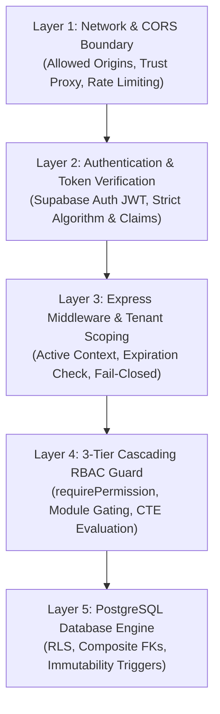

# PayPulse: Consolidated Security & Access Control Specification

**Document Version:** 3.0.0 (Authoritative Security Specification)  
**Status:** Implemented, Deployed, and Verified across Live Supabase PostgreSQL and Express API  
**Scope:** Authentication, Session Lifecycle, Multi-Tenancy, 3-Tier RBAC, Privilege Escalation Protection, and Audit Immutability

---

## 1. Multi-Layer Defense-in-Depth Model

PayPulse enforces security across five distinct architectural boundaries:



---

## 2. Authentication & Identity Architecture

### 2.1 Identity Provider (Supabase Auth)
- Production authentication relies exclusively on Supabase Auth (`auth.users`).
- Plaintext passwords and private key material are never stored in the application database.
- Deprecated backdoor credentials and automatic provisioning routines (identified in SEC-FIND-02) have been permanently removed.

### 2.2 JWT Verification Standards
1. **Algorithm Enforcement:** Strictly allows only configured algorithms (`HS256` or `RS256`). Tokens with `alg: none` are rejected.
2. **Issuer & Audience Validation:**
   - Issuer (`iss`) must match `jk-payroll` or Supabase project URL.
   - Audience (`aud`) must match `jk-payroll-api` or `authenticated`.
3. **Expiration:** Tokens past their `exp` timestamp fail with `401 Unauthorized`.
4. **Production Configuration Guard:**
   - `ALLOW_LOCAL_JWT` is prohibited in production. Startup fails immediately if `ALLOW_LOCAL_JWT=true` when `NODE_ENV=production`.
   - Missing Supabase keys (`SUPABASE_URL`, `SUPABASE_ANON_KEY`, `SUPABASE_SERVICE_ROLE_KEY`) halt server startup.

---

## 3. Organization Lifecycle & Expiration Enforcement

1. **Active Status Verification:** Inactive organizations (`status != 'Active'` or `is_active = false`) deny access to all tenant users.
2. **Subscription Expiration:** If an organization has an `end_date` in the past, logins for all users under that organization are blocked immediately:
   ```typescript
   if (!profile.is_super_admin && tenantRecord?.endDate) {
     if (new Date(tenantRecord.endDate).getTime() < Date.now()) {
       throw new Error('Organization subscription or access period has expired. Users under this company cannot log in.');
     }
   }
   ```
3. **SuperAdmin Exemption:** Platform SuperAdmins have null expiration dates and retain administrative access to manage or unblock expired tenants.

---

## 4. Cascading RBAC Authorization & Policy Enforcement

### 4.1 3-Tier Cascading Formula
An action grant is effective if and only if all three tiers are satisfied:
$$\text{Access Granted} \iff \text{Action} \in \text{Role Grants} \land \text{Module} \in \text{Dept Modules} \land \text{Module} \in \text{Org Modules}$$

### 4.2 Fail-Closed Guarantee
- If the permission resolution RPC (`get_user_effective_permissions`) throws an error or fails, the application returns an empty permission set `[]`.
- Access is denied by default (`403 Forbidden`). Fallback grants or default permissions are strictly prohibited.

### 4.3 SuperAdmin Privilege Escalation Protection
1. **Database Trigger:** `trg_enforce_organization_role_assignment` intercepts all writes to `public.user_roles`:
   - Assignment of global SuperAdmin role (`f0000000-0000-0000-0000-000000000001`) is rejected with code `42501`.
   - Creation or assignment of protected role codes (`SUPERADMIN`, `SUPER_ADMIN`) is blocked.
2. **Client-Controlled Flags Rejected:** The onboarding API and client forms cannot set `is_super_admin` or `is_organization_admin` on profile rows. Only server-side database RPCs control administrative state.

---

## 5. PostgreSQL Row Level Security (RLS) Isolation

Every operational table has Row Level Security enabled (`ENABLE ROW LEVEL SECURITY`) and enforced (`FORCE ROW LEVEL SECURITY`):

| Database Table | Anonymous Access | Authenticated Member Access | Service-Role Access |
| :--- | :---: | :---: | :---: |
| `public.organizations` | **DENIED (0 rows)** | Read own organization only | Full access (Bypass RLS) |
| `public.departments` | **DENIED (0 rows)** | Read/write own organization departments | Full access (Bypass RLS) |
| `public.profiles` | **DENIED (0 rows)** | Read own organization profiles | Full access (Bypass RLS) |
| `public.roles` | **DENIED (0 rows)** | Read own organization roles | Full access (Bypass RLS) |
| `public.role_permissions` | **DENIED (0 rows)** | Read own organization role permissions | Full access (Bypass RLS) |
| `public.user_roles` | **DENIED (0 rows)** | Read own organization role assignments | Full access (Bypass RLS) |
| `public.organization_modules` | **DENIED (0 rows)** | Read own organization modules | Full access (Bypass RLS) |
| `public.department_modules` | **DENIED (0 rows)** | Read own organization department modules | Full access (Bypass RLS) |
| `public.audit_logs` | **DENIED (0 rows)** | Read own organization audit logs (SuperAdmin/TenantAdmin) | Full access (Append-only) |

---

## 6. Audit Trail Immutability & Forensics

1. **Immutability Enforcement:** The trigger `trg_audit_log_immutability` executes before `UPDATE`, `DELETE`, or `TRUNCATE` on `public.audit_logs`:
   ```sql
   CREATE OR REPLACE FUNCTION public.check_audit_log_immutability()
   RETURNS trigger AS $$
   BEGIN
       RAISE EXCEPTION 'Audit logs are immutable and cannot be updated, deleted, or truncated' USING ERRCODE = '42501';
   END;
   $$ LANGUAGE plpgsql;
   ```
2. **Actor Attribution:** Every mutation captures `auth.uid()`, client IP, user agent, before/after JSONB state, and PostgreSQL `clock_timestamp()`.
3. **Retention Independence:** Deleting an operational department or role does not alter historical audit log entries.

---

## 7. Database Function Security & Least-Privilege Execution Model

Implemented and enforced via migration `20261122130000_harden_database_functions_and_security.sql`:

### 7.1 Immutable `search_path` Standard
All public database functions and triggers must explicitly configure a fixed `search_path`:
- Standard: `SET search_path = public, pg_temp;`
- Catalog-pinned: `SET search_path = pg_catalog, public, pg_temp;` (used for low-level cast and system functions)
- Functions with mutable or null `search_path` are strictly forbidden to prevent search path hijacking.

### 7.2 Function Execution Privileges Matrix
PostgreSQL assigns default `EXECUTE` on functions to `PUBLIC`. PayPulse strictly overrides this default:

| Function Category | Function Names | `PUBLIC` | `anon` | `authenticated` | `service_role` | Justification |
| :--- | :--- | :---: | :---: | :---: | :---: | :--- |
| **Trigger Functions** | `enforce_audit_log_immutability`, `fn_sync_department_hierarchy`, `fn_sync_organization_active_status`, `record_audit_log`, `enforce_profile_security_fields`, `enforce_organization_role_assignment`, etc. | **REVOKED** | **REVOKED** | **REVOKED** | **REVOKED** / Owner | Triggers execute exclusively via engine mutation triggers. Exposing them to `authenticated` or `anon` creates unintended RPC endpoints. |
| **Internal Traversal Helpers** | `get_ancestor_department_ids`, `get_sub_department_ids` | **REVOKED** | **REVOKED** | **REVOKED** | **GRANTED** | Internal recursive CTEs invoked by administrative routines or server workloads; direct client invocation is denied. |
| **RLS Helper Functions** | `current_user_organization_id`, `is_super_admin`, `is_organization_admin`, `is_organization_member`, `get_profile_by_id`, `is_assignable_organization_role`, `is_existing_trusted_tenant_admin_membership`, `is_existing_trusted_tenant_admin_user_role` | **REVOKED** | **REVOKED** | **GRANTED** | **GRANTED** | Evaluated within PostgreSQL RLS policy expressions when authenticated users execute queries. Identity is cryptographically pinned via `auth.uid()`. |
| **Utility Functions** | `safe_cast_uuid` | **REVOKED** | **REVOKED** | **GRANTED** | **GRANTED** | Read-only deterministic parsing function used in data transformations and RLS parsing. |

---

## 8. Supabase Auth Security Configuration

### 8.1 Leaked Password Protection (HaveIBeenPwned Integration)
To guard against credential stuffing and compromised credential reuse:
- **Supabase Cloud Dashboard Configuration:**
  1. Navigate to your Supabase Project: **Authentication** -> **Configuration** -> **Security**.
  2. Locate the **Leaked password protection** toggle.
  3. Toggle **Enable Leaked Password Protection** to **ON**.
  4. Ensure the check is set to block signup and password reset attempts containing compromised passwords known in HaveIBeenPwned.
- *Note:* Supabase Auth configuration is managed at the platform control plane level and cannot be toggled via transactional SQL migrations.
