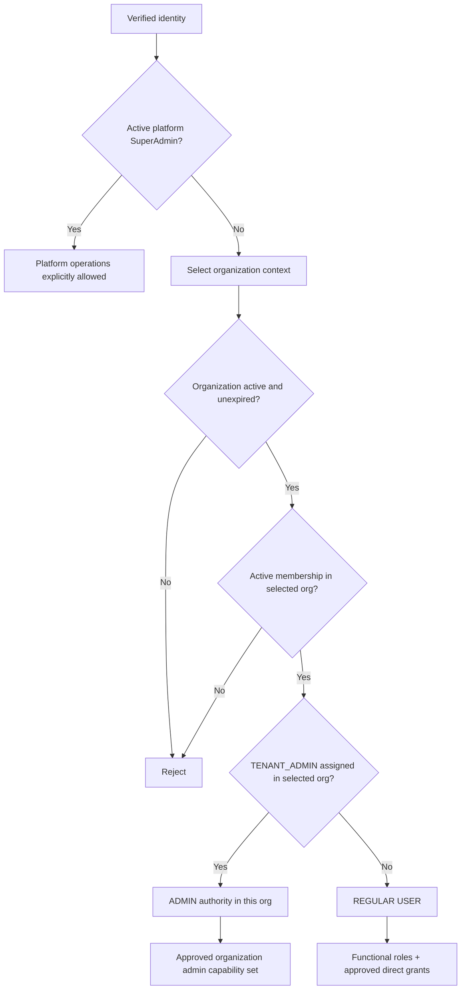

# Phase 3.0.1 — Three-Level Authorization Architecture

**Date:** 2026-11-21  
**Scope:** Read-only architecture review and design. No source, migrations, records, roles, assignments, permissions, or deployment state were changed.  
**Decision:** Recommend a dedicated canonical SYSTEM `TENANT_ADMIN` assignment as the organization-scoped ADMIN marker, separate from the user’s functional role assignment.  
**Implementation status:** BLOCKED on deployed database inventory and business approvals in this document. Phase 3.1 was not started.

## 1. Executive architecture decision

Use three independent authorization levels:

1. **SUPERADMIN** — platform authority, based on a verified active platform identity and restricted to explicit platform operations.
2. **ADMIN** — organization administration, based on a dedicated `TENANT_ADMIN` SYSTEM role assignment in `user_roles` for the requested organization, plus a valid active membership in that organization.
3. **REGULAR USER** — active organization member whose functional permissions come from assigned functional roles and approved direct permissions.

The selected functional role does not determine ADMIN status. An organization ADMIN may have functional role `HR_MANAGER`, `PAYROLL_OFFICER`, or no separate functional role; the independent `TENANT_ADMIN` assignment establishes admin authority in each organization. A Regular User assigned a functional role with an administrative-sounding name does not become ADMIN. Role code aliases (`ORG_ADMIN`, `ADMIN`, `ORGANIZATION_ADMIN`) and profile/owner flags must not independently confer ADMIN authority.

The canonical SYSTEM role approach is recommended over adding a new `organization_members.is_admin` column because the repository already has role assignment infrastructure, the canonical global `TENANT_ADMIN` seed, and Phase 1.2 onboarding that assigns it. The SYSTEM role definition remains global (`organization_id IS NULL`); the assignment is explicitly scoped by `user_roles.organization_id`. A separate functional role assignment may coexist for the same user and organization.

This recommendation is not a deployed-state finding. The deployed role/permission rows, migration state, policies, functions, and assignments remain **NOT VERIFIED**. The local seed file contains conflicting legacy examples described below.

## 2. Three authorization levels

| Level | Canonical evidence | Scope | Must not imply |
|---|---|---|---|
| SUPERADMIN | Approved platform principal. Recommended source is active `profiles.is_super_admin` re-read from the database for verified `auth.uid()`; do not accept a JWT metadata role claim as an independent grant. | Platform operations explicitly granted to SuperAdmin. | Tenant membership or automatic access to sensitive tenant payroll data. |
| ADMIN | Active `organization_members` row for organization X plus assignment to the canonical global SYSTEM `TENANT_ADMIN` in `user_roles` for organization X. | Only the selected, validated organization X. A multi-org user may be Admin in X and Regular User in Y. | Platform authority, cross-organization access, or authority derived from functional job role. |
| REGULAR USER | Active organization membership plus role assignments and approved direct grants for that organization. | Assigned organization, department tree, active modules, granted actions. | Organization administration because a role is named `ORG_ADMIN`, `ADMIN`, `HR_MANAGER`, or `PAYROLL_OFFICER`. |

JWT metadata may select a candidate organization only when the server verifies membership in it. It must not establish ADMIN or SUPERADMIN authority. Switching organizations re-runs the organization and membership checks and recomputes ADMIN status for the destination.

## 3. Canonical ADMIN authority recommendation (Gate 2)

### Chosen model: dedicated canonical SYSTEM role assignment

`TENANT_ADMIN` is a dedicated administrative assignment, not a user’s selected functional job role. It is not assignable by tenant admins through ordinary role assignment. A user can hold both `TENANT_ADMIN` and functional assignments in the same organization; the selected functional role may vary without changing admin status.

Required semantics:

- `roles`: exactly one canonical active immutable `SYSTEM` definition with code `TENANT_ADMIN` and `organization_id IS NULL` (deployed duplicate/alias inventory required before relying on uniqueness).
- `user_roles`: assignment row must include requested `organization_id`, authenticated target `user_id`, and that SYSTEM role id.
- Organization membership: must exist and be active in the same requested organization; role row alone never creates membership.
- ADMIN revocation: delete/revoke the `TENANT_ADMIN` assignment; retain the membership and functional assignments unless a separate workflow changes them.
- Admin promotion: privileged transactional workflow writes only after trusted actor, target membership, organization status, delegation, and lockout checks.
- Role identifiers: strict canonical role id/type/code checks; `ORG_ADMIN`, `ADMIN`, `ORGANIZATION_ADMIN`, display names, and custom role codes do not establish admin status.

Why not `organization_members.is_admin`? It would be a clean membership-scoped boolean, but requires a new schema field and separate grant/revoke controls. It also creates an authority plane outside the existing role-assignment and permission framework, requiring careful coordination with `role_permissions`. The current schema already has a global SYSTEM `TENANT_ADMIN`, onboarding assigns it per organization, and `user_roles` supports multiple assignments. A dedicated assignment therefore fits current multi-organization and provisioning structures with less parallel authority state.

This choice still requires strict constraint/RPC design. Base `user_roles` lacks composite scope constraints and an active/revoked status. The assignment must be bound to active membership by transaction validation and/or appropriate declarative constraints where schema permits.

### Legacy authority sources to retire

| Current source | Current use | Target treatment |
|---|---|---|
| `profiles.is_organization_admin` | Migration 14 helper and Express middleware can grant ADMIN for a member in the profile’s home org. | Must not grant organization administration. Keep field temporarily for compatibility/reporting only; inventory, reconcile, then retire as an auth input. |
| `organization_members.role_id` | Migration 14 helper and invitation helper can independently grant ADMIN when it references active SYSTEM admin-code role. Also mirrors functional assignment in Phase 1.2 invitations. | Must not grant ADMIN. It duplicates `user_roles`; stop treating it as authority, reconcile data, then retire after dependent uses are removed. |
| `organization_members.is_owner` | Migration 14 helper and Express middleware treat owner as ADMIN; local permission fallback gives owner broad module access. | Ownership remains separate and must not automatically confer general ADMIN permissions. Until owner-only product capabilities are defined, retain as a non-auth ownership fact and do not use as an admin bypass. |
| `roles.code` aliases | SQL helpers accept multiple administrator-like strings. | Only the canonical `TENANT_ADMIN` SYSTEM role id/type/code is considered for Admin; aliases never substitute. Custom functional role names never grant Admin. |

## 4. SUPERADMIN authority

### Checked-in implementation

- Core schema includes `profiles.is_super_admin` (`supabase/migrations/20261104000001_core_schema.sql:187`).
- `is_super_admin()` in migration 12 (`20261121000012_remediate_critical_containment.sql:101-120`) returns true from an active profile flag **or** `auth.jwt()->'app_metadata'->>'role' = 'SUPER_ADMIN'`.
- Migration 14’s `fn_enforce_profile_security_fields()` is `SECURITY INVOKER` and blocks ordinary users from changing their own SuperAdmin flag and organization admins from changing another profile’s SuperAdmin flag (`20261121000014_security_corrections_phase1_1_1.sql:80-165`). It explicitly trusts database roles including `service_role`; service-role paths bypass RLS and remain privileged.
- `is_super_admin()` is used by RLS and SECURITY DEFINER helpers. Express loads `profiles.is_super_admin` from PostgreSQL for a remote profile, then derives request SuperAdmin context from it (`src/server/middleware/auth.middleware.ts:184-202, 268-288`). Organization context exempts SuperAdmin from tenant membership validation but restricts status/expiry bypass to administrative routes (`src/features/organizations/organization-context.service.ts:281-340`).
- Migration 14’s token hook sets an informational `app_metadata.role=SUPER_ADMIN` from the active profile and describes role claims as informational (`:300-380`). But migration 12’s current checked-in `is_super_admin()` function still accepts that JWT metadata claim as a grant.

### Assessment and target

The profile flag is protected against ordinary authenticated self-promotion and tenant-admin promotion in the checked-in trigger/RLS design, but it is not the sole current authority source because the SQL helper also accepts a JWT app-metadata role claim. Further, service-role access can modify protected profile fields and bypass RLS, so every backend service-role operation must have its own trusted actor check and narrow operation boundary.

Recommend active `profiles.is_super_admin` for verified `auth.uid()` as the single canonical platform authority source, unless the organization has a separate approved platform identity registry. Remove JWT role metadata as an independent authorization grant; token claims may be informational only. SuperAdmin must not depend on tenant membership or tenant functional roles. Whether SuperAdmin may read payroll remains restricted by the existing role description (“No access to sensitive tenant payroll data”) and requires explicit policy before any exception.

## 5. Functional RBAC behavior (Gate 3)

### Model

- `roles` describe SYSTEM or organization-scoped CUSTOM role definitions.
- `user_roles` assigns one or more roles per user and organization. A canonical `TENANT_ADMIN` assignment indicates Admin; functional role assignments independently identify job permissions.
- `role_permissions` maps a role to allowed catalog actions for an organization.
- `user_permissions` provides direct grants under the current migration 14 additive evaluator; direct grants must not imply Admin.
- Organization module eligibility (Tier 1), department module allocation (Tier 2), and action grants (Tier 3) remain required. Department hierarchy and active membership/department restrictions continue to filter effective actions.
- Regular User permissions are derived from functional role permission rows and approved direct grants, not code or display name.
- Admin has the approved organization-administration capability set regardless of their functional assignment. Recommend an explicit Admin capability set evaluated separately from ordinary functional role permissions (or explicit permissions attached to the canonical `TENANT_ADMIN` system role). Do not silently bypass all permission checks or payroll data protections.
- An Admin who also has `HR_MANAGER`/`PAYROLL_OFFICER` receives that functional grant only through the functional role assignment. Admin status itself must not grant payroll viewing/approval unless approved in the Admin capability policy.
- Custom role creation/assignment remains organization-scoped. Tenant admins cannot create/assign SYSTEM or platform privileged roles. A role named `ORG_ADMIN` or `ADMIN` is not privileged or administrative by name.

### Catalog evidence and proposed capability matrix

No `INSERT INTO public.role_permissions` was found in checked-in migrations, the configured local seed, or alternate catalog seed. Therefore, current role grant sets are **NOT VERIFIED**. `supabase/config.toml:67-72` configures `supabase/seed.sql`; that script contains legacy `tenants`/`tenant_id` schema and a custom `ORG_ADMIN` fixture/assignment (`:579, 628-645`) plus a profile admin flag (`:274-289`). It starts with destructive truncation and was not run; compatibility with current migrations is unverified. The separate `supabase/seeds/20261101000001_seed_catalog.sql` is not configured as `db.seed.sql_paths`.

Existing catalog/code keys include:

- `Organization.View/Add/Edit/Delete`, `Department.*`, `Profile.*`, `Role.*`, `UserRole.*`, `OrganizationModule.*`, `DepartmentModule.*`, `RolePermission.*`, `UserPermission.*` in current TypeScript constants and configured local seed (with a mismatch: configured seed has `TenantModule.*`, while current code uses `OrganizationModule.*`).
- `TypeOfLeave.*`, `RequestForLeave.*`, `RequestForLeave.Approval.Create`, and `PayrollComputation.*` in application constants. The active SQL catalog seed does not define all these business actions.

| Capability area | Proposed ADMIN treatment | Functional/custom role treatment | Owner/SuperAdmin boundary |
|---|---|---|---|
| Organization settings | `Organization.View/Edit` for own org after field-level approval. `Organization.Add/Delete` not Admin grants. | Explicitly delegated, same organization. | Cross-org creation/status management SuperAdmin-only. |
| Departments | `Department.View/Add/Edit`; deletion requires approval due structural/payroll impacts. | Only explicitly delegated scope. | No ownership bypass. |
| Membership/users | `Profile.View/Add/Edit` and `UserRole.View/Add/Edit/Delete` as approved; invitation, activation, suspension, and revocation through transactions. | Cannot assign roles outside actor’s grant ceiling or self-escalate. | SuperAdmin controls platform identity/admin provisioning workflow. |
| Custom roles | `Role.View/Add/Edit/Delete` for own-org CUSTOM roles; never SYSTEM definitions. | Can hold functional permission subsets; admin actions are not conveyed by a name/code. | SYSTEM role definitions and platform permission catalog SuperAdmin-only. |
| Permission management | `RolePermission.View/Add/Edit/Delete` only if approved delegation model proves grants are within actor authority; not assumed by this design. | Role grant ceiling and module/department scope apply. | SYSTEM role permission changes SuperAdmin-only. |
| Organization modules (Tier 1) | Not part of ADMIN set; current RLS reserves tier-one licensing to SuperAdmin. | No. | SuperAdmin-only. |
| Department modules (Tier 2) | `DepartmentModule.View/Add/Edit` only where org Tier 1 allocation is active; delete requires approval. | Scoped delegated subset. | Cross-org allocations SuperAdmin-only. |
| Payroll and approvals | No implied grant. Determine exact catalog and policy before grant. | Only explicit functional role/direct grants. | SuperAdmin description excludes sensitive tenant payroll; no exception without approval. |
| Owner operations | No existing owner-specific keys found. No automatic Admin or full permission grant from `is_owner`. | No. | Transfer/removal/recovery workflow is blocked pending product definition; enforce separately if approved. |

No permission key is invented in this document. The matrix is a design proposal, not an existing seed assignment. Delete, direct-grant, role-permission delegation, payroll, and owner capabilities require approval.

## 6. Permission evaluation rules

For each request in organization X:

1. Authenticate identity; fail closed if missing, inactive, invalid, or unverified.
2. Resolve explicit organization X and verify it exists, is active/unexpired for tenant operations, and the user has an active membership in X. Invalid or inactive membership rejects request.
3. Resolve Admin independently: active canonical `TENANT_ADMIN` assignment with `user_roles.organization_id=X`, global SYSTEM role identity, and active membership X. The selected functional role, profile flag, JWT role claim, owner bit, membership role mirror, and direct permission rows are not substitutes.
4. Resolve SuperAdmin independently from the approved platform authority source; no tenant membership required. Permit only explicit platform operations.
5. If Admin, apply approved organization-admin capability set for X. If Regular User, evaluate assigned functional role permissions plus approved direct permissions for X. For both, retain module and department eligibility unless an explicitly approved Admin action is designed to bypass a particular tier.
6. Direct permissions are additive per migration 14 but do not grant Admin. If direct permission policy changes to deny/override, that is a separate approved architecture decision.
7. Remove stale JWT role claims and cache authority. If a cache exists, invalidate it after commit; database committed state remains authoritative.

## 7. Express and PostgreSQL authorization alignment (Gate 4)

| Component | Current checked-in behavior | Target behavior |
|---|---|---|
| `organization-context.service.ts` | Validates active membership for non-SuperAdmins and active organization eligibility. Membership is loaded by `(organization_id,user_id)`. | Keep as mandatory context gate. Membership/profile token alone cannot imply ADMIN. SuperAdmin bypass only for explicitly platform operations. |
| `auth.middleware.ts` | Loads profile admin/SuperAdmin flags. After membership resolution, sets `isTenantAdmin` from `isOwner` or home-org profile flag. Does not query `user_roles` for admin status. | Resolve verified actor + selected org, validate active membership, then derive Admin from committed canonical `TENANT_ADMIN` assignment. Derive SuperAdmin from approved platform source. Do not use JWT role metadata. |
| `rbac.guard.ts` | `requireTenantAdmin` trusts `req.user.isTenantAdmin`; `requirePermission` trusts loaded permission keys. | General routes use explicit Admin capability / permission checks; no boolean bypass. `isTenantAdmin` may remain display-only or derived summary, never independent authority. |
| `auth.service.ts` | Organization switching validates membership but sets admin context from owner/profile flag rather than selected organization’s user_roles assignment. | On switch, resolve destination membership and canonical assignment; recompute ADMIN in destination. Never promote authority from stale token claims. |
| `role.service.ts` | In-memory repository handles assignment, revocation, and role permissions; actor flags drive checks. | Call narrow PostgreSQL transactional workflows; derive actor from trusted request/database context. Cache only after commit. |
| PostgreSQL helpers | `is_organization_admin()` currently ORs `is_owner`, code aliases in `user_roles`, code aliases in membership `role_id`, and profile admin flag after membership checks. `is_super_admin()` accepts profile and JWT app_metadata role claim in migration 12. | Replace with canonical ADMIN check (`TENANT_ADMIN` id/type/code + active membership in selected org) and single approved SuperAdmin check. No alias/owner/profile admin grant. |
| RLS policies | Migration 10 uses broad helper; direct assignment/role-permission writes are organization-admin scoped without delegation depth; RLS is bypassed by service_role. | Match Express decisions: org-scoped Admin capabilities and target validation. Revoke direct sensitive writes where RPC is required. Service-only RPC verifies actual actor authorization. |
| `get_user_effective_permissions` | Migration 14 reads durable `user_roles`/`role_permissions` and `user_permissions`, checks active membership/profile/org/department and module eligibility; additive direct grants. | Keep committed database evaluation; filter functional grants per selected org. Add approved Admin capability set independently, or evaluate TENANT_ADMIN’s explicit permission set separately. No code-name wildcard. |

### Required consistent result

For every request, middleware and PostgreSQL must return the same classification for the same verified user and selected organization: `SUPERADMIN`, `ADMIN in X`, `REGULAR USER in X`, or deny. Context and permission errors fail closed. Authorization cannot be based only on `req.user.isTenantAdmin`, a client-provided actor id, a profile `organization_id`, or JWT role metadata. Production service-role operations must use narrow authenticated RPCs; service role is a transport privilege, not proof that the end user is authorized.

## 8. Membership, Admin, and ownership lifecycle (Gate 5)

| Workflow | Required behavior |
|---|---|
| Create organization Admin | Privileged onboarding/platform workflow assigns `TENANT_ADMIN` and active membership in one transaction; profile admin flag stays false; `is_owner` only set if approved owner. |
| Promote Regular User | Verify target’s active membership in organization X and trusted actor’s delegation; lock organization authorization state; insert canonical admin assignment atomically. No self-promotion. |
| Demote Admin | Transactionally remove/revoke `TENANT_ADMIN`, preserve functional assignment and membership unless separately changed; verify another active Admin remains. |
| Suspend Admin membership | Mark membership inactive; immediately deny access/effective permissions in X, even if role assignment remains. Decide whether dormant role assignment is retained or separately revoked. |
| Reactivate membership | Verify org active, target profile active, role still active/in-scope, and current admin grant approved; do not trust stale session/cache. |
| Remove Admin | Ensure last-active-admin rule; remove the ADMIN assignment; membership deletion is separate and auditable. |
| Transfer ownership | Separate transaction and owner-specific authorization after product defines ownership powers. Do not grant/retain ADMIN automatically. |
| Remove owner | Owner field update/delete must use approved owner workflow; does not change ADMIN assignment by implication. |
| Last active Admin | Serialize on organization row (e.g. `SELECT ... FOR UPDATE`) and count eligible active memberships + canonical assignments in same transaction; concurrent removals cannot remove all Admins. |
| Last owner | **BLOCKED** pending whether owners must remain. If yes, enforce a separate locked owner count and recovery path. |

The checked-in membership policies allow admins to alter membership status and permit owner demotion through `is_owner=false`; no last-owner or last-admin lock was found. Current onboarding creates the owner and Admin assignment together. Member invitation creates a non-owner member with custom functional role. `user_roles` has no active/expiry column; revocation is physical deletion or role deactivation. There is no production membership lifecycle service in the inspected role feature.

## 9. Legacy authority transition plan (Gate 6)

Do not change records until read-only inventory and approval are complete.

1. **Inventory current deployment:** migration state/checksums; actual role records; role and direct permission rows; user role assignments; membership status/roleId/owner; profile admin/SuperAdmin flags; organization status/expiry; all related FKs; RLS policies, grants, trigger/function source and ownership.
2. **Classify each Admin candidate by source:** canonical SYSTEM `TENANT_ADMIN`, aliases and type/scope, custom functional role, membership `role_id`, profile flag, owner bit. Do not let names alone classify authority.
3. **Compare permissions:** record effective permissions before and after hypothetical canonical model by anonymized user/org; identify any removed/admin-added capabilities, especially payroll and permission delegation.
4. **Resolve conflicts manually:** mismatched `user_roles` and membership `role_id`; owners without Admin assignment; Admin assignments without owner; profile flags; multiple memberships; duplicate role rows; inactive/expired orgs; role from another org; no active Admin. Do not automatically promote all owners or remove all legacy assignments.
5. **Preserve valid access:** approve a per-record mapping for each existing Admin; preserve custom functional assignments independently. Convert to canonical assignment only after actor/business authorization and permission parity are established.
6. **Transition compatibility:** introduce canonical reads/telemetry in an approved staged phase; compare results; switch Express and SQL together; then stop writes to profile flag/membership role mirror; only later remove fields/functions after dependency scan.
7. **Rollback:** capture anonymized mapping, counts, effective-permission snapshots, and old function/policy definitions. Stage reversible compatibility changes; rollback must restore old checks without broadening stale flags. Define break-glass SuperAdmin recovery and audit.

Known source conflict: migration 5 defines global SYSTEM `TENANT_ADMIN`; configured local `supabase/seed.sql` includes tenant-scoped custom `ORG_ADMIN`, a sample user_roles assignment, and a profile admin flag. The root seed is configured by `supabase/config.toml`, but uses legacy `tenants`/`tenant_id` schema and begins with destructive truncation. It was not run, and compatibility with current migrations is unverified. This source conflict is not evidence of deployed assignments.

## 10. Deployed database preflight requirements

No live/staging database was queried. Before implementation, use a read-only connection and obtain:

- Actual Supabase migration history and schema diff against repository.
- `roles`: all SYSTEM/CUSTOM rows, ids, case-insensitive codes, organization scope, active/mutable; duplicate canonical aliases.
- `role_permissions` and `user_permissions`: per-role/org/action counts and effective action list; catalog keys absent from migrations/seeds.
- `user_roles`: assignments grouped by role/org; duplicates; users with admin plus functional role; users with multiple organizations; assignments without active memberships.
- `organization_members`: active/inactive memberships, owner counts (0/1/multiple per org), legacy role references, role mirror mismatches, departments, cross-org inconsistencies.
- `profiles`: active status, `is_organization_admin`, `is_super_admin`, profile/home organization compared with memberships; report only aggregate/anonymized data.
- Organizations: active/suspended/expired, zero Admins, no owners, multiple owners; determine lockout risk.
- Before/after permission snapshots for Admin, Regular User, multi-org user, inactive membership, owner-only, profile-flag-only, alias-role-only, custom admin-looking role, and SuperAdmin cases.
- Actual `pg_policies`, `pg_get_functiondef`, function owner, SECURITY DEFINER/search_path, trigger definitions, table/function grants/EXECUTE ACL, including service-role access.

Checked-in source findings are documented above. Deployed migrations, records, grants, permissions, counts, and runtime outcomes are **NOT VERIFIED**.

## 11. Risks and blocked decisions

- **BLOCKED — Admin capability set:** approve exact organization-management actions, deletion, role-permission delegation, direct grants, and any bypass behavior. No role-permission seed matrix currently establishes the set.
- **BLOCKED — payroll:** decide whether Admin may view/approve payroll; do not infer it from admin status. Ensure SuperAdmin policy follows platform requirements and the current no-sensitive-payroll role description.
- **BLOCKED — ownership:** determine whether any owner-only operations exist, whether multiple owners are permitted, and whether a last-owner must remain. Do not equate ownership with ADMIN.
- **BLOCKED — admin delegation:** define which actors can create/revoke Admins and whether SuperAdmin-only provisioning or an existing Admin may promote another Admin.
- **BLOCKED — last Admin definition:** specify what counts as valid Admin (active membership/account/org, exact role identity, and org expiration) and an emergency recovery path.
- **BLOCKED — SuperAdmin source:** approve removal of JWT `app_metadata.role` as an independent source and confirm the protected database profile flag is the canonical source; verify all service-role writers.
- **Schema integrity:** base `user_roles` lacks a composite membership/role scope constraint and active/revoked status. Add only after preflight identifies data shape and migration plan.
- **Authorization drift:** Express ignores role-based admin assignment for its boolean guard while SQL accepts it; separate sources can bypass or deny. A coordinated change and tests are required.
- **Catalog drift:** configured local seed and code disagree on `TenantModule` vs `OrganizationModule`; alternate seed differs. Deployed catalog must be inspected before mapping role permissions.

## 12. Recommended implementation phases

1. Obtain written approval for canonical SYSTEM `TENANT_ADMIN` ADMIN marker, SuperAdmin source, exact admin capability set, payroll policy, owner semantics, last-admin/owner rules, and promotion authority.
2. Run and review read-only deployed preflight. Stop on migration drift, duplicate definitions, missing assignment inventory, or permission deltas that are not approved.
3. Define the exact `TENANT_ADMIN` capability matrix from existing deployed action keys; add no action names without separate catalog approval. Confirm custom functional role delegation ceiling.
4. Design database constraints and narrow transactional RPCs: trusted actor, active org/membership, target scope, no self-promotion, assignment changes, last-admin lock, audit, fail-closed behavior, service-role grants.
5. Align SQL helpers/RLS/effective-permission behavior with canonical role identity and explicit Admin capabilities; remove owner/profile/membership-role/alias admin shortcuts as staged and approved.
6. Align Express middleware/session/switching/guards; derive Admin from selected organization’s active membership and committed `TENANT_ADMIN` assignment. Keep JWT metadata informational.
7. Convert `role.service.ts` operations to durable transactions; update caches only after commit; ensure revoked permissions are immediately absent.
8. Add integration/security tests for all authority sources, multi-org switching, lifecycle, direct DB writes, service-role RPCs, concurrency, rollback, and parity across HTTP and SQL.
9. Verify in staging against actual PostgreSQL; separately approve production rollout. Retire legacy columns only after staged proof and rollback window.

## 13. Acceptance criteria for Phase 3.1 readiness

- A user’s functional role never determines Admin or SuperAdmin status.
- One active canonical global SYSTEM `TENANT_ADMIN` role definition is used; assignment is organization scoped and requires active membership.
- `ORG_ADMIN`, `ADMIN`, `ORGANIZATION_ADMIN`, custom role names, profile admin flags, membership role mirror, owner bit, and JWT metadata cannot independently grant Admin.
- Express context, organization switching, guards, RLS, RPCs, and effective permissions agree for the same user/org.
- Regular User permissions are strictly functional role/direct grants filtered by org/module/department eligibility.
- Admin capabilities are an explicit approved set; no implicit payroll, platform, or cross-org rights.
- SuperAdmin authority is separate, trusted, active, and limited to platform routes; service-role operations validate the real actor.
- Membership suspension/invalid org selection denies immediately; role revoke/demotion is durable and immediate.
- Last-admin protection is transaction-safe and concurrency-tested; last-owner behavior follows an approved rule.
- Legacy records are inventoried, mapped, permission-compared, and recoverable; no blind owner promotion or deletion.
- Staging database verification is complete; PGlite/unit results are not represented as live verification.

## Final report

1. **Recommended canonical architecture:** dedicated canonical SYSTEM `TENANT_ADMIN` assignment plus active organization membership for ADMIN; separate functional roles; active verified platform SuperAdmin source for SUPERADMIN.
2. **ADMIN representation:** choose the canonical SYSTEM role assignment in `user_roles`, not a new `organization_members.is_admin` field. Assign it independently from functional roles.
3. **Existing custom roles:** may remain unchanged as functional assignments. Their names/codes never confer Admin; action permissions remain subject to organization scope and approved delegation.
4. **Retire:** `profiles.is_organization_admin` authorization, `organization_members.role_id` authorization/mirror, owner-as-general-admin behavior, administrator code aliases, and JWT metadata as an independent platform grant. Do this only after inventory and staged replacement proof.
5. **Approval needed:** Admin action set, payroll access, owner-only powers/multiple/last-owner rules, Admin promotion/revocation authority, direct grant/delegation ceiling, last-admin definition, and SuperAdmin source change.
6. **Phase 3.1 readiness:** **NOT READY — BLOCKED** pending the approvals and read-only deployed database preflight above.

This design supersedes prior Phase 3.0.1 draft recommendations where they did not explicitly separate ADMIN authority from functional role assignment. It is not an implementation, production approval, or authorization to migrate data.
