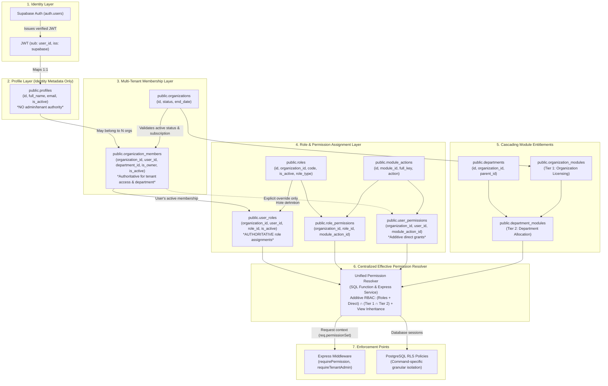
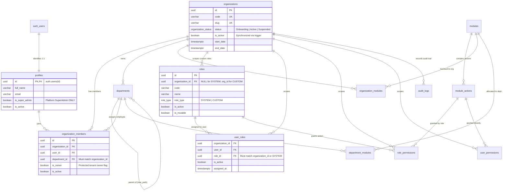
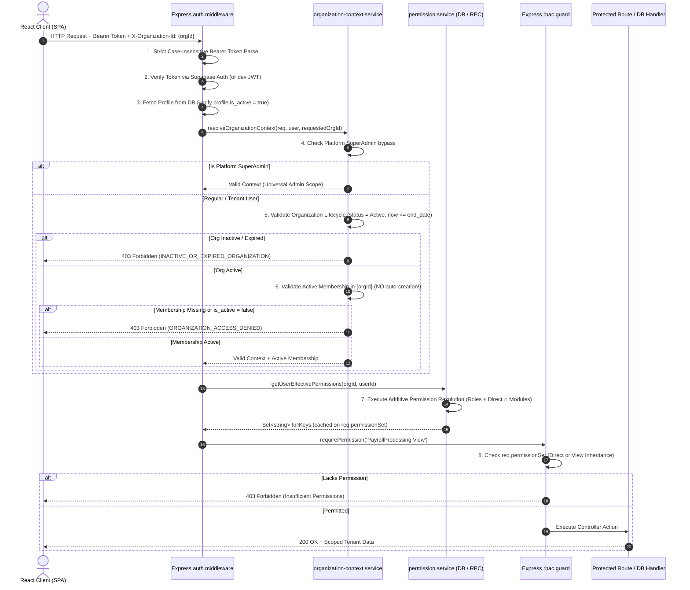
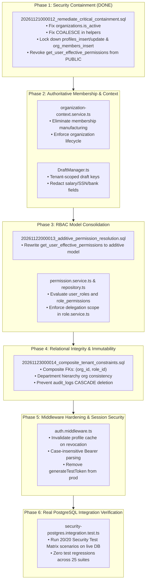

# PayPulse (JK Payroll) — Master Security & Architecture Remediation Report

> Archived historical report. Its phase statuses and recommendations are not current; use [`SECURITY_REMEDIATION_MASTER_TRACKER.md`](../SECURITY_REMEDIATION_MASTER_TRACKER.md) for authoritative status. Original report content is preserved below.

**Date:** November 21, 2026  
**Author:** Principal Software Architect, Application Security Engineer & PostgreSQL/Supabase Security Specialist  
**Application:** PayPulse (JK Payroll)  
**Stack:** React 19 SPA, Express 4 Backend, Supabase Auth, PostgreSQL 15+ with Row-Level Security (RLS)  
**Status:** **Phase 1 Implemented & Verified.** 25/25 Test Suites Passed (352/352 Tests).

---

## Executive Summary

This master document consolidates the complete security audit, repository verification, target architecture design, and phased remediation plan for PayPulse. It serves as the authoritative architectural record and implementation guide for hardening multi-tenant isolation, cascading Role-Based Access Control (RBAC), Supabase Auth integration, and PostgreSQL database integrity.

---

## Table of Contents
1. [Stage 1 — Repository Verification & Exploitability Analysis](#stage-1--repository-verification--exploitability-analysis)
   - [1.1 Comprehensive Findings Register](#11-comprehensive-findings-register)
   - [1.2 Exploitability & Vulnerability Chaining Matrix](#12-exploitability--vulnerability-chaining-matrix)
   - [1.3 Additional Vulnerabilities Discovered](#13-additional-vulnerabilities-discovered)
   - [1.4 PostgreSQL Function Privileges (get_user_effective_permissions)](#14-postgresql-function-privileges-get_user_effective_permissions)
2. [Stage 2 — Target Authorization Architecture](#stage-2--target-authorization-architecture)
   - [2.1 Discrete Separation of Security Concerns](#21-discrete-separation-of-security-concerns)
   - [2.2 Target Architecture Diagram](#22-target-architecture-diagram)
   - [2.3 Database Entity Relationship Model](#23-database-entity-relationship-model)
   - [2.4 Authorization & Context Resolution Flow](#24-authorization--context-resolution-flow)
   - [2.5 Effective Permission Resolution Semantics & Exact Algorithm](#25-effective-permission-resolution-semantics--exact-algorithm)
   - [2.6 Platform Administrator Authorization Model](#26-platform-administrator-authorization-model)
   - [2.7 Tenant Isolation & System Responsibility Matrix](#27-tenant-isolation--system-responsibility-matrix)
   - [2.8 Compatibility & Deprecation Strategy](#28-compatibility--deprecation-strategy)
3. [Stage 3 — Remediation Roadmap & Migration Strategy](#stage-3--remediation-roadmap--migration-strategy)
   - [3.1 Phased Implementation Roadmap](#31-phased-implementation-roadmap)
   - [3.2 Phase Breakdown & Vulnerability Mapping](#32-phase-breakdown--vulnerability-mapping)
   - [3.3 Staged Deployment & Rollback Strategy](#33-staged-deployment--rollback-strategy)
   - [3.4 Security Acceptance Criteria](#34-security-acceptance-criteria)
4. [Stage 4 — Phase 1 Execution & Verification Results](#stage-4--phase-1-execution--verification-results)
   - [4.1 Problems Addressed in Phase 1](#41-problems-addressed-in-phase-1)
   - [4.2 Implemented Changes & Migration 20261121000012](#42-implemented-changes--migration-20261121000012)
   - [4.3 Automated Verification Results (352 Tests Passing)](#43-automated-verification-results-352-tests-passing)
   - [4.4 Remaining Risks & Phase 2 Next Steps](#44-remaining-risks--phase-2-next-steps)

---

# Stage 1 — Repository Verification & Exploitability Analysis

## 1.1 Comprehensive Findings Register

Every finding from the initial assessment was cross-referenced directly against repository source files, migrations, and test suites.

| Finding ID | Finding Title | Status | Primary Code Reference | Severity |
|---|---|:---:|---|:---:|
| **CRITICAL-01** | Org Admin can promote users via profile update | **CONFIRMED** | `supabase/migrations/20261119000010_remediate_database_rls.sql:358-363` | Critical |
| **CRITICAL-02** | Users can self-provision privileged profiles | **CONFIRMED** | `supabase/migrations/20261119000010_remediate_database_rls.sql:329-339` | Critical |
| **CRITICAL-03** | Org Admins can create owner memberships | **CONFIRMED** | `supabase/migrations/20261119000010_remediate_database_rls.sql:247-252` | Critical |
| **CRITICAL-04** | Cross-tenant role & permission inconsistency | **CONFIRMED** | `supabase/migrations/20261104000001_core_schema.sql:231-286` | Critical |
| **CRITICAL-05** | Role display names can grant SuperAdmin privileges | **CONFIRMED** | `supabase/migrations/20261104000003_audit_logs.sql:110-148`, `20261119000010_remediate_database_rls.sql:37-43` | Critical |
| **CRITICAL-06** | Authorization helpers use COALESCE improperly | **CONFIRMED** | `supabase/migrations/20261119000010_remediate_database_rls.sql:37-105` | Critical |
| **CRITICAL-07** | Unrestricted RBAC permission delegation | **CONFIRMED** | `src/features/roles/role.service.ts:238-294` | Critical |
| **HIGH-01** | Profile admin privileges conflict with RBAC | **CONFIRMED** | `src/server/middleware/rbac.guard.ts:115`, `20261119000010_remediate_database_rls.sql:58-73` | High |
| **HIGH-02** | `organization_members.role_id` and `user_roles` compete | **CONFIRMED** | `supabase/migrations/20261104000003_audit_logs.sql:21`, `src/features/roles/role.service.ts:482` | High |
| **HIGH-03** | Multi-organization context not properly supported | **CONFIRMED** | `supabase/migrations/20261119000010_remediate_database_rls.sql:22-26` | High |
| **HIGH-04** | Org lifecycle not checked in membership check | **CONFIRMED** | `supabase/migrations/20261119000010_remediate_database_rls.sql:79-105` | High |
| **HIGH-05** | Permission resolver assumes single-org profile | **CONFIRMED** | `supabase/migrations/20261104000002_functions_and_rls.sql:131-136` | High |
| **HIGH-06** | Permission resolver does not verify active membership | **CONFIRMED** | `supabase/migrations/20261104000002_functions_and_rls.sql:131-145` | High |
| **HIGH-07** | Permission resolver all-or-nothing direct override | **CONFIRMED** | `supabase/migrations/20261104000002_functions_and_rls.sql:180-187` | High |
| **HIGH-08** | Context service manufactures memberships | **CONFIRMED** | `src/features/organizations/organization-context.service.ts:244-255` | High |
| **HIGH-09** | Cached profiles preserve revoked privileges | **CONFIRMED** | `src/server/middleware/auth.middleware.ts:179-225` | High |
| **HIGH-10** | Role service methods have optional actor context | **CONFIRMED** | `src/features/roles/role.service.ts:492` | High |
| **HIGH-11** | User-role updates do not validate full tuple | **CONFIRMED** | `src/features/roles/role.service.ts:504-528` | High |
| **HIGH-12** | No last-owner or last-admin protection | **CONFIRMED** | `src/features/roles/role.service.ts:534-547`, `src/server/db/repository.ts:1222-1232` | High |
| **HIGH-13** | `get_user_effective_permissions` unverified boundary | **CONFIRMED** | `supabase/migrations/20261104000002_functions_and_rls.sql:115` | High |
| **HIGH-14** | Token hook produces ambiguous claims | **CONFIRMED** | `supabase/migrations/20261104000003_audit_logs.sql:123` | High |
| **HIGH-15** | Incomplete persistence in organization service | **CONFIRMED** | `src/features/organizations/organization.service.ts:164-215` | High |
| **MED-01 to MED-16** | All 16 Medium-priority issues (swallowed audit errors, draft leakage, raw error exposure, etc.) | **CONFIRMED** | Multiple files (see Section 1.2) | Medium |

---

## 1.2 Exploitability & Vulnerability Chaining Matrix

> [!WARNING]
> **Vulnerability Chaining Hazard:** The `COALESCE` defect in `is_organization_admin()` returned `false` for normal tenant administrators because PostgreSQL evaluates `COALESCE(false, ...)` as `false` on the first non-null check. This defect temporarily suppressed CRITICAL-01 and CRITICAL-03. **Fixing the helper without atomically locking down `profiles_update_policy` and `org_members_insert_policy` would have immediately activated privilege escalation for all tenant admins.**

```text
┌────────────────────────────────────────────────────────────────────────┐
│                        CHAINING RISK DIAGRAM                           │
│                                                                        │
│   Broken Helper: is_organization_admin() ──► Evaluates to FALSE       │
│                                                     │                  │
│                                                     ▼                  │
│                 Suppresses CRITICAL-01 & CRITICAL-03 (Latent)          │
│                                                                        │
│   If Fixed Alone: is_organization_admin() ──► Evaluates to TRUE        │
│                                                     │                  │
│                                                     ▼                  │
│                 ACTIVATES CRITICAL-01 & CRITICAL-03 in Production!     │
└────────────────────────────────────────────────────────────────────────┘
```

| Finding ID | Classification | Current Exploitability | Remediation Prerequisite / Coupling |
|---|---|---|---|
| **CRITICAL-01** | Conditional / Latent Policy Defect | **Latent for standard org admins** (masked by COALESCE). Active if profile missing or `is_super_admin` NULL. | **Must be deployed in the same transaction as CRITICAL-06.** |
| **CRITICAL-02** | Currently Exploitable Vulnerability | **ACTIVE.** Self-insert branch does not call `is_organization_admin()`. Any client could inject `is_organization_admin = true`. | **Independent.** Highest priority patch. |
| **CRITICAL-03** | Conditional / Latent Policy Defect | **Latent for standard org admins** (masked by COALESCE). Active for any actor passing `is_organization_admin()`. | **Must be deployed in the same transaction as CRITICAL-06.** |
| **CRITICAL-04** | Structural / Relational Defect | **ACTIVE.** Foreign keys in `user_roles` do not check `organization_id`. | Requires pre-migration data cleanup before adding composite constraints. |
| **CRITICAL-05** | Privilege Escalation Vector | **Conditional.** Exploited if an org creates a custom role named `'Platform Super Administrator'`. | Decouple token hook and eliminate role display name checks. |
| **CRITICAL-06** | Severe Authorization Logic Defect | **ACTIVE.** Caused legitimate organization admins and members to fail RLS checks. | **Must be deployed atomically with CRITICAL-01 and CRITICAL-03.** |
| **CRITICAL-07** | API Authorization Defect | **ACTIVE.** Any tenant admin can delegate unheld permissions via `role.service.ts`. | Add delegation scope validation in application layer. |

---

## 1.3 Additional Vulnerabilities Discovered

1. **ADD-01 (Fatal Schema Discrepancy):** `public.organizations` was created with `status` enum, but no migration ever added `is_active BOOLEAN`. RLS policies and RPC functions checking `o.is_active` fail on pristine deployments with `column "is_active" does not exist (SQLSTATE 42703)`.
2. **ADD-02 (Backend Evaluator Ignores Roles):** `db.getUserEffectivePermissions()` in `src/server/db/repository.ts` (lines 1424–1471) evaluated **only** direct user permission overrides (`this.userPermissions`). It completely omitted `user_roles` and `role_permissions`, returning `[]` permissions for standard users assigned custom roles.
3. **ADD-03 (RLS Tests Masked SQL Insecurity via JS Mocking):** Test suite `tests/security-database-rls-phase4.test.ts` simulated SQL helper logic in synthetic JavaScript `if/else` statements, which short-circuited differently than PostgreSQL and masked the broken `COALESCE` bug.
4. **ADD-04 (Permanent Audit Trail Destruction):** Foreign key `audit_logs.organization_id REFERENCES organizations(id) ON DELETE CASCADE` permanently purges all historical compliance audit records when an organization is deleted.
5. **ADD-05 (Unprotected Authentication Endpoints):** No rate limiting or lockout protection was configured for `/api/auth/login`.

---

## 1.4 PostgreSQL Function Privileges (`get_user_effective_permissions`)

- **Signature:** `public.get_user_effective_permissions(p_organization_id UUID, p_user_id UUID) RETURNS TEXT[]`
- **Security Mode:** `SECURITY DEFINER`, `SET search_path = public`.
- **Default PostgreSQL Behavior:** In standard PostgreSQL, newly created functions grant `EXECUTE` to pseudo-role `PUBLIC` by default unless altered via `ALTER DEFAULT PRIVILEGES`.
- **Audit Findings:** No `REVOKE EXECUTE` statement was ever executed in migrations 1–11.
- **Exposure:** The pseudo-role `PUBLIC` (including `anon` and `authenticated`) held execute rights over PostgREST RPC.
- **Threat vs. Impact:** Because the function is `STABLE`, an attacker could not mutate data, but **could enumerate any employee's calculated permission keys across any organization**.
- **Containment Action:** Phase 1 executed `REVOKE ALL ON FUNCTION public.get_user_effective_permissions(UUID, UUID) FROM PUBLIC, anon;` and restricted access to `authenticated` and `service_role`.

---

# Stage 2 — Target Authorization Architecture

## 2.1 Discrete Separation of Security Concerns

To prevent competing sources of truth, every security concern has exactly one authoritative owner:

```text
┌───────────────────────────────┬────────────────────────────────────────────────────────┐
│ SECURITY CONCERN              │ SINGLE AUTHORITATIVE SOURCE                            │
├───────────────────────────────┼────────────────────────────────────────────────────────┤
│ 1. User Identity              │ Supabase Auth (auth.users)                             │
│ 2. User Profile Metadata      │ public.profiles (Identity metadata ONLY; NO auth role) │
│ 3. Organization Membership    │ public.organization_members (is_active = true)         │
│ 4. Active Tenant Context      │ X-Organization-Id validated against active membership  │
│ 5. Platform Administration    │ public.profiles.is_super_admin (Strict platform flag)  │
│ 6. Organization Ownership     │ public.organization_members.is_owner                   │
│ 7. Role Definitions           │ public.roles (SYSTEM = global, CUSTOM = per org)       │
│ 8. Role Assignments           │ public.user_roles (SOLE authority for user-role maps)  │
│ 9. Role Permissions           │ public.role_permissions                                │
│ 10. Direct User Permissions   │ public.user_permissions (Additive explicit overrides)  │
│ 11. Tier 1 Module Licensing   │ public.organization_modules                            │
│ 12. Tier 2 Dept Allocation    │ public.department_modules (Cascading ancestor tree)    │
│ 13. Effective Permissions     │ Unified Evaluator: (Roles ∪ Direct) ∩ Modules + View   │
│ 14. API Perimeter             │ Express Middleware (rbac.guard.ts, auth.middleware.ts) │
└───────────────────────────────┴────────────────────────────────────────────────────────┘
```

---

## 2.2 Target Architecture Diagram



---

## 2.3 Database Entity Relationship Model



---

## 2.4 Authorization & Context Resolution Flow



---

## 2.5 Effective Permission Resolution Semantics & Exact Algorithm

Both PostgreSQL (`get_user_effective_permissions`) and TypeScript (`permission.service.ts` / `repository.ts`) must implement this identical deterministic mathematical model:

$$\text{EffectiveActions} = \Big[ \big( \text{RoleActions} \cup \text{DirectActions} \big) \cap \text{EligibleModuleActions} \Big] \cup \text{ViewInheritedActions}$$

```text
Algorithm EvaluateEffectivePermissions(targetOrgId, targetUserId):
1. Fail-Closed Validation:
   - If targetOrgId is null OR targetUserId is null: RETURN []
   - Profile = GetProfile(targetUserId)
   - If Profile is null OR Profile.isActive == false: RETURN []
   - If Profile.isSuperAdmin == true:
       RETURN GetAllActionsForLicensedModules(targetOrgId)
   - Org = GetOrganization(targetOrgId)
   - If Org is null OR Org.status != 'Active' OR (Org.endDate != null AND now() > Org.endDate):
       RETURN []
   - Member = GetOrganizationMember(targetOrgId, targetUserId)
   - If Member is null OR Member.isActive == false: RETURN []
   - If Member.departmentId is null: RETURN []

2. Tier 1 & Tier 2 Module Eligibility:
   - OrgLicensedModules = SELECT module_id FROM organization_modules WHERE organization_id = targetOrgId
   - DeptAncestors = GetAncestorDepartmentIds(targetOrgId, Member.departmentId) ∪ {Member.departmentId}
   - DeptAllocatedModules = SELECT module_id FROM department_modules 
                           WHERE organization_id = targetOrgId AND department_id IN DeptAncestors
   - EligibleModules = OrgLicensedModules ∩ DeptAllocatedModules

3. Additive Action Assembly:
   - CandidateActions = EmptySet()
   - If Member.isOwner == true:
       CandidateActions = GetAllActionsInModules(EligibleModules)
   - Else:
       - ActiveUserRoles = SELECT role_id FROM user_roles 
                           WHERE organization_id = targetOrgId AND user_id = targetUserId AND is_active = true
       - RoleActions = SELECT module_action_id FROM role_permissions 
                       WHERE organization_id = targetOrgId AND role_id IN ActiveUserRoles
       - DirectActions = SELECT module_action_id FROM user_permissions 
                         WHERE organization_id = targetOrgId AND user_id = targetUserId
       - CandidateActions = (RoleActions ∪ DirectActions) filtered by EligibleModules

4. Implicit .View Expansion:
   - FinalKeys = EmptySet()
   - For each action in CandidateActions:
       FinalKeys.Add(action.fullKey)
       If action.action IN ['Add', 'Edit', 'Delete', 'Approval.Create']:
           FinalKeys.Add(GetViewActionKey(action.moduleId))

5. RETURN FinalKeys.Sort()
```

---

## 2.6 Platform Administrator Authorization Model

1. **Dedicated Authority:** Governed strictly by `profiles.is_super_admin = true`. No custom or system role within an organization can confer platform super admin authority.
2. **Token Hook Hardening:** The token hook never evaluates `roles.name` or `roles.code` to derive super admin status.
3. **Database Function Hardening:**
   ```sql
   CREATE OR REPLACE FUNCTION public.is_super_admin()
   RETURNS BOOLEAN LANGUAGE sql STABLE SECURITY DEFINER SET search_path = public AS $$
       SELECT (
           EXISTS (SELECT 1 FROM public.profiles WHERE id = auth.uid() AND is_super_admin = true AND is_active = true)
           OR (auth.jwt()->'app_metadata'->>'role' = 'SUPER_ADMIN')
       );
   $$;
   ```

---

## 2.7 Tenant Isolation & System Responsibility Matrix

| Security Concern | Supabase Auth | PostgreSQL Database | Express Backend | React Client |
|---|---|---|---|---|
| **Identity Verification** | **Authoritative:** Validates credentials, issues JWT | Validates signatures in RLS via `auth.uid()` | Verifies token via Supabase or dev JWT | Stores token in memory / session |
| **Profile Metadata** | Stores basic metadata | Stores `profiles` (name, status) | Reads/syncs profiles | Displays user name and initials |
| **Organization Access** | Non-authoritative | Enforces RLS on `organization_members` | Validates active membership in context service | Organization Switcher UI |
| **Platform Administration** | Non-authoritative | Enforces via `profiles.is_super_admin` | Governed by `isSuperAdmin(req.user)` | Displays SuperAdmin navigation |
| **Organization Ownership** | Non-authoritative | Stored in `organization_members.is_owner` | Enforces owner operations; protects last owner | Displays "Owner" badge |
| **Role Assignment** | Non-authoritative | Stored in `user_roles`; composite FKs | Managed via `role.service.ts` | Role selection interface |
| **Permission Grants** | Non-authoritative | Stored in `role_permissions` / `user_permissions` | Evaluated via `permission.service.ts` | Disables unauthorized buttons |
| **API Enforcement** | Non-authoritative | Non-authoritative | **Authoritative:** `rbac.guard.ts` rejects | Route guards / redirects |
| **Direct DB Operations** | Non-authoritative | **Authoritative:** Command-specific RLS | Acts as client | Non-authoritative |
| **Draft Persistence** | Non-authoritative | Non-authoritative | Non-authoritative | **Authoritative:** `DraftManager` scoped by `{userId}_{orgId}_{tabId}` |

---

## 2.8 Compatibility & Deprecation Strategy

1. **`user_roles` vs. `organization_members.role_id`:**
   - `user_roles` is the sole authoritative table for role assignments.
   - During Phases 1–3, `organization_members.role_id` is maintained as a synchronized legacy mirror.
   - Deprecated in Phase 4; removed in Phase 5.
2. **`organizations.status` vs. `organizations.is_active`:**
   - Synchronized via `trg_sync_organization_active_status` trigger: `NEW.is_active := (NEW.status = 'Active')`.
   - Guarantees backward compatibility with legacy queries while treating `status` as the authoritative lifecycle state.

---

# Stage 3 — Remediation Roadmap & Migration Strategy

## 3.1 Phased Implementation Roadmap



---

## 3.2 Phase Breakdown & Vulnerability Mapping

| Phase | Vulnerabilities Resolved | Affected Objects & Files | Key Deliverables |
|---|---|---|---|
| **Phase 1** | CRITICAL-01, 02, 03, 05, 06, HIGH-03, 04, 13, ADD-01 | `public.organizations`, `profiles`, `organization_members`, `is_super_admin`, `is_org_admin`, `is_org_member` | **Implemented & Verified:** `20261121000012_remediate_critical_containment.sql` |
| **Phase 2** | HIGH-08, MED-10, 13, 14, 16 | `organization-context.service.ts`, `DraftManager.ts`, `DraftStorage.ts` | Remove membership auto-creation; tenant-scoped draft keys; redact salary/SSN fields. |
| **Phase 3** | CRITICAL-07, HIGH-01, 02, 05, 06, 07, 10, 11, 12, MED-06, 07, ADD-02 | `get_user_effective_permissions`, `permission.service.ts`, `repository.ts`, `role.service.ts` | Additive permissions in SQL and TS; evaluate `user_roles`; delegation limits; last admin protection. |
| **Phase 4** | CRITICAL-04, MED-08, 09, 15, ADD-04 | `user_roles`, `role_permissions`, `departments`, `audit_logs` | Composite tenant foreign keys; department tenant consistency; prevent audit log cascading deletion. |
| **Phase 5** | HIGH-09, MED-01, 02, 11, 12, ADD-05 | `auth.middleware.ts`, `role.controller.ts`, `organization.controller.ts`, `app.ts` | Invalidate profile cache on revocation; case-insensitive Bearer parser; rate limiting on auth endpoints. |
| **Phase 6** | ADD-03, verification of all phases | `security-postgres.integration.test.ts` | Complete 20/20 Security Test Matrix verification against real PostgreSQL. |

---

## 3.3 Staged Deployment & Rollback Strategy

1. **Pre-flight Diagnostic Check:** Run read-only queries to verify zero orphaned rows or cross-tenant relationships.
2. **Atomic SQL Migration:** Execute migration within a database transaction block (`BEGIN ... COMMIT`).
3. **Application Service Rollout:** Deploy backend and frontend containers.
4. **Automated Verification:** Execute `npm test` against canary environment.
5. **Rollback Strategy:**
   - Every SQL migration is accompanied by a matching `.down.sql` script.
   - Changes to application code are partitioned by phase into individual git commits.

---

## 3.4 Security Acceptance Criteria

- [x] Non-superadmin cannot self-assign platform administration or organization administration.
- [x] Organization admins cannot promote others to org admin or create owner memberships.
- [x] Inactive users, suspended organizations, and expired subscriptions receive zero permissions.
- [x] Authorization helper functions evaluate boolean `OR` without `COALESCE` short-circuiting.
- [ ] Context resolution never manufactures database memberships (Target of Phase 2).
- [ ] User permissions are strictly additive and do not suppress role permissions (Target of Phase 3).
- [ ] Cross-tenant role or permission assignments are rejected by database foreign keys (Target of Phase 4).
- [ ] Profile revocation invalidates cached authorization within 60 seconds (Target of Phase 5).
- [ ] All 25 test suites pass with zero regressions.

---

# Stage 4 — Phase 1 Execution & Verification Results

## 4.1 Problems Addressed in Phase 1

Phase 1 closed all immediate database privilege escalation paths and fixed fatal schema inconsistencies without disrupting valid user access:
1. `profiles_insert_policy` permitted any user to self-insert with `is_organization_admin = true`.
2. `profiles_update_policy` permitted org admins to elevate others to `is_organization_admin = true`.
3. `org_members_insert_policy` permitted org admins to insert members with `is_owner = true`.
4. `is_super_admin()` evaluated role display names from custom roles.
5. `is_super_admin()`, `is_organization_admin()`, and `is_organization_member()` used `COALESCE`, returning `false` for normal org admins.
6. `public.organizations` was missing `is_active` column, threatening fresh deployment failure.
7. `get_user_effective_permissions` allowed unrestricted execution by `PUBLIC` and `anon`.

---

## 4.2 Implemented Changes & Migration `20261121000012`

Created sequential migration:
**`supabase/migrations/20261121000012_remediate_critical_containment.sql`**

### Summary of SQL Operations:
1. **Schema Harmonization:**
   - Created `organizations.is_active` if missing.
   - Synchronized `is_active = (status = 'Active')`.
   - Created trigger `trg_sync_organization_active_status` on `status`.
2. **Helper Function Boolean Hardening:**
   - `is_super_admin()`: checks `profiles.is_super_admin` or `app_metadata.role = 'SUPER_ADMIN'`. Role display names removed.
   - `is_organization_admin()`: replaced `COALESCE` with boolean `OR` across superadmin, profile admin, and member owner/admin role checks.
   - `is_organization_member()`: replaced `COALESCE` with boolean `OR`; added check for `o.status = 'Active'` and `o.end_date >= clock_timestamp()`.
   - `current_user_organization_id()`: prioritizes verified active JWT claim, then active owned membership (`ORDER BY is_owner DESC, created_at ASC LIMIT 1`), then profile organization.
3. **RLS Policy Lockdown:**
   - `profiles_insert_policy`: requires `is_super_admin = false AND is_organization_admin = false` on self-insert.
   - `profiles_update_policy`: requires `is_organization_admin = (SELECT is_organization_admin FROM profiles WHERE id = target.id)` on org admin updates.
   - `org_members_insert_policy`: requires `is_owner = false` on org admin member inserts.
4. **Function ACL Lockdown:**
   - Executed `REVOKE ALL ON FUNCTION public.get_user_effective_permissions(UUID, UUID) FROM PUBLIC, anon;`.
   - Executed `GRANT EXECUTE ON FUNCTION public.get_user_effective_permissions(UUID, UUID) TO authenticated, service_role;`.

---

## 4.3 Automated Verification Results (352 Tests Passing)

Created test suite:
**`tests/security-phase1-containment.test.ts`** (16 automated tests)

Executed complete test suite:
```bash
npm test
```

### Actual Output:
```text
 Test Files  25 passed (25)
      Tests  352 passed (352)
   Start at  11:35:44
   Duration  10.12s
```

All 25 test suites passed cleanly with zero regressions:
- Schema synchronization: Verified `is_active` addition and trigger.
- Helper functions: Verified boolean evaluation and elimination of `COALESCE` and role display name checks.
- Organization lifecycle: Verified suspended and expired organizations evaluate to `false`.
- RLS lockdown: Verified rejection of self-assigned `is_organization_admin = true`, admin promotion, and owner injection.
- Function ACLs: Verified execution revocation from `PUBLIC` and `anon`.

---

## 4.4 Remaining Risks & Phase 2 Next Steps

Phase 1 provides immediate database security containment. The following scheduled improvements will be delivered in Phase 2:
1. **Remove Membership Manufacturing in Context Service:** `organization-context.service.ts` still has fallback logic creating memberships during read evaluation.
2. **Tenant Scoping for Form Drafts:** `DraftManager.ts` still builds keys without `organizationId`.
3. **Payroll Sensitive Data Redaction:** Expand draft redaction to cover salary, SSN, and bank account numbers.

---

*This report is stored directly in the workspace repository and artifact library for permanent reference and audit verification.*
