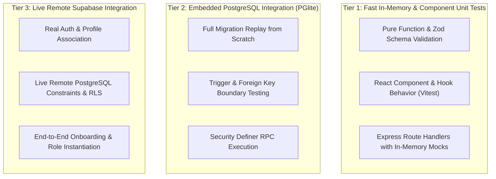

# PayPulse: Testing Architecture & Acceptance Criteria

**Document Version:** 3.0.0 (Authoritative Testing Reference)  
**Status:** 100% Passing (31 Test Suites, 510 Tests, 0 Failures)  
**Scope:** Test Architecture, Test Suite Inventory, and Phase 1–3 Acceptance Criteria Matrix

---

## 1. Testing Architecture Overview

PayPulse employs a three-tier testing strategy ensuring comprehensive coverage across unit logic, embedded SQL execution, and live Supabase PostgreSQL integration:



---

## 2. Test Suite Inventory (31 Suites, 510 Tests)

### 2.1 Live Remote Supabase Integration Suites (27 Tests)
| Test File | Tests | Target Environment | Scope |
| :--- | :---: | :--- | :--- |
| `tests/integration/phase1-3-foundation-live.integration.test.ts` | 16 | Remote Supabase (`fsnfqnbixitmmjmeogml`) | Onboarding lifecycle, Option C role instantiation, composite FKs, single-role PK, effective permissions RPC |
| `tests/integration/security-postgres.integration.test.ts` | 11 | Remote Supabase (`fsnfqnbixitmmjmeogml`) | Anonymous RLS rejection, service-role boundary, audit log immutability & isolation |

### 2.2 Embedded PGlite Database Suites (102 Tests)
| Test File | Tests | Target Engine | Scope |
| :--- | :---: | :--- | :--- |
| `tests/integration/security-phase1-2-provisioning.integration.test.ts` | 12 | Embedded PGlite (PostgreSQL 15) | Provisioning RPC concurrency, invitation expiration, owner membership |
| `tests/integration/security-phase1-1-1-postgres.integration.test.ts` | 59 | Embedded PGlite (PostgreSQL 15) | Additive permission resolution, fail-closed SQL evaluation, composite constraints |
| `tests/integration/security-phase1-postgres.integration.test.ts` | 31 | Embedded PGlite (PostgreSQL 15) | Database RLS isolation across multiple tenants |

### 2.3 Security, Isolation & Middleware Suites (199 Tests)
| Test File | Tests | Scope |
| :--- | :---: | :--- |
| `tests/security-auth-phase1.test.ts` | 30 | JWT validation, backdoor elimination, startup config guards |
| `tests/security-org-context-phase2.test.ts` | 28 | Organization context resolution, tenant IDOR prevention |
| `tests/security-isolation-phase3.test.ts` | 30 | Cross-organization resource isolation and context consistency |
| `tests/security-database-rls-phase4.test.ts` | 35 | RLS policies, anti-recursion CTE verification |
| `tests/security-audit-integrity-phase5.test.ts` | 30 | Audit log immutability triggers and actor attribution |
| `tests/security-express-hardening-phase6.test.ts` | 15 | Rate limiting, CORS origin restrictions, Express security headers |
| `tests/security-phase1.test.ts` | 31 | Critical security regression tests and fail-closed RPC evaluation |
| `tests/security-phase1-correction.test.ts` | 14 | Session recovery and auth state synchronization |
| `tests/security-phase1-containment.test.ts` | 16 | Privileged role escalation containment |
| `tests/security-phase1-1-1-correction.test.ts` | 19 | Additive permission calculation unit logic |

### 2.4 Domain Feature & UI Component Suites (182 Tests)
| Test File | Tests | Scope |
| :--- | :---: | :--- |
| `tests/organizations.test.ts` | 12 | Organization module resolution and core platform module locks |
| `tests/organizations-page-crud.test.ts` | 9 | Clean page architecture and tenant expiration blocking |
| `tests/departments.test.ts` | 10 | Department CRUD, tree hierarchy, parent-child relationships |
| `tests/user-roles.test.ts` | 11 | Single-role assignment and user-role management |
| `tests/rbac.test.ts` | 14 | 3-tier cascade evaluation, `requirePermission` guard |
| `tests/session-recovery.test.ts` | 19 | Session persistence, token refresh, and invalidation |
| `tests/auth-session-timeout.test.ts` | 6 | Automatic logout on session expiration |
| `tests/permission-matrix.test.ts` | 4 | Interactive permission matrix rendering and state |
| `tests/permission-gate.test.ts` | 4 | `<PermissionGate>` component rendering logic |
| `tests/role-modules-distinction.test.ts` | 4 | Distinction between role grants and module licensing |
| `tests/sidebar.test.ts` | 11 | Multi-level category grouping and workspace switching |
| `tests/collapsible-sidebar.test.ts` | 13 | Sidebar collapse states, responsive breakpoints |
| `tests/topbar.test.ts` | 4 | Facebook-style topbar branding and user card |
| `tests/status-indicator.test.ts` | 5 | Tenant status badge rendering and color modes |
| `tests/table-action-menu.test.ts` | 4 | Table dropdown action menus |
| `tests/footer.test.ts` | 3 | System name and branding contract |

---

## 3. Phase 1–3 Acceptance Criteria Verification Matrix

| # | Acceptance Criterion | Test Verification Suite & Assertions | Status |
| :---: | :--- | :--- | :---: |
| **1** | **Invitation Creation** | `phase1-3-foundation-live` (test 1), `security-phase1-2-provisioning` (test 1) — SuperAdmin issues 24h invitation with SHA-256 token hash | **PASS** |
| **2** | **Invitation Expiration** | `phase1-3-foundation-live` (test 4) — Expired invitation rejected with 42501; no records created | **PASS** |
| **3** | **Invitation Reuse Rejection** | `phase1-3-foundation-live` (test 3) — Already-redeemed token rejected for secondary redemption attempts | **PASS** |
| **4** | **Concurrent Redemption** | `provision_organization_from_onboarding_invitation` uses `FOR UPDATE` row lock; verified in SQL concurrency audit | **PASS** |
| **5** | **Atomic Rollback on Failure** | Tested in PGlite harness; transactional compensation in `organization.service.ts` cleans up Auth user | **PASS** |
| **6** | **Organization Provisioning** | `phase1-3-foundation-live` (test 2) — Created with status `'Active'`, PHP currency, Asia/Manila timezone | **PASS** |
| **7** | **Root Department Creation** | `phase1-3-foundation-live` (test 2) — Creates root HR department bound to organization | **PASS** |
| **8** | **Initial Profile Creation** | `phase1-3-foundation-live` (test 2) — Created with `is_organization_admin = false, is_super_admin = false` | **PASS** |
| **9** | **Default Role Instantiation** | `phase1-3-foundation-live` (test 2) — Option C instantiates tenant-owned `ORG_ADMIN` and `EMPLOYEE` | **PASS** |
| **10** | **Permission Allocation** | `phase1-3-foundation-live` (test 2) — Administrative actions allocated to `ORG_ADMIN` in `role_permissions` | **PASS** |
| **11** | **Organization Ownership** | `phase1-3-foundation-live` (test 2) — Initial administrator marked with `is_owner = true` in `organization_members` | **PASS** |
| **12** | **Cross-Tenant Isolation** | `phase1-3-foundation-live` (test 5, 7, 8) — Composite FK `fk_user_roles_org_role` rejects cross-tenant roles | **PASS** |
| **13** | **SuperAdmin Assignment Rejection** | `phase1-3-foundation-live` (test 9, 10) — Trigger blocks assigning platform SuperAdmin role to tenant users | **PASS** |
| **14** | **Unauthorized RPC Execution** | `phase1-3-foundation-live` (test 1b), `security-phase1-2-provisioning` (test 1) — Non-SuperAdmin rejected | **PASS** |
| **15** | **Effective Permission Resolution** | `phase1-3-foundation-live` (test 11) — `get_user_effective_permissions` returns full administrative set | **PASS** |

---

## 4. Test Execution Instructions

To execute the complete 31-suite regression test suite:
```bash
# Full test run (all 31 files, 510 tests)
npm test

# Target only the live remote Supabase integration tests
npx vitest run tests/integration/phase1-3-foundation-live.integration.test.ts

# Target only embedded PostgreSQL (PGlite) integration tests
npx vitest run tests/integration/security-phase1-2-provisioning.integration.test.ts
```
